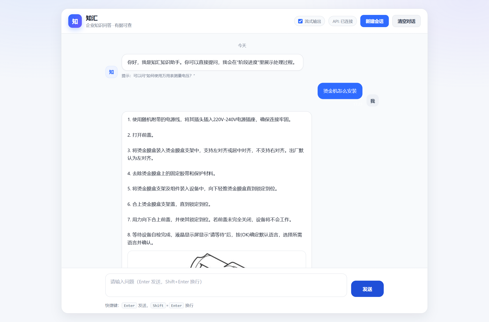
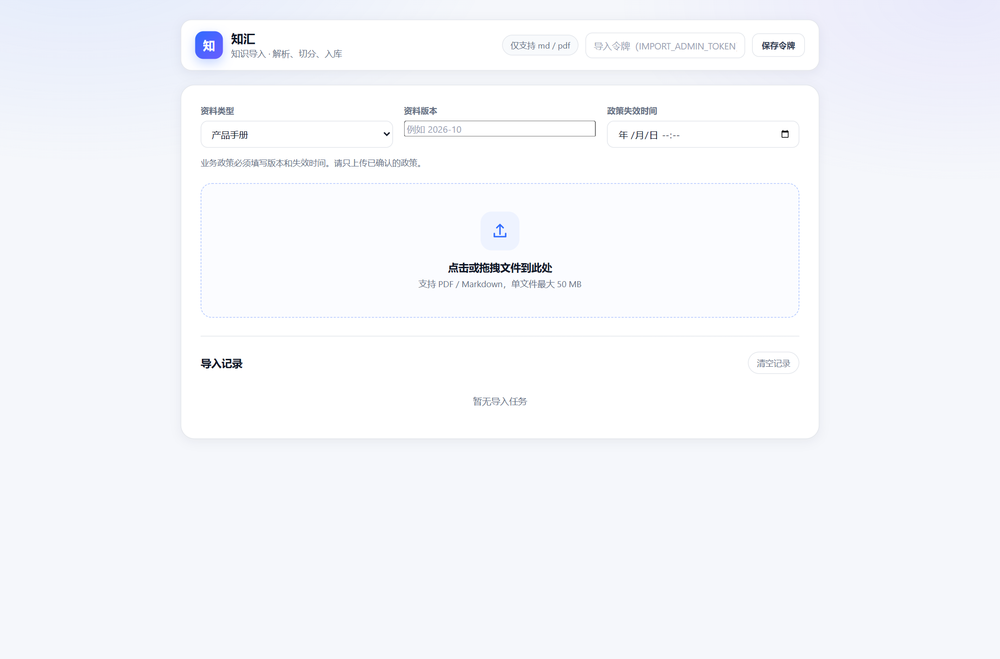
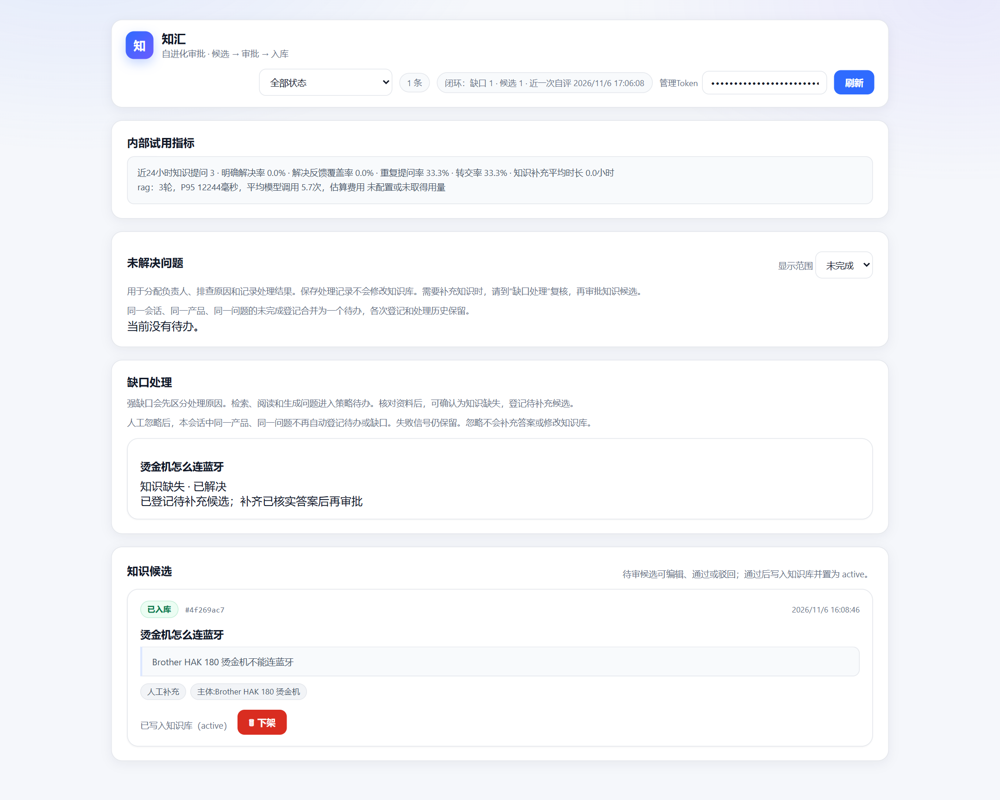
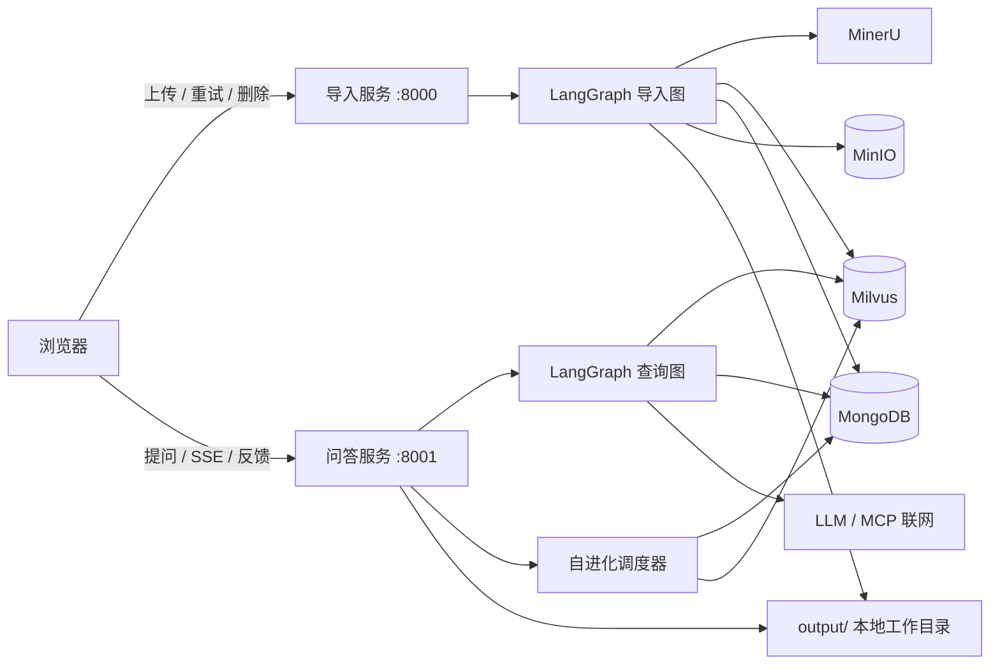

# 知汇（se_rag）

企业知识问答与知识自进化平台。项目包含文件导入、结构感知切分、混合检索、Agentic 检索编排、会话问答，以及“反馈 → 缺口 → 候选 → 审批 → 入库 → 回测/调参”的知识自进化闭环。

当前版本：`0.1.0`。Python 要求：`>=3.11`。

## 能力概览

| 领域 | 能力 |
|---|---|
| 文件导入 | 支持 `.md` / `.pdf`；PDF 经 MinerU 转 Markdown；导入任务异步执行、状态可查、失败可重试、记录可删除 |
| 文档处理 | 结构感知解析；父块/子块两级切分；表格保留表头；代码块按行切分；图片生成说明并转存 MinIO |
| 主体识别 | LLM 识别文档主体，按库内标准名归并，写入 `kb_item_names` |
| 向量检索 | BGE-M3 稠密 + 稀疏混合检索；主体过滤；HyDE；联网补充 |
| 结果融合 | RRF 融合、BGE-Reranker 重排、动态截断、父块回溯 |
| 问答 | 流式 SSE / 非流式；引用、页码、章节面包屑、接地性；历史持久化；刷新后恢复 |
| Agentic | 受限状态机；工具预算；证据校验；先评估后起草，起草后核验 |
| 知识自进化 | 反馈收集、缺口分级、候选生成、人工审批、发布/下架、召回保护、回测止损、参数自调 |
| 运维页面 | 客服对话页、文件导入页、自进化审批页 |

## 界面预览

以下截图来自本地运行实例，数据为演示数据。

### 客服对话

提问、检索、引用、证据支持度与反馈集中在一页。



### 文件导入

资料类型、版本与政策失效时间集中填写；上传后实时展示节点进度。



### 自进化审批

指标、未解决问题、缺口与知识候选分区展示，写操作需管理令牌。



## 系统架构



两个 FastAPI 进程共用同一套代码与 `.env`：

- 导入服务：端口 `8000`，负责上传、解析、切分、向量化、入库。
- 问答服务：端口 `8001`，负责检索问答、会话历史、反馈、自进化审批与调度。

## 目录结构

```text
se_rag/
├─ app/
│  ├─ api/
│  │  ├─ http/                # 两个服务入口（import_server / query_server）
│  │  ├─ routers/             # 导入、查询、自进化、健康检查、页面路由
│  │  └─ schema/              # 请求与响应模型
│  ├─ process/
│  │  ├─ import_/agent/       # LangGraph 导入图与节点
│  │  └─ query/agent/         # LangGraph 查询图与节点
│  ├─ rag/
│  │  ├─ import_/             # MinerU、解析、切分、向量化、入库、对账
│  │  ├─ query/               # 检索、融合、重排、作答、引用、业务策略
│  │  ├─ agentic/             # Agentic 控制器、工具、预算、证据、契约
│  │  └─ item_name/           # 主体目录、别名、匹配
│  ├─ evolution/              # 反馈、缺口、候选、审批、索引、指标、调参、回测
│  ├─ shared/                 # 配置、存储客户端、模型、日志、SSE、任务状态
│  ├─ resources/              # 三张页面与静态资源
│  └─ rag_eval/               # 离线评估、切分评估、答案质量、Agentic 对比、隔离联调
├─ docs/                      # PRD、代码设计、技术讲解
├─ doc/                       # 手册语料（PDF）
├─ output/                    # 导入工作目录与任务快照（运行时生成）
├─ tests/
│  ├─ unit/                   # 离线单测
│  ├─ e2e/                    # 真机端到端
│  └─ frontend/               # node:test 前端脚本测试
├─ pyproject.toml
└─ .env
```

## 快速开始

### 1. 准备依赖服务

| 服务 | 用途 | 关键配置键 |
|---|---|---|
| MongoDB | 会话、反馈、缺口、候选、父块、指标 | `MONGO_URL`、`MONGO_DB_NAME` |
| Milvus | 子块向量、主体名向量、已审批 FAQ 向量 | `MILVUS_URL`、`CHUNKS_COLLECTION`、`ITEM_NAME_COLLECTION`、`EVOLUTION_COLLECTION` |
| MinIO | 文档图片对象存储 | `MINIO_ENDPOINT`、`MINIO_ACCESS_KEY`、`MINIO_SECRET_KEY`、`MINIO_BUCKET_NAME` |
| LLM | 问答、主体识别、意图识别、图片说明、候选提炼 | `OPENAI_BASE_URL`、`OPENAI_API_KEY`、`LLM_DEFAULT_MODEL`、`VL_MODEL` |
| MinerU | PDF → Markdown | `MINERU_BASE_URL`、`MINERU_API_TOKEN` |
| MCP 联网 | 可选联网检索 | `MCP_DASHSCOPE_BASE_URL`、`MCP_TIMEOUT_SECONDS` |
| 本地模型 | BGE-M3、BGE-Reranker | `BGE_M3_PATH`、`BGE_RERANKER_LARGE` |

### 2. 安装依赖

```bash
uv sync
```

开发与测试依赖：

```bash
uv sync --group dev
```

离线评估依赖：

```bash
uv sync --group eval
```

### 3. 配置 `.env`

参考下文“关键配置”。`.env` 由 `app/shared/config/common.py` 统一加载，且 `override=True`，会覆盖进程内同名环境变量。

### 4. 启动服务

```bash
# 导入服务（8000）
uv run python -m app.api.http.import_server

# 问答服务（8001）
uv run python -m app.api.http.query_server
```

等价的 uvicorn 命令：

```bash
uv run uvicorn app.api.http.import_server:app --host 0.0.0.0 --port 8000
uv run uvicorn app.api.http.query_server:app --host 0.0.0.0 --port 8001
```

问答服务启动时会加载 BGE-M3 与重排模型。首次启动会多等一段时间，日志出现“检索模型预热完成”后再开始问答。

### 5. 打开页面

| 页面 | 地址 | 说明 |
|---|---|---|
| 客服对话 | `http://127.0.0.1:8001/` | 提问、流式输出、引用、反馈、历史 |
| 文件导入 | `http://127.0.0.1:8000/import` | 上传、进度、日志、失败重试、删除记录 |
| 自进化审批 | `http://127.0.0.1:8001/approval` | 候选、缺口、问题、闭环状态、试用指标 |

导入页需要填写 `IMPORT_ADMIN_TOKEN`。审批页需要填写 `EVOLUTION_ADMIN_TOKEN`。两个令牌相互独立。

## 关键配置

运行配置集中在 `app/shared/config/settings.py`（审批令牌 `EVOLUTION_ADMIN_TOKEN` 由自进化路由直接读取环境变量）。下表只列常用键，默认值以代码为准。

### 服务与端口

| 键 | 默认 | 说明 |
|---|---|---|
| `APP_HOST` | `0.0.0.0` | 监听地址 |
| `IMPORT_APP_PORT` | `8000` | 导入服务端口 |
| `QUERY_APP_PORT` | `8001` | 问答服务端口 |
| `APP_ENV` | `dev` | 运行环境 |
| `CORS_ORIGINS` | `*` | 跨域白名单 |
| `SESSION_OWNERSHIP_ENABLED` | `true` | 会话属主校验 |

### 导入

| 键 | 默认 | 说明 |
|---|---|---|
| `IMPORT_ADMIN_TOKEN` | 内置默认值 | 导入鉴权；生产环境必须改成强随机值；为空时 fail-closed 503 |
| `IMPORT_MAX_UPLOAD_MB` | `50` | 单文件上限 |
| `IMPORT_MAX_CONCURRENT_TASKS` | `2` | 进程内并发导入数 |
| `IMPORT_ACQUIRE_TIMEOUT_SECONDS` | `600` | 等待并发名额上限 |
| `IMPORT_MAX_RETRY_ATTEMPTS` | `3` | 导入有界重试次数 |
| `IMPORT_RETRY_BACKOFF_SECONDS` | `1.0` | 退避基准 |
| `IMPORT_CHECKPOINT_ENABLED` | `true` | 复用已有 MinerU 产物 |
| `IMPORT_RECONCILE_ENABLED` | `true` | 导入后跨存储对账 |
| `MILVUS_INSERT_BATCH_SIZE` | `500` | Milvus 批量写入大小 |
| `EMBEDDING_BATCH_SIZE` | `6` | 向量化批大小 |

### 切分

| 键 | 默认 | 说明 |
|---|---|---|
| `CHUNK_SIZE` | `600` | 子块目标长度 |
| `CHUNK_MAX_SIZE` | `1000` | 子块硬上限 |
| `CHUNK_MIN` | `400` | 短块合并阈值 |
| `CHUNK_OVERLAP` | `50` | 仅超长原子块切分时生效 |
| `CHUNKS_SPLIT_TOP_NUMBER` | `10` | 主体识别使用的切片数 |

### 查询与 Agentic

| 键 | 默认 | 说明 |
|---|---|---|
| `RAG_MODE` | `agentic` | `agentic` / `legacy` |
| `RAG_GRAY_PERCENT` | `0` | Agentic 灰度比例 |
| `AGENT_MAX_TOOL_CALLS` | `4` | 工具调用上限 |
| `AGENT_MAX_WEB_CALLS` | `1` | 联网调用上限 |
| `AGENT_MAX_REPAIRS` | `1` | 核验不通过后的重写次数 |
| `AGENT_MAX_CONTEXT_TOKENS` | `8000` | 证据上下文 token 上限 |
| `AGENT_TIMEOUT_SECONDS` | `60` | 单轮 Agentic 总时长 |
| `AGENT_KEYWORD_SCAN_LIMIT` | `500` | 关键词扫描上限 |
| `AGENT_NEIGHBOR_WINDOW` | `1` | 读块邻近扩窗 |
| `HYDE_GATE_ENABLED` | `false` | 是否对短事实型问题跳过 HyDE |
| `WEB_MAX_IN_CONTEXT` | `2` | 最终上下文中的联网条数上限 |
| `PARENT_MAX_CHARS` | `1200` | 单父块注入上限 |
| `PARENT_TOTAL_BUDGET_CHARS` | `4000` | 父块总预算 |

说明：检索模式按会话哈希与 `RAG_GRAY_PERCENT` 分流。比例为 0 时全部走 `legacy`；需要全量 `agentic` 时设为 100。

### 自进化

| 键 | 默认 | 说明 |
|---|---|---|
| `EVOLUTION_ENABLED` | `false` | 总开关 |
| `EVOLUTION_ADMIN_TOKEN` | 无 | 审批写操作令牌；未配置时写接口 503 |
| `EVOLUTION_SCHEDULE_ENABLED` | `true` | 调度器开关 |
| `EVOLUTION_SCHEDULE_INTERVAL_MINUTES` | `30` | 调度周期 |
| `EVOLUTION_GAP_STRONG_THRESHOLD` | `0.65` | 强缺口阈值 |
| `EVOLUTION_GAP_WEAK_THRESHOLD` | `0.45` | 弱缺口阈值 |
| `EVOLUTION_GAP_WEIGHT_USER` | `0.4` | 用户信号权重 |
| `EVOLUTION_GAP_WEIGHT_RETRIEVAL` | `0.3` | 检索信号权重 |
| `EVOLUTION_GAP_WEIGHT_GENERATION` | `0.3` | 生成信号权重 |
| `EVOLUTION_RECALL_ENABLED` | 跟随总开关 | 已审批 FAQ 召回开关 |
| `EVOLUTION_WRITE_ENABLED` | 跟随总开关 | 知识写入开关 |
| `EVOLUTION_AUTO_TUNE_ENABLED` | `false` | 参数自调 |
| `EVOLUTION_BACKTEST_ENABLED` | `true` | 回测止损 |
| `EVOLUTION_BACKTEST_MIN_HITS` | `3` | 回测最低命中数 |

### 运行时

| 键 | 默认 | 说明 |
|---|---|---|
| `TASK_STATE_TTL_SECONDS` | `21600` | 内存任务状态 TTL |
| `INTENT_TIMEOUT_SECONDS` | `2.0` | 意图识别超时 |
| `LLM_TIMEOUT_SECONDS` | `60` | 模型调用超时 |
| `LLM_MAX_RETRIES` | `2` | SDK 内建重试 |
| `MILVUS_TIMEOUT_SECONDS` | `15` | Milvus RPC 超时 |

## 接口一览

### 导入服务（8000）

| 方法 | 路径 | 说明 | 鉴权 |
|---|---|---|---|
| POST | `/api/import/upload` | 上传单个文件并异步导入 | `X-Internal-Token` |
| GET | `/api/import/status/{task_id}` | 任务状态与节点进度 | `X-Internal-Token` |
| POST | `/api/import/retry/{task_id}` | 重试失败的导入 | `X-Internal-Token` |
| DELETE | `/api/import/records/{task_id}` | 删除导入记录与本地产物 | `X-Internal-Token` |
| GET | `/api/health` | 健康检查与资源版本 | 无 |
| GET | `/import` | 导入页 | 无 |

上传参数：`files`（单文件）、`document_kind`（`manual` / `policy`）、`document_version`、`valid_until`。业务政策必须填写版本与未来失效时间。

### 问答服务（8001）

| 方法 | 路径 | 说明 | 鉴权 |
|---|---|---|---|
| POST | `/api/query` | 提问（流式或非流式） | 会话 Cookie |
| GET | `/api/query/status/{session_id}` | 查询进度快照 | 会话 Cookie |
| GET | `/api/stream/{session_id}` | SSE 事件流 | 会话 Cookie |
| GET | `/api/history/{session_id}` | 历史消息 | 会话 Cookie |
| DELETE | `/api/history/{session_id}` | 清空历史 | 会话 Cookie |
| POST | `/api/evolution/feedback` | 点赞/点踩/解决反馈 | 会话 Cookie |
| GET | `/api/evolution/candidates` | 候选列表 | `X-Internal-Token` |
| POST | `/api/evolution/candidates/{id}/approve` | 审批入库 | `X-Internal-Token` |
| POST | `/api/evolution/candidates/{id}/reject` | 驳回 | `X-Internal-Token` |
| POST | `/api/evolution/candidates/{id}/edit` | 编辑候选 | `X-Internal-Token` |
| DELETE | `/api/evolution/candidates/{id}` | 下架 | `X-Internal-Token` |
| GET | `/api/evolution/gaps` | 缺口列表 | `X-Internal-Token` |
| POST | `/api/evolution/gaps/{gap_id}/review` | 缺口复核 | `X-Internal-Token` |
| GET | `/api/evolution/status` | 闭环状态 | `X-Internal-Token` |
| GET | `/api/evolution/issues` | 未解决问题 | `X-Internal-Token` |
| POST | `/api/evolution/issues/{issue_id}` | 更新问题 | `X-Internal-Token` |
| GET | `/api/evolution/trial-metrics` | 内部试用指标 | `X-Internal-Token` |
| GET | `/api/health` | 健康检查 | 无 |
| GET | `/`、`/approval` | 对话页、审批页 | 无 |

SSE 事件：`ready`、`progress`、`delta`、`final`、`error`、`close`。

## 核心流程

### 导入

1. 校验文件数量、名称、后缀、大小与文件头。
2. 落盘到 `output/<YYYYMMDD>/<task_id>/`，写入 `_import_meta.json`。
3. 异步执行导入图：PDF 解析 → 图片增强 → 切分 → 主体识别 → 向量化 → 写入 Milvus / Mongo / MinIO。
4. 任务状态写入内存与 `output/tasks/<task_id>.json`。
5. 失败可按错误码有界重试；也可从页面重试或删除记录。

### 问答

1. 意图识别：`rag` 或 `chitchat`。
2. 主体确认：点选消解、历史改写、目录对齐；未确认时给出候选或反问。
3. 模式分流：
   - `legacy`：向量召回 + HyDE + 联网 → RRF → 重排 → 父块回溯 → 作答。
   - `agentic`：受限状态机按证据覆盖度循环检索、起草、核验。
4. 业务策略：投诉转人工；价格/售后只允许当前有效政策。
5. 作答：引用、页码、章节面包屑、接地性、历史落库、SSE 收尾。

### 自进化

1. 反馈事件写入 `fb_events`。
2. 调度器扫描未解决信号，按权重计算置信度并分级。
3. 强缺口进入处理：非知识缺失转策略问题；知识缺失生成候选。
4. 人工审批候选，发布到 `kb_evolution_items`。
5. 查询时召回已审批 FAQ，并防止被普通切片挤出。
6. 指标快照、参数自调、回测止损按周期运行。

## 测试

```bash
# 离线单测（默认跳过 e2e）
uv run pytest

# 真机端到端（需真实服务，会产生模型费用）
E2E_ENABLED=1 uv run pytest -m e2e tests/e2e -s

# 前端脚本测试（Node 18+，使用 node:test）
node --test tests/frontend
```

离线单测通过 `tests/conftest.py` 的 `offline_guard` 禁止真实 Mongo / Milvus / MinIO 连接。

## 常见问题

| 现象 | 原因 | 处理 |
|---|---|---|
| 导入页 401 / 503 | 令牌不一致或未配置 | 检查 `IMPORT_ADMIN_TOKEN`，在页面保存令牌 |
| 审批接口 401 / 503 | 未配置或令牌不一致 | 设置 `EVOLUTION_ADMIN_TOKEN` 并填写页面令牌 |
| PDF 解析失败 `retry limit reached` | MinerU `vlm` 对超大单页排版稿失败 | 已自动回退 `pipeline`；仍失败时把 PDF 拆成常规页 |
| 首次提问报 `agentic query deadline exceeded` | 模型冷启动耗尽 60 秒预算 | 重启问答服务并等待预热完成；必要时增大 `AGENT_TIMEOUT_SECONDS` |
| 已审批 FAQ 查不到 | 评估阶段曾把否定答案判为证据不足 | 当前已修：否定结论按 `supported` 处理；重启服务生效 |
| 召回 0 条且 Milvus 报 metric 不匹配 | dense 索引为 COSINE，请求用了 IP | 保持 `CHUNK_DENSE_METRIC=COSINE`，与导入端一致 |
| 页面刷新后查询消失 | SSE 断开 | 前端会先读 `/api/query/status` 再重连；确认服务未重启 |
| 会话 404 | 浏览器归属 Cookie 丢失 | 新建会话；不要只用 `session_id` 访问他人会话 |

## 安全说明

- 导入与审批写操作使用请求头 `X-Internal-Token`；未配置令牌时 fail-closed。
- 会话归属由 HttpOnly Cookie `kb_owner` 的哈希绑定；`session_id` 本身不是凭据。
- Milvus 过滤表达式统一转义；主体范围由服务端确认，模型只能收窄。
- 引用 URL 只允许 `http/https`。
- `.env` 含密钥，不要提交生产值。

## 已知限制

- 查询服务采用单 worker 租约：只能以 `--workers 1` 运行。
- 导入并发闸门与任务状态是进程内语义，多 worker 下不共享。
- Milvus、Mongo、MinIO 无跨存储事务；一致性依赖幂等写入与只读对账。
- BGE-M3 与重排模型为本地模型；CPU 下启动和编码较慢。
- 生产鉴权目前是共享令牌 + 浏览器归属 Cookie，未接入企业 SSO。

## 相关文档

- 产品需求：[docs/PRD.md](docs/PRD.md)
- 代码设计：[docs/CODE_DESIGN.md](docs/CODE_DESIGN.md)
- 技术讲解与运维：[docs/TECHNICAL_GUIDE.md](docs/TECHNICAL_GUIDE.md)
