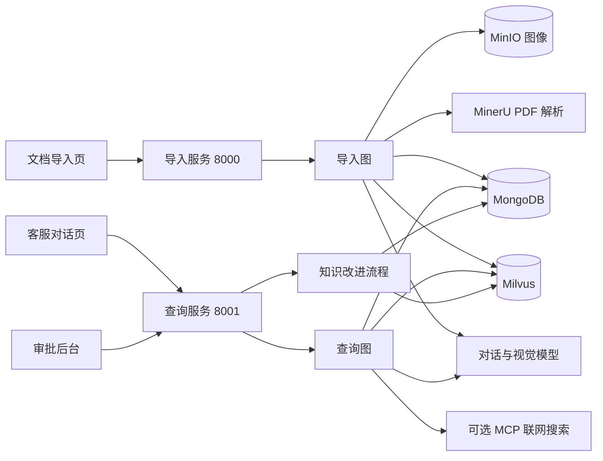

# se_rag：企业知识库客服系统

se_rag 将企业文档转成可检索的知识。用户通过网页提问。系统先检索证据，再生成带来源的回答。管理员可以处理知识缺口，并审批补充知识。

本文依据 `codex/agentic-rag-next` 分支的当前工作区编写。核对日期：2026-11-05。范围包括当前尚未提交的代码。

## 1. 文档入口

- [项目 PRD](docs/PRD.md)：产品目标、用户流程、功能要求和验收条件。
- [代码设计文档](docs/CODE_DESIGN.md)：模块边界、数据结构、接口和运行约束。
- [项目技术讲解](docs/TECHNICAL_GUIDE.md)：按一份文档和一个问题，解释整个系统。

文档使用短句。一个术语只表示一个概念。“已实现”表示代码中存在该能力。它不表示已通过生产验收。

## 2. 当前功能

- 导入 Markdown 和 PDF。PDF 通过外部 MinerU 服务解析。
- 识别文档中的产品或设备。代码用 `item_name` 表示此类主体。
- 按章节生成父块，再生成用于检索的子块。
- 使用本地 BGE-M3 生成稠密向量和稀疏向量。
- 使用 Milvus 检索。使用 BGE-Reranker 重排候选内容。
- 支持传统检索流程和 Agentic 检索流程。支持按会话进行灰度分配。
- 区分知识库问题和闲聊。主体不明确时，可以要求用户选择主体。
- 支持流式回答、来源引用、受控图像显示、会话历史和反馈恢复。
- 记录未解决问题。支持缺口复核、知识补录、人工审批和下架。
- 提供离线测试、答案评测、Agentic 对比评测和隔离试用工具。

“知识自进化”表示知识管理流程。该流程补充检索知识。它不训练模型权重。

## 3. 系统结构



两个 HTTP 服务分别启动。网页由 FastAPI 直接提供。前端使用 HTML、CSS 和原生 JavaScript，无需前端打包。

## 4. 运行前提

项目声明支持 Python 3.11 及以上版本。`.python-version` 指定 Python 3.12。建议使用 Python 3.12 和仓库中的 `uv.lock`。

运行完整流程前，准备以下资源：

1. MongoDB。用于会话、父块、反馈、候选和治理记录。
2. Milvus。用于子块、主体名和已发布补充知识的向量检索。
3. MinIO。用于文档图像。浏览器必须能访问返回的对象 URL。
4. OpenAI 兼容的模型服务。配置对话模型；处理图像时还需视觉模型。
5. BGE-M3 和 BGE-Reranker 模型文件。模型在应用进程内运行。
6. MinerU 服务。仅 PDF 解析需要。
7. MCP 搜索服务。仅联网搜索需要。

仓库未提供完整的基础设施编排文件。Python SDK 版本由依赖文件约束。数据库服务端版本需要在部署环境中确认。

CPU 可以运行向量模型。GPU 可以加速模型推理。项目没有经过统一测量的最低显存要求。

## 5. 安装与配置

以下命令使用 PowerShell。在仓库根目录执行。

```powershell
uv sync --locked --group dev
```

创建或编辑仓库根目录的 `.env`。以下配置是示例。将模型名称、路径、服务地址和凭据替换为实际值。

```dotenv
APP_ENV=dev
APP_HOST=127.0.0.1
IMPORT_APP_PORT=8000
QUERY_APP_PORT=8001
CORS_ORIGINS=http://127.0.0.1:8000,http://127.0.0.1:8001
SESSION_OWNERSHIP_ENABLED=true

OPENAI_BASE_URL=https://model.example.com/v1
OPENAI_API_KEY=replace-with-your-api-key
LLM_DEFAULT_MODEL=your-chat-model
LLM_DEFAULT_TEMPERATURE=0
VL_MODEL=your-vision-model

BGE_M3_PATH=C:/Models/bge-m3
BGE_DEVICE=cpu
BGE_FP16=false
BGE_RERANKER_LARGE=C:/Models/bge-reranker-large
BGE_RERANKER_DEVICE=cpu
BGE_RERANKER_FP16=false

MILVUS_URL=http://127.0.0.1:19530
CHUNKS_COLLECTION=kb_chunks
ITEM_NAME_COLLECTION=kb_item_names
EVOLUTION_COLLECTION=kb_evolution_items
CHUNK_DENSE_METRIC=COSINE

MONGO_URL=mongodb://127.0.0.1:27017
MONGO_DB_NAME=se_rag
MONGO_CHAT_COLLECTION=chat_message
PARENT_CHUNKS_COLLECTION=kb_parent_chunks

MINIO_ENDPOINT=127.0.0.1:9000
MINIO_ACCESS_KEY=replace-with-your-access-key
MINIO_SECRET_KEY=replace-with-your-secret-key
MINIO_BUCKET_NAME=se-rag
MINIO_IMG_DIR=images
MINIO_SECURE=false

IMPORT_ADMIN_TOKEN=replace-with-a-unique-import-token
EVOLUTION_ADMIN_TOKEN=replace-with-a-unique-approval-token

RAG_MODE=legacy
RAG_GRAY_PERCENT=0
EVOLUTION_ENABLED=false
```

`common.py` 使用 `load_dotenv(override=True)`。因此，`.env` 中的同名值可以覆盖进程环境变量。修改配置后，重启服务。

导入令牌与审批令牌是两套配置。部署时必须显式设置它们。当前代码为导入令牌提供了内置回退值。只有显式空值才会触发该配置的 503 拒绝逻辑。不要依赖这个回退值。

导入 PDF 时，另行配置：

```dotenv
MINERU_BASE_URL=https://mineru.example.com/api/v4
MINERU_API_TOKEN=replace-with-your-mineru-token
```

联网搜索使用 `MCP_DASHSCOPE_BASE_URL`，并复用 `OPENAI_API_KEY`。服务地址必须兼容当前 MCP 客户端。

### 5.1 启用 Agentic 检索

以下配置让所有会话选择 Agentic 流程：

```dotenv
RAG_MODE=agentic
RAG_GRAY_PERCENT=100
AGENT_MAX_TOOL_CALLS=4
AGENT_MAX_WEB_CALLS=1
AGENT_MAX_REPAIRS=1
AGENT_MAX_CONTEXT_TOKENS=8000
AGENT_TIMEOUT_SECONDS=60
```

代码默认 `RAG_MODE=agentic`，但默认灰度比例为 `0`。这组默认值仍会选择传统流程。不能只设置 `RAG_MODE` 就认定 Agentic 已生效。

### 5.2 启用知识改进流程

```dotenv
EVOLUTION_ENABLED=true
EVOLUTION_RECALL_ENABLED=true
EVOLUTION_WRITE_ENABLED=true
EVOLUTION_SCHEDULE_ENABLED=true
EVOLUTION_AUTO_TUNE_ENABLED=false
```

召回开关控制已审批知识的读取。写入开关控制缺口处理和知识写入。未单独设置时，两者跟随总开关。自动调参默认关闭。

## 6. 启动服务

在第一个终端启动导入服务：

```powershell
uv run python -m app.api.http.import_server
```

在第二个终端启动查询服务：

```powershell
uv run python -m app.api.http.query_server
```

这两个入口读取 `.env` 中的监听地址和端口。也可以直接使用 Uvicorn。查询服务必须使用一个 worker。

```powershell
uv run uvicorn app.api.http.query_server:app --host 127.0.0.1 --port 8001 --workers 1
```

默认页面与接口地址：

- [客服对话页](http://127.0.0.1:8001/)。
- [审批后台](http://127.0.0.1:8001/approval)。
- [文档导入页](http://127.0.0.1:8000/import)。
- [查询接口说明](http://127.0.0.1:8001/docs)。
- [导入接口说明](http://127.0.0.1:8000/docs)。

`GET /api/health` 主要检查 HTTP 服务和静态资源。返回成功不表示数据库、模型或检索流程已经可用。

## 7. 首次使用

1. 打开导入页。
2. 输入 `IMPORT_ADMIN_TOKEN`，并保存。
3. 选择资料类型。首次验证建议使用小型 UTF-8 Markdown 手册。
4. 上传文件。每个请求只接收一个文件。默认文件上限为 50 MB。
5. 等待任务状态变为 `completed`。
6. 打开客服对话页。提问已导入资料中的内容。
7. 检查答案与引用。需要图像时，再检查图像地址。
8. 提交“有帮助”或“已解决”反馈。这是两个独立的反馈维度。
9. 启用知识改进流程后，在审批页输入审批令牌，查看缺口、待办和候选。

业务政策使用 `policy` 类型。上传时必须填写版本和未来的失效时间。系统会对这类问题执行专用证据检查。

## 8. 接口示例

以下示例保留浏览器归属 Cookie。后续调用同一会话时，复用 `$ragWebSession`。

```powershell
$queryBody = @{ query = '设备如何进行日常维护？'; is_stream = $false } | ConvertTo-Json
$queryResult = Invoke-RestMethod -Method Post `
  -Uri 'http://127.0.0.1:8001/api/query' `
  -ContentType 'application/json; charset=utf-8' `
  -Body $queryBody -SessionVariable ragWebSession
$queryResult
```

流式调用分两步：先提交 `is_stream=true` 的查询，再连接 `GET /api/stream/{session_id}`。

流包含 `ready`、`progress`、`delta`、`final`、`error` 和 `close` 事件。以 `final` 中的结构化结果为准。

## 9. 测试与评测

运行 Python 离线测试：

```powershell
uv run python -m pytest -q
```

默认排除标记为 `e2e` 的测试。离线测试使用替身阻止真实 MongoDB、Milvus 和 MinIO 连接。

运行前端测试。此步骤需要 Node.js：

```powershell
$frontendTests = (Get-ChildItem -LiteralPath tests/frontend -Filter *.test.cjs).FullName
node --test $frontendTests
```

真实端到端测试还需要 `E2E_ENABLED=1`，以及通过隔离检查的整套数据库、集合和存储桶配置。它会写入测试数据并调用模型。先阅读[技术讲解中的评测说明](docs/TECHNICAL_GUIDE.md#11-测试与评测)。

离线测试通过，只能证明测试覆盖的代码行为。答案质量、外部服务连通性和真实业务效果需要单独验证。

## 10. 目录导航

```text
app/api/                HTTP 入口、路由、请求与响应模型
app/process/            LangGraph 图、状态和节点
app/rag/import_/        文档解析、图像增强、切分和索引写入
app/rag/query/          主体确认、检索、重排、作答和引用
app/rag/agentic/        工具调度、证据检查和执行预算
app/rag/item_name/      主体名目录与匹配
app/evolution/          反馈、缺口、候选、审批、发布和观察
app/shared/             配置、客户端、模型和运行工具
app/resources/          网页、脚本、样式和提示词
app/rag_eval/           检索、答案、Agentic 和隔离试用评测
tests/unit/             Python 离线测试
tests/frontend/         原生 JavaScript 测试
tests/e2e/              真实服务端到端测试
docs/                   项目文档
```

## 11. 当前限制

- 查询准入、SSE 通道和任务进度保存在进程内。查询服务使用主机文件锁限制一个 worker。它不是分布式锁。
- 页面刷新可以恢复同一进程中的查询。服务重启后，不会继续执行中断的查询或导入任务。
- 导入状态有磁盘快照。快照不等于持久任务队列。
- 同名文档共享文档标识。当前设计没有租户级文档隔离。
- Milvus、MongoDB 和 MinIO 之间没有跨库事务。导入后的对账只记录差异。
- 关键词工具使用有界扫描和字符串匹配。当前没有独立 BM25 全文索引。
- 已有 Milvus 集合不会自动升级字段。修改 schema 后，需要单独设计迁移。
- Cookie 用于绑定浏览器与会话。它不提供企业账号、角色权限或单点登录。
- 当前评测题库含待人工复核的草稿。历史报告不代表当前环境的验收结果。

更完整的行为边界、故障定位和扩展位置，见[代码设计文档](docs/CODE_DESIGN.md)与[项目技术讲解](docs/TECHNICAL_GUIDE.md)。
