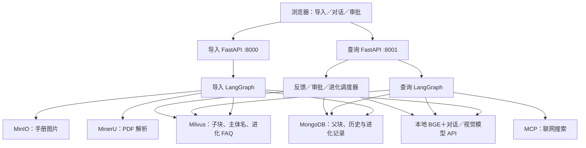

# se_rag · RAG 知识库客服系统

将产品手册整理成可检索知识，在网页上依据资料回答问题，并把未解决的问题转成待人工审核的知识候选。

项目包含三个页面和两个 FastAPI 服务：导入服务处理文件，查询服务提供客服对话、反馈和知识审批，两者共用模型与底层存储。

想理解代码如何运作，阅读 **[技术讲解文档](docs/se_rag-技术讲解文档.md)**。本文侧重安装、配置、使用与排障。

## 目录

- [功能与边界](#功能与边界)
- [架构概览](#架构概览)
- [环境与依赖](#环境与依赖)
- [快速开始](#快速开始)
- [配置说明](#配置说明)
- [页面与使用流程](#页面与使用流程)
- [API 速查](#api-速查)
- [开发与测试](#开发与测试)
- [部署约束与已知问题](#部署约束与已知问题)
- [排障与源码导航](#排障与源码导航)

## 功能与边界

- **文档导入**：Markdown 直接读取；PDF 经 MinerU 转成 Markdown，再做图片说明、结构化切分、主体识别和向量化。
- **检索问答**：先确认产品主体，再并行进行普通向量检索、HyDE 检索与 MCP 联网搜索，经融合、重排和章节背景补充生成答案。
- **对话交互**：支持普通响应与 SSE 流式回答、历史读取与清空、引用、图片、主体候选点选和常见刷新续接路径。
- **知识自进化**：反馈 → 缺口识别 → 候选提炼 → 人工审批 → 索引回流，并提供指标、自调参数和基于反馈的回测。
- **分层评估**：复用真实切分和检索节点，检查召回、融合及重排效果。

“自进化”更新的是 FAQ 知识和有限的检索参数，**不训练大模型权重**。引用表示回答上下文中的参考材料；重排分和模型评估的接地性都不等于答案正确率。自进化默认关闭，未开启时反馈接口接受请求但不落库。

上传 API 每次只接受一个 `.md` 或 `.pdf`，默认上限 50 MB；网页可以把多个文件分别提交。当前应使用小写后缀和 UTF-8 Markdown，大小写及文件头编码边界问题见[已知问题](#部署约束与已知问题)。

## 架构概览



关键分工：

- **Milvus** 保存检索子块、产品主体名和审核通过的 FAQ，使用稠密＋稀疏向量。
- **MongoDB** 保存章节父块、对话历史、反馈、缺口、候选、指标和参数。
- **MinIO** 保存图片，正文和答案通过 URL 引用。
- **LangGraph** 编排固定业务图；后台任务、进度和 SSE 主要依赖当前进程内状态。

主体名是检索过滤条件；子块用于精确命中，父块用于命中后补充背景。Milvus 内的 dense/sparse 混合与后续 RRF 是两层不同的融合，联网结果在重排阶段加入。

目录按 `api / process / rag / evolution / shared / rag_eval` 划分职责，但实际存在跨模块双向依赖，并非严格单向分层。完整关系见[模块讲解](docs/se_rag-技术讲解文档.md#3-模块分层与相互关系)。

## 环境与依赖

- Python ≥ 3.11；仓库的 `.python-version` 指定 3.12。
- 已安装 `uv`；依赖声明在 [pyproject.toml](pyproject.toml)，解析版本在 [uv.lock](uv.lock)。
- 可访问的 Milvus、MongoDB、MinIO，以及相应权限与存储空间。
- 本地 BGE-M3 与 BGE-Reranker 模型文件；支持配置 CPU/GPU 与 FP16。
- 可用的对话模型 API；图片说明还需要视觉模型。客户端走 OpenAI 兼容协议，并固定透传 `enable_thinking=false`，更换模型服务时需检查参数兼容性。
- PDF 导入需要 MinerU 服务与令牌；联网补充需要可用的百炼 MCP 搜索地址。

模型首次调用时按需加载。导入和查询是不同进程，可能各加载一份模型；源码未给出经过验证的最低显存或吞吐指标，应依据实际模型、硬件与文档量测量。

仓库没有提供 Docker/Compose 或 CI 工作流，外部服务需自行准备。

## 快速开始

以下命令从项目根目录执行。它们是操作说明，不代表文档更新时已经安装、启动或测试成功。

### 1. 安装依赖

```powershell
uv sync --group dev
```

仓库默认依赖索引配置在 `pyproject.toml`。安装前确认该索引、模型来源及各外部服务在你的环境中可达。

### 2. 创建或核对 `.env`

已有 `.env` 时按需补充，不要用示例覆盖真实配置。下面的尖括号字段必须替换为自己的值；令牌与路径均为占位内容，不是可直接使用的凭据。

```dotenv
# 对话与视觉模型
OPENAI_API_KEY=<your-api-key>
OPENAI_BASE_URL=https://<your-llm-host>/v1
LLM_DEFAULT_MODEL=<your-chat-model>
VL_MODEL=<your-vision-model>
LLM_DEFAULT_TEMPERATURE=0.1
LLM_TIMEOUT_SECONDS=60
LLM_MAX_RETRIES=2

# 本地模型；路径统一使用正斜杠
BGE_M3_PATH=<absolute-path-to-bge-m3>
BGE_DEVICE=cpu
BGE_FP16=false
BGE_RERANKER_LARGE=<absolute-path-to-bge-reranker>
BGE_RERANKER_DEVICE=cpu
BGE_RERANKER_FP16=false

# Milvus：示例集合名，新环境可采用；已有环境应保持现有数据契约
MILVUS_URL=http://<milvus-host>:19530
CHUNKS_COLLECTION=kb_chunks
ITEM_NAME_COLLECTION=kb_item_names
EVOLUTION_COLLECTION=kb_evolution_items
MILVUS_TIMEOUT_SECONDS=15

# MongoDB
MONGO_URL=mongodb://<mongo-host>:27017
MONGO_DB_NAME=<your-database-name>

# MinIO：ENDPOINT 不含 http:// 或 https://
MINIO_ENDPOINT=<minio-host>:9000
MINIO_ACCESS_KEY=<your-minio-access-key>
MINIO_SECRET_KEY=<your-minio-secret-key>
MINIO_BUCKET_NAME=<your-image-bucket>
MINIO_IMG_DIR=upload-images
MINIO_SECURE=false

# 管理凭据：分别配置，使用自行生成的随机值
IMPORT_ADMIN_TOKEN=<your-random-import-token>
EVOLUTION_ADMIN_TOKEN=<your-random-evolution-token>

# PDF 解析；只导入 Markdown 时不使用此能力
MINERU_BASE_URL=https://<your-mineru-host>/<api-prefix>
MINERU_API_TOKEN=<your-mineru-token>

# 联网补充；不可用时该路降级为空，不建议保留占位地址
MCP_DASHSCOPE_BASE_URL=https://<your-mcp-host>/<search-path>

# 服务与自进化
APP_HOST=127.0.0.1
IMPORT_APP_PORT=8000
QUERY_APP_PORT=8001
CORS_ORIGINS=http://127.0.0.1:8000,http://127.0.0.1:8001
EVOLUTION_ENABLED=false
```

`MINIO_SECURE`、模型设备和地址应匹配实际环境。代码会把 PDF、图片或检索文本发送给相应解析/模型/搜索服务，使用内部资料前需确认这些服务的数据处理边界。

### 3. 在两个终端启动

终端一：

```powershell
uv run python -m app.api.http.import_server
```

终端二：

```powershell
uv run python -m app.api.http.query_server
```

模块入口读取 `.env` 中的主机与端口。也可以显式指定 Uvicorn 参数；以下命令的地址和端口由命令行决定：

```powershell
uv run uvicorn app.api.http.import_server:app --host 127.0.0.1 --port 8000 --workers 1
uv run uvicorn app.api.http.query_server:app --host 127.0.0.1 --port 8001 --workers 1
```

这两条仍需在不同终端运行。查询服务必须保持单 worker；多个查询实例连接同一进化库还可能重复执行调度。

### 4. 打开页面并导入资料

| 页面 | 默认本机地址 | 操作 |
| --- | --- | --- |
| 文件导入 | `http://127.0.0.1:8000/import` | 输入导入令牌并保存，上传文件，等待任务结束 |
| 客服对话 | `http://127.0.0.1:8001/` | 说明产品主体后提问；必要时点选候选主体 |
| 知识审批 | `http://127.0.0.1:8001/approval` | 开启自进化后查看候选，输入审批令牌执行写操作 |

端口改变时使用实际地址。网页令牌保存在当前标签页会话的 `sessionStorage`，不会自动从服务端配置中获取。上传成功只表示文件已接收；`completed` 也不保证父块和图片等增强数据全部一致落地，需结合对账日志判断。

## 配置说明

配置主要在 [settings.py](app/shared/config/settings.py)，查询、切分、主体匹配等参数还分布在各领域 `config.py`。日志、根路径、Mongo 和进化鉴权也有独立读取入口。

- `.env` 通过 `load_dotenv(override=True)` 加载，**会覆盖已有的同名进程环境变量**。修改后通常需要重启进程使配置与缓存重新建立。
- `PROJECT_ROOT` 可显式指定根目录，否则代码向上查找 `.env`；没有 `.env` 且未指定根目录时，路径初始化可能失败。
- 导入端默认令牌是源码中的固定非空值；必须显式设置自己的随机令牌。未设置变量并不会触发“缺少令牌”的 503；明确置空才会。
- 进化写鉴权直接读取 `EVOLUTION_ADMIN_TOKEN`；未配置或置空时写操作返回 503，错误令牌返回 401。
- 只想使用已有知识问答时可保持 `EVOLUTION_ENABLED=false`；开启后，查询服务还会按调度开关驱动候选生成、指标与回测。

常用参数均为**源码默认值**，不是当前 `.env` 的实际值：

| 参数组 | 默认值 | 作用 |
| --- | --- | --- |
| `ITEM_NAME_CONFIRM_MIN_SCORE` / `ITEM_NAME_CONFIRM_MARGIN` | 0.65 / 0.02 | 主体确认门槛与不同主体间距 |
| `CHUNK_SIZE` / `CHUNK_MAX_SIZE` / `CHUNK_MIN` / `CHUNK_OVERLAP` | 600 / 1000 / 400 / 50 | 按正文字符数切分与合并；不等于 token 数 |
| `EMBEDDING_BATCH_SIZE` | 6 | 子块向量化批量 |
| `IMPORT_MAX_UPLOAD_MB` / `IMPORT_MAX_CONCURRENT_TASKS` | 50 / 2 | 单文件大小与当前进程同时执行任务数 |
| `IMPORT_ACQUIRE_TIMEOUT_SECONDS` / `IMPORT_MAX_RETRY_ATTEMPTS` | 600 / 3 | 等待执行槽与导入尝试次数 |
| `HYDE_GATE_ENABLED` | false | 开启后短事实型问题可跳过 HyDE |
| `WEB_MAX_IN_CONTEXT` | 2 | 有本地命中时联网结果条数上限 |
| `PARENT_MAX_CHARS` / `PARENT_TOTAL_BUDGET_CHARS` | 1200 / 4000 | 父块背景字符预算 |
| `EVOLUTION_SCHEDULE_ENABLED` / `EVOLUTION_SCHEDULE_INTERVAL_MINUTES` | true / 30 | 总开关开启后的扫描周期 |
| `EVOLUTION_METRIC_INTERVAL_MINUTES` / `EVOLUTION_BACKTEST_INTERVAL_HOURS` | 60 / 24 | 指标自调与反馈回测周期 |
| `EVOLUTION_BACKTEST_MIN_HITS` | 3 | 回测自动下架的最低反馈命中数量 |

RRF 默认 K=60、Top=5，重排默认上限 6；开启进化后参数注册表可覆盖部分值，FAQ 保底逻辑还可能突破最终条数上限。`EVOLUTION_GRAY_ENABLED` 和 `EVOLUTION_GROUNDEDNESS_MIN` 目前仅有配置定义，不能依赖它们形成上线灰度或质量闸门。

## 页面与使用流程

**导入**：鉴权 → 落盘 → PDF/Markdown 分派 → 图片说明 → 结构切分 → 主体识别 → 向量化 → 写入与旧数据清理。文档身份目前与文件标题绑定，不要用同名文件代表两份无关手册，也应避免同文档并发重导入。

**问答**：主体确认 → 普通混合召回、HyDE 与联网 → RRF → 重排 → 父块回填 → 生成 → 引用与历史。主体不明确时先反问；点选后通过独立 `rewrite_hint` 保留原问题的意图。

**自进化**：将 `EVOLUTION_ENABLED` 改为 true 并重启查询服务；未解决信号与负反馈进入扫描。无证据的候选成为 `need_info`，须人工补充事实后再审批；`draft` 通过后进入进化索引。调度实际触发时间受扫描循环与执行耗时影响，不是精确整点任务。

具体数据字段、失败降级、SSE 恢复和流程图见[技术讲解](docs/se_rag-技术讲解文档.md)。

## API 速查

完整路径及请求模型以[查询路由](app/api/routers/query.py)、[导入路由](app/api/routers/import_.py)、[进化路由](app/api/routers/evolution.py)为准。以下鉴权描述仅针对应用源码，不包括部署方可能设置的网关保护。

| 服务 | 方法与路径 | 用途 | 应用层鉴权 |
| --- | --- | --- | --- |
| 两者 | `GET /api/health` | 存活与静态资源指纹，不检查模型和存储就绪 | 无 |
| 查询 | `POST /api/query` | 提交问题，普通结果或返回流式会话 ID | 无用户身份要求 |
| 查询 | `GET /api/query/status/{session_id}` | 查询状态与阶段快照 | 未校验会话所有者 |
| 查询 | `GET /api/stream/{session_id}` | SSE 事件 | 未校验会话所有者 |
| 查询 | `GET /api/history/{session_id}` | 最近消息，limit 限 1～100 | 未校验会话所有者 |
| 查询 | `DELETE /api/history/{session_id}` | 清空会话 | 未校验会话所有者 |
| 查询 | `POST /api/evolution/feedback` | 点赞/点踩等反馈 | 无归属校验 |
| 查询 | `GET /api/evolution/candidates` | 候选列表，可按 status 筛选 | 未要求管理令牌 |
| 查询 | `GET /api/evolution/status` | 闭环运行统计 | 未要求管理令牌 |
| 查询 | `POST /api/evolution/candidates/{id}/approve` | 审批通过 | EVOLUTION_ADMIN_TOKEN |
| 查询 | `POST /api/evolution/candidates/{id}/reject` | 驳回 | EVOLUTION_ADMIN_TOKEN |
| 查询 | `POST /api/evolution/candidates/{id}/edit` | 编辑问题/答案 | EVOLUTION_ADMIN_TOKEN |
| 查询 | `DELETE /api/evolution/candidates/{id}` | 下架并删除候选 | EVOLUTION_ADMIN_TOKEN |
| 导入 | `POST /api/import/upload` | multipart `files`，每次一个 | IMPORT_ADMIN_TOKEN |
| 导入 | `GET /api/import/status/{task_id}` | 导入状态，内存未命中可读磁盘快照 | IMPORT_ADMIN_TOKEN |

两类管理令牌均通过请求头 `X-Internal-Token` 传递。

查询请求示例：

```json
{
  "query": "示例设备如何清洁？",
  "session_id": "<your-session-id>",
  "is_stream": true
}
```

`session_id` 可省略，由服务端生成。普通模式返回 answer、引用、主体、图片等；流式模式先返回 session_id，再订阅 SSE：`ready → progress/delta → final → close`。业务失败可能通过 error 事件报告，不应只看流连接的 HTTP 200。

HTTP 错误体统一为：

```json
{"code": "<machine-code>", "message": "<human-readable-message>"}
```

## 开发与测试

### 离线单元测试

下面使用 PowerShell，先明确关闭真实 E2E 开关：

```powershell
$env:E2E_ENABLED = "0"
uv run pytest -q
```

pytest 默认 marker 排除 E2E；共享夹具阻断 Mongo/Milvus/MinIO 真实客户端并清理部分缓存，具体模型和 HTTP 行为仍以各用例的替身为准。测试覆盖切分、主体消解、重排、引用、上传防护、任务状态、SSE 与进化等；文档不维护固定的通过数。

### 真实端到端测试

仅在已准备好外部依赖的隔离环境中执行：会调用模型、产生费用、真实写库并清理测试数据。

```powershell
$env:E2E_ENABLED = "1"
try {
    uv run pytest -m e2e tests/e2e -s
} finally {
    $env:E2E_ENABLED = "0"
}
```

### RAG 效果评估

入口为 `app.rag_eval.RagEvalTester`，参见[评估模块说明](app/rag_eval/README.md)。`run_insert_test_data()` 会向已配置存储写评测知识并生成题库；`run_eval()` 执行检索评估并生成报告。使用前隔离数据库/集合，不能把它们当作无副作用的只读操作。

现有评估固定主体名和 HyDE 输出、使用联网占位结果，适合分层检索回归；它不代表真实主体识别、完整答案、多轮交互或浏览器端到端效果。

文档核对日期为 2026-10-18；此次只更新说明，未运行安装、服务、项目测试或评估。

## 部署约束与已知问题

当前实现尚不能仅凭随机会话 ID 和管理写令牌提供完整多用户权限边界。对不可信客户端开放前，需处理用户身份、会话所有权、候选读取权限和反馈归属，或在部署层提供相应隔离。

最值得关注的限制：

1. **单 worker、单调度器**：SSE、任务状态、信号量和缓存为进程内对象；多 worker 可造成丢流、找不到状态、并发限制失效和重复扫描。
2. **后台任务不持久化**：导入磁盘快照保存状态，不自动恢复进程中断的执行；旧 processing 快照可能残留。
3. **跨库没有共同事务**：先写后清和审批回滚降低风险，但不能保证 Milvus/MongoDB/MinIO 一致提交。
4. **知识撤回存在缺口**：向量下架失败仍可能删除候选记录；编辑和驳回 API 的状态约束也不完整。页面成功提示不能代替向量库核验。
5. **恢复并非所有时序可靠**：同会话并行请求、多标签页和某些刷新窗口仍有问题。
6. **几项确定性不一致**：PDF 检查点路径与实际解压布局不同；大写后缀先接受后失败；UTF-8 文件头可能截断字符；历史落库把未评估变为 0；参数快照默认值覆盖自调缓存。
7. **数据与索引契约**：普通子块/主体 dense 默认 COSINE，进化 dense 为 IP；维度固定为 1024。改模型、维度或 schema 需规划迁移，集合存在时不会自动升级。`migrate_chunk_schema(force=True)` 会清空重建子块集合，不可直接对线上数据试跑。
8. **数据处理边界**：新建 MinIO 桶的默认策略为公开只读；问题文本和异常局部变量可能进入日志。内部资料需核查实际桶策略、模型外发与日志权限。

完整的 21 项发现、触发条件、已有防护、建议及待验证场景，见[风险与改进建议](docs/se_rag-技术讲解文档.md#9-风险问题与改进建议)。这些说明记录当前行为，并不表示相关问题已经修复。

## 排障与源码导航

| 现象 | 优先检查 |
| --- | --- |
| 上传或审批返回 401/503 | 页面令牌与对应环境变量；503 为缺少/空令牌，导入还需注意固定默认值 |
| 总是要求明确产品 | 主体提取、目录标准名、别名和确认间距，先看 `item_name_confirm_service` 与 `item_name/match` |
| 主体正确却检索为空 | 集合名、metric、维度、主体过滤、Milvus 网关日志；区分没知识与依赖故障降级 |
| 上传成功但长时间未完成 | 任务状态、MinerU 轮询、执行槽、模型首次加载和存储写入；重启后还需核查旧快照 |
| 导入完成却缺章节背景或图片 | 父块/图片写入警告和对账日志；增强项可能失败而不阻断主链路 |
| 流式卡住或刷新丢回答 | 单 worker、同会话并发、多标签页、SSE 通道及历史持久化 |
| 回答刷新后接地性变为 0% | 历史仓储对 None 的转换，当前已知问题 |
| 审批通过却检索不到／下架后仍能命中 | 同时核对候选 Mongo 状态、evo_doc_id 和 Milvus 条目，勿只依赖页面状态 |
| health 正常但业务失败 | health 只报告存活和资源指纹，需要分别检查数据库与模型 |
| 页面交互像旧版本 | 对照 `/api/health` 的 asset_version，刷新页面资源 |

源码入口：

- [服务装配](app/api/http/query_server.py)、[查询图](app/process/query/agent/main_graph.py)、[导入图](app/process/import_/agent/main_graph.py)。
- [导入业务](app/rag/import_)、[查询业务](app/rag/query)、[主体目录与匹配](app/rag/item_name)。
- [自进化闭环](app/evolution)、[模型与存储底座](app/shared)、[前端与提示词](app/resources)。
- [单元测试](tests/unit)、[E2E](tests/e2e)、[逐层阅读路线](docs/se_rag-技术讲解文档.md#11-附录阅读路线文件索引与掌握检验)。
