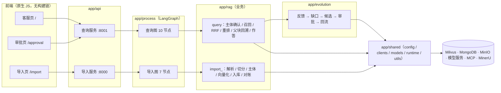

# se_rag · 企业化 RAG 知识库客服系统

把企业文档导入向量库，在网页上用自然语言提问，并让知识库**自己长大**——自动发现客服答不出的问题、
生成知识候选、经人工审批后回流知识库。

> **三个页面**：客服对话 `/`、自进化审批 `/approval`、文件导入 `/import`。
> **两个服务**：导入服务 `:8000`、查询服务 `:8001`（共用同一份 `app/`，只挂不同路由）。
> **技术栈**：Python ≥3.11 · FastAPI · LangGraph · Milvus · MongoDB · MinIO · BGE-M3 / BGE-Reranker · DashScope Qwen。

> 想直接看代码怎么走，读 **[技术讲解文档](docs/se_rag-技术讲解文档.md)**
> （`docs/se_rag-技术讲解文档.html` 是可离线打开的单页版，含流程图与侧边目录）。
> 本文档偏重「怎么用、怎么配、出问题看哪里」。

## 目录

- [一、功能与定位](#一功能与定位)
- [二、架构与技术栈](#二架构与技术栈)
- [三、核心流程](#三核心流程)
- [四、快速开始](#四快速开始)
- [五、开发与测试](#五开发与测试)
- [六、注意事项与排障](#六注意事项与排障)

## 一、功能与定位

通用大模型不懂企业内部专有知识，而企业知识更新快、人工维护贵。本项目用
「导入 → 检索增强生成 → 反馈 → 缺口发现 → 候选生成 → 人工审批 → 回流」的闭环，
让知识库跟着真实客服数据持续自我完善。

| 能力 | 说明 | 入口 |
| --- | --- | --- |
| 文档导入 | Markdown 直接处理；PDF 经 MinerU 云解析转 Markdown；图片自动生成说明并上传 MinIO | 导入页 `:8000/import` |
| 混合检索 | 稠密 + 稀疏（BGE-M3）混合检索；并行 HyDE 假设性检索与 MCP 联网补充 | 客服页内部 |
| 主体识别与对齐 | 从提问中识别商品主体并对齐库内标准名；无法确认时**列出相似主体供点选** | 客服页 |
| 流式回答 | SSE 逐字输出，附引用来源（知识库 / 自进化 / 联网）与回答置信度 | 客服页 |
| 闲聊分流 | 入口意图识别（LLM 二分类）判定闲聊 / 知识库问答；闲聊用人设直接作答，不进检索链路，回答带「闲聊」徽标 | 客服页 |
| 会话历史 | 按会话读取 / 清空；支持跨轮次主体指代消解 | 客服页 |
| 刷新续传 | 对话进行中刷新页面，进度与答案自动接回 | 客服页 |
| 用户反馈 | 每条回答可 👍/👎，反馈落库并参与自进化 | 客服页 |
| 知识自进化 | 缺口扫描 → 候选生成（质量闸门 / PII 拦截）→ 人工审批 → 回流向量库 → 参与后续召回 | 审批页 `:8001/approval` |
| 自动调度 | 内置调度器：每轮扫描生成；指标快照与参数自调、回测止损按周期运行 | 查询服务 lifespan |
| 在线评估 | LLM 判定答案接地性；统计采纳率 / 缺口率并落库 | `GET /api/evolution/status` |

**边界**：只支持 `.md` / `.pdf`；其他类型在入口即被拒绝（422）。知识库与自进化共用同一套 Milvus / MongoDB。

## 二、架构与技术栈

### 2.1 分层与依赖方向

`api` 负责协议，`process` 负责图编排，`rag` 和 `evolution` 负责业务，`shared` 提供基础能力。`shared` 不导入业务层。图状态类型仍由 `process` 定义，业务服务复用这些类型。

| 分层 | 职责 | 改什么时来这里 |
| --- | --- | --- |
| `app/api` | 服务组装、路由、Pydantic 契约、统一错误体、页面与静态资源 | 加接口、改路由 |
| `app/process` | LangGraph 图与节点（薄编排） | 调流程分支 / 并行 |
| `app/rag` | 业务实现：解析、切分、主体识别、召回、融合、重排、作答 | 改检索 / 生成行为 |
| `app/evolution` | 反馈 → 缺口 → 候选 → 审批 → 回流；指标 / 自调 / 回测 | 改自进化规则 |
| `app/shared` | 唯一底座：配置单点、外部客户端、模型门面、日志、工具 | 换模型 / 换存储 |
| `app/rag_eval` | 离线评估子系统（独立包边界） | 改评估指标 |
| `app/resources` | 页面、样式、脚本与提示词模板 | 改前端交互 / 改提示词 |



### 2.2 技术栈

| 类别 | 技术 | 用途 | 位置 |
| --- | --- | --- | --- |
| 语言 / 依赖 | Python ≥3.11 + `uv` | 后端全部逻辑；`pyproject.toml` + `uv.lock` 锁版本 | `pyproject.toml` |
| Web | FastAPI + Uvicorn + SSE | 两个服务、Pydantic 契约、流式回答 | `app/api/http/*_server.py` |
| 编排 | LangGraph（`StateGraph`） | 导入图 / 查询图，条件边 + 并行召回 | `app/process/*/agent/main_graph.py` |
| 向量库 | Milvus（`pymilvus[model]`） | 三集合稠密 + 稀疏混合检索 | `app/shared/clients/milvus_gateway.py` |
| 文档库 | MongoDB（`pymongo`） | 会话、反馈、缺口、候选、指标、参数、父块 | `app/shared/clients/mongo.py` |
| 对象存储 | MinIO | Markdown 图片外链（公开只读桶） | `app/shared/clients/minio_gateway.py` |
| 模型 | BGE-M3（本地，稠密+稀疏）、BGE-Reranker-Large（本地）、DashScope Qwen（云端） | 向量化、重排、生成 / 视觉 / 接地性评估 | `app/shared/models/` |
| 联网检索 | 百炼 MCP（`openai-agents` + `requests`） | 补充实时信息，失败降级为空 | `app/rag/query/web_search_service.py` |
| PDF 解析 | MinerU 云服务（`vlm` 版本） | PDF → Markdown | `app/rag/import_/pdf_parse_service.py` |
| 前端 | 原生 HTML / CSS / JS | 三页 UI，无构建链 | `app/resources/` |
| 日志 | loguru | 控制台 + 文件双通道；`sys._getframe` 定位真实调用点 | `app/shared/runtime/logger.py` |
| 测试 | pytest（+ `mongomock`） | 离线单测 + 可选真机 e2e | `tests/` |

### 2.3 数据契约

集合名与字段名属数据契约。改名这类操作必须绕开它们。

**Milvus 三个集合**

| 集合 | 主键 | 关键字段 | 向量 / 口径 |
| --- | --- | --- | --- |
| `kb_chunks` | `chunk_id` VARCHAR(40)，**确定性哈希** | `doc_id` / `parent_id` / `file_title` / `item_name` / `title` / `parent_title` / `heading_path` / `part`(INT16) / `seq` / `page` / `content` / `content_hash` | dense **COSINE** + sparse IP |
| `kb_item_names` | `pk` INT64（显式） | `file_title` / `item_name` | dense **COSINE** + sparse IP |
| `kb_evolution_items` | `evo_doc_id` VARCHAR(128)（`evo_<12hex>`） | `faq_question` / `faq_answer` / `source_refs` / `item_name` / `status` / `file_title` | dense **IP**（BGE-M3 已 L2 归一化） |

`chunk_id = sha1(doc_id#heading_path#occurrence#part)`：只编码结构、不编码内容，因此**重复导入后 id 稳定**，
标注与引用不再失效；内容变更由 `content_hash` 感知。`occurrence` 用于消歧重名标题。

**MongoDB 七个集合**（库名见 `MONGO_DB_NAME`）

| 集合 | 内容 | 唯一写入者 |
| --- | --- | --- |
| `chat_message` | 会话历史（含 `citations` / `groundedness` / `pending_subject_ask` / `intent`） | `history_repository.save_message` |
| `fb_events` | 反馈事件（`adopt` / `thumbs` / `cited_chunk_ids` / `item_names` / `source`） | `app/evolution/feedback/collector.py` |
| `k_gaps` | 知识缺口（`confidence` / `signals` / `status`） | `app/evolution/gap/detector.py` |
| `k_candidates` | 候选知识（`draft` / `need_info` / `active` / `rejected` / `deprecated`） | 生成器 + 审批状态机 |
| `k_metrics` | 指标快照（`adopt_rate` / `gap_rate` / `params_snapshot`） | `app/evolution/online_eval/metrics.py` |
| `param_registry` | 参数注册表（`RRF_K` / `RRF_TOP` / `RERANK_TOP_K` + `rev`） | `app/evolution/tuning/param_registry.py` |
| `kb_parent_chunks` | 章节级父块（`parent_id` / `doc_id` / `title` / `heading_path` / `page` / `content` / `child_count`） | `app/rag/import_/parent_index_service.py` |

父块只按 `parent_id` 批量取回、从不参与向量检索，故存 Mongo 而非 Milvus：避开 `VARCHAR(65535)`
字节上限，长章节可完整存储，也无需为父块额外生成向量。

**三条不变式**

1. 集合名与字段名属数据契约；LangGraph `state` 键名、SSE 事件名同理。
2. `kb_chunks` 按 `file_title` 先写新后清旧（幂等覆盖），`kb_parent_chunks` 按 `doc_id` 同理；
   `chunk_id` 为确定性哈希，**重复导入不会重新分配**。
3. `EVOLUTION_*` 开关语义、`app/rag_eval` 包边界保持不变。

## 三、核心流程

### 3.1 导入流程（:8000，7 节点）

```
POST /api/import/upload   鉴权 + 校验扩展名（仅 md/pdf）+ 大小上限 → 落盘 → 后台任务 → 立即返回 task_ids
  → node_entry                     按后缀分派 md / pdf，写 file_title
  → node_pdf_to_md                 仅 PDF：MinerU 解析（轮询 600s 上限 / 3s 间隔）→ 下载解压
  → node_md_img                    图片 → 视觉模型生成说明 → 上传 MinIO → 链接替换
  → node_document_split            结构感知解析 → 章节识别 → 两级切片（父块 + 子块）
  → node_item_name_recognition     LLM 读前 10 片识别主体 → 归并库内标准名 → 回填 chunks 与 parent_chunks
  → node_bge_embedding             分批（6 条/批）生成稠密 + 稀疏向量
  → node_import_milvus             按 file_title 先写新后清旧；父块写 Mongo
  → 对账                           Milvus / Mongo 做集合比对，MinIO 只输出计数；只记日志不阻断
```

编排层（`app/rag/import_/pipeline.py`）另有四项加固，**不引入消息队列**、保持单进程形态：

- **并发闸门**：进程内信号量限制同时执行的导入任务数（默认 2），避免线程池被打满；
- **有界重试**：只对可重试错误码退避重试（默认 3 次）；配合 MinerU 产物复用，重试不重复付云端解析的代价；
- **错误分类**：失败原因落成稳定机器码（`app/rag/import_/errors.py`）；
- **磁盘快照**：状态迁移时落盘，进程重启后状态接口仍能回读终态。

不支持的文档类型会显式标记任务 `FAILED`（图内会静默走到 END，靠业务层兜底），不会出现「已完成但未入库」。
进度记录不立即清理，由 `TASK_STATE_TTL_SECONDS`（默认 6h）回收，保证前端仍能轮询到终态。

### 3.2 查询流程（:8001，10 节点 + 2 条条件短路）

```
POST /api/query    流式：先建 SSE 通道再后台执行，立即返回 session_id；非流式：同步等待
  → node_intent_route          LLM 二分类（rag / chitchat）；开关关闭 / rewrite_hint / 识别失败 → 恒 rag
  → 条件边                    闲聊 → node_chitchat_answer → END；知识库问答 → 主体确认
     闲聊分支 node_chitchat_answer   人设提示词作答 → 流式 delta → 落库 user+assistant 两条（intent=chitchat）
     知识库分支 node_item_name_confirm   历史上下文 → 确定性消解（见 3.3）或 LLM 抽主体 + 改写 → 向量对齐 → 四态判定
  → 条件边                   主体已确认 → 继续；未确认（answer 已就绪）→ 直接作答 END
  → 并行三路召回             ① 知识库混合检索（含自进化条目）② HyDE 假设性检索 ③ MCP 联网（失败降级空）
  → node_rrf                 多路 RRF 融合，强制并入自进化权威条目
  → node_rerank              本地优先排序 → 限联网条数 → BGE-Reranker 打分 → 累计断崖截断 → 权威条目保底
  → node_parent_expand       命中子块 → 按 parent_id 批量取章节级父块 → 按预算注入章节背景
  → node_answer_output       有现成答案则跳过 LLM；否则作答 → 抽图 → 回填引用/信号/接地性 → 落库
  → SSE final + close        返回 answer / citations / groundedness / item_name_options / intent
```

**闲聊分流**（`app/rag/query/intent_route_service.py` + `chitchat_service.py`）：判定边界保守——
出现产品名/型号/品类词、知识诉求、问候与知识混合输入、历史在讨论产品的跟进追问，一律判 rag；
拿不准或识别失败也判 rag（误判闲聊会让用户得不到答案，误判 rag 只是多走一次检索）。
`CHITCHAT_ENABLED=false` 时意图节点零外部调用、纯透传，RAG 链路逐字节等价。
闲聊消息 `item_names` 为空，被 `list_valid_history` 过滤，不污染下一轮主体消解；
闲聊轮显式排除自进化未解决信号（无检索过程不代表知识缺口）。

**父块回溯（Small-to-Big）**：重排仍以**子块**文本打分（子块短、主题集中，打分精度高），父块只作为
最终上下文的补充——若把长父块一并喂给重排，会稀释相关性分数、把精确命中的子块压下去。父块按分数
降序分配预算（`PARENT_MAX_CHARS` 单块 / `PARENT_TOTAL_BUDGET_CHARS` 合计），同一父块被多个子块命中
只注入一次；联网结果与自进化条目没有父块，自动跳过。

一次提问只对 `rewritten_query` 编码一次向量，知识库与自进化两路复用。

### 3.3 主体确认与意图保真

主体判定分四态（`app/rag/query/item_name_confirm_service.py`）：

| 判定 | 触发条件 | 行为 |
| --- | --- | --- |
| 确认 | 完整命中库内标准名，或 top1 达下限且与次优主体间距达标 | 正常多路召回 |
| 可选 | 向量分落在 `0.60 ~ 0.65` 区间 | 列出候选主体，请用户点选 |
| 相似 | 目录子串 / token 前缀 / 问句里出现库内关键词 | 列相似主体供点选 |
| 无主体 | 以上都不成立 | 提示补充产品名称 |

`confirm_item_name` 有**三条消解路径**，优先级从高到低：

1. `resolve_by_hint`——本轮带 `rewrite_hint`（前端点选主体，或手输命中反问候选）。
   直接用「主体名 + 意图原句」确定性拼装，**不经过模型**。
2. `resolve_by_pending_clarify`——本轮没带 hint，但上一轮反问过、且本轮是反问候选里的主体名。
   覆盖「刷新后手输」与非浏览器客户端。
3. 常规流程——历史上下文 + LLM 抽主体与改写 + 相似主体兜底。

**为什么确定性消解优先于模型改写。** 当问句里只有主体名、没有任何动作或疑问词时，
模型缺少可依据的意图，只能从历史话题里找一个续上——历史在聊什么，答案就偏向什么。
把「主体名」与「意图原句」拆成两个独立字段后，模型没有推断的余地。
**信息结构化直传比提示词劝说可靠**，这是三条路径排序的依据。

配套的两个机制：

- **反问信息落库**：反问轮（给出了可点选主体）把 `{"intent": 触发反问的原话, "options": [候选主体名]}`
  写进助手消息的 `pending_subject_ask`。下一轮读「最近一条助手消息」取回意图——只认最近一条，
  更早的反问不得残留成「上一轮意图」。
- **前端补 hint**：反问的选项栏出现后，手输文本若命中候选主体，前端把触发反问的原话作为
  `rewrite_hint` 传下去，与点选等价。

### 3.4 自进化闭环

```
点踩 / 零命中 / 命中却答不出
  → fb_events（30s 幂等窗口）
  → 缺口扫描（ts 升序 + 游标；加权置信度分级 strong / weak / none）
  → 候选生成（LLM 提炼 FAQ；无证据或疑似「无信息」→ need_info；命中 PII / 重复 → rejected）
  → 人工审批（通过 / 驳回 / 编辑，写操作需 X-Internal-Token）
  → 索引回流（kb_evolution_items，status=active；源缺口回写 resolved / rejected）
  → 后续查询经 RRF 并入、重排置顶，引用标签显示「自进化」
```

| 闸门 | 规则 | 目的 |
| --- | --- | --- |
| 缺口分级 | `strong ≥ 0.65`、`weak ≥ 0.45`（权重 user/retrieval/generation = 0.4/0.3/0.3） | 只有 strong 才生成候选 |
| 缺口去重 | **按问题**（不是按会话）+ 1 小时窗口 | 同一会话的后续新问题仍能被扫到 |
| 候选质量 | 无证据 → `need_info`；答案像「未提及…建议联系官方」→ 拒绝通过 | 不让伪知识入库 |
| 回测止损 | 观察窗内命中 ≥ `EVOLUTION_BACKTEST_MIN_HITS`（默认 3）且拒绝率超限才下架 | 防单条差评误杀已审批知识 |

调度节拍（`app/evolution/scheduler.py`）：每轮扫描生成；指标快照 + 参数自调按
`EVOLUTION_METRIC_INTERVAL_MINUTES`（默认 60 分钟）；回测止损按
`EVOLUTION_BACKTEST_INTERVAL_HOURS`（默认 24 小时）。参数自调基线取**历史**快照，避免与本轮快照自比自。

### 3.5 SSE 协议与前端

| 事件 | 载荷要点 |
| --- | --- |
| `ready` | 连接建立（服务端先回放订阅前缓冲，避免 POST 与 GET 竞态） |
| `progress` | `status` / `done_list` / `running_list`（节点进度） |
| `delta` | `delta`（LLM 增量文本） |
| `final` | `answer` / `image_urls` / `item_names` / `citations` / `groundedness` / `item_name_options` / `intent`（rag / chitchat，前端据此渲染「闲聊」徽标） |
| `error` | `code` / `message` |
| `close` | 服务端关闭（前端停止等待） |

前端三页共用 `/static/app.js`（`fetchJson` / `openStream` / `formatDateTime` / `checkFreshness` 等），
页面自身只管业务交互；资源以 `?v=<内容指纹>` 引用，`/api/health` 回传同一指纹，发现页面过期会提示刷新。

**刷新续传**：页面刷新会同时丢掉 POST 响应与 SSE 连接，但后台查询仍在跑。前端加载时先读
`GET /api/query/status/{session_id}`：状态为 `pending` / `processing` 时，用快照的
`done_list` / `running_list` 重建阶段进度，再重新订阅 SSE 收尾；否则只回显历史。
服务端侧，断开连接时**只解绑订阅者、不销毁通道**（任务仍在跑时），并保留缓冲事件供重连回放。

## 四、快速开始

### 4.1 环境要求

- Python ≥ 3.11（推荐用 `uv` 管理依赖）
- 可访问的 Milvus / MongoDB / MinIO
- DashScope（Qwen）API Key；本地 BGE-M3 与 BGE-Reranker-Large 模型文件
- 可选：MinerU API Token（仅导入 PDF 需要）、百炼 MCP 地址（联网检索）

### 4.2 安装

```bash
uv sync                 # 依据 pyproject.toml + uv.lock 创建 .venv 并安装依赖
```

### 4.3 配置（项目根目录 `.env`）

> `app/shared/config/common.py:14` 使用 `load_dotenv(override=True)`：**`.env` 会覆盖同名系统环境变量**，
> 想用环境变量临时改配置会失效。不要提交真实密钥。

| 分组 | 变量 |
| --- | --- |
| LLM | `OPENAI_API_KEY`、`OPENAI_BASE_URL`、`LLM_DEFAULT_MODEL`、`VL_MODEL`、`LLM_DEFAULT_TEMPERATURE`、`LLM_TIMEOUT_SECONDS`（60）、`LLM_MAX_RETRIES`（2） |
| 嵌入 / 重排 | `BGE_M3`、`BGE_M3_PATH`、`BGE_DEVICE`、`BGE_FP16`、`BGE_RERANKER_LARGE`、`BGE_RERANKER_DEVICE`、`BGE_RERANKER_FP16` |
| Milvus | `MILVUS_URL`、`CHUNKS_COLLECTION`、`ITEM_NAME_COLLECTION`、`EVOLUTION_COLLECTION`（`kb_evolution_items`）、`MILVUS_TIMEOUT_SECONDS`（15）、`MILVUS_INSERT_BATCH_SIZE`（500） |
| MongoDB | `MONGO_URL`、`MONGO_DB_NAME`、`MONGO_CHAT_COLLECTION`（`chat_message`）、`PARENT_CHUNKS_COLLECTION`（`kb_parent_chunks`）、`EVOLUTION_FB_EVENTS_COLLECTION`（`fb_events`）、`EVOLUTION_K_GAPS_COLLECTION`（`k_gaps`）、`EVOLUTION_K_CANDIDATES_COLLECTION`（`k_candidates`）、`EVOLUTION_K_METRICS_COLLECTION`（`k_metrics`）、`EVOLUTION_PARAM_REGISTRY_COLLECTION`（`param_registry`） |
| MinIO | `MINIO_ENDPOINT`、`MINIO_ACCESS_KEY`、`MINIO_SECRET_KEY`、`MINIO_BUCKET_NAME`、`MINIO_IMG_DIR`、`MINIO_SECURE` |
| 外部服务 | `MINERU_BASE_URL`、`MINERU_API_TOKEN`、`MCP_DASHSCOPE_BASE_URL`、`MCP_TIMEOUT_SECONDS`（30）、`IMAGE_SUMMARY_MAX_WORKERS`（4） |
| 服务 | `APP_HOST`（`0.0.0.0`）、`IMPORT_APP_PORT`（8000）、`QUERY_APP_PORT`（8001）、`CORS_ORIGINS`、`APP_ENV`（`dev`）、`IMPORT_APP_NAME`、`QUERY_APP_NAME` |
| 导入链路 | `IMPORT_ADMIN_TOKEN`（带开发默认值，生产必须覆盖）、`IMPORT_MAX_UPLOAD_MB`（50）、`IMPORT_MAX_CONCURRENT_TASKS`（2）、`IMPORT_ACQUIRE_TIMEOUT_SECONDS`（600）、`IMPORT_MAX_RETRY_ATTEMPTS`（3）、`IMPORT_RETRY_BACKOFF_SECONDS`（1.0）、`IMPORT_RECONCILE_ENABLED`（true）、`IMPORT_CHECKPOINT_ENABLED`（true） |
| 日志 | `LOG_CONSOLE_ENABLE` / `LOG_CONSOLE_LEVEL` / `LOG_FILE_ENABLE` / `LOG_FILE_LEVEL`（默认 INFO）/ `LOG_FILE_RETENTION`（`7 days`） |
| 运行期 | `TASK_STATE_TTL_SECONDS`（21600）、`WEB_MAX_IN_CONTEXT`（2）、`CHUNK_DENSE_METRIC` / `ITEM_NAME_DENSE_METRIC`（COSINE）、`CHITCHAT_ENABLED`（true，闲聊功能开关；关闭后意图节点零调用纯透传） |
| 主体判定 | `ITEM_NAME_CONFIRM_MIN_SCORE`（0.65）、`ITEM_NAME_CONFIRM_MARGIN`（0.02）、`ITEM_NAME_OPTION_MIN_SCORE`（0.60）、`ITEM_NAME_CATALOG_TTL_SECONDS`（60）、`ITEM_NAME_SEARCH_LIMIT`（10） |
| 切分 | `CHUNK_MAX_SIZE`（1000）、`CHUNK_SIZE`（600）、`CHUNK_OVERLAP`（50）、`CHUNK_MIN`（400）、`CHUNKS_SPLIT_TOP_NUMBER`（10）、`EMBEDDING_BATCH_SIZE`（6） |
| MinerU | `MINERU_POLL_TIMEOUT_SECONDS`（600）、`MINERU_POLL_INTERVAL_SECONDS`（3）、`MINERU_DOWNLOAD_TIMEOUT_SECONDS`（60）、`MINERU_REQUEST_TIMEOUT_SECONDS`（30）、`MINERU_UPLOAD_TIMEOUT_SECONDS`（120） |
| 自进化 | `EVOLUTION_ENABLED`（false）、`EVOLUTION_ADMIN_TOKEN`（直读环境变量，不走 `settings`）、`EVOLUTION_SCHEDULE_ENABLED` / `EVOLUTION_SCHEDULE_INTERVAL_MINUTES`（30）、`EVOLUTION_METRIC_INTERVAL_MINUTES`（60）、`EVOLUTION_BACKTEST_ENABLED` / `EVOLUTION_BACKTEST_INTERVAL_HOURS`（24）/ `EVOLUTION_BACKTEST_MIN_HITS`（3）、`EVOLUTION_OBSERVE_WINDOW_DAYS`（7）、`EVOLUTION_SCAN_BATCH`（50）、`EVOLUTION_GEN_CONTEXT_ENABLED`、`EVOLUTION_GAP_WEIGHT_USER` / `_RETRIEVAL` / `_GENERATION`、`EVOLUTION_GAP_STRONG_THRESHOLD` / `_WEAK_THRESHOLD`、`EVOLUTION_ATTAIN_RATE_MIN`、`EVOLUTION_REJECT_RATE_MAX`、`EVOLUTION_ALARM_ADOPT_DROP`、`EVOLUTION_RECALL_LIMIT`、`EVOLUTION_RRF_WEIGHT`、`EVOLUTION_GROUNDEDNESS_MIN`、`EVOLUTION_GRAY_ENABLED` |

### 4.4 启动

```bash
# 查询服务（客服对话 + 审批后台 + 自进化接口 + 调度器）
uvicorn app.api.http.query_server:app --host 0.0.0.0 --port 8001

# 导入服务（文件上传与导入）
uvicorn app.api.http.import_server:app --host 0.0.0.0 --port 8000
```

也可用模块入口（端口取 `.env`）：`python -m app.api.http.query_server` / `python -m app.api.http.import_server`。

| 页面 | 地址 |
| --- | --- |
| 客服对话 | `http://127.0.0.1:8001/` |
| 自进化审批 | `http://127.0.0.1:8001/approval` |
| 文件导入 | `http://127.0.0.1:8000/import` |

> 首次启动较慢（BGE-M3 / BGE-Reranker 需要加载模型），属正常现象。
> **调度器只随查询服务启动**，因此不要为同一个库同时跑多个查询服务实例（无分布式锁，会重复扫描）。

### 4.5 接口速查

查询服务（:8001）：

| 方法与路径 | 说明 |
| --- | --- |
| `GET /api/health` | 健康检查（含 `asset_version` 静态资源指纹） |
| `POST /api/query` | 提交问题（`is_stream=true` 时异步执行并返回 `session_id`；响应与 SSE `final` 均含 `intent`：rag / chitchat） |
| `GET /api/query/status/{session_id}` | 进行中查询的进度快照（刷新后据此重建阶段进度） |
| `GET /api/stream/{session_id}` | SSE 事件流（`ready → progress → delta → final → close`） |
| `GET /api/history/{session_id}` | 读取会话历史 |
| `DELETE /api/history/{session_id}` | 清空会话历史 |
| `POST /api/evolution/feedback` | 提交反馈（`thumbs` = 1 / -1） |
| `GET /api/evolution/candidates` | 候选列表（可按 `status` 筛选） |
| `GET /api/evolution/status` | 闭环状态（缺口 / 候选计数、调度进度、最近指标快照） |
| `POST /api/evolution/candidates/{id}/approve` `/reject` `/edit` | 审批写操作（需 `X-Internal-Token`） |
| `DELETE /api/evolution/candidates/{id}` | 下架候选（已入库条目同时移出向量库，需 Token） |

导入服务（:8000）：

| 方法与路径 | 说明 |
| --- | --- |
| `POST /api/import/upload` | 上传文件（仅 md / pdf，其余入口直接 422；需 `X-Internal-Token`） |
| `GET /api/import/status/{task_id}` | 任务状态与节点进度（需 `X-Internal-Token`） |

错误响应统一为 `{"code": "<机器码>", "message": "<中文提示>"}`。

## 五、开发与测试

### 5.1 门禁命令

```bash
python -m pyflakes app tests          # 静态检查（期望 0 输出）
python -m compileall -q app tests     # 字节码编译
pytest -q                             # 离线单测（默认 -m 'not e2e'，不访问外部服务）
E2E_ENABLED=1 pytest -m e2e tests/e2e -s   # 真机端到端（会产生模型调用与真实写库）
```

当前状态：**58 个测试文件，离线 458 passed / 1 deselected**。
`test_query_degradation.py::test_milvus_down_query_no_longer_500` 依赖本地 BGE-M3 模型文件，
缺模型文件的环境（模型下载被网络策略拦截）会失败，属既有环境约束，与业务代码无关。
真机 E2E 覆盖：小 md 导入 → Milvus 落库校验 → 一次查询的完整 SSE 事件序列 → 反馈与缺口扫描 →
候选审批回流；测试数据带 `e2e_` 前缀并在用例结束后「删除 → 等待 → 复核」。

### 5.2 目录速查

| 路径 | 职责 |
| --- | --- |
| `app/api/http/*_server.py` | 服务组装（FastAPI 实例、CORS、lifespan、路由挂载） |
| `app/api/routers/` | 路由层（query / evolution / import_ / pages / health） |
| `app/api/errors.py` | 统一错误模型与异常处理器 |
| `app/process/*/agent/` | LangGraph 状态、节点与图定义 |
| `app/rag/query/` | 主体确认、检索、RRF、重排、父块回溯、作答、引用、历史上下文 |
| `app/rag/import_/` | 入口分派、PDF 解析、图片增强、结构感知切分（两级切片）、主体识别、向量化、入库、对账、schema 迁移 |
| `app/rag/item_name/` | 主体名目录缓存、检索判定与相似兜底 |
| `app/evolution/` | feedback / gap / candidate / approval / index / online_eval / tuning / backtest / scheduler |
| `app/shared/config/` | 唯一配置出口 `settings`（`common.py` 是唯一读环境变量的地方） |
| `app/shared/clients/` | Milvus / MongoDB / MinIO 客户端、会话历史仓储、章节父块仓储 |
| `app/shared/models/` | LLM / 向量 / 重排模型入口（`llm_providers`） |
| `app/shared/runtime/` | 日志与提示词加载 |
| `app/shared/utils/` | 校验、文本归一、JSON 解析、SSE 通道、任务状态与快照、重试 |
| `app/rag_eval/` | 离线检索评估（真实切分器产出样本 → 分层评测 + 切分质量 → 报告） |
| `tests/unit`、`tests/e2e` | 离线单测与真机端到端 |
| `doc/` | 样本手册（85 份 PDF + 1 份表格），供导入联调使用 |
| `docs/` | 技术讲解文档：`se_rag-技术讲解文档.md` / `.html`（流程图 / 逐节点源码走读 / 架构补充） |
| `logs/`、`output/` | 运行日志（`app_YYYYMMDD.log`）与导入中间产物；`output/` 与 `*.log` 均在 `.gitignore` 中 |

### 5.3 常调参数（改这些会直接改变行为）

| 参数 | 默认 | 作用 |
| --- | --- | --- |
| `ITEM_NAME_CONFIRM_MIN_SCORE` / `_MARGIN` | 0.65 / 0.02 | 主体自动确认下限与 top1–top2 间距 |
| `ITEM_NAME_OPTION_MIN_SCORE` | 0.60 | 低于它就进入「相似主体点选」兜底 |
| `RRF_K` / `RRF_TOP`（`param_registry` 可覆盖，默认 60 / 5） | 60 / 5 | RRF 平滑常数与融合后保留条数 |
| `RERANK_MAX_TOPK` / `RERANK_MIN_TOPK` / `GAP_RATIO` / `GAP_ABS` | 6 / 2 / 0.2 / 0.2 | 重排保留上限、无条件保留数、累计断崖截断 |
| `RERANK_MAX_INPUT_TOKENS` / `RERANK_SUMMARY_MAX_WORKERS` | 512 / 4 | 重排输入预算（超长先 LLM 压缩再按 token 硬截断）与压缩并发 |
| `WEB_MAX_IN_CONTEXT` | 2 | 本地有命中时联网结果条数上限 |
| `PARENT_MAX_CHARS` / `PARENT_TOTAL_BUDGET_CHARS` | 1200 / 4000 | 单个父块的背景注入上限与全部父块的合计预算 |
| `HYDE_GATE_ENABLED` / `HYDE_GATE_SHORT_CHARS` | false / 24 | 短事实型查询是否跳过 HyDE（默认关闭，保持三路无条件扇出） |
| `CHITCHAT_ENABLED` | true | 闲聊功能开关；关闭后 `node_intent_route` 零外部调用纯透传，RAG 链路逐字节等价 |
| `EVOLUTION_GAP_STRONG_THRESHOLD` / `_WEAK_THRESHOLD` | 0.65 / 0.45 | 缺口分级门槛 |
| `EVOLUTION_OBSERVE_WINDOW_DAYS` / `EVOLUTION_SCAN_BATCH` | 7 / 50 | 缺口扫描窗口与每轮批量 |
| `EVOLUTION_METRIC_INTERVAL_MINUTES` / `_BACKTEST_INTERVAL_HOURS` / `_BACKTEST_MIN_HITS` | 60 / 24 / 3 | 指标、回测、回测下架门槛 |
| `TASK_STATE_TTL_SECONDS` | 21600 | 任务进度内存回收 |

切分策略（`app/rag/import_/config.py`）：`CHUNK_MAX_SIZE` 1000（硬上限：仅单个原子块超过它才从中间切开）
/ `CHUNK_SIZE` 600（软目标：决定多个原子块如何打包）/ `CHUNK_OVERLAP` 50（仅在单个原子块必须切开时生效）
/ `CHUNK_MIN` 400（同章节内过短分块向后合并的门槛）/ 向量化批大小 6。
三个长度阈值一律按**正文口径**比较（不含切片前置标题）。

## 六、注意事项与排障

### 6.1 必须知道的约束

- **单进程部署**：SSE 通道、任务进度、主体目录缓存、参数注册表缓存都在进程内存里，调度器也没有分布式锁。
  多 worker 会丢流、进度错乱、重复扫描；要水平扩展先引入 Redis。
- **一个端口只能有一个进程**：Windows 允许两个进程绑定同一端口，连接会被随机分发；如果 `POST /api/query` 与
  `GET /api/stream` 落到不同进程，流式回答就会卡住。用
  `Get-NetTCPConnection -State Listen | Where-Object LocalPort -eq 8001` 确认只有一行。
- **长开的旧页面不会自动换脚本**：后端已部署新版但页面仍是旧 JS 时，会出现「按钮不渲染 / 置信度 0%」这类
  看似没修好的现象。刷新页面即可；系统检测到资源版本变化会主动提示「请按 Ctrl+F5 刷新」。
- **`.env` 覆盖系统环境变量**（`load_dotenv(override=True)`）；密钥请勿提交。
- **Milvus metric 口径必须与建表一致**：`kb_chunks` / `kb_item_names` dense 用 COSINE、`kb_evolution_items` 用 IP；
  不一致会让 Milvus 报 `metric type not match` 并静默返回 None。
- **Milvus RPC 必须各自传超时**：`pymilvus` 的构造参数只覆盖建连等待，`hybrid_search` / `query` 等业务 RPC
  要显式传 `MILVUS_TIMEOUT_SECONDS`，否则网络挂起时会永久阻塞。
- **`kb_chunks` 主键是确定性哈希**：`chunk_id = sha1(doc_id#heading_path#occurrence#part)`，只编码结构不编码
  内容，因此重导入后 id 稳定，绑在它上面的标注与引用不会失效。但 schema 变更无法自动生效（集合「存在即跳过」），
  需显式调用 `app/rag/import_/schema_migration.py:migrate_chunk_schema(force=True)` 重建集合（**会清空数据**）。
- **父块存 MongoDB**：`kb_parent_chunks` 只按 `parent_id` 批量取回，不参与向量检索；父块写入失败只告警不阻断导入。
- **导入需鉴权**：上传与状态查询都要求请求头 `X-Internal-Token` 等于 `IMPORT_ADMIN_TOKEN`。
  该值在 `app/shared/config/settings.py` 里带一个**硬编码的开发默认令牌**，生产部署务必在 `.env` 覆盖；
  置空时接口 fail-closed（503）。
- **审批写操作需鉴权**：请求头 `X-Internal-Token` 需等于 `EVOLUTION_ADMIN_TOKEN`。该变量由
  `app/api/routers/evolution.py` **直接读环境变量**（不走 `settings`），未配置时写操作一律 503、令牌不符 401。
- **自进化需显式开启**：`EVOLUTION_ENABLED=false` 时反馈接口仅幂等接受不落库，进化条目不参与召回。
- **`app/rag_eval` 会写共享 Milvus**：执行离线评估前确认不影响线上库，或改用独立集合。

### 6.2 常见现象 → 排查路径

| 现象 | 先看这里 | 说明 |
| --- | --- | --- |
| 提问答不出 / 没有引用 | 客服页「引用来源 / 回答置信度」→ `GET /api/evolution/status` → `logs/app_*.log` | 置信度显示「未评估」表示证据为空或评估失败（不是 0 分） |
| 一直回「请补充产品名称」 | 日志中 `模型识别item_name` / `相似主体` 两条 | 主体识别失败：确认库内主体名目录是否有该型号，必要时看 `ITEM_NAME_*` 阈值 |
| 点选主体后答的是上一个问题 | 日志中 `点选消解完成` / `手输兜底消解完成` | 确定性消解未命中，回退到了模型改写。检查请求是否带 `rewrite_hint`，以及反问轮助手消息是否落了 `pending_subject_ask` |
| 刷新页面后这一轮问答消失 | `GET /api/query/status/{session_id}` | 状态为 `processing` 表示后台仍在跑，前端应重连 SSE；若通道已被回收则只回显历史 |
| 审批页没有候选 | `GET /api/evolution/status` 的 gaps / candidates 计数 | 缺口扫描只处理观察窗内未解决信号；同问题在 1 小时窗口内会去重 |
| 点了「通过」但状态没变 | 审批页 toast 文案 | `need_info` 或疑似「无信息」答案会被拒绝通过，需先「编辑」补充事实 |
| 上传后一直「处理中」 | `GET /api/import/status/{task_id}` + 终端日志 | PDF 走 MinerU 轮询（600s 上限）；不支持的扩展名会在入口 422 |
| 上传报 503 / 401 | `.env` 的 `IMPORT_ADMIN_TOKEN` 与请求头 `X-Internal-Token` | 503 = 令牌被置空（fail-closed）；401 = 请求头与配置不一致。注意该配置带开发默认值 |
| 页面样式 / 交互异常 | `/api/health` 的 `asset_version` 与页面脚本 `?v=` | 版本不一致即页面过期，刷新即可 |


## 内部试用更新

部署、接口兼容、政策资料、待办管理和完整入口评测见 [内部试用说明](docs/internal-trial.md)。
