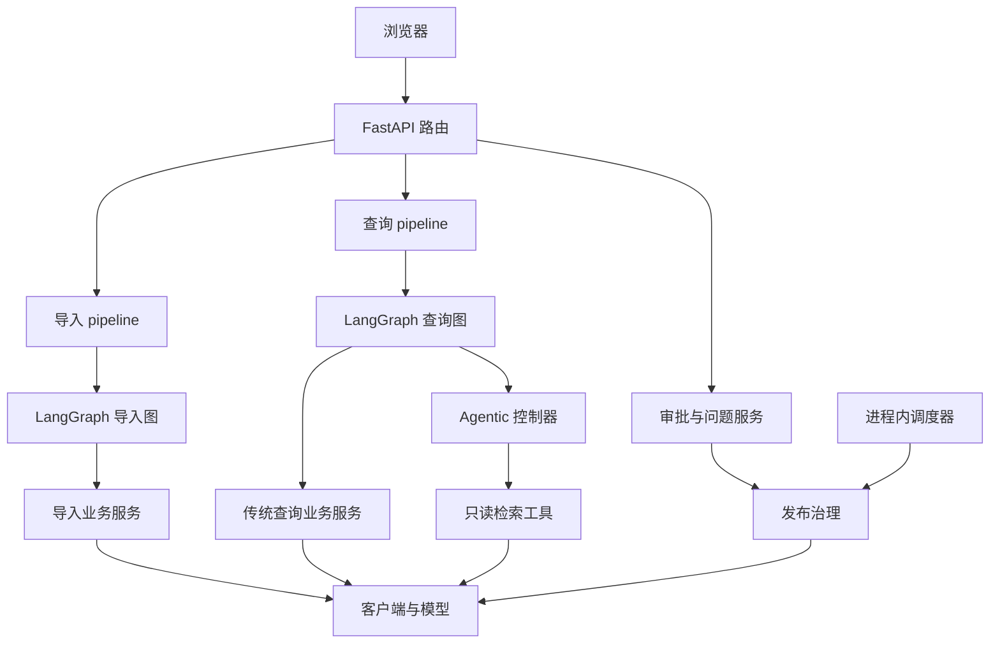
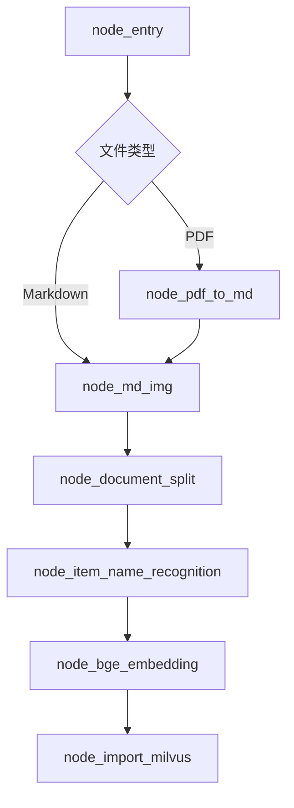
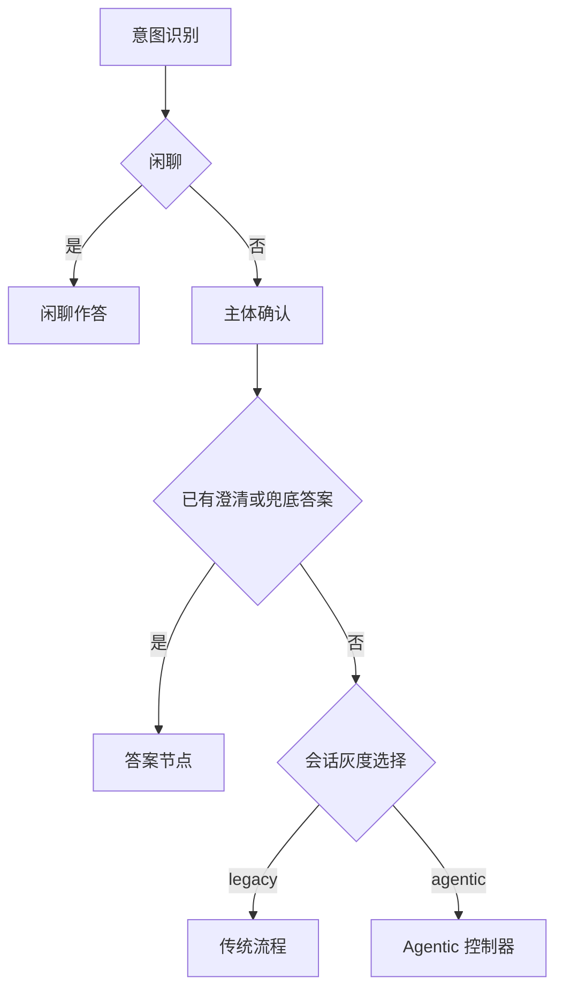
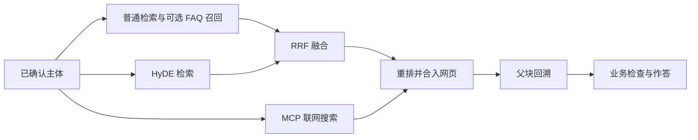
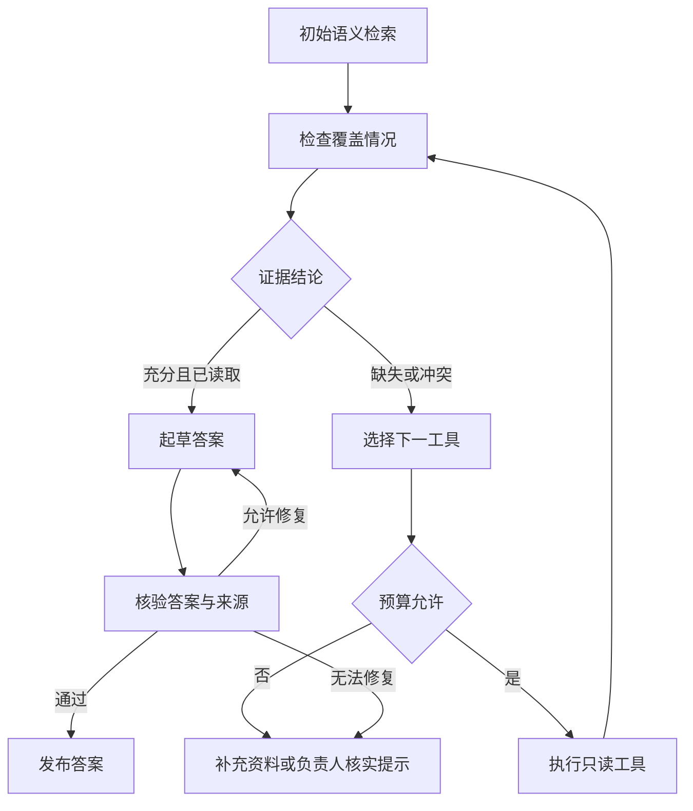
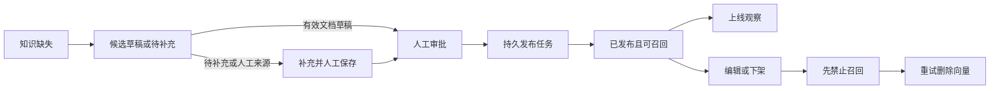

# se_rag 代码设计文档

## 1. 设计基线

本文描述 `codex/agentic-rag-next` 分支的当前工作区，包括尚未提交的代码。核对日期为 2026-11-05。

本文说明代码当前如何工作。未实现的扩展只在第 14 节列出。产品要求见 [PRD](PRD.md)。安装步骤见 [README](../README.md)。概念解释见[技术讲解](TECHNICAL_GUIDE.md)。

## 2. 模块与职责

### 2.1 HTTP 层：`app/api`

- `http/import_server.py`：创建导入 FastAPI 应用。
- `http/query_server.py`：创建查询应用，管理单 worker 租约和知识改进调度器。
- `routers/`：处理查询、导入、历史、审批、待办、页面和健康检查。
- `schema/`：定义查询与导入接口模型。
- `session_access.py`：绑定浏览器 Cookie 与会话归属。
- `errors.py`：把异常转换成统一错误响应。

HTTP 层负责输入校验和调用边界。重试、检索和发布规则主要位于业务模块。

### 2.2 流程层：`app/process`

流程层使用 LangGraph。图声明节点顺序与条件分支。节点将状态交给业务服务，并更新进度。

- [导入图](../app/process/import_/agent/main_graph.py)编译为 `import_app`。
- [查询图](../app/process/query/agent/main_graph.py)编译为 `query_app`。
- 两个 `state.py` 定义图内传递的字典字段。

### 2.3 业务层：`app/rag`

- `import_/`：文件读取、解析、图像增强、切分、主体识别、向量化和索引写入。
- `query/`：意图识别、主体确认、检索、融合、重排、父块回溯、作答和引用。
- `agentic/`：工具契约、证据契约、预算和检索控制器。
- `item_name/`：共享主体名目录、别名对齐和匹配规则。

`pipeline.py` 是业务执行入口。它管理一次任务的开始、结束和异常处理。

### 2.4 知识管理层：`app/evolution`

该模块处理反馈、缺口、候选、审批、发布、下架、上线观察和有限参数调整。`repositories.py` 提供 Mongo 集合访问器。

### 2.5 基础能力与界面

- `app/shared/config/`：配置加载与配置对象。
- `app/shared/clients/`：MongoDB、Milvus、MinIO、MCP 和父块仓储。
- `app/shared/models/`：对话、视觉、向量和重排模型入口。
- `app/shared/runtime/`：日志、截止时间、单 worker 锁和查询指标。
- `app/shared/utils/`：任务状态、SSE、快照和公共函数。
- `app/resources/`：网页、脚本、样式和提示词。
- `app/rag_eval/`：检索、答案、Agentic 和网页试用评测。

当前代码存在业务服务导入图状态类型的依赖。它不是完全单向的分层结构。修改状态字段时，需要同时检查流程层和业务层。

## 3. 进程与调用关系



两个应用分别监听端口。导入任务通过 FastAPI `BackgroundTasks` 启动。查询可以同步执行，也可以先返回任务标识后在后台执行。

当前没有独立的消息队列或通用任务服务。知识发布任务例外：它们在 Mongo 中持久化，并由治理逻辑重试。

## 4. 配置和模型设计

### 4.1 配置加载

[common.py](../app/shared/config/common.py)加载 `.env`，并提供布尔、整数、浮点和字符串解析函数。`load_dotenv(override=True)` 允许 `.env` 覆盖进程中的同名配置。

[settings.py](../app/shared/config/settings.py)构造聚合配置对象。

模型子对象为 `llm`、`embedding`、`reranker` 和 `evaluation`。存储及外部服务子对象为 `milvus`、`mongo`、`minio`、`mineru` 和 `mcp`。其余主要子对象为 `api`、`import_`、`evolution`、`agentic` 和 `runtime`。

部分调优参数仍在领域 `config.py` 中读取。审批令牌在路由中读取环境变量。因此，不能只检查 `settings.py` 就认定已找到全部配置。

`PROJECT_ROOT` 优先使用环境变量。没有该变量时，路径工具向上查找 `.env`。找不到根标识时会抛错。

### 4.2 模型能力入口

[LLMProvider](../app/shared/models/providers.py)提供以下方法：

- `chat()`：创建对话客户端。可以指定 JSON 输出和请求超时。
- `vision_chat()`：创建视觉客户端。
- `generate_embeddings()`、`embed_text()`：生成 BGE-M3 向量。
- `reranker_model()`：获取 BGE-Reranker。

向量模型与重排模型在首次使用时加载，并在进程内复用。对话和视觉使用外部兼容接口。

Agentic 决策、覆盖检查和答案核验使用 `AGENT_LLM_MODEL`。该值为空时复用默认对话模型。答案起草使用默认对话模型。当前没有备用模型或供应商自动切换逻辑。

### 4.3 关键默认值

- HTTP 端口：导入 `8000`，查询 `8001`。
- 浏览器会话归属检查：开启。
- 文件上限：`50 MB`。导入并发：每进程 `2` 个。
- 导入执行次数上限：`3` 次。名额等待上限：`600` 秒。
- 切分参数：目标 `600` 字符，拆分上限参数 `1000` 字符，拆分重叠 `50` 字符，短块合并阈值 `400` 字符。
- 闲聊分类：开启。默认等待 `2` 秒。
- HyDE 短事实分流：关闭。
- RRF：`k=60`，默认 Top `5`。
- 重排：默认最多选择 `6` 条。FAQ 补回后可能超过该数值。
- 父块背景：单块 `1200` 字符，总计 `4000` 字符。
- Agentic：工具 `4` 次，联网 `1` 次，修复 `1` 次，证据计量 `8000`，时间预算 `60` 秒。
- 知识改进总开关：关闭。自动调参：关闭。
- 调度周期：`30` 分钟。指标周期：`60` 分钟。回测周期：`24` 小时。

这些值是源码默认值。它们不是当前机器的实际配置，也不是性能验收值。

## 5. 导入流程设计

### 5.1 状态和入口

[ImportGraphState](../app/process/import_/agent/state.py)保存四组数据：

- 输入：`task_id`、文件路径、任务目录和资料类型。
- 解析：`md_path`、`pdf_path`、`md_content` 和文件类型标记。
- 知识：`file_title`、`item_name`、`chunks` 和 `parent_chunks`。
- 写入：`embeddings_content`、`document_version` 和 `valid_until`。

`create_default_state()` 对默认字典进行深拷贝。每个任务获得独立的列表。

执行入口为：

```python
def invoke_import_graph(
    task_id: str,
    local_file_path: str,
    local_dir: str,
    document_kind: str = "manual",
    document_version: str = "",
    valid_until: float = 0.0,
) -> None:
    ...
```

### 5.2 节点顺序



PDF 解析向 MinerU 申请上传地址，上传文件，再按批次轮询。完成后下载 ZIP 并选择主 Markdown。

图像增强只处理 Markdown 同目录 `images/` 中被引用的本地图像。它为图像生成视觉摘要，再上传到 MinIO。单图失败可以降级。上传接口没有提供图像目录或 ZIP 的独立上传协议。

### 5.3 结构切分

[split_service.py](../app/rag/import_/split_service.py)优先读取 `*_content_list.json`。文件缺失、JSON 读取失败、列表校验失败或归一化结果为空时，回退到 Markdown 解析。其他归一化异常仍可能导致导入失败。

[section_splitter.py](../app/rag/import_/section_splitter.py)按标题结构组织父块与子块：

1. 父块保存章节正文及子节正文。
2. 子块只使用本节正文，避免重复包含子节内容。
3. 段落、图像、表格和代码作为原子块参与打包。
4. 原子块过长时，再执行内部拆分。
5. 长表格拆分重复表头。长代码拆分补齐围栏。
6. 同章节短块尝试合并。不同章节保持来源边界。

切分长度按正文字符比较。标题前缀不计入这些阈值。特殊结构可能带来额外长度，因此不能把配置值当作所有输出的绝对字节上限。

### 5.4 主体识别与向量化

主体识别默认读取前 `10` 个子块。空结果回退到文件标题。匹配服务再将名称对齐到已有主体目录，并回填父块和子块。

向量化输入包含主体名和正文。BGE-M3 同时返回 `dense` 和 `sparse`。默认每批处理 `6` 个子块。

### 5.5 写入顺序和一致性

主体名记录在主体识别阶段更新。子块在最终索引阶段按批次 upsert。默认每批 `500` 条。

子块全部写入后，代码清理相同 `file_title` 下已经不存在的旧子块 ID。随后写入 Mongo 父块，并清理旧父块。最后执行跨存储对账。

父块写入错误只记录日志。对账只记录差异，不执行补写或回滚。导入成功状态不等于已证明三个存储完全一致。

任务失败后可能已留下图像、主体名或部分向量批次。当前没有跨库事务，也没有全局导入孤儿数据修复任务。

## 6. 查询流程设计

### 6.1 状态和生命周期

[QueryGraphState](../app/process/query/agent/state.py)保存：

- 请求：`session_id`、`turn_id`、`original_query`、`rewrite_hint`、`is_stream`。
- 路由：`intent`、`item_names`、`item_name_options`、`rewritten_query`、`query_mode`。
- 检索：普通、HyDE、网页、FAQ、RRF 和重排结果。
- 答案：正文、图像、引用、接地性、答案 ID 和实际答案上下文。
- 业务：业务标签、转交标记、问题类型和问题 ID。
- Agentic：轨迹、证据清单、停止原因、核验结果和指标。

`create_query_default_state()` 深拷贝默认状态。内部字段不全部对外公开。

[reserve_query()](../app/rag/query/lifecycle.py)先登记轮次，再启动后台任务。`finally` 中释放该轮准入，并记录执行指标。同一会话已有活动任务时返回 `409`。

### 6.2 主体与模式路由



规则可直接识别纯寒暄和业务问题。其余问题可以调用分类模型。分类超时、繁忙或输出非法时，降级为 RAG。

`rewrite_hint` 表示用户选择主体前的问题意图。存在该值时，主体服务优先确定性拼装问题，避免历史改写改变问题。

模式选择使用会话 ID 的 SHA-256 分桶。`RAG_MODE=agentic` 且桶值小于灰度比例时，才选择 Agentic。代码默认比例为 `0`。

### 6.3 传统检索流程



图运行时，三路召回都完成后进入后续节点。网页不参与 RRF 分数计算。

普通检索使用稠密与稀疏混合检索。默认权重为 `0.6` 和 `0.4`。主体过滤还放行全局条目。FAQ 召回可以复用同一查询向量。

RRF 按各路排名计算分数：

```text
某个子块的分数 = 各召回路的 weight / (k + rank) 之和
rank 从 1 开始；默认 k = 60
```

重排合入网页结果，并对长文本进行压缩。动态截断后可以补回 FAQ。本地有结果时，网页默认最多保留 `2` 条。该规则不保证所有本地结果都排在所有网页之前。

父块只作为背景。默认单父块最多使用 `1200` 字符，全部父块最多 `4000` 字符，同一父块只注入一次。

## 7. Agentic 控制器设计

### 7.1 数据契约

[contracts.py](../app/rag/agentic/contracts.py)定义三个 Pydantic 模型：

- `RetrievalScope`：服务器确认的主体、可选语料版本和文档类型。
- `EvidenceRef`：证据 ID、正文、来源、内容 SHA-256、页码、文档版本、政策有效期和来源状态。
- `ToolResult`：状态、证据、耗时、计量值和错误。

工具状态为 `ok`、`empty`、`timeout`、`unavailable` 或 `invalid`。空结果与服务故障有不同语义。

### 7.2 执行循环



进入检索循环后，初始语义检索必执行，并计入工具预算。投诉分支直接应用业务规则，不执行检索循环。覆盖结论为 `supported`、`missing` 或 `conflicting`。

### 7.3 五个工具

- `semantic_search`：在允许范围内执行混合检索。
- `keyword_search`：有界扫描后执行字面包含匹配。默认扫描上限为 `500`。结果是未读取摘要，必须再读取原文。
- `read_chunk`：读取指定块，可附加同文档、同版本邻块和父块。
- `search_approved_faq`：检索已发布知识，并以 Mongo 当前状态和正文为准。
- `web_search`：调用 MCP，保留抓取时间和网页来源。

搜索工具的结果数默认是 `5`，允许范围为 `1～20`。`read_chunk` 按 `1～20` 个指定 ID 读取，还可加入邻块。因此，读取结果数可能超过 `20`。邻块窗口默认为 `1`，配置范围为 `0～2`。

关键词扫描不是 BM25。超过扫描上限时，工具可以返回不可用，并提示需要词法索引。

### 7.4 预算与停止

预算累计工具次数、联网次数、证据计量和经过时间。重复工具与参数、连续两次没有新证据、预算耗尽和截止时间到达，都会停止循环。

未配置本地 tokenizer 时，证据计量使用 UTF-8 字节数上界。计量对象为工具返回的可见证据 JSON。它不是完整模型输入的 token 数量，也不是完整上下文窗口保证。

截止时间向模型请求和支持超时的客户端传递。模型 SDK 重试关闭。同步本地推理只在执行前后检查时间，不能强制中断。

### 7.5 发布前检查

起草前检查证据是否已读取。起草前和核验后复查本地知识与 FAQ。检查包括当前正文、版本、审批状态和政策有效期。

网页证据保留为带时间戳的搜索快照。复查不重新抓取网页，也不能证明网页此刻仍未变化。

模型草稿通过核验后，控制器一次发送完整正文 `delta`。固定失败提示和业务处理提示可以直接发送。

内部 `agentic_trace` 和 `evidence_manifest` 不直接加入公开 HTTP 答案。公开 `metrics` 可以包含 Agentic 指标。

失败后没有自动切换回传统流程。最终可以返回资料补充提示，并设置 `handoff_required=true`。

## 8. 存储和标识设计

### 8.1 文档与块标识

[ids.py](../app/rag/import_/ids.py)生成确定性标识：

- `file_title`：文件名去后缀。
- `doc_id`：标题去首尾空白并转小写后，计算 SHA-1。
- `parent_id`：加入标题路径和重复路径序号。
- `chunk_id`：再加入章节内块序号。
- `content_hash`：单独表示正文内容变化。

ID 不包含租户、目录或完整文件内容。同名文档共享文档标识。大小写不同的标题也可能共享 `doc_id`，但旧子块清理按精确 `file_title` 匹配。重导时需要检查这一边界。

位置 ID 稳定，不表示正文永远不变。插入章节或改变块序号，也可能改变后续块的 ID。

### 8.2 Milvus

主集合使用字符串 `chunk_id` 主键，关闭自动 ID。核心字段包括：

```text
身份：chunk_id, doc_id, parent_id, file_title, item_name
结构：title, parent_title, heading_path, part, seq, page
内容：content, content_hash
政策：document_kind, document_version, valid_until
向量：dense_vector, sparse_vector
```

稠密向量为 `1024` 维，使用 HNSW/COSINE。稀疏向量使用 SPARSE_INVERTED_INDEX/IP。主体名集合另用自增 INT64 主键。

写入前对齐字段、补默认值，并按 UTF-8 字节截断字符串。正文 VARCHAR 上限为 `65535` 字节。

已有集合不会自动增加字段或更换主键。`schema_migration.py` 中强制迁移会删除并重建集合。执行前需要数据备份和重导方案。

### 8.3 MongoDB

主要集合与默认名称：

- `chat_message`：用户与助手消息、引用、主体、轮次和答案信息。
- `query_sessions`：浏览器归属哈希。
- `query_runs`：执行指标和问题哈希。
- `query_feedback`：每个回答合并后的帮助与解决反馈。
- `query_issues`：业务问题、负责人、处理状态和历史。
- `kb_parent_chunks`：完整父块正文。
- `fb_events`：显式反馈与服务器自动失败信号。
- `k_gaps`：强缺口、来源键和处理关联。
- `k_candidates`：候选、人工编辑、审批指纹和发布状态。
- `k_candidates_publication_tasks`：默认候选集合对应的持久发布与撤回任务。
- `k_metrics`、`param_registry`：指标快照与检索参数版本。

集合名以配置和仓储访问器为准。发布任务集合名由候选集合名加后缀得到。

重要唯一约束包括 `turn_id`、反馈 `answer_id`、父块 `parent_id`、参数 `key` 和非空缺口来源键。索引初始化失败只告警，因此健康检查不能证明这些约束已建立。

### 8.4 MinIO 与本地磁盘

MinIO 图像键为 `<image_dir>/<stem>/<image_name>`。客户端返回直接对象 URL。已有桶需要自行具备可读取策略。代码没有使用预签名读取 URL。

本地 `output/` 保存上传文件、解析结果、任务快照和部分评测产物。该目录不进入 Git。

## 9. 知识改进与治理设计

### 9.1 反馈到缺口

显式反馈先查服务端答案记录，再保存问题、产品、引用和业务范围。自动失败信号不能覆盖用户明确解决状态。

缺口分类使用反馈、引用和 Agentic 诊断。当前只有强信号进入 `k_gaps`。权重默认为用户 `0.4`、检索 `0.3`、生成 `0.3`。强阈值为 `0.65`，弱阈值为 `0.45`。

来源键约束同一反馈来源只能绑定一个缺口。合并还检查问题和已知上下文。扫描游标使用严格的时间比较；相同时间戳事件存在扫描延迟边界，见第 15 节。

### 9.2 策略待办与知识候选

`retrieval_miss`、`reading_miss` 和 `generation_error` 进入策略处理。`knowledge_missing` 才进入候选生成。

缺口使用持久租约。跨集合登记先写 `staged`，完成绑定后转为 `ready`。未绑定记录不进入正常审批列表。`reconcile_registrations()` 负责恢复这一登记过程。

这项登记对账不同于导入后的存储对账。后者只记录差异。

### 9.3 编辑、审批与发布

候选具有内容版本、内容摘要、来源版本、人工编辑时间和审批指纹。文档来源候选检查来源当前状态与支持度。人工候选需要明确保存和审批。

审批调用 `approve_candidate()`。发布任务键包含候选、内容版本、摘要和索引版本。执行使用租约、确定性向量 ID、幂等 upsert 和退避重试。



候选 `status` 与 `publication_status` 表达不同状态。只有状态、版本、摘要和来源检查均通过时，条目才可召回。

当前回滚能力主要是下架条目或恢复检索参数。它不提供完整的上一版 FAQ 自动恢复入口。

### 9.4 调度与上线回测

每轮调度先处理发布任务，再扫描缺口。指标和回测按各自周期运行。周期时间戳保存在进程内。重启后首轮可视为到期。

回测只读取已发布候选。默认观察 `7` 天，至少 `3` 次带引用的反馈命中后才判断下架。拒绝率超过 `0.30` 可下架。采纳率至少 `0.60` 可得到 `promote` 结论。

这里的命中是反馈事件数。它不是全量曝光数。`promote` 当前不触发额外发布动作。

自动调参只涉及 `RRF_K`、`RRF_TOP` 和 `RERANK_TOP_K`。它要求有效历史基线和足量反馈。默认关闭。`EVOLUTION_GRAY_ENABLED` 当前只见配置声明，未接入实际行为。

## 10. HTTP 接口契约

两个服务均提供 `GET /api/health`。OpenAPI 位于各服务的 `/docs`。

### 10.1 导入服务

- `POST /api/import/upload`：multipart 字段 `files`、`document_kind`、`document_version`、`valid_until`。响应含 `task_ids`。
- `GET /api/import/status/{task_id}`：返回状态、阶段列表、错误码和提示。
- `GET /import`：导入页面。

上传与状态接口均要求 `X-Internal-Token`。令牌使用 `IMPORT_ADMIN_TOKEN`。配置为空时为 503，不匹配时为 401。源码包含非空默认回退值，部署必须显式覆盖。

### 10.2 查询服务

- `POST /api/query`：请求字段 `query`、可选 `session_id`、`is_stream` 和 `rewrite_hint`。
- `GET /api/query/status/{session_id}`：返回当前轮次和进度。
- `GET /api/stream/{session_id}`：SSE。
- `GET /api/history/{session_id}`：历史，`limit` 限制在 `1～100`。
- `DELETE /api/history/{session_id}`：清空消息。活动查询期间拒绝。
- `GET /`、`GET /approval`：对话页和后台页。

非流式答案主要字段为：

```text
answer, answer_id, session_id, turn_id, intent,
item_names, item_name_options, citations, image_urls,
groundedness, retrieval_signals, business_tag,
handoff_required, issue_id, metrics
```

历史项还包含已保存的反馈。`answer_contexts`、完整 Agentic 轨迹和证据清单属于内部数据。

### 10.3 知识管理接口

统一前缀为 `/api/evolution`。

- `POST /feedback`：提交帮助或解决反馈，检查会话归属。
- `GET /candidates`：按状态查询候选。
- `POST /candidates/{id}/edit`：编辑候选。
- `POST /candidates/{id}/approve`：审批发布。
- `POST /candidates/{id}/reject`：驳回。
- `DELETE /candidates/{id}`：下架并保留记录。
- `GET /gaps`、`POST /gaps/{id}/review`：缺口列表与复核。
- `GET /issues`、`POST /issues/{id}`：问题列表与处理。
- `GET /status`：闭环运行状态。
- `GET /trial-metrics`：试用指标。

反馈之外的上述管理接口要求 `EVOLUTION_ADMIN_TOKEN`。它们没有逐人登录身份。

### 10.4 统一错误

错误结构为：

```json
{"code": "query_in_progress", "message": "当前会话仍在处理上一条问题"}
```

HTTP 状态码表达调用结果。JSON `code` 表达稳定业务原因。客户端应保留这两个维度。

## 11. 会话、SSE 与前端恢复

浏览器保存 `kb_owner` HttpOnly Cookie。Mongo 只保存归属哈希。旧历史不能由首次访问者直接认领。

Cookie 默认为 SameSite Strict，有效期 `7` 天。在 HTTPS 或 `APP_ENV=prod` 下启用 Secure。生产配置需要匹配 HTTPS 部署。

SSE 事件名为 `ready`、`progress`、`delta`、`final`、`error` 和 `close`。进度含 `status`、`done_list` 和 `running_list`。成功最终事件含答案字段、`turn_id` 和状态。

通道在进程内保存。未连接客户端时，最多缓冲 `512` 条事件。空闲通道约 `30` 分钟回收。实现每个会话只保存一个当前订阅队列，不能视为多订阅者广播总线。

前端用 `localStorage` 保存当前会话 ID。导入任务和管理令牌使用 `sessionStorage`。导入任务键还包含 API 地址，避免不同服务之间串用卡片。

刷新恢复依赖任务仍在原进程执行，或结果已经保存。导入磁盘快照只恢复显示状态。它不会重启图执行。

静态资源使用内容指纹。HTML 使用 `no-cache`。资源使用带版本号的长缓存。健康接口返回资源版本，供旧页面提示刷新。

## 12. 故障和观测

任务整体状态为 `pending`、`processing`、`completed` 和 `failed`。节点阶段列表只是执行进度。节点装饰器在退出时结束阶段，因此不能仅凭 `done_list` 判断业务成功。

查询异常经 `classify_query_error()` 分类。导入有独立分类与重试。流式错误通过 `error` 事件返回。非流式查询失败时，HTTP 返回业务错误。

可选检索、历史保存和在线接地性评估有局部降级。主体识别、重排、答案模型和必要的归属存储仍可能阻断请求。

`QueryMetrics` 记录总耗时、首段文本时间、分类耗时、模型次数、token 用量、费用和降级原因。未知费用保持 `null`。

Agentic 的核验后整段输出会影响首段文本时间。与传统流式模式比较时，应同时比较完整答案耗时。

## 13. 部署约束

查询应用启动时获取 `SingleWorkerLease`。默认锁文件按查询端口命名，并放在主机临时目录。第二个相同端口配置的查询 worker 会启动失败。

该锁不是跨主机锁。多个主机或不同端口实例仍可能同时运行调度器。当前部署应使用一个查询 worker，并保留任务状态所在进程。

导入并发信号量也在进程内。扩大导入 worker 数量会改变总并发上限和状态可见性。

Mongo 索引初始化失败不阻止服务启动。`/api/health` 不执行数据库和模型全链路检查。上线前需要独立连通性与业务验证。

## 14. 扩展位置

以下为后续设计入口，不表示已经实现：

- 新文档格式：先扩展上传校验，再扩展入口分流、解析服务和测试。
- 新检索工具：扩展工具参数、结果契约、范围检查、预算和控制器可选动作。
- 新模型服务：扩展模型入口，并验证用量、超时和 JSON 输出契约。
- 多租户：先改变文档 ID 与查询范围契约，再改存储与接口授权。
- 多实例：将准入、任务状态和 SSE 移到共享存储，并增加调度选主。
- 索引升级：制定版本迁移流程，避免把删除重建当作自动升级。

## 15. 验证范围与已知问题

测试目录覆盖接口、切分、召回、预算、来源变更、治理和页面恢复。真实 E2E 默认排除，并要求完整隔离资源配置。

2026-11-05 的 Python 离线全量运行得到：`850 passed, 6 skipped, 1 deselected, 1 failed`。失败位于 `test_gap_replay.py` 的 `different0` 参数。

定向复核发现两条反馈可能具有相同 `ts`。扫描条件使用 `ts > cursor_ts`，因此后一条可能被该轮排除。空扫描后游标归零，后续轮次可能再次读取它。当前不能承诺每条新反馈都在下一轮被扫描。

该证据不证明跨产品错误合并。它也不能支持“缺口回放已全部通过”。本次仅编写文档，未修复这段逻辑。

前端测试 `38` 项通过。三个默认评测 CLI 的本地校验执行成功。题库仍为未复核草稿。当前未执行真实数据库、模型和网页端到端验收。
