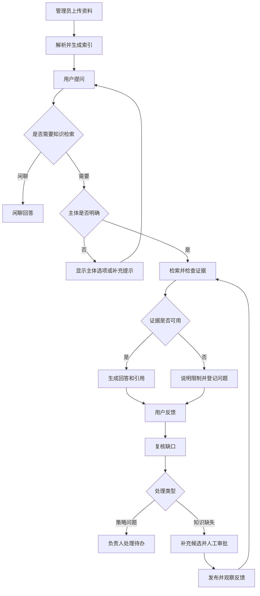

# se_rag 项目 PRD

## 1. 文档基线

- 项目：se_rag 企业知识库客服系统。
- 分支：`codex/agentic-rag-next`。
- 代码基准：当前工作区，包括尚未提交的代码。
- 核对日期：2026-11-05。
- 文档性质：依据现有代码整理的产品要求。

本文件没有新增已承诺的业务范围。它也不代替业务方签字确认。功能描述说明当前实现。验收条款说明应如何检查该实现。

阅读入口：[README](../README.md)、[代码设计](CODE_DESIGN.md)、[技术讲解](TECHNICAL_GUIDE.md)。

## 2. 产品问题

企业知识分散在手册、PDF 和政策文件中。用户难以找到适用的段落。客服人员还需判断资料属于哪个产品，以及政策是否有效。

一次回答失败，也可能有不同原因：

- 资料已经存在，但检索未命中。
- 检索已命中，但系统未读取所需内容。
- 证据已经充分，但回答生成错误。
- 知识库确实缺少资料。

产品需要把这些问题分开处理。只有真实知识缺失才进入知识补录。策略问题应进入处理待办。

## 3. 产品目标

1. 用户可以通过自然语言查询企业资料。
2. 回答可以追溯到检索来源。
3. 主体不明确时，系统先澄清主体。
4. 证据不足时，系统明确说明限制。
5. 价格和售后承诺只能使用有效政策资料。
6. 管理员可以处理缺口，并审批补充知识。
7. 管理员可以观察回答耗时、反馈和知识处理结果。

这些目标没有附带已承诺的准确率、吞吐量或响应时间。对应目标值需要在指定环境中测量后确定。

## 4. 用户与页面

### 4.1 提问用户

使用客服对话页。可以提问、选择主体、查看来源、提交反馈和查看历史。

当前使用浏览器 Cookie 绑定会话。系统没有企业账号登录流程。

### 4.2 知识管理员

使用文档导入页。可以上传产品手册和业务政策，并查看导入状态。

导入接口要求共享导入令牌。当前没有逐用户的导入权限模型。

### 4.3 审批与问题处理人员

使用审批后台。可以查看缺口、候选和问题待办。可以编辑、审批、驳回或下架知识。

后台使用共享审批令牌。这里的人员分类是工作职责。它不是已经实现的角色授权系统。

### 4.4 开发与评测人员

使用测试与评测入口。可以验证代码行为、检索质量和答案质量。真实服务验证必须使用适用的隔离资源。

## 5. 术语

- **主体**：产品、设备或资料主题。代码字段为 `item_name`。
- **文档**：一次导入的 Markdown 或 PDF 资料。
- **父块**：章节级正文。用于补充上下文，不参与向量检索。
- **子块**：用于向量检索的较小文本单元。
- **证据**：本轮实际读取并用于作答的内容。
- **引用**：随答案返回的来源信息。引用不表示已完成逐句核验。
- **知识缺口**：待复核的回答失败信号。
- **知识候选**：待编辑或待审批的补充问答。
- **已发布知识**：通过审批，并满足发布和召回检查的补充问答。
- **接地性**：回答受到证据支持的程度。字段名为 `groundedness`。
- **转交标记**：`handoff_required=true`。它表示需要负责人处理，不表示已经发送外部通知。

## 6. 核心用户流程

此图表示产品流程。不同检索模式的内部步骤见代码设计文档。

## 7. 功能要求

### FR-01：导入产品手册

当前已实现。

1. 管理员输入导入令牌。
2. 管理员选择 UTF-8 Markdown 或 PDF。
3. 前端按文件分别提交请求。
4. 服务返回 `task_ids` 数组。单文件任务标识为 `task_ids[0]`。
5. 页面轮询任务状态，并显示已完成与正在执行的阶段。

每次上传请求只接收一个文件。默认文件上限为 50 MB。后端检查文件名、后缀、大小和文件头。文件头检查不能代替完整解析。

Markdown 跳过 PDF 解析。PDF 依赖兼容当前协议的 MinerU 服务。

源码：[导入路由](../app/api/routers/import_.py)、[导入图](../app/process/import_/agent/main_graph.py)。

### FR-02：导入有效政策

当前已实现。

管理员将资料类型设为 `policy`。必须填写 `document_version` 和未来的 `valid_until`。缺少这些信息时，服务拒绝导入。

默认类型为 `manual`。手册内容不能自动获得政策承诺资格。系统不核实管理员提交的政策是否经过企业内部批准。

源码：[导入参数检查](../app/api/routers/import_.py)、[业务证据规则](../app/rag/query/business.py)。

### FR-03：知识库提问与主体澄清

当前已实现。

输入问题去除首尾空白后，长度必须为 1～4096 字符。系统保留多轮历史，并提取或确认主体。

未确认的主体放入 `item_name_options`。它们不进入已确认的 `item_names`。用户点击选项后，前端发送主体名与原问题意图。系统据此恢复完整问题。

纯主体名称可以回答上一轮的主体反问。该能力依赖服务保存的待确认信息。

源码：[请求模型](../app/api/schema/query_schema.py)、[主体确认](../app/rag/query/item_name_confirm_service.py)。

### FR-04：传统检索

当前已实现。

传统模式并行执行普通检索、HyDE 检索和联网搜索。HyDE 使用假设性文本扩展检索问题。它生成的文本只用于检索。

普通、HyDE 和已审批知识结果使用 RRF 融合。联网结果在重排前加入。系统重排后，可以补充命中子块所属的父块。

联网搜索不可用时，可以继续处理本地结果。主体提取、重排或答案模型失败时，整轮仍可能失败。

源码：[查询图](../app/process/query/agent/main_graph.py)、[RRF](../app/rag/query/rrf_service.py)、[重排](../app/rag/query/rerank_service.py)。

### FR-05：Agentic 检索

当前已实现，按配置启用。

服务器先确定主体范围。进入检索循环后，控制器先执行语义检索，再检查证据。投诉分支直接应用业务处理规则，不进入该循环。

证据不足时，模型从五个只读工具中选择下一步：

- 语义检索。
- 关键词扫描。
- 读取原文及邻块。
- 检索已审批知识。
- 联网搜索。

模型可以缩小主体范围。模型不能扩大服务器确认的主体范围。

控制器限制工具次数、联网次数、证据计量和执行时间。模型草稿通过核验后，才作为正式答案发送。固定失败提示和业务处理提示可以直接发送。

正式答案的发送方式与传统模式的逐段输出不同。

`RAG_MODE=agentic` 还需配合 `RAG_GRAY_PERCENT`。代码默认灰度为 0，因此默认实际选用传统模式。

Agentic 失败不会自动重跑传统流程。系统可以返回补充资料提示和转交标记。

源码：[控制器](../app/rag/agentic/controller.py)、[工具](../app/rag/agentic/tools.py)、[预算和模式选择](../app/rag/agentic/budget.py)。

### FR-06：答案、来源与图像

当前已实现。

答案可以包含正文、引用、图像、主体选项、业务标签和问题标识。

系统只能展示本轮允许的图像。图像链接还需满足服务端筛选与前端渲染规则。正文中出现任意图像 URL，不代表页面会显示该图像。

接地性缺失时显示“未评估”。不得将 `null` 转成 0% 或 100%。Agentic 的二元核验通过，也不产生百分制接地性分数。

引用代表进入上下文的来源。它不保证每个句子都有单独对应的来源。

源码：[答案字段](../app/rag/query/answer_payload.py)、[图像筛选](../app/rag/query/answer_images.py)、[对话脚本](../app/resources/js/chat.js)。

### FR-07：业务问题约束

当前已实现。

- 投诉：返回负责人处理提示，并设置转交标记。
- 价格与售后：只使用带版本且未过期的政策原文。
- 缺少有效政策：明确说明不能确认价格、库存或售后承诺。
- 网页和补充 FAQ：不能代替这些业务承诺所需的政策原文。

业务类型使用关键词规则。它可能误判，也可能漏判。当前没有接入订单、库存、工单或客服消息系统。

源码：[业务规则](../app/rag/query/business.py)、[Agentic 证据规则](../app/rag/agentic/evidence.py)。

### FR-08：会话与刷新恢复

当前已实现，受单进程约束。

同一会话每次只执行一个问题。重复提交返回 409。查询执行期间不能清空历史。

刷新页面后，前端先读取历史和任务快照。任务仍在运行时，前端重新连接 SSE。已保存的同轮回答不能重复显示。

导入页使用当前标签页的存储恢复任务卡片和轮询。导入状态可以回退到磁盘快照。

服务重启不会继续执行中断任务。查询进度和 SSE 不提供跨进程恢复。

源码：[查询准入](../app/rag/query/lifecycle.py)、[事件通道](../app/shared/utils/sse_broker.py)、[导入状态快照](../app/shared/utils/task_snapshot.py)。

### FR-09：用户反馈

当前已实现。

“有帮助”和“已解决”是两个独立维度。用户可以分别提交。刷新历史后，已保存的选择应继续显示。

反馈绑定服务端保存的回答。系统从回答记录读取问题、主体和引用。客户端不能替换这些治理依据。

用户明确提交的解决状态，不能被自动失败信号覆盖。点赞不能自动表示问题已经解决。

源码：[反馈收集](../app/evolution/feedback/collector.py)、[历史接口](../app/api/routers/query.py)。

### FR-10：缺口复核与处理待办

当前已实现，但反馈扫描存在同时间戳边界。

系统结合反馈、引用情况和服务器诊断识别缺口。强信号可以形成缺口记录。弱信号仍保留在反馈事件中，当前不会全部写入缺口集合。

系统区分检索未命中、阅读遗漏、生成错误和知识缺失。策略问题进入待办。管理员可以设置负责人、处理状态和结果。

管理员可以确认知识缺失，或填写原因后忽略缺口。忽略操作保留原始失败信号。它不表示用户问题已解决。

反馈来源具有持久关联和唯一约束。合并规则检查已知产品、会话和业务上下文。本次离线运行中，相同时间戳让后一条反馈未进入该轮扫描。该失败不证明跨产品错误合并，也不能证明相关场景已全部验收。

源码：[缺口扫描](../app/evolution/gap/detector.py)、[缺口复核](../app/evolution/gap/review.py)、[问题待办](../app/evolution/issues.py)。

### FR-11：候选编辑与人工审批

当前已实现。

知识缺失可以生成候选。缺少可靠材料时，候选进入 `need_info`。空答案不能直接发布。

文档来源候选需要通过来源、版本、主体和支持度检查。管理员可以补充人工知识。人工知识仍需保存、审批和内容指纹检查。

审批后，发布任务负责写入索引。召回时再次检查当前发布状态和内容。下架先禁止召回，再重试删除索引。

编辑已发布内容后，旧内容撤回。新内容需要重新审批。

系统无法独立证明人工答案的业务事实。审批记录也没有完整的逐人身份链。

源码：[审批服务](../app/evolution/approval/service.py)、[发布治理](../app/evolution/governance.py)、[召回校验](../app/evolution/retrieval.py)。

### FR-12：上线观察与运行指标

当前部分实现。

已发布补充知识可以按观察窗回测。这里的回测位于发布之后。它主要分析带引用的反馈事件，不是发布前答案验收。

试用指标包括查询耗时、首段文本耗时、模型调用次数、明确解决率、转交率和重复提问率。

费用依赖模型返回的用量和配置单价。缺少这些数据时，费用保持未知。

在线快照的 `recall_k`、`precision` 和 `groundedness` 尚未接通完整计算。不能把字段默认值用作质量结果。

源码：[上线回测](../app/evolution/backtest/runner.py)、[试用指标](../app/evolution/trial_metrics.py)、[调用指标](../app/shared/runtime/query_metrics.py)。

## 8. 非功能要求与当前边界

### 8.1 可用性

可选能力失败时，应保留可用的主流程。错误必须包含机器码和可读提示。不能将所有服务故障都描述为可自动恢复。

导入任务有重试和并发限制。知识发布任务有持久重试记录。两者不是同一种任务机制。

### 8.2 性能

传统流程可以并行检索。Agentic 流程使用共享截止时间。同步本地模型推理不能被强制中断，因此默认 60 秒是执行预算，不是所有调用的硬中断保证。

验收时应固定硬件、模型、资料规模和并发数。项目当前没有统一的 P95 响应时间承诺。

### 8.3 数据与安全

浏览器会话必须绑定归属 Cookie。会话 ID 本身不是访问凭据。后台管理接口必须检查共享令牌。

当前没有企业账号、租户隔离、细粒度角色权限和统一保留期限。候选脱敏只覆盖有限规则。原问题和资料可能进入所配置的模型服务。

同名文档可覆盖同一知识标识。管理员应使用稳定且唯一的文件标题。

### 8.4 部署

查询服务必须使用一个 worker。主机文件锁不能提供跨主机选主。导入并发限制也只作用于单个进程。

MongoDB、Milvus 和 MinIO 之间没有跨库事务。对账告警不能视为自动修复。

## 9. 验收场景

以下为验收要求。测试文件表示已有检查入口，不表示本次全部通过。

### AC-01：资料导入

上传小型 UTF-8 Markdown。任务完成后，子块应能被检索，父块应能关联。错误文件应返回明确错误。

自动检查：[上传校验](../tests/unit/test_import_upload_guard.py)、[写入顺序](../tests/unit/test_import_index_atomicity.py)、[两级切分](../tests/unit/test_split_two_level.py)。真实服务检查使用 `tests/e2e`。

### AC-02：问答与澄清

对已导入资料提问。主体已知时，应进入检索。主体未确认且存在相似候选时，应提供主体选项。没有候选时，应提示补充产品名称。点击选项后，系统应保留原问题意图。

自动检查：[选项意图](../tests/unit/test_query_option_intent.py)、[澄清恢复](../tests/unit/test_query_pending_clarify.py)。

### AC-03：Agentic 证据检查

开启 100% 灰度。检查工具调用、预算停止和核验结果。未读取证据、撤回来源和过期政策不能支撑答案发布。

自动检查：[控制器](../tests/unit/test_agentic_controller.py)、[工具](../tests/unit/test_agentic_tools.py)。

### AC-04：流式输出与刷新

在查询期间刷新页面。页面应接回同一轮任务。最终回答只显示一次。导入页刷新后，不得自动重复上传文件。

自动检查：[查询恢复](../tests/unit/test_query_resume.py)、[SSE](../tests/unit/test_sse_broker.py)、[前端恢复测试](../tests/frontend/chat_resume.test.cjs)、[导入恢复测试](../tests/frontend/import_resume.test.cjs)。

### AC-05：反馈与缺口

分别提交帮助反馈和解决反馈。刷新后，两类反馈均应保留。旧反馈重扫不应重复派单。不同已知产品不得被错误合并。

自动检查：[反馈恢复](../tests/frontend/feedback_restore.test.cjs)、[缺口回放去重](../tests/unit/test_gap_replay.py)。不同产品参数用例有同时间戳扫描失败记录，需要修复后重新验收。

### AC-06：审批与撤回

创建待补充候选。补充答案后审批。确认已发布条目可以召回。撤回后，即使向量删除暂时失败，也不得继续召回旧条目。

自动检查：[发布治理](../tests/unit/test_agentic_governance.py)、[人工知识](../tests/unit/test_manual_knowledge.py)。

### AC-07：政策和投诉

使用无政策、过期政策和有效政策分别查询价格与售后。无有效政策时，系统不得给出确认承诺。投诉应产生负责人处理提示。

自动检查：[内部试用规则](../tests/unit/test_internal_trial.py)、[业务与接口检查](../tests/unit/test_trial_api.py)。

## 10. 评估口径

- **明确解决率**：报告窗口内，用户明确标记已解决的 RAG 回答数，除以 RAG 查询轮数。
- **解决反馈覆盖率**：具有明确解决或未解决反馈的 RAG 回答数，除以 RAG 查询轮数。
- **转交率**：带转交标记的 RAG 查询轮数，除以 RAG 查询轮数。
- **重复提问率**：同一会话中，相同问题哈希的重复次数，除以 RAG 查询轮数。
- **资料补齐耗时**：缺资料待办从创建到完成的平均时间。

试用报告默认观察近 24 小时。每类读取最多 10000 条记录。大流量下需注意样本上限。

“有帮助”不等于“已解决”。没有解决反馈也不等于已解决。接地性分数也不能替代解决率。

## 11. 发布前仍需完成的工作

以下项目是待验证或待设计事项，不是当前已交付能力：

1. 完成评测题库的人工复核，并建立可信答案基线。
2. 修复反馈扫描的同时间戳边界，并复核相关去重场景。
3. 在指定环境验证解析、模型、数据库和图像访问。
4. 测量目标并发下的延迟、资源占用和模型费用。
5. 根据使用范围补充账号权限、租户隔离和数据保留规则。
6. 为多实例部署设计共享任务状态、事件通道和调度选主。

本次代码核对不能替代这些验证。
