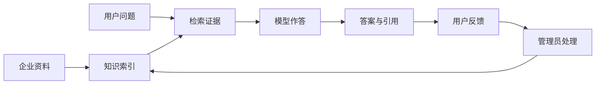
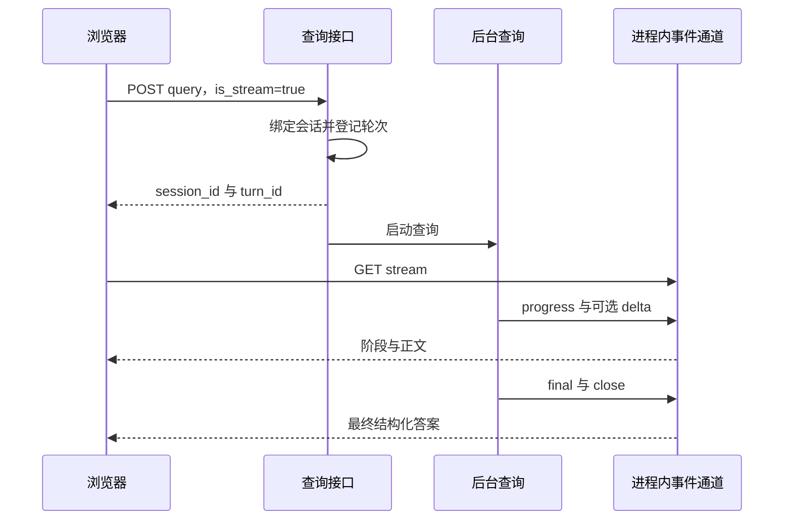

# se_rag 项目技术讲解

## 1. 阅读范围

本文面向需要理解整个项目的开发者和技术读者。本文依据 `codex/agentic-rag-next` 分支的当前工作区编写。核对日期：2026-11-05。

先阅读 [README](../README.md)了解运行方法。产品流程见 [PRD](PRD.md)。字段、接口和模块边界见[代码设计文档](CODE_DESIGN.md)。

本文先定义术语，再解释处理步骤。示例问题只用于说明流程，不代表任何产品的真实技术参数。

## 2. 项目解决什么问题

大模型可以生成通顺的文字。但它不一定知道企业当前使用的手册，也不一定知道最新政策。

本项目在回答前检索企业资料。模型使用本轮资料作答，并返回来源。这种方式称为检索增强生成，简称 RAG。

项目还有一条反馈处理流程。它把失败问题交给管理员。管理员可以修复检索策略，也可以补充知识。



“知识自进化”指这条知识管理流程。系统没有在此流程中训练模型权重。

## 3. 先认识五个核心概念

### 3.1 主体

主体表示用户正在询问的产品、设备或资料主题。代码字段为 `item_name`。

问题“如何维护这台设备”缺少明确主体。系统需要从历史中确认设备，或要求用户选择设备。否则，相似手册中的段落可能互相干扰。

主体目录位于 [app/rag/item_name](../app/rag/item_name)。导入和查询共用名称匹配规则。这样可以把名称变体对齐到已有标准名。

### 3.2 子块

子块是检索单元。一本手册太长，不能每次完整送入模型。系统把手册拆成较小文本，并分别生成向量。

子块保存正文，还保存标题路径、页码、父块 ID 和文档版本。检索命中后，系统可以定位来源。

### 3.3 父块

父块保存较大的章节内容。它帮助解释子块附近的条件、定义或步骤。

项目采用先检索子块、再读取父块的方式。小块便于找到相关内容。父块补充语义背景。

父块保存在 MongoDB。它不生成检索向量。入口为 [parent_chunk_repository.py](../app/shared/clients/parent_chunk_repository.py)。

### 3.4 证据

证据是本轮真正读取的内容。它可能来自子块、父块、已审批知识或网页快照。

“搜索到了一个标题”与“已经读取原文”是不同状态。Agentic 流程会检查这一区别。

### 3.5 引用

引用告诉用户本轮使用了什么来源。它可以包含块 ID、资料标题、页码或网页地址。

引用表示来源进入了上下文。当前系统没有保证每个答案句子都与单独引用一一对应。

## 4. 一份文档如何进入知识库

假设管理员上传一份 `device-manual.pdf`。系统按以下顺序处理。

### 4.1 接收与校验

导入服务先检查令牌。然后检查文件数量、文件名、后缀、大小和文件头。一个请求只接收一个文件。

文件保存到本次任务目录。接口立即返回 `task_ids` 数组，再通过后台任务启动导入图。单文件任务标识为 `task_ids[0]`。网页使用该标识查看进度。

上传成功只表示文件已经接收。任务状态变成 `completed` 后，才表示导入流程已经完成。

相关代码：[导入路由](../app/api/routers/import_.py)、[导入执行入口](../app/rag/import_/pipeline.py)。

### 4.2 将 PDF 转成可处理内容

PDF 通过 MinerU 服务转换。应用先申请上传地址，再上传文件。之后，应用轮询解析状态。解析完成后，应用下载结果压缩包。

解析结果通常包含 Markdown、图像和结构清单。系统优先选择匹配原文件名的 Markdown，也可使用 `full.md`。

Markdown 文件跳过该步骤。MinerU 服务需要兼容当前代码使用的批次上传与结果查询协议。

相关代码：[pdf_parse_service.py](../app/rag/import_/pdf_parse_service.py)。

### 4.3 理解与保存图像

图像增强服务查找 Markdown 同目录 `images/` 中被正文引用的图像。视觉模型根据图像和附近文字生成摘要。服务将图像上传到 MinIO，再替换正文引用。

这一步让图像说明可以参与后续文本检索。回答时，图像仍需通过筛选才能显示。

单张图像处理失败时，系统可以跳过该摘要或保留原引用。只上传一个含本地图像链接的 Markdown 文件，并不会同时上传配套图像目录。

相关代码：[enrich_markdown_images.py](../app/rag/import_/enrich_markdown_images.py)、[minio_gateway.py](../app/shared/clients/minio_gateway.py)。

### 4.4 保留文档结构

普通的定长切分可能把表头与数据分开，也可能把操作步骤的前提丢掉。本项目先识别结构，再切分内容。

存在可读取的 `*_content_list.json` 时，系统解析其中的标题、页码和块类型。

文件缺失、JSON 读取失败、列表校验失败或归一化结果为空时，系统回退到 Markdown。其他结构归一化异常仍可能导致导入失败。

切分器先建立章节父块，再生成本节子块。长表格拆分时重复表头。长代码拆分时补齐代码围栏。

默认正文目标长度为 `600` 字符。单个原子块超过 `1000` 字符时，再执行内部拆分。只有这种拆分使用默认 `50` 字符重叠。

这些参数控制正文打包。它们不表示输出文本始终具有固定长度。

相关代码：[结构清单解析](../app/rag/import_/content_list.py)、[Markdown 解析](../app/rag/import_/markdown_blocks.py)、[章节切分](../app/rag/import_/section_splitter.py)。

### 4.5 确认主体

模型读取前若干子块，识别资料主体。默认读取前 `10` 个子块。识别为空时，使用文件标题。

共享匹配服务再把名称对齐到目录中的标准名。最终名称回填到父块和子块。

主体识别发生在文档切分之后。它不是 PDF 解析前的步骤。

相关代码：[item_name_service.py](../app/rag/import_/item_name_service.py)。

### 4.6 生成两类向量

向量是文本的数值表示。本项目使用 BGE-M3，在应用进程内生成两类向量。

- 稠密向量：每段文本使用固定长度的数值序列。它用于发现语义相近的内容。
- 学习型稀疏向量：只保留部分维度及其权重。它补充词项相关信号。

两类向量来自同一个模型。稀疏向量不能直接称为项目已建立的 BM25 全文索引。

导入和查询必须使用兼容的向量模型与索引维度。只改变查询侧模型，不会自动重建已有向量。

相关代码：[embedding.py](../app/shared/models/embedding.py)、[embedding_service.py](../app/rag/import_/embedding_service.py)。

### 4.7 写入三个存储

Milvus 保存主体名与子块向量。MongoDB 保存完整父块和业务记录。MinIO 保存图像。

子块采用确定性 ID。重复导入可以更新同一 ID。全部新块写入后，代码再清理同名文档的残留旧块。

文档 ID 由规范化后的文件标题生成。它没有包含租户或文件内容。因此，同名文件可能覆盖同一知识范围。位置 ID 也不能代替内容摘要。

三个存储没有跨库事务。导入后的对账只报告差异。它不能自动恢复所有部分失败。

相关代码：[ids.py](../app/rag/import_/ids.py)、[index_service.py](../app/rag/import_/index_service.py)、[reconcile.py](../app/rag/import_/reconcile.py)。

## 5. 一个问题如何得到回答

假设用户提问：“设备 A 如何清洁？”其中“设备 A”是示例主体。

### 5.1 绑定会话并登记轮次

服务使用 Cookie 检查会话归属。会话 ID 用于定位数据，不能单独作为访问凭据。

服务为本次问题分配 `turn_id`。同一会话已有问题在执行时，新问题返回 409。这样可以避免两轮状态和流式事件相互覆盖。

相关代码：[session_access.py](../app/api/session_access.py)、[lifecycle.py](../app/rag/query/lifecycle.py)。

### 5.2 区分闲聊和知识问题

纯寒暄可以按规则进入闲聊分支。其他输入可以使用分类模型。分类超时或失败时，系统默认进入知识问答。

闲聊分支不执行知识检索。闲聊结果也不会因没有引用而自动形成知识缺口。

相关代码：[intent_route_service.py](../app/rag/query/intent_route_service.py)、[chitchat_service.py](../app/rag/query/chitchat_service.py)。

### 5.3 确认设备与问题意图

系统根据当前问题和历史确认主体，并改写成适合检索的问题。

主体未确认且存在相似候选时，系统返回选择项。没有候选时，系统提示补充产品名称。

用户选择后，前端通过 `rewrite_hint` 带回原问题意图。系统可以直接拼装完整问题。

这能避免把“清洁方法”错误改写成历史中的其他话题。未确认选项不会直接成为检索主体。

相关代码：[item_name_confirm_service.py](../app/rag/query/item_name_confirm_service.py)。

### 5.4 选择检索模式

传统模式执行固定步骤。Agentic 模式根据已有证据选择后续工具。

模式按会话分桶。相同会话在相同配置下保持相同选择。默认 `RAG_MODE=agentic`，默认灰度比例为 `0`。因此，仅使用源码默认值仍会进入传统模式。

相关代码：[budget.py](../app/rag/agentic/budget.py)、[查询图](../app/process/query/agent/main_graph.py)。

## 6. 传统检索为什么需要多条路径

### 6.1 普通语义检索

系统把问题转成稠密和稀疏向量，再到 Milvus 中搜索。查询还使用已确认主体作为过滤条件，并允许全局资料。

默认混合权重为稠密 `0.6`、稀疏 `0.4`。这些权重影响召回排序。它们不表示回答正确率。

相关代码：[chunk_search.py](../app/rag/query/chunk_search.py)。

### 6.2 HyDE 检索

问题与手册可能使用不同词语。HyDE 先生成假设性说明，再用该说明辅助检索。

假设性说明可能有错误。因此，系统应使用检索回来的真实内容作答。不能把假设性说明直接当作事实。

项目有一个可选开关，用于让短事实问题跳过 HyDE。该开关默认关闭。

相关代码：[hyde_search_service.py](../app/rag/query/hyde_search_service.py)。

### 6.3 联网搜索

联网结果提供额外背景。它们通过 MCP 获取。服务不可用时，可以继续使用本地结果。

联网信息不自动具有企业政策效力。价格和售后承诺仍需要有效政策原文。

相关代码：[mcp_web.py](../app/shared/clients/mcp_web.py)、[web_search_service.py](../app/rag/query/web_search_service.py)。

### 6.4 RRF 融合

不同检索路径的原始分数不容易直接比较。RRF 是倒数排名融合。它使用排名位置合并结果。

默认 `k=60`。某块在一路排第 `1`，贡献为 `1/61`。它在另一路排第 `3`，贡献为 `1/63`。两路等权时，总分约为 `0.03227`。

同一块在多路靠前出现时，它更可能进入融合结果。这个分数仍不表示答案正确概率。

项目只把普通、HyDE 和已审批知识结果放入 RRF。网页在后续重排时加入。

相关代码：[rrf_service.py](../app/rag/query/rrf_service.py)。

### 6.5 重排与父块回溯

召回先找候选。BGE-Reranker 再逐一比较问题与候选正文，生成更细的相关分数。

系统按分差动态截断候选。已召回 FAQ 可以补回。因此，默认 Top 数不是最终结果条数的严格上限。

重排之后，系统读取命中子块所属的父块。父块受单块和总字符预算限制。它补充背景，不替代命中子块的来源身份。

相关代码：[rerank_service.py](../app/rag/query/rerank_service.py)、[parent_expand_service.py](../app/rag/query/parent_expand_service.py)。

## 7. Agentic 如何按证据选择步骤

### 7.1 固定图与检索控制器的区别

传统模式事先规定所有检索步骤。Agentic 控制器在每次得到结果后，检查还缺少什么。

例如，初始语义搜索没有找到所需步骤。控制器可以调用 `keyword_search` 查找候选摘要，再用 `read_chunk` 读取原文。预算不足时，控制器停止。

这只是流程示例。实际动作由控制器、工具结果和决策模型共同决定。

### 7.2 工具的具体作用

`semantic_search` 查找语义相关内容。`keyword_search` 查找字面词。后者采用有界扫描，默认最多扫描 `500` 条，不是独立全文搜索服务。

`read_chunk` 读取原文，并可扩展同文档、同版本邻块。`search_approved_faq` 读取仍然有效的已审批知识。`web_search` 读取网页快照。

工具由服务器约束范围。模型不能凭动作参数访问任意产品资料。

相关代码：[tools.py](../app/rag/agentic/tools.py)。

### 7.3 检查证据是否支持回答

控制器把覆盖情况分为充分、缺失或冲突。只有证据已经读取，引用 ID 存在，且覆盖充分时，才进入答案起草。

证据带有正文 SHA-256。这个摘要用于判断实际使用的内容是否发生变化。起草前和核验后还会复查本地资料与 FAQ 的当前状态。

网页证据保留为带时间戳的搜索快照。系统不会在复查时重新抓取网页。

摘要可以检查内容是否变化。它不能独立证明资料内容真实。

相关代码：[contracts.py](../app/rag/agentic/contracts.py)、[evidence.py](../app/rag/agentic/evidence.py)。

### 7.4 限制循环成本

默认预算为四次工具调用、一次联网调用、一次草稿修复和六十秒。进入检索循环后，初始语义检索占用一次工具调用。投诉分支直接应用业务规则，不进入检索循环。

证据计量默认上限为 `8000`。未配置 tokenizer 时，代码使用 UTF-8 字节上界。这个值只约束工具证据累计量，不等于完整提示词 token 上限。

重复动作、连续没有新证据、预算耗尽和超时都可以停止循环。同步本地模型推理不能被强制取消，因此六十秒不能解释为所有工作的硬停止时间。

### 7.5 核验后再发送正文

控制器先起草，再核验。模型草稿核验通过后，一次发送完整正文。固定失败提示和业务处理提示可以直接发送。传统模式可以在模型生成时逐段发送。

因此，Agentic 的首次正文出现时间可能更晚。评估体验时，需要同时看首次正文时间、完整答案时间和答案质量。

核验失败且不能修复时，系统给出资料补充或负责人核实提示。它不会自动再跑一遍传统流程。

相关代码：[controller.py](../app/rag/agentic/controller.py)。

## 8. 答案如何变成网页内容

### 8.1 业务规则先限制承诺

系统用规则区分产品知识、故障处理、价格、售后和投诉。

投诉产生负责人处理提示。价格与售后只允许使用带版本且未过期的政策资料。没有这类证据时，系统明确说明不能确认承诺。

`handoff_required` 只是转交标记。系统没有因此自动发送消息、创建外部工单或修改订单。

相关代码：[business.py](../app/rag/query/business.py)。

### 8.2 统一答案字段

同步响应和流式最终事件使用统一的答案字段，包括正文、引用、图像、主体选项、接地性和指标。

历史接口返回已保存的正文、引用、图像、接地性和反馈。它不返回完整执行指标或主体选项字段。

接地性为 `null` 时，表示没有有效评估结果。Agentic 核验通过也不会将它改成 100%。

图像必须先由服务端选入允许列表，再由前端渲染。图像只是与回答相关时才显示。任意远程图片链接不会自动成为答案图片。

相关代码：[answer_service.py](../app/rag/query/answer_service.py)、[answer_payload.py](../app/rag/query/answer_payload.py)、[answer_images.py](../app/rag/query/answer_images.py)。

### 8.3 流式事件与刷新



网页刷新会断开连接，但后台任务可以继续执行。前端读取历史与当前任务状态，再接回事件通道。

事件通道在进程内。它保留有限缓冲，不是持久消息队列。服务重启、多 worker 和多个并行订阅都有当前实现边界。

相关代码：[sse_broker.py](../app/shared/utils/sse_broker.py)、[chat.js](../app/resources/js/chat.js)、[import.js](../app/resources/js/import.js)。

## 9. 一次负反馈如何得到处理

### 9.1 先绑定真实回答

用户可以分别提交“没有帮助”和“未解决”。反馈处理先找到服务端保存的回答，再读取对应问题、主体和引用。

这可以避免直接使用客户端提交的产品与来源作为治理事实。已保存的用户解决状态优先于自动失败信号。

### 9.2 判断失败属于哪一类

没有命中不一定表示知识不存在。系统区分检索未命中、阅读遗漏、生成错误和知识缺失。

前三类进入策略待办。管理员可以指定负责人，并保存处理结果。只有知识缺失进入补充知识候选流程。

当前只有强缺口写入缺口集合。弱信号保留在反馈事件中。不能把没有候选解释为调度一定没有运行。

### 9.3 防止旧反馈重复派单

系统用来源键把反馈与缺口关联。扫描确认失败后，可以根据持久关联恢复。合并还检查问题和已知上下文。

当前扫描使用时间戳游标。同时间戳事件可能在紧接的一轮被排除。因此，本次测试没有证明这部分已全部通过。

“缺口回放去重”表示旧信号不应重复生成待办。它不表示补录后会自动重跑原问题，并证明答案已经修复。

相关代码：[collector.py](../app/evolution/feedback/collector.py)、[detector.py](../app/evolution/gap/detector.py)、[issues.py](../app/evolution/issues.py)。

## 10. 补充知识如何安全发布

### 10.1 生成候选

候选生成器只处理知识缺失。它可以从有限上下文中组织问答。没有可靠证据或没有事实答案时，生成待补充候选。

候选不是在线知识。管理员需要检查问题、答案、产品范围和来源。

候选生成后有有限隐私规则。规则主要识别部分手机号、身份证和邮箱。它不覆盖所有隐私。原始输入还可能已经发送到配置的模型服务。

### 10.2 人工编辑与审批

文档来源候选需要检查来源是否存在、内容是否变化、产品是否一致，以及政策是否过期。人工补充没有来源时，必须保留人工保存和审批信息。

审批绑定内容摘要和版本。审批期间内容变化时，系统不能继续发布原审批对象。

人工审批不能让系统独立证明业务事实。共享令牌也不能提供完整的逐人审批身份。

### 10.3 持久发布与撤回

发布需要同时更新 Mongo 和 Milvus。两者不能使用当前代码中的跨库事务。因此，系统保存发布任务，并使用确定性 ID 和重试保证可恢复执行。

在线召回以 Mongo 当前状态为准。下架先改变状态，再删除向量。即使删除暂时失败，旧向量也不能继续获得有效发布资格。

编辑已发布知识会撤回旧内容。修改后的内容需要重新审批。

### 10.4 发布后的观察

回测读取已发布条目的反馈。它默认观察七天。样本不足时继续观察。拒绝过多时可以下架。

这项回测发生在发布之后。它不是发布前的标准答案考试。反馈命中数也不能代替全量曝光数。

自动调参默认关闭。开启后，只调整少数检索参数。它不训练大模型，也不自动修复业务资料。

相关代码：[候选生成](../app/evolution/candidate/generator.py)、[审批](../app/evolution/approval/service.py)、[发布治理](../app/evolution/governance.py)、[上线回测](../app/evolution/backtest/runner.py)、[调参](../app/evolution/tuning/controller.py)。

## 11. 测试与评测

### 11.1 先区分代码测试与质量评测

代码测试检查明确的行为。例如，重复请求是否返回 409，撤回知识是否不能再召回。

检索评测检查相关块是否进入候选。答案评测检查最终回答是否忠实、相关和正确。一个层面的测试通过，不能代替另一个层面的验收。

### 11.2 离线代码测试

```powershell
uv run python -m pytest -q

$frontendTests = (Get-ChildItem -LiteralPath tests/frontend -Filter *.test.cjs).FullName
node --test $frontendTests
```

Python 默认排除真实 E2E。离线夹具阻止真实存储连接。前端测试使用 Node 自带的测试能力。

### 11.3 本地题库校验

以下命令默认只检查本地数据，不采集真实答案，也不评分：

```powershell
uv run python -m app.rag_eval.answer_quality
uv run python -m app.rag_eval.agentic_comparison
uv run python -m app.rag_eval.full_flow
```

本次执行得到答案题 `40` 条、意图题 `200` 条，人工复核数均为 `0`。默认 Agentic 对比也使用这份答案题库。另有 `4` 条 Agentic 扩展草稿题，需通过 `--cases` 显式指定。

草稿校验成功只说明数据结构和相关文件检查成功。它不能产生可信答案基线。扩展场景还包含未准备完成的夹具。

相关代码：[answer_quality.py](../app/rag_eval/answer_quality.py)、[agentic_comparison.py](../app/rag_eval/agentic_comparison.py)、[full_flow.py](../app/rag_eval/full_flow.py)。

### 11.4 真实答案评分

真实评分需要可选评测依赖。`eval` 依赖组固定了 Ragas 与兼容包版本。

```powershell
uv sync --locked --group dev --group eval
```

还需显式配置 `EVAL_LLM_MODEL`。评测服务地址和密钥可以单独设置。指标包括忠实度、答案相关性和事实正确性。

准备并复核题库、配置独立评测资源后，再使用 `--allow-external`。例如：

```powershell
uv run --group eval python -m app.rag_eval.answer_quality --allow-external
```

真实答案采集要求 Mongo 数据库、切片集合和主体名集合使用 `eval_` 前缀。知识写入必须关闭。

总开关或 FAQ 召回任一开启时，必须关闭调度和自动调参。FAQ 召回开启时，还必须使用独立的 `eval_` FAQ 集合。

`.env` 会覆盖同名进程配置。隔离配置必须在最终加载后仍然满足检查。只在终端临时改一个数据库名，不足以完成整套隔离。

`--allow-unreviewed` 仅用于草稿调试。它不会把草稿变成可信基线。评测失败的指标保持 `null`，并单独报告覆盖率。

旧的 `RagEvalTester.run_insert_test_data()` 会写入当前配置资源。旧的 `run_eval()` 也没有上述答案采集隔离前置检查。使用前需要独立核对资源。

### 11.5 隔离网页联调与 E2E

[ui_trial.py](../app/rag_eval/ui_trial.py)提供独立入口。它根据一次运行标识生成整套 Mongo、Milvus 和 MinIO 名称。

`prepare` 会读取现有资料。它只复制 HAK 180、HL-3040 和 ER 2100 对应规则匹配的资料。当前命令没有产品选择参数。其他产品资料可能不会被复制。

执行前需要来源资料可读，以及服务和模型配置完整。该命令不能完成空环境安装。

以下命令会创建测试资源。按顺序执行。保存 `$trialRun`，后续终端使用同一个值。

```powershell
$trialRun = 'ui_test_20261105_' + [guid]::NewGuid().ToString('N').Substring(0, 8)
uv run python -m app.rag_eval.ui_trial prepare --run $trialRun
```

在两个终端中分别启动服务：

```powershell
uv run python -m app.rag_eval.ui_trial serve-query --run $trialRun --mode agentic
```

```powershell
uv run python -m app.rag_eval.ui_trial serve-import --run $trialRun
```

新终端需先把 `$trialRun` 设为准备步骤产生的完整标识。试用查询端口为 `8011`，导入端口为 `8010`。后台令牌为运行标识加 `-admin`。导入令牌为运行标识加 `-import`。

独立运行 E2E 时执行：

```powershell
uv run python -m app.rag_eval.ui_trial e2e --run $trialRun --mode agentic
```

E2E 需要真实数据库、图像存储、模型与相应配套服务。该入口保留测试数据。隔离使用逻辑资源名，不是独立物理账户。原手册图像还可能继续使用原 URL。

### 11.6 本次验证记录

核对日期：2026-11-05。运行环境使用仓库已有的 Python 3.12 虚拟环境，以及 Node.js 22。

- Python 离线全量：`850 passed, 6 skipped, 1 deselected, 1 failed`。
- 前端测试：`38 passed`。
- 三个默认评测入口：本地校验成功。
- 题库：尚未达到人工复核基线条件。
- 真实 E2E、模型评分和网页手工验收：本次未执行。

失败用例为 `test_persistent_coalescing_keeps_known_contexts_separate[different0]`。复核确认，相同时间戳可能被严格递增游标排除。

对 `test_gap_replay.py` 的一次定向复跑得到 `3 failed, 20 passed`。相关检查存在时间依赖。

本次保留业务代码。不能将这些结果写成“全部测试通过”。

## 12. 如何定位常见问题

### 12.1 HTTP 健康，但无法问答

先检查会话归属存储是否可用。然后检查模型配置、模型文件与 Milvus 连接。最后使用明确存在于资料中的问题验证检索。

健康接口主要确认 HTTP 和静态资源。它没有完成这些业务检查。

### 12.2 上传失败或导入失败

先区分 HTTP 上传失败与后台任务失败。检查导入令牌、大小和 UTF-8 编码。PDF 再检查 MinerU 状态与结果协议。

当前上传检查接受大小写后缀，但图入口使用区分大小写的分流。优先使用小写 `.md` 和 `.pdf`。

### 12.3 任务完成，但召回为空

检查主体名是否与实际写入名称一致。检查集合 schema 与向量维度。再检查 `CHUNK_DENSE_METRIC` 是否与索引一致。

查看导入对账日志。父块失败可能只影响背景补充。子块没有写入，则会影响主要召回。

### 12.4 已审批知识没有出现

先检查发布任务是否完成。再检查 Mongo 当前状态、摘要、来源和政策有效期。最后检查实际查询模式与知识召回开关。

传统流程还有部分外层总开关检查。因此，“总开关关闭、独立召回开启”不能保证传统流程仍召回 FAQ。

### 12.5 看不到知识候选

检查知识写入与调度开关。查看缺口类型和跳过原因。策略问题会进入待办。弱信号也可能只保留在反馈集合中。

不要通过重复提交差评来替代这些检查。先确认原反馈与缺口的持久关联。

### 12.6 刷新后内容异常

先检查浏览器是否保留原 Cookie 和会话 ID。再检查服务是否已经重启。最后检查页面资源版本。

同进程刷新恢复不能恢复已终止的后台执行。旧脚本也可能产生不同的显示行为。

## 13. 建议的源码阅读顺序

1. 阅读 [pyproject.toml](../pyproject.toml)，确认运行依赖和测试配置。
2. 阅读 [settings.py](../app/shared/config/settings.py)与领域 `config.py`，确认开关和默认值。
3. 阅读两个 [HTTP 入口](../app/api/http/query_server.py)与[导入入口](../app/api/http/import_server.py)，确认进程生命周期。
4. 阅读[查询路由](../app/api/routers/query.py)和[导入路由](../app/api/routers/import_.py)，确认外部契约。
5. 阅读两张图与状态：[查询图](../app/process/query/agent/main_graph.py)、[导入图](../app/process/import_/agent/main_graph.py)。
6. 按节点进入业务服务。先追一条成功路径，再看降级与错误分支。
7. 阅读 [Agentic 控制器](../app/rag/agentic/controller.py)和证据工具。
8. 阅读[调度器](../app/evolution/scheduler.py)、[发布治理](../app/evolution/governance.py)和[反馈收集](../app/evolution/feedback/collector.py)。
9. 阅读对应测试，确认哪些边界已有断言。
10. 使用隔离资源执行一个完整业务场景，再评估质量与性能。

阅读时持续区分三件事：代码中存在的能力、测试实际通过的行为，以及真实环境已经验收的结果。
