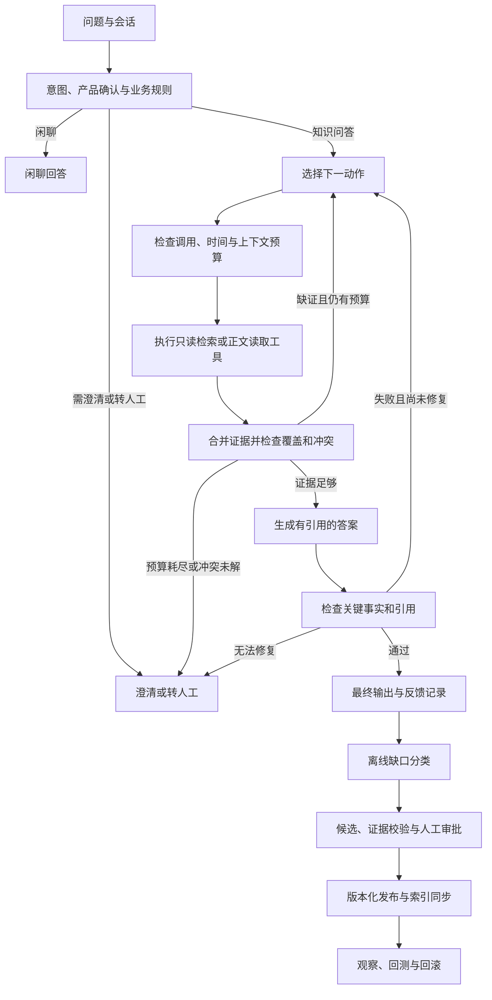

# 自进化 RAG 架构升级评估

评估日期：2026-10-23。代码基点：`a7d3321d1bd427f0d005febb79fd5b96611d9671`。评估分支：`codex/agentic-rag-architecture`，从本地 `master` 创建。

本文是设计建议，不代表实现或性能验证。代码结论来自该基点的静态检查。论文机制来自原始论文和作者仓库。收益、预算和工期均为待验证的工程判断。

图示采用 Mermaid。本次环境未发现与该工作区匹配的托管 Canvas 目录，因此不创建 Canvas 文件。

## 1. 结论

建议采用**有预算限制的 Agentic RAG + A-RAG 分层检索工具 + 独立的知识治理闭环**。

保留 FastAPI、LangGraph、Milvus、MongoDB、BGE-M3、重排器和现有人工审批。把固定检索链改为可选择工具、检查证据和补充检索的查询循环。简单问题仍走低成本路径。

第一阶段不建设全量知识图谱。完成基线后，再用 HippoRAG 2 做多跳问题的隔离实验。只有实验显示稳定收益，才把图检索作为一个工具接入。

理由：现有模块已能提供大部分检索能力。主要缺口在查询控制、证据契约和版本治理。更换全部检索基础设施会增加迁移成本，不能直接解决这些缺口。

## 2. 分支操作与保留内容

- 删除的本地分支为 `codex/rag-internal-trial`。删除前，它与 `master` 都指向 `a7d3321`，没有仅存在于旧分支的提交。
- 旧分支仍被独立工作区占用。因此，先将该工作区切换到同一提交的分离 HEAD，再执行普通分支删除。
- 旧工作区中的 `.idea/se_rag.iml` 和 `app/shared/config/settings.py` 改动保持原样。没有删除工作区目录。
- 新分支为 `codex/agentic-rag-architecture`。未操作远端分支；本地跟踪信息显示旧远端分支已不存在。
- 主目录已有的两个 HTML 文件和 IDE 配置改动均保留。本次仅新增评估文档。

## 3. 现有系统：可以复用什么

### 3.1 查询链

`app/process/query/agent/main_graph.py:35` 定义意图路由。知识问答先确认产品主体，再固定调用直接检索、HyDE 和联网检索，随后执行 RRF、重排、父章节展开和作答。图中没有证据不足后的回边。

`app/rag/query/chunk_search.py:51` 已使用 BGE-M3 的稠密、稀疏向量混合检索，并按产品名称和全局条目过滤。它不是单一稠密向量检索。BGE 稀疏向量也不等同于精确关键词检索。

`app/rag/query/parent_expand_service.py:28` 已实现 Small-to-Big，并限制父章节字符预算。现有数据已有 `chunk_id`、`doc_id`、`parent_id`、`seq` 和页码。它们可支撑“检索摘要后再读正文”，但目前没有完整的句子级索引。

`app/rag/query/pipeline.py:25` 维护会话、任务状态和 SSE 结束事件。新架构必须保留这一入口契约。

### 3.2 自进化闭环

`app/evolution/scheduler.py:116` 已调用缺口扫描、候选生成、指标记录、参数调整和回测。系统已有知识维护能力，但不训练或更新回答模型的权重。

`app/evolution/candidate/generator.py:66` 会把无证据问题转入 `need_info`。`app/evolution/approval/service.py:40` 保留人工审批，并在向量写入失败时回退候选状态。`app/evolution/backtest/runner.py:37` 按引用反馈决定保留、提升或下架。

`app/evolution/tuning/controller.py:37` 根据采纳率变化调整 RRF 和重排参数。它有样本量检查和稳定快照回退，但仍属于启发式控制。代码不能证明参数变化导致了质量变化。

### 3.3 评测与业务规则

当前 `master` 已包含 Ragas 评测及 `answer_contexts`。无需重做此前功能。`app/rag_eval/answer_quality.py:81` 支持证据快照、独立评分模型和基线比较。`app/rag_eval/full_flow.py` 可评测完整 HTTP 路由。

`app/rag/query/business.py:41` 对投诉、价格和售后执行明确规则。价格和售后答案要求有效政策资料。Agent 必须服从这些规则，不能用联网内容或历史回答替代有效政策。

## 4. 可行性比较

### 4.1 有限制的 Agentic RAG：作为主架构，工程可行性高

Agent 根据问题和已有证据选择检索、读取、补充检索或结束。LangGraph 继续负责状态、预算和确定性路由。一个控制器即可完成第一版，无需先引入多 Agent。

预期收益是减少不必要的 HyDE、联网调用，并让跨章节问题补齐证据。代价是额外的决策调用、停止条件和失败处理。实际延迟可能升高，须按问题类型实测。

### 4.2 A-RAG：作为工具接口设计，工程可行性高

本文中的 A-RAG 指 2026 年论文 *Scaling Agentic Retrieval-Augmented Generation via Hierarchical Retrieval Interfaces*。它提供关键词搜索、语义搜索、分块读取，并用已读记录减少重复读取。原文语义检索使用句子向量，再映射回分块。[原始论文](https://arxiv.org/html/2602.03442v1)、[作者实现](https://github.com/Ayanami0730/arag)。

本项目先暴露现有分块混合检索和正文读取，属于借鉴 A-RAG 的工程方案。它不是论文完整复现。只有增加句子向量索引并完成消融实验后，才能评估完整接口的增量收益。

精确关键词搜索对型号、错误码、规格和部件名称有直接价值。第一版可在按产品限定的小语料内做安全的字面匹配。大语料需要专用词法索引或经验证的全文索引。BM25 是可选扩展，不是该论文精确匹配的同义实现。

### 4.3 HippoRAG / HippoRAG 2：作为多跳检索插件，条件可行

HippoRAG 2 将短语节点、原文段落节点和关系结合。它先检索段落及三元组，再用模型筛选三元组，并用 Personalized PageRank 找回相关原文。[原始论文](https://arxiv.org/html/2502.14802v2)。

它适合关系密集、跨文档关联的问题，例如“故障现象—部件—兼容条件—处理步骤”。当前产品手册是否有足够比例的这类问题，尚无标注数据证明。因此暂不作为默认检索器。

试验需要新增 OpenIE、实体消歧、图版本和更新任务。型号相似不代表实体相同；共享词汇也不代表产品兼容。三元组必须保留产品、版本和原文出处。图检索最终返回原文，而非把抽取关系直接当答案。

[作者仓库](https://github.com/OSU-NLP-Group/HippoRAG) 已提供多种接入能力，但不能据此假定它与本项目的 Python、模型 SDK 和索引约束兼容。建议先用独立环境或进程做适配试验；固定上游提交后检查依赖和许可证。不先强行合并依赖，也不预先引入 Neo4j。

### 4.4 其它方案：选取机制，不同时堆叠框架

- **CRAG**：借鉴检索证据检查与纠错路由。当前联网由固定分支触发，可改成仅在允许且缺证时触发。[原始论文](https://arxiv.org/abs/2401.15884)。
- **Adaptive-RAG**：借鉴按问题复杂度选择检索深度。其原始方法包含复杂度分类器。本项目先使用规则和结构化模型决策，不宣称复现原方法。[原始论文](https://arxiv.org/abs/2403.14403)。
- **Self-RAG**：借鉴证据支持检查。原方法训练检索和反思标记；普通 API 模型加评审提示词不是完整 Self-RAG。第一版没有必要增加训练流程。[原始论文](https://arxiv.org/abs/2310.11511)。
- **GraphRAG**：更适合全库主题总结。产品规格和步骤问答需要精确原文，第一版不建设社区摘要索引。[原始论文](https://arxiv.org/abs/2404.16130)。

这些方案不完全互斥：Agentic RAG 是控制层；A-RAG 是检索接口方案；HippoRAG 是一种检索后端；CRAG 和 Self-RAG 提供质量检查机制。选型必须比较各层的收益，不能只比较名称。

## 5. 目标架构



### 5.1 单控制器，明确动作

控制器输出受校验的结构化动作：`search`、`read`、`answer`、`clarify` 或 `handoff`。服务端决定可用工具、可读产品、参数范围和预算。模型不能提交任意 Mongo/Milvus 表达式，也不能执行知识发布或配置修改。

第一版建议上限：4 次检索/读取工具调用、1 次答案修复、1 次联网调用、8,000 个累计工具输出 token、60 秒端到端截止时间。以上为试验起点，不是现有 SLA。首次直接检索也计入预算。控制器、验证器及重试都计入模型调用和时间统计。

连续两次没有新增有效证据、重复相同工具参数、模型输出无效或达到任一预算时，停止循环。已有证据足够则回答；不足则说明缺少的资料或转人工。不能在超时后强制拼出完整答案。

时间预算须落实到每个模型和工具的请求超时。调用超时取“配置值与剩余时间”的较小值。同步客户端要有自身超时；不能仅用协程超时包装线程并假设底层调用已停止。回退路径也使用同一个剩余预算。

### 5.2 工具契约

建议新增 `app/rag/agentic/contracts.py`，定义：

```python
# 接口草案；不是本次已实现代码。
class RetrievalScope(BaseModel):
    item_names: list[str]
    corpus_version: str
    allowed_document_kinds: list[str]

class EvidenceRef(BaseModel):
    evidence_id: str
    source: str  # kb / evolution / web
    doc_id: str | None = None
    chunk_id: str | None = None
    parent_id: str | None = None
    document_version: str | None = None
    document_kind: str | None = None
    valid_until: float | None = None
    approval_status: str | None = None
    source_version: str | None = None
    fetched_at: float | None = None
    page: int | None = None
    url: str | None = None
    content_sha256: str
    text: str

class ToolResult(BaseModel):
    status: Literal['ok', 'empty', 'timeout', 'unavailable', 'invalid']
    evidence: list[EvidenceRef]
    elapsed_ms: float
    token_count: int
```

工具集合：

1. `keyword_search(terms, scope, limit)`：精确型号、错误码和术语匹配。返回 ID 和短摘要。
2. `semantic_search(query, scope, limit)`：先复用当前 BGE 混合检索；句子索引作为后续版本。
3. `read_chunk(chunk_ids, scope, neighbor_window)`：读取子块、必要邻块和父章节。所有读取均重新校验范围和版本。
4. `search_approved_faq(query, scope)`：复用已审批的进化条目召回。搜索结果必须带审批及来源版本。
5. `web_search(query, scope)`：仅在业务允许时启用。联网证据单独标记来源和抓取时间。
6. `graph_search(query, scope)`：后续可选。隐藏在同一契约后，返回可核验原文。

搜索结果先做范围过滤，再执行排序、阅读和作答。图检索也要在授权子图内传播，不能只在最终结果上过滤。未来若加入租户权限，范围必须由服务端身份生成。

政策证据必须带 `document_kind`、`document_version` 和 `valid_until`。服务端在读取时及最终作答前校验有效期。进化证据还须校验审批状态及来源版本；联网证据记录 `fetched_at`。不能在接口转换时丢失现有业务规则依赖的字段。

原始检索分数、重排分数和模型自评不是同一种概率。分别记录，不能直接拼成“答案置信度”。

### 5.3 证据与停止机制

问题拆为少量可回答子任务，例如“环境要求”“准备步骤”“操作顺序”“风险”。证据检查器为每项返回 `supported`、`missing` 或 `conflicting`，并引用 `evidence_id`。该状态只是决策信号，需要测试校准。

记录已搜索参数、已读分块及版本。按内容摘要去重，并以实际输出文本计算累计预算。检索摘要可用于定位；精确参数、步骤和安全结论须读取原文后才作答。

`answer_contexts` 必须继续保存最终实际送入答案模型的文本，包括父章节和联网证据。新增结构化 `evidence_manifest` 保存其 ID、摘要和版本。中间工具结果另存轨迹。不要把所有看过的内容都计为答案证据。

在线 `groundedness` 当前取子块文本，并把各段截到 500 字，而答案提示词可能使用父章节。这会产生证据口径差异。建议在线检查和离线评分都消费同一份实际上下文。裁剪时标记覆盖范围。检查失败返回 `null`，与真实零分区分。

对关键事实和引用做一次验证。失败时最多修复一次。草稿验证通过前不向客户端发送答案 `delta`。这会影响首字延迟，须作为单独指标验证。内部只发送阶段进度，不发送模型私有推理。

## 6. 自进化机制的重构

### 6.1 区分四类缺口

- 检索遗漏：原文存在，但没有找到。优先修复产品别名、词法索引或检索策略。
- 阅读遗漏：找到了正文，但没有覆盖关键事实。优先修复正文读取和上下文选择。
- 生成错误：证据充足但回答错误。优先修复提示词或事实检查，并加入回归题。
- 知识缺失：原文没有答案。进入 `need_info`，由人补充事实。

前三类不应默认生成新 FAQ。否则会用重复知识掩盖控制流程问题。

### 6.2 来源可核验，发布可恢复

当前调度器 `_build_context()` 仅传文本，生成器的 `source_refs` 来自模型输出。建议让调度器传 `EvidenceRef`，并由服务端限制引用只能来自本轮已读取 ID。审批前校验原文存在、产品范围匹配、版本有效和答案支持关系。

保留人工审批。建议引入 `draft → validating → approved → indexing → active → deprecated` 状态。Mongo 中审批成功不立即代表可检索；只有目标索引全部同步完成后才进入 `active`。

用持久化发布任务和幂等键同步 Milvus、句子索引及可选图索引。发布键至少包含候选 ID、内容版本和索引版本。失败可重试；撤回时使各索引失效。避免将一次 Mongo 写入和一次向量写入视为跨库事务。

源文档修改或删除时，通过反向依赖标记派生 FAQ 和关系边失效，重新校验后再发布。模型答案、用户点赞和 Agent 轨迹都不能直接成为权威事实。

### 6.3 参数策略先试验，后发布

将当前全局参数调整逐步改为版本化策略提案。分别按单事实、步骤、多跳和业务政策问题评估。采纳率只提供辅助信号，同时检查答案质量、失败率、成本和延迟。

迁移期间建议暂停自动改参，固定各实验策略快照。离线回放通过后，再进行稳定会话分组的灰度。按策略 ID 和语料版本回滚。多实例部署前，给调度器增加分布式租约和任务幂等；当前进程内时间戳不能保证跨进程唯一执行。

## 7. 关键代码改动清单

以下新增路径均为建议，不是当前已存在的实现。

1. **查询图**：修改 `app/process/query/agent/main_graph.py`。保留意图和主体节点。增加 `select_action → execute_tool → assess_evidence` 回边及确定性预算路由。将旧图保留为 `legacy` 模式。回退必须有预算，且不重复输出或落库。
2. **状态**：修改 `app/process/query/agent/state.py`。新增动作、证据、已读 ID、累计预算、检查结果、停止原因和策略版本。合并证据按 ID/版本去重。未来若并行工具，应使用明确 reducer；第一版顺序执行，减少共享状态冲突。
3. **控制器**：新增 `app/rag/agentic/controller.py`、`budget.py`、`evidence.py` 和 `tools.py`。使用 Pydantic 校验动作。无效动作有限重试后结束或降级。模型客户端通过现有 provider 注入，不复制密钥配置。
4. **检索**：复用 `app/rag/query/chunk_search.py:51`；增加可按 ID 与范围取回正文的仓储接口。复用 `parent_expand_service.py:28`，将固定附加改为按需读取。不要用全库扫描代替生产关键词索引。
5. **导入**：扩展 `app/rag/import_/index_service.py:160`。先增加统一语料版本和更新事件，再可选生成 `sentence_id → chunk_id → doc_id` 映射。句子 ID 包含内容版本，删除旧文档时同步清理。保留表格行列和标题上下文，不能只按句号切断参数表。
6. **答案与引用**：调整 `app/rag/query/answer_service.py:44`、`:111` 和 `app/rag/query/citations.py`。从最终证据集合生成提示词、引用和评测快照。保留对外字段，通过内部 manifest 扩展溯源。父章节同样要有可核验引用。
7. **任务与 SSE**：调整 `app/rag/query/pipeline.py:25`。记录内部工具进度，但保持公开 `FINAL`、`CLOSE`、`turn_id`、历史恢复和单次答案保存语义。超时与取消只收尾一次；清理会话锁。
8. **进化侧**：修改 `scheduler.py`、`candidate/generator.py`、`approval/service.py`、`models.py` 和 `index/update.py`。增加缺口类型、真实来源映射、派生依赖和发布任务。审批旧记录时，缺少溯源的条目要求复核。
9. **指标与配置**：扩展 `app/shared/runtime/query_metrics.py` 和 `app/shared/config/settings.py`。新增模式、决策模型、预算和图索引开关。记录决策调用、读取 token、重复读取、停止原因、修复、降级、工具错误和策略版本。配置名如 `RAG_MODE`、`AGENT_MAX_TOOL_CALLS` 为建议的新配置。
10. **评测**：扩展 `app/rag_eval/answer_collection.py`、`answer_scoring.py` 和 `full_flow.py`，保存轨迹与 manifest。继续独立配置评测模型。预算、提示词、索引和策略 ID 加入报告。题库、文档及评分配置一致后才比较质量。

评测还需拆分“已审批 FAQ 读取”和“后台进化写入”开关。当前采集器要求 `EVOLUTION_ENABLED=false`，而查询节点用同一开关控制进化召回。直接沿用会使 FAQ 路径没有被评测。建议新增独立读开关和后台写开关，默认值保持线上旧行为；离线模式关闭所有知识写入及自动调参，但允许读取隔离的 `eval_` 进化集合。基线记录已审批 FAQ 的内容摘要和索引版本，新旧策略读取同一快照。

HippoRAG 试验另建 `app/rag/graph/adapter.py` 与离线索引任务。先约定 `graph_search → ToolResult`，再选择进程内或独立服务部署。不要让上游 QA 流程绕过本项目的引用、业务规则和反馈入口。

## 8. 分步实施计划

工期为一名熟悉项目的工程师的粗估，不是承诺。不含标注等待、模型服务采购或生产审批。各阶段先验收，再决定是否进入下一阶段。

### P0：固定基线，2–3 人日

本次检查确认：40 条答案样本和 200 条意图样本全部为 `draft`。先进行人工复核。补充跨章节、多文档、版本冲突、无答案、错误产品和过期政策样本。每个复杂样本标注所需原文集合。按产品及文档版本分开开发集和保留集。

固定当前代码、文档、回答模型、评测模型和策略配置。在独立资源上运行旧图基线。输出质量、失败、延迟和成本报告。未评分项保持 `null`，报告有效评分比例。没有人工复核，不建立可信基线。

### P1：统一证据与工具，3–5 人日

实现证据契约、正文读取、词法工具和来源校验。暂时继续旧图。把生成和评分使用的上下文对齐。拆分进化读写开关，并将已审批 FAQ 快照加入隔离资源检查与基线清单。完成同一 ID/版本正文一致性、产品隔离、父章节引用和工具错误分类测试。

验收：旧图结果能通过契约适配；证据可追溯。没有运行新的 Agent 循环时，不应新增控制器调用。

### P2：受控查询循环，4–6 人日

增加动作选择、覆盖检查、预算与停止机制。先在测试环境运行。简单问题默认直接检索；只有缺证或复杂任务进入循环。HyDE 和联网改成可选工具。

验收：重复动作、空结果、无效 JSON、超时、工具不可用、矛盾证据和预算耗尽都能有限结束。不得跨产品读取。验证 SSE 刷新恢复和并发会话隔离。正常与失败路径都只保存一次最终答案。

### P3：治理闭环，3–5 人日

加入四类缺口、真实来源 ID、发布状态和幂等同步。为旧候选增加兼容读取，逐步复核后补齐元数据。新旧索引并存，使用版本指针切换，不原地破坏旧索引。

验收：文档更新、FAQ 撤回、索引写失败、重复审批和服务重启都可恢复；未审批及已失效内容不可召回。

### P4：对照实验与灰度，3–5 人日

比较：旧图、仅按需检索、受控循环、增加分层工具、可选句子索引。统一语料、模型、评分配置和预算。按问题类型报告差异，附样本数和不确定性。

试验门槛建议：关键政策和安全测试零违规；失败及跨产品错误不增加；简单问题质量不降低；多跳问题取得可复核改善。具体质量差值、成本上限和 p95 延迟上限必须在 P0 数据产生后确定，不能现在声称已达到。

灰度按会话稳定分组。先影子运行，再小流量开放。保留 `legacy` 模式和旧索引指针。质量下降、预算异常或失败率上升时，回退策略及索引版本。影子运行只记录，不发布知识或调整线上参数。

### P5：HippoRAG 2 隔离试验，可选 5–8 人日

从已审核文档建立小图，评测产品消歧、三元组质量、PPR 检索和原文映射。对比相同预算下的 Agentic 检索与“Agentic + 图工具”。单独统计建图费用、更新耗时、删除正确性和多跳收益。

只有保留集显示多跳质量收益且成本可接受时才接入灰度。没有收益则保留插件接口并结束试验。

P0–P4 合计约 15–24 人日。HippoRAG 试验另计。现有标注和基线若不可用，实际时间会增加。

## 9. 验证与运维要求

- 质量：分别报告忠实度、相关性、事实正确性 F1、引用支持率、步骤完整率和正确拒答率。不合成为一个总分。
- 检索：报告目标证据 Recall@K、关键子任务覆盖、原文读取命中和错误产品率。相关性高不等于事实正确。
- 运行：报告全部请求的完成率、路由错误、超时、工具失败、首字及总时延 p50/p95、每题调用和 token。失败不能从分母中消失。
- 成本：每题模型费用按各模型输入、输出 token 乘实际单价计算。另计 embedding、图抽取和存储费用；价格未知时记录未知，不能填零。
- 实验：按问题配对比较，必要时重复运行评估稳定性。分别固定查询模型和评审模型。避免用修改后的题库与旧基线直接比较。
- 防污染：工具返回内容是数据。文档中的指令不能扩展权限或触发写操作。反馈、轨迹和草稿与权威手册分开保存。
- 运维：工具提供独立超时和降级状态。后台发布记录重试次数及失败原因。日志保留动作摘要与证据引用，不保存私有推理，也不输出密钥。

回归重点：`tests/unit/test_answer_contexts.py`、`test_parent_expand.py`、`test_intent_chitchat.py`、`test_evolution_retrieval.py`、`test_evolution_loop_wiring.py`、`test_answer_evaluation.py`、`test_answer_quality_entry.py`、`test_ragas_adapter.py` 及前端会话恢复测试。另新增预算、工具范围、重复动作、来源伪造、发布补偿和版本撤回测试。

本次没有修改运行代码，也没有运行模型质量、吞吐或成本实验。不能把历史分支的单测结果作为新架构已通过验证的证据。

## 10. 开始实施前需要确定的参数

P0 应确定当前可用模型的工具调用能力、真实 p95 时延和每题费用。还需确定已审核问题中的多跳比例、文档规模、更新频率和允许使用联网资料的范围。这些数据决定循环预算、是否需要句子索引，以及是否值得建设图索引。

在数据不足时，建议先实施 P0 和 P1。它们直接改善溯源与可测性，也为后续架构选择提供证据。
