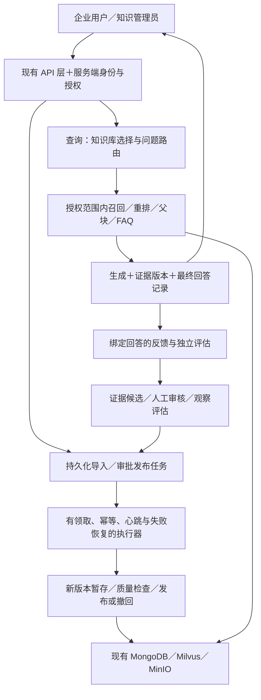

# se_rag 企业内部 RAG 架构评估与优化路线

评估日期：2026-10-18。目标场景：**一家企业内部、多员工、多知识库，中小规模使用**。不以多租户 SaaS、跨地域高可用或复杂自治 Agent 为默认目标。

源码基线：`fba0c6277fd186ec6846d205d8fccce18a95a2f2`；审查分支：`codex/enterprise-rag-review`。工作区中的既有文档改动保留。本轮仅创建分支、编写评估并补充文档导航，没有修改业务代码、升级依赖、启动服务、运行项目测试或连接实际数据库与模型。

安装与使用见 [README](../README.md)，逐链路源码走读见[技术讲解文档](se_rag-技术讲解文档.md)。本文回答“设计是否适用、企业使用还缺什么、先改哪里”，不重复全部代码讲解。

## 目录

- [1. 结论与判断标准](#1-结论与判断标准)
- [2. 六个领域的技术与业务评估](#2-六个领域的技术与业务评估)
- [3. 建议的目标架构与契约变化](#3-建议的目标架构与契约变化)
- [4. 原有 21 项发现的复核与重新排序](#4-原有-21-项发现的复核与重新排序)
- [5. 优化工作包与三阶段路线](#5-优化工作包与三阶段路线)
- [6. 验收场景与效果验证](#6-验收场景与效果验证)
- [7. 官方资料、兼容性与证据边界](#7-官方资料兼容性与证据边界)

## 1. 结论与判断标准

### 1.1 直接结论

**核心 RAG 技术方向合理，适合继续作为产品手册客服的基础；尚不能仅凭现有实现认定已经满足多员工、多知识库的企业生产要求。**

值得保留的是：结构感知父子块、稠密＋稀疏召回、RRF、交叉编码重排、确定性主体消解、人工审批回流、先写后清和可选能力降级。需要优先补齐的是：身份与权限、文档与知识版本、发布撤回一致性、执行恢复、可信反馈和独立效果评估。

这不是“框架过时”的问题。企业级能力首先体现在：资料只给有权的人；发布的知识有来源与责任人；错误知识能撤回；任务失败能发现并收敛；更新效果能用可信数据验证。是否引入 Redis、任务队列、更多 Agent 或更换数据库，应由这些能力和实际负载决定。

### 1.2 当前适用性

| 使用方式 | 评估结论 | 成立条件或当前缺口 |
| --- | --- | --- |
| 非敏感产品手册的受控演示 | 可作为原型基础 | 明确数据外发、管理令牌和单 worker 边界，故障可人工处理 |
| 所有试点人员拥有相同资料权限的内部验证 | 可受控试点，尚无容量保证 | 限定资料与用户、保留人工审核、验证导入和撤回，不能依赖随机会话 ID 作为授权 |
| 多部门、不同资料权限的正式使用 | 上线前补齐权限与知识生命周期 | 缺少用户归属、知识库/文档授权、版本发布与完整撤回 |
| 重启后任务必须恢复、后台导入持续运行 | 当前不足 | Web 进程内后台任务与状态快照不等于持久化任务执行 |
| 多实例、大量并发或严格 SLA | 需演进且实测 | 共享运行状态、调度唯一性、模型资源和负载基线尚未建立 |

不提供“企业级完成度百分比”或未经测试的并发人数。没有流量、文档规模、硬件和错误预算，就无法给出可信容量判断。

### 1.3 评估方法

- **实现事实**：来自代码、配置、锁文件和测试源码，可定位到相对路径与行号。
- **设计取舍**：某个方案在特定业务中合理，但扩展到其他业务时需调整。
- **风险推断**：存在相应代码路径，实际影响仍依赖部署、数据、时序或负载。
- **建议能力**：本报告提出的目标，均未在本轮实现。

官方资料提供设计参照，不是本项目已经合格的认证。Microsoft 的 RAG 设计指南强调分阶段与端到端评估；本文据此把“某一阶段指标好”和“员工真的得到可用答案”分开判断。[RAG 设计与评估指南](https://learn.microsoft.com/en-us/azure/architecture/ai-ml/guide/rag/rag-solution-design-and-evaluation-guide)

## 2. 六个领域的技术与业务评估

### 2.1 整体架构与技术选型

**现状与依据。** 导入和查询是同一代码库的两个 FastAPI 入口，查询服务还挂载进化 API 和调度器；模型、Mongo、Milvus、MinIO 由共享模块封装。[查询服务](../app/api/http/query_server.py#L26)、[导入服务](../app/api/http/import_server.py#L22)、[模型门面](../app/shared/models/providers.py#L13)

**合理思想。** 将耗时的资料准备与交互问答区分入口，业务层保留模块边界，三类存储分别承担向量、业务记录和对象文件，符合当前工作负载的分工。数据库较多增加运维和一致性成本，但没有证据表明换成一种数据库就能改善效果或可靠性。

**当前限制。** `process` 调 `rag`，`rag` 又使用 `process` 中的状态类型；`rag` 与 `evolution` 也相互调用。状态模型、外部客户端与业务策略没有完全解耦。模型单例只在进程内成立，两个入口可能各加载一份；门面仍返回 LangChain 对象，不是完全独立的模型插件协议。[图状态](../app/process/query/agent/state.py#L5)、[普通召回节点](../app/process/query/agent/nodes/node_search_embedding.py#L14)、[模型初始化](../app/shared/models/embedding.py#L14)

**判断。** 保留模块化应用、双入口和主要技术栈。先建立共享契约、依赖边界和清晰配置；不要仅为消除反向类型引用进行大规模重写，也不应直接拆出多个独立部署的微服务。

| 技术 | 当前业务价值 | 建议 |
| --- | --- | --- |
| FastAPI | 上传、结构化接口、SSE 适配直接 | 保留；补身份、限额、运行检查 |
| LangGraph | 固定分支和并行检索易于表达、追踪 | 保留；图的持久化与任务执行分开设计 |
| BGE-M3＋Milvus | 同时处理自然语言语义与型号词项 | 保留；先测真实题库，再考虑索引或模型替换 |
| BGE-Reranker | 为初筛候选提供问题—片段联合相关性打分 | 保留；衡量额外耗时及无关 FAQ 问题 |
| MongoDB | 会话、父块和知识治理记录易扩展 | 保留；完善身份、版本、状态与索引 |
| MinIO | 图片独立存储，避免把二进制塞进向量文本 | 保留；访问方式由资料权限决定 |
| 原生 JS 页面 | 三页交互简单，不需要额外前端构建链 | 暂不更换；优先补恢复、鉴权和浏览器验证 |

### 2.2 流程编排与运行可靠性

**现状与依据。** 导入图有文件类型分支；查询图主体确认后扇出到普通召回、HyDE、联网，再进入融合重排。并行节点主要回写各自负责的字段，是合理的状态分工。两个图都直接 `compile()`，没有传持久化 checkpointer。[导入图](../app/process/import_/agent/main_graph.py#L16)、[查询图](../app/process/query/agent/main_graph.py#L16)、[节点状态补丁](../app/process/query/agent/nodes/node_search_embedding.py#L37)

**合理思想。** 这种产品手册问答有可预期步骤、需要稳定边界，使用受控工作流是优点。没有证据要求模型自行规划检索次数和工具选择；更多自治循环会增加成本、调试和验收难度，不是企业化的必要条件。

**关键区别：**

| 能力 | 它解决什么 | 当前实现 |
| --- | --- | --- |
| 图状态 checkpoint | 保存节点执行进度与状态，支持按框架语义恢复 | 未配置持久化 checkpointer |
| 持久化任务执行 | 请求接收后任务不因 Web 重启无声消失，有领取、重试、终态和责任归属 | BackgroundTasks＋进程内信号量，没有完整持久化任务机制 |
| 外部副作用幂等 | 恢复/重试时避免重复提交 PDF、重复审批或互相清理数据 | 部分稳定 ID/upsert；外部调用和跨库操作尚未完整覆盖 |
| 用户可恢复事件 | 重连后知道当前请求及结果，避免串流与丢最终状态 | session 级内存 SSE 与有限缓冲，非持久事件日志 |

LangGraph 官方文档区分 checkpointer 与跨线程 store，并说明内存 checkpoint 无法跨重启保存；不能由“使用 LangGraph”推断“任务一定能恢复”。[LangGraph 持久化](https://docs.langchain.com/oss/python/langgraph/persistence)

FastAPI 官方把复杂的跨进程后台计算与小型进程内后台任务区分开。对应本项目，PDF、图片、嵌入等长任务应有明确执行归属；是否采用 Celery 等工具须另评估，文档中的例子不是必须采用的选型结论。[FastAPI 后台任务](https://fastapi.tiangolo.com/tutorial/background-tasks/)

**当前限制。** 导入执行槽不跨进程，等待名额的任务仍占资源；本地快照可能永久停在 processing；SSE 只有一个订阅槽；同 session 两问共享并重置进度；查询 lifespan 中每个实例都可能启动进化调度。取消 asyncio 调度任务也不能证明其 `to_thread` 内的同步远端调用已停止。[导入执行](../app/rag/import_/pipeline.py#L64)、[快照](../app/shared/utils/task_snapshot.py#L21)、[SSE](../app/shared/utils/sse_broker.py#L156)、[调度循环](../app/evolution/scheduler.py#L152)

**判断。** 短期保留单查询 worker、唯一调度器，补服务端每会话互斥与 request_id。正式持续导入前，要有持久化任务记录、心跳/租约、失败终态和人工重试；这与吞吐量大小无关。多实例与通用队列作为后续演进，不用“先加 Redis”替代执行语义设计。

### 2.3 导入与知识生命周期

**现状与依据。** MinerU 结构化产物与 Markdown 回退统一为 Block；父块提供章节背景，子块集中主题供检索；表格重复表头、代码块保留围栏，图片用视觉摘要转成可检索文本。子块采用稳定结构 ID，先 upsert 再清旧，父块也先更新再清理，已有防数据空窗的思想。[结构解析](../app/rag/import_/content_list.py#L177)、[父子切分](../app/rag/import_/section_splitter.py#L234)、[子块写入](../app/rag/import_/index_service.py#L156)、[父块写入](../app/shared/clients/parent_chunk_repository.py#L38)

**适用的业务假设。** 一份手册主要描述一个产品、标题结构有意义、图片说明足以辅助文本检索。这对产品文档有价值，但不自动覆盖 HR 政策、财务制度、多个产品合集或表格精确计算。

**当前限制。**

- `file_title` 来自文件名 stem，`doc_id` 由它哈希；同名文件、PDF/MD 同 stem 或不同知识库的同名资料没有独立身份。子块按 file_title 清理，图片按 stem 组织，父块按 doc_id 更新。[文件名](../app/rag/import_/entry_service.py#L31)、[ID](../app/rag/import_/ids.py#L27)、[清理](../app/rag/import_/index_service.py#L125)
- 没有知识库 ID、文档版本发布指针、来源权限与明确生效/失效生命周期。同一个 chunk_id 的文本可被覆盖，历史引用无法单靠 ID 重现当时内容。
- 图片先写、主体索引先更新、子块及父块再落库，没有共同事务；父块失败和对账差异主要告警，不妨碍主导入完成。因此“完成”不等于整份知识已完整、同版本发布。[主体入库顺序](../app/rag/import_/item_name_service.py#L125)、[父块降级](../app/rag/import_/parent_index_service.py#L15)、[对账](../app/rag/import_/reconcile.py#L108)
- PDF 检查点路径、大写后缀、UTF-8 文件头边界、结构化转换异常存在明确实现问题；文档体积限制也不限制解压后的总大小或图片数。[解析产物](../app/rag/import_/pdf_parse_service.py#L173)、[复用查找](../app/rag/import_/pdf_parse_service.py#L200)、[上传验证](../app/api/routers/import_.py#L82)、[结构回退](../app/rag/import_/split_service.py#L54)

**判断。** 保留切分和先写后清，升级“文件导入”为“文档版本发布”。文档使用服务端独立身份，产品名只作业务标签；新版本暂存、质量检查和跨库对账通过后切换可见版本，失败保留旧版本。撤回要覆盖子块、父块、图片、进化衍生知识与缓存，不用简单删除一个集合代替生命周期。

质量改进先衡量文本覆盖、表格完整、页码可追溯和来源版本；图片摘要属于模型生成内容，应能区分原文与补充描述，避免它变成无标识的“官方事实”。

### 2.4 检索与回答的业务思想

**合理思想。** 主体确认避免不同型号混答；独立 rewrite_hint 保存当前意图，优于让模型从历史猜动作。Milvus 内 dense/sparse 混合、后续 RRF、交叉编码重排和重排后的父块回填解决的是不同阶段的问题，不是无意义堆砌。[主体消解](../app/rag/query/item_name_confirm_service.py#L145)、[混合检索](../app/rag/query/chunk_search.py#L47)、[RRF](../app/rag/query/rrf_service.py#L50)、[重排](../app/rag/query/rerank_service.py#L254)

**应调整的业务假设。** 现有入口通常要求先确定产品主体，否则反问。企业一般知识问题“报销材料需要哪些”未必有产品名；把它强行送入同一路由会反问无关主体。产品客服场景应保留该设计，通用制度场景则应先确定知识库/问题类型，再选择是否需要主体消解。权限来自服务端身份，与模型识别 item_names 无关。[非空主体要求](../app/rag/query/chunk_search.py#L40)、[提取提示词](../app/resources/prompts/rewritten_query_and_itemnames.prompt#L1)

**主要优化点。**

1. **召回路由由问题和边界驱动。** 目前主体确认后通常同时走 HyDE 和联网；本地已有充分证据也会付出额外调用。应比较“本地直接检索基线”与“按需 HyDE/联网”，在质量不退化的前提下控制时间与费用。内部问题是否允许发送给外部搜索要有明确策略。[扇出](../app/process/query/agent/main_graph.py#L31)、[联网调用](../app/rag/query/web_search_service.py#L45)
2. **权威性与相关性分别判断。** 已审批 FAQ 有可信来源优势，但当前无条件补回被截掉的 FAQ，可能让弱相关材料占用上下文。人工审核通过不意味着对每个问题都相关；至少需要相关性门、上下文总预算和冲突处理。[FAQ 保底](../app/rag/query/rerank_service.py#L124)
3. **证据溯源细于候选列表。** 当前引用来自最终上下文全集，不代表每块都被模型使用；接地性评估每块只取前 500 字，且未带 parent_content，可能漏掉实际支持证据。应区分“参考材料”“逐句支持”“来源可信度”，按真实支持片段评估。[引用](../app/rag/query/citations.py#L17)、[评估证据](../app/rag/query/answer_service.py#L107)、[截取预算](../app/evolution/online_eval/grounding.py#L23)
4. **分数含义不能混用。** Milvus 分、RRF 分、rerank 分和模型 groundedness 不是同一种概率；联网排序还被业务策略压分。界面应准确标注，并保留未评估语义，不能用百分号暗示已校准正确率。

**判断。** 不急于加入 GraphRAG、全自治 Agent 或大量新召回路。先建立真实产品与通用知识的分层基线，通过消融实验判断 HyDE、压缩和父块的收益；对未解决问题要允许拒答并给出可追踪的人工处理入口。

### 2.5 自进化与知识治理

**合理思想。** 不让用户问题直接变成在线知识，而是先候选、无证据转 need_info、人工补充/审批后入库；审批有原子抢占和失败回滚，反馈回测有最低样本数保护。这体现了“模型提出、人员确认”的治理方向。[候选生成](../app/evolution/candidate/generator.py#L66)、[审批](../app/evolution/approval/service.py#L40)、[回测](../app/evolution/backtest/runner.py#L37)

**最大的业务偏差：未解决不一定缺知识。** 失败可能来自缺文档、召回失败、生成遗漏、产品待澄清、服务故障或权限拒绝。现有逻辑把零命中/无检索/拒答变为负反馈，缺口分级又用是否引用等代理信号；不能据此认定一定应新增 FAQ。[自动信号](../app/evolution/feedback/collector.py#L43)、[分级](../app/evolution/gap/detector.py#L70)

**需防止形成错误强化循环。** 错误召回 → 用错误上下文提炼候选 → 人工在缺少真实来源时误批 → FAQ 保底反复进入上下文 → 原本错误更难消除。当前调度上下文不带主体过滤且只返回 text，source_refs 又由模型生成，来源 ID、知识库、版本及权限没有形成证据链。[候选上下文](../app/evolution/scheduler.py#L31)、[source_refs](../app/evolution/candidate/generator.py#L101)

**状态治理仍有缺口。** 向量下架失败仍删除候选；API 可编辑 active 的 Mongo 记录而不重新索引，也能驳回 active 而不撤回。只有页面按钮受限不能替代服务端状态机。PII 检查在自动生成阶段，人工补充后激活前未复用同样检查。[编辑与撤回](../app/evolution/approval/service.py#L106)、[PII](../app/evolution/candidate/pii.py#L40)

**反馈回测不等于独立评测。** 自动负事件与用户评价混合；未评价的成功回答缺少对应正事件；客户端可提交引用、时间与结果标志。自调同时修改多个参数，且没有独立对照或单次变更归因。业务流量与问题难度变化也会改变采纳率，不能都归因到参数。[反馈模型](../app/evolution/models.py#L18)、[指标](../app/evolution/online_eval/metrics.py#L13)、[控制器](../app/evolution/tuning/controller.py#L36)

**判断。** 保留人工知识补全，优先升级为“可审计的知识改进流程”；自动信号先用于诊断，不直接作为事实。反馈绑定 answer_id，由服务端补齐来源与版本。审批记录责任人、证据、有效期与变更版本。自动调参应先有独立开关和观察模式；现有配置不能单独安全停用自调，间隔为 0 代表每轮执行，不能作为关闭办法。

### 2.6 企业内部生产能力

**身份与授权是上线阻塞项。** 查询、历史、状态与 SSE 没有用户归属校验，候选读取未要求管理令牌；上传管理令牌还带固定非空默认。UUID 和前端禁用按钮均不等于服务端授权。[查询路由](../app/api/routers/query.py#L32)、[进化路由](../app/api/routers/evolution.py#L55)、[默认令牌位置](../app/shared/config/settings.py#L272)

企业内部也有部门或文档权限。现有 item_name 过滤只区分产品；`default_item_name` 放行的是业务全局条目，不能解释成对所有员工公开。父块回取按 parent_id，不检查主体权限；图片链接和进化知识也必须遵守同一授权规则。[召回过滤](../app/rag/query/chunk_search.py#L66)、[父块读取](../app/shared/clients/parent_chunk_repository.py#L78)、[图片桶策略](../app/shared/clients/minio_gateway.py#L22)

Microsoft 的安全 RAG 架构要求最终用于生成的 grounding data 属于请求者有权访问的数据；本文只借鉴这个数据边界原则，不采用其多租户部署拓扑作为当前目标。[检索数据权限](https://learn.microsoft.com/en-us/azure/architecture/ai-ml/guide/secure-multitenant-rag)

**最低权限闭环应覆盖：** 服务端身份 → 可用知识库与文档 → 搜索过滤 → 重排输入 → 父块 → FAQ → 生成上下文 → 引用和图片下载 → 缓存与日志。仅在答案生成之后过滤已经来不及防止模型处理未授权文本；仅隐藏网页同样不足。

**可运维能力需要补证据。** 当前有节点耗时日志、错误分类、TTL 和指标记录，但 health 仅报告存活与静态资源版本；未在仓库发现完整 readiness、部署 CI、备份与恢复演练说明。日志 diagnose 与明文问题、公开新建图片桶也需按资料敏感度治理。不能由仓库缺少脚本断言实际部署一定没有这些保护。[日志](../app/shared/runtime/logger.py#L46)、[health](../app/api/routers/health.py#L12)、[Mongo 索引](../app/shared/clients/mongo.py#L62)

**判断。** 在现有模块化架构内先补：接入企业已有身份来源、角色/知识库授权、管理操作审计、私有图片访问、脱敏日志、存活/就绪分离、数据备份和恢复验证。小规模可以没有复杂可观测平台，但不能没有失败率、排队长度、阶段延迟和知识发布状态。

## 3. 建议的目标架构与契约变化

### 3.1 保留模块化应用，分开三种责任

下图是**建议目标**，不是当前实现；其中 worker、权限契约和任务持久化均需后续开发。可在同一仓库演进，不要求一开始拆成多个微服务。

三个责任分别是：**谁能看什么、哪些知识正式有效、哪次任务执行到哪里**。它们应有不同身份和状态，不能继续都靠产品名或 session_id 表达。

### 3.2 后续改造需要明确的契约

这些是建议的最小概念模型，不是本轮新增 schema 或已承诺的最终字段名。

| 契约 | 需要表达的能力 | 兼容与迁移关注 |
| --- | --- | --- |
| 用户与授权范围 | 用户身份、角色、服务端计算的可访问知识库/文档 | 不信任客户端自行传入权限；缓存也要按权限范围区分并能失效 |
| 文档与版本 | 独立 document_id、知识库、版本、来源、发布状态、权限和内容指纹 | 文件名降为属性；旧 chunk/parent/image 需要映射或重建，旧引用不能悄悄指向新版本 |
| 一次请求与回答 | conversation/session、request/run、answer 各有独立身份与归属 | HTTP/SSE 需携带本轮身份；客户端升级与历史兼容要同步规划 |
| 可执行任务 | 接收、领取、处理中、成功、失败、取消等状态与重试归属 | 超时与恢复策略明确；外部副作用按任务/版本幂等，不宣称 exactly-once |
| 候选与知识发布 | 原始证据 ID/版本、审核人、候选版本、索引中间态、撤回状态 | Mongo 状态与 Milvus 可见性存在窗口，需要 outbox/补偿与可核验终态 |
| 反馈与实验 | answer_id、事件类型、人工评价、系统诊断、参数/模型/提示词版本 | 成功无反馈与负反馈分母分开；旧事件不伪造缺失归属字段 |

### 3.3 保持克制的选型结论

- 不因“企业级”强制更换 FastAPI、LangGraph、Milvus、MongoDB 或 MinIO。
- 不因有多个模块就拆微服务；先清理共享契约与可观察的依赖方向。
- 任务先明确持久化、幂等和领取语义，再比较复用 Mongo 任务记录与成熟队列；不要引入一个无人维护的自制消息平台。
- 共享事件/缓存或多 worker 确有需求时再评估 Redis；加入 Redis 不会自动带来任务恢复或一致性。
- 图恢复可以先验证持久化 saver 的适配，不为跟随最新示例立刻新增 PostgreSQL；当前适配包兼容性没有运行验证。
- 只有跨资料推理/动态选源的独立评估证明固定流程不足时，再考虑 agentic RAG；若需要精确数值或结构化查询，先考虑确定性查询能力，而非单靠扩大模型上下文。

## 4. 原有 21 项发现的复核与重新排序

复核以现有实现和测试源码为准，没有运行复现。原始详细触发条件见[技术讲解的风险章节](se_rag-技术讲解文档.md#9-风险问题与改进建议)。下表将发现归并到第 5 节工作包；“上线阻塞”特指本报告的多员工、不同知识库权限和持续知识运营场景，不代表已有线上事故。

| 原编号 | 复核结果与重新判断 | 分类 | 对应工作包 |
| --- | --- | --- | --- |
| F01 | 查询/历史缺归属、候选读取开放、反馈可由客户端伪造；不同权限用户正式使用前必须处理 | 治理缺口；上线阻塞 | G01、G07 |
| F02 | 固定非空导入默认令牌仍在；未配置不等于关闭接口 | 确定缺陷；上线阻塞 | G02 |
| F03 | deactivate 返回 False 仍继续删除候选，撤回可误报成功 | 确定缺陷；知识正式发布前阻塞 | G03 |
| F04 | active 编辑/驳回与向量状态不同步，审批崩溃窗口仍在 | 确定缺陷＋跨库一致性缺口 | G03 |
| F05 | 文档身份按文件名，未跨知识库隔离；同名并发清理可能互相影响 | 身份模型取舍；多知识库上线阻塞 | G04 |
| F06 | 进程内运行状态与调度限制属现有部署前提；不是“加 worker 就能修”的普通缺陷 | 部署约束；扩容前阻塞 | G05、G06、G09 |
| F07 | SSE 单槽覆盖、旧连接清理新槽和活跃队列无限制仍在 | 确定并发/资源缺陷 | G05 |
| F08 | 旧助手存在、新用户尚未落库的恢复窗口仍在 | 确定时序路径；需浏览器复现 | G05 |
| F09 | 实际解压在子目录，复用只找根目录；单测未串起真实布局 | 确定缺陷 | G02 |
| F10 | 大写后缀口径不同；头部 UTF-8 解码可截断合法字符 | 确定边界缺陷 | G02 |
| F11 | 历史写入把 None 变为 0，实时/刷新语义不同 | 确定契约缺陷 | G02 |
| F12 | 处理态磁盘快照无重启收敛机制，也不是执行 checkpoint | 恢复能力缺口 | G06 |
| F13 | get_all_params 合并时默认值覆盖缓存值，快照可与实际参数不同 | 确定缺陷；实验前需修 | G02 |
| F14 | 时间戳单键游标存在同时间戳批次边界，问题去重无主体范围 | 确定处理边界＋语义缺口 | G07 |
| F15 | 系统负事件与用户评价混计，成功曝光不足；不能作真实解决率 | 指标设计缺口；自动决策前阻塞 | G07 |
| F16 | FAQ 通过审核却无条件保底，与新问题的相关性未保证 | 检索策略取舍；须独立效果验证 | G08 |
| F17 | PII 校验未覆盖人工激活链路，source_refs 无真实来源校验 | 内容治理缺口 | G03、G07 |
| F18 | 部分远端写入无显式业务超时、整轮预算/背压不足 | 可靠性风险；容量需实测 | G06、G09 |
| F19 | 新建桶公共只读、日志可能保留业务文本和局部变量 | 数据边界风险；依敏感度成为阻塞 | G01、G10 |
| F20 | JSON 读取之外的结构转换异常未纳入完整回退，坏表格可丢失或中断 | 确定缺陷 | G02 |
| F21 | 未消费开关、配置入口分散、旧注释及温度 0 语义漂移 | 维护/契约欠账 | G02、G10 |

复核中需要特别避免的误读：

- F06 的单 worker 约束可以作为短期运行方式保留，但不代表满足重启恢复；F12 要单独解决。
- F05 的稳定哈希 ID 有价值，问题在文档身份范围和版本，不需要否定全部 ID 设计。
- F16 的权威性保底有业务动机，不能仅删掉策略就声称效果更好；应增加相关性门与对照实验。
- F14 同时间戳事件不是必然永久丢失：游标归零后可能重扫，持续有新事件时可能长时间延迟。需用稳定复合游标验证。
- F19 的代码默认策略不证明现有桶公开，也不证明生产日志已泄露；实际权限与采集策略待核实。

## 5. 优化工作包与三阶段路线

### 5.1 排序与成本说明

P1：目标场景正式开放前优先完成；P2：可靠性、效果或运营必须规划补齐；P3：按实测收益演进。S/M/L 为相对工程量：局部兼容修复、跨模块改动、涉及数据迁移/执行架构；不代表天数、预算或承诺工期。

所有工作包均为**建议，未实施**。不把新的权限、版本或执行组件写成现有能力。

### G01 · P1：贯穿数据链路的用户与知识权限（M～L）

- **收益/范围**：员工只能处理授权会话与资料；覆盖身份、API、检索、父块、FAQ、图片、缓存和日志。
- **依赖**：企业可用的身份来源与角色/资料权限规则；先定义知识库粒度，文档例外权限按业务需要支持。
- **方案**：复用企业身份体系；请求上下文由服务端计算授权范围；所有召回源及回填遵守同一策略，候选管理读取也鉴权。
- **兼容/迁移风险**：旧会话没有 owner、旧资料没有知识库和权限，不能默认全部公开；需管理员归档/分配后逐步启用。
- **验收**：跨用户会话与跨知识库数据不进入检索输出、模型上下文、引用或图片响应；撤权后缓存不继续泄漏。

### G02 · P1/P2：确定性缺陷与契约修复（S～M）

- **收益/范围**：先清除低成本、明确可验证的问题；包括默认令牌、PDF manifest/复用路径、后缀、UTF-8 边界、nullable groundedness、参数快照、结构回退及无效配置说明。
- **依赖**：不依赖新中间件；默认令牌属于发布安全门，优先于其他修复。
- **方案**：用局部可复现用例验证输入→产物→复用、保存→读取等跨函数契约，而非仅验证单函数自己的假设。
- **兼容/迁移风险**：移除默认令牌会使漏配部署不能导入；历史 0 分无法可靠区分未评估与真实 0，应按数据版本处理，不统一改写旧值。
- **验收**：对应失败用例在修复前可复现、修复后通过；原有正常路径保持；配置显式 0 与未配置语义准确。

### G03 · P1：知识发布与撤回状态机（M）

- **收益/范围**：管理页面状态与在线知识可见性可核验；覆盖审批、编辑、索引、撤回、质量检查与操作审计。
- **依赖**：稳定候选/知识身份；完成后与 G04 版本模型整合，避免两次重写状态机。
- **方案**：将索引中/撤回中与最终 active/已撤回分开；显式处理失败和重试；active 修改形成新版本或重新审批；所有激活入口统一检查 PII、事实及来源。
- **兼容/迁移风险**：旧 active 可能没有实际向量，旧向量可能没有候选记录；需要只读对账清单和受控补偿，不能启动时无条件删库。
- **验收**：删除失败不返回已完成且保留重试依据；并发审批不产生重复知识；中断、重放、编辑和驳回后两端最终一致，并记录责任人。

### G04 · P1：知识库内的文档身份与版本发布（L）

- **收益/范围**：同名文件可隔离、更新能回滚、引用有版本；涉及导入状态、三类存储、检索过滤、清理与历史引用。
- **依赖**：G01 的知识库范围，G03 的发布语义；已有数据先建立迁移映射。
- **方案**：文件名作为显示属性，document_id 独立分配；版本化存储与权限元数据向父子块、图片、衍生 FAQ 传递；检查通过后切换发布版本，再清旧产物。
- **兼容/迁移风险**：涉及旧集合 schema 和 re-embedding/重建可能性；需离线备份、并行新索引、对账与可回退切换，禁止直接 force 重建线上集合。
- **验收**：跨知识库同名与同文档并发更新不会互删；查询只见一个有效发布版本；历史引用可区分版本，资料撤回能关联处理衍生知识。

### G05 · P2：区分会话、请求与连接（M）

- **收益/范围**：解决多标签、重连和同会话并发时串流；覆盖 API、pipeline、状态、SSE 与前端恢复。
- **依赖**：G01 的归属约束；先保留单 worker，避免把所有问题同时变成分布式改造。
- **方案**：为每轮分配 request/run 身份，明确同会话串行或拒绝策略；连接按自身身份清理，有界队列及可重同步终态；恢复通过本轮结果确认，不只判断最后一条消息角色。
- **兼容/迁移风险**：现有只凭 session 的客户端需过渡期；消息/事件与查询返回一起升级，不允许一半客户端沿用旧恢复规则。
- **验收**：同会话两问不互相覆盖；两个订阅者、旧连接退出、慢消费者和不同刷新窗口均能获得正确终态或明确失败。

### G06 · P1/P2：持久化任务及失败收敛（M～L）

- **收益/范围**：导入与知识发布不因 Web 重启无声消失，耗时任务可管理；任务记录、执行器、幂等、重试、取消、外部调用与状态查询联动。
- **依赖**：G03/G04 的任务和版本幂等键；部署可使用的存储与执行环境。
- **方案**：先形成持久化任务、领取/心跳/租约和终态约定，再验证复用现有 Mongo 或成熟队列的维护成本；重试仅覆盖可重试失败，检查点产物须绑定源文件指纹。
- **兼容/迁移风险**：旧 processing 快照需收敛为可诊断状态；恢复可能重复外部副作用，必须设计幂等；引入图 saver 不能替代这些规则。
- **验收**：任意关键阶段重启后，任务能恢复或明确失败并可重试；外部副作用不重复发布；取消有明确边界，不把客户端断开当任务已取消。

### G07 · P1/P2：可信反馈与受控知识改进（M）

- **收益/范围**：把真实知识缺口与检索/生成/服务问题分开，避免污染 FAQ 和调参；覆盖回答归档、反馈、扫描、候选、评估和审计。
- **依赖**：G01 授权、G03 发布、G05 answer/run 身份；候选引用使用真实版本证据。
- **方案**：事件绑定服务端 answer_id；诊断与用户评价分型，定义曝光和采纳分母；复合游标＋范围化去重；候选保留来源和人工责任；新增自调独立开关与观察模式。
- **兼容/迁移风险**：旧反馈没有可靠 answer/权限/版本，单独保留历史统计，不用于新体系的自动决策；全局调参需避免一个知识库的偏差影响其他库。
- **验收**：伪造引用/ts 被拒绝或重建；跨库证据不生成候选；批次边界不漏处理；未评成功不当作差评；无独立效果证据时不自动发布参数变化。

### G08 · P2：以独立评估驱动检索路由与上下文（M）

- **收益/范围**：在回答质量、拒答、时延和调用成本间做可解释取舍；覆盖主体路由、HyDE/联网、FAQ 相关性、父块预算、引用与提示词。
- **依赖**：G02 参数/分数语义修正；G07 可信事件；独立产品/制度题库。
- **方案**：建立本地检索基线，逐项消融；产品与一般知识分路由，外部联网有准入策略；FAQ 权威性与相关性双门；证据与生成上下文用一致版本/预算。
- **兼容/迁移风险**：短期效果可能改变，默认阈值不能由另一模型或知识库直接套用；保留旧策略开关与回滚配置，避免多变量同时改变无法归因。
- **验收**：无答案、相近型号、无关已审批 FAQ、恶意片段、表格、跨段和多轮样本分别报告；结果可重现，且与完整答案人工复核一致地解释。

### G09 · P2/P3：资源预算、执行隔离与扩展（M～L）

- **收益/范围**：保护交互响应并建立可扩容依据；覆盖请求/用户配额、模型初始化和推理并发、队列、超时、导入解压预算与多实例调度。
- **依赖**：G05/G06 运行身份与持久任务；真实阶段延迟、资源和负载测量。
- **方案**：先落实单次 RPC 与整轮 deadline、有界等待及任务大小预算；若双进程模型副本影响资源，再考虑共享推理服务；多实例时使用单调度职责/租约与共享事件状态。
- **兼容/迁移风险**：拒绝/超时语义需对前端可见；新组件增加连接、权限、监控和故障面；不能以加线程或 worker 替代背压。
- **验收**：指定负载与故障下无无限等待/队列增长，用户可见失败可解释；逐级测试后再确认容量。报告不预设吞吐或 SLA 数字。

### G10 · P1/P2：上线验证、审计与运维底线（M）

- **收益/范围**：知道系统在用哪个版本、哪部分失败、能否恢复；覆盖私有图片/脱敏日志、配置校验、readiness、指标、CI 和备份说明。
- **依赖**：各工作包产生的身份、版本与状态契约；部署方明确资料敏感度和恢复目标。
- **方案**：按知识敏感度关闭异常 diagnose 与公开图片默认；建立请求和导入 trace、错误/降级/排队/成本指标；离线用例与隔离 E2E 分开；备份业务记录、来源与索引重建材料并演练恢复。
- **兼容/迁移风险**：readiness 不应因可选联网不可用就拒绝所有查询；日志脱敏不可破坏必要排障信息；备份恢复要保持引用/版本对应，不只证明能启动空服务。
- **验收**：关键依赖失效能区分存活与就绪；一次回答和一次发布均可追踪；恢复后样本问答、权限及撤回状态一致；日志与输出中无真实凭据。

### 5.2 三阶段安排与进入条件

| 阶段 | 主要工作 | 结束条件 |
| --- | --- | --- |
| 第一阶段：修复明确问题、建立试点底线 | G02；G03 的撤回失败/状态限制；G05 单会话保护；明确单 worker、访问范围和 G10 数据处理底线 | 确定性用例可验证；错误知识可以可靠退出；试点人员资料权限相同且访问受控。此时仍不宣称满足多知识库生产 |
| 第二阶段：权限与知识治理 | G01、G03 完整状态机、G04、G06 最小持久任务、G07 事件与证据；G08 建立真实基线，G10 补运行验证 | 身份、版本、权限、任务、反馈和撤回闭环通过；达到已确认的内部正式使用边界 |
| 第三阶段：按实测收益演进 | G05 共享事件恢复、G09 多实例/模型资源优化；G08 策略实验与 G07 受控自调；完善恢复演练 | 只有达到业务负载与效果目标才启用对应组件；每次变化能比较、监测和回滚 |

依赖关系不是简单串行清单：G01 的知识库概念与 G04 的身份设计需先对齐；G03/G04/G06 共用发布与幂等约定；G07 必须先有可信 answer 身份；G08 的实验必须保存 G02 修正后的真实参数快照。

第二阶段应先完成数据与接口设计再写迁移。每次迁移执行“备份→新版本/新索引→隔离验证→对账→切换→保留回滚窗口”，不在当前审查分支直接跑库迁移。

## 6. 验收场景与效果验证

### 6.1 最小验收矩阵

以下全部是**待实施或待执行的场景**，不是本轮通过结果。

| 场景 | 关键断言 | 工作包 |
| --- | --- | --- |
| A 员工访问 B 的会话、SSE 或删除接口 | 服务端拒绝，不能仅靠 UUID 隐蔽性 | G01、G05 |
| 两知识库含同名文件与相同型号 | 身份、向量、父块、FAQ、图片和清理均隔离 | G01、G04 |
| 用户撤权但仍有缓存/旧引用 | 不继续返回受限正文、背景或图片 | G01 |
| 同文档两版本并发导入、其中一次失败 | 不互删，查询只见一个有效发布版本，旧版本可回退 | G04、G06 |
| PDF 正常解压后在索引阶段失败并重试 | 使用同指纹产物，避免重复外部解析；不是只测手工布置的根目录文件 | G02、G06 |
| 索引写失败、撤回失败或提交中崩溃 | 状态不误报完成，保留重试依据，最终可对账 | G03 |
| 大写后缀、UTF-8 头部边界、畸形表格 | 校验与处理一致，失败明确且内容不静默丢失 | G02 |
| None 与真实 0 接地性保存后刷新 | 未评估仍未评估，真实 0 保留其含义 | G02 |
| 处理过程中重启或取消 | 任务恢复或明确失败，无永久无主 processing，外部副作用幂等 | G06 |
| 多标签、两问、旧连接退出、慢消费与刷新窗口 | 不串轮次、不误清新连接；最终结果可重新获取 | G05 |
| 伪造 answer/引用/ts，大量同 ts 事件或同问不同主体 | 拒绝不可信归属，处理游标完整，去重作用域正确 | G07 |
| 无答案、待澄清、服务故障、无关 active FAQ | 分型准确，不误造知识，不因保底把无关 FAQ 当答案 | G07、G08 |
| 真实多轮、一般制度问题与相近产品型号 | 主体与意图不串，问题类型路由适用，权限优先于模型判断 | G01、G08 |
| 依赖故障、磁盘压力、模型并发首次加载 | 超时/背压可解释，主链路与增强能力故障区分 | G09、G10 |
| 从备份恢复一套隔离环境 | 资料权限、版本、索引、引用及撤回状态一致，而非仅 health=200 | G04、G10 |

### 6.2 效果指标应分层，且来源可追溯

- **数据层**：解析覆盖、表格完整、页码/来源关联、版本发布一致性；先保证知识正确进入系统。
- **检索层**：在有标注证据的题上测 Recall@K、排序指标和重要证据命中；型号、部门、资料类型分别分桶，权限泄漏单独记录，不与平均分抵消。
- **回答层**：事实正确、引用支持、完整性、拒答与多轮意图；模型裁判可辅助，重要样本需人工复核，接地性不能替代正确性。
- **体验/运行层**：首个有效输出和完整回答的延迟分位、导入排队/成功/恢复、每次回答的模型调用及 token/费用、降级与资源峰值；按流式和非流式区分。
- **治理层**：反馈曝光覆盖、缺口分类、候选通过与人工修改、撤回收敛和错误知识复发；不把系统诊断当用户差评。

不在没有业务目标时编造统一阈值。先记录当前版本、模型、提示词、参数、知识版本、样本划分与硬件环境，形成真实基线，再锁定发布门槛。开发集与保留集分开，自动生成 FAQ 不能既来自保留题又被拿来证明该题效果提高。

### 6.3 现有验证资产与边界

已有切分、主体消解、引用、重排、上传、SSE 和进化单测，值得继续使用。具体包括[先写后清](../tests/unit/test_import_index_atomicity.py#L69)、[故障降级](../tests/unit/test_query_degradation.py#L105)、[调度接线](../tests/unit/test_evolution_loop_wiring.py#L62)、[审批成功/失败基础](../tests/unit/test_approval_service.py#L45)。这些用例不是多用户权限、真实并发和跨库崩溃一致性的完整证明。

现有 `rag_eval` 固定 expected_item_names、固定 HyDE 并使用联网占位结果，适合确定性检索回归；未覆盖完整主体识别、父块、最终生成、浏览器和真实网络。它还复用真实导入节点写配置中的集合，运行前必须隔离数据。[评估输入与节点](../app/rag_eval/runner.py#L243)、[评估入库](../app/rag_eval/runner.py#L155)

E2E 需要真实服务并有写入清理；应补 HTTP/浏览器与代理时序验证，而非把直接调用 pipeline 等同完整线上体验。[E2E](../tests/e2e/test_import_query_flow.py#L1)

## 7. 官方资料、兼容性与证据边界

### 7.1 当前官方资料对照

资料于 2026-10-18 查阅，均为一手官方文档；引用的是能力与原则，不代表推荐迁移到相应云产品。

| 官方来源 | 本报告采用的原则 | 对本项目的含义 |
| --- | --- | --- |
| [LangGraph Persistence](https://docs.langchain.com/oss/python/langgraph/persistence) | checkpointer 保存图执行上下文，store 保存跨线程资料；内存不跨重启 | 现有 Mongo 历史不是图 checkpoint；引入 saver 也不能包办外部写入幂等 |
| [FastAPI Background Tasks](https://fastapi.tiangolo.com/tutorial/background-tasks/) | 进程内后台任务与跨进程重计算/执行体系应按需要区分 | 耗时导入需要明确执行可靠性，是否上成熟队列取决于维护与运行需求 |
| [Microsoft RAG 设计与评估](https://learn.microsoft.com/en-us/azure/architecture/ai-ml/guide/rag/rag-solution-design-and-evaluation-guide) | 阶段实验与最终体验都需要验证 | 保留分层评估，同时补真实问题、完整答案、多轮与运行指标 |
| [Microsoft 安全检索架构](https://learn.microsoft.com/en-us/azure/architecture/ai-ml/guide/secure-multitenant-rag) | 生成所用 grounding data 应属于用户授权范围 | 即使一家企业内部，也要保护不同员工的资料；不照搬多租户拓扑 |

### 7.2 版本与建议兼容性

[uv.lock](../uv.lock#L1231) 锁定 LangGraph 1.1.3；本地依赖元数据也显示 1.1.3，通过只读检查其 `StateGraph.compile` 签名确认存在 checkpointer 参数。这里只确认可评估接入点，**没有创建 saver、运行恢复或验证数据库适配器版本**。

FastAPI 锁定 0.135.1；本项目使用的是 BackgroundTasks，不是已部署的独立执行平台。BGE-M3 对应向量维度默认固定 1024，普通子块和主体集合 dense 使用 COSINE、进化集合 dense 使用 IP；不得因为当前模型或官方示例变化就直接改配置替换存量向量。[依赖声明](../pyproject.toml#L1)、[向量注册](../app/shared/clients/milvus_gateway.py#L58)、[进化建库](../app/evolution/index/update.py#L34)

后续涉及 saver/队列/鉴权库时，应在锁定依赖下先做隔离兼容验证，再决定升级范围；不以“最新版本”代替针对当前接口、数据和部署的迁移验证。

### 7.3 尚不能确认的事项

未核查真实 `.env` 的生效值、生产网关身份保护、现有桶权限、数据库服务端版本与部署副本、外部备份、企业身份来源、硬件容量、真实问答效果、模型费用或用户负载。源码中缺少某能力，不证明外部部署没有补偿措施；已有组件和测试，也不证明能力在实际环境已达标。

本报告全部实现结论应能追溯源码，官方资料用于对照，取舍与优先级为针对目标场景的工程判断。正式修改应从第二阶段所需契约出发逐项设计、验证和迁移；本轮没有执行这些修改。

**最值得持续坚持的核心思想：先保证“谁有权、知识何时有效、失败如何收敛、效果如何证明”，再增加模型技巧和基础设施。**
