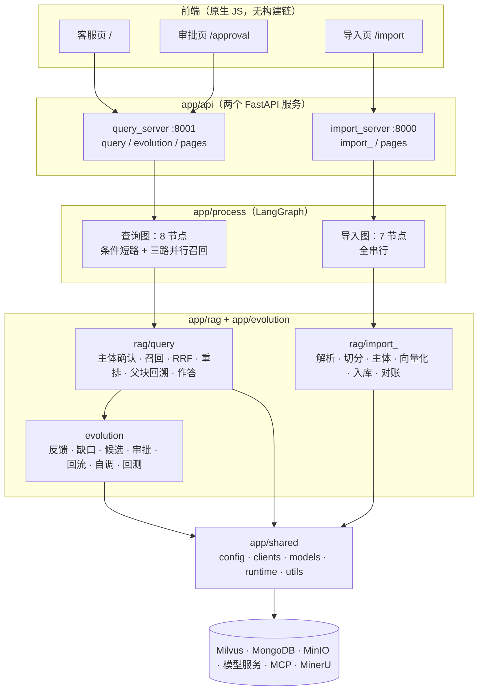
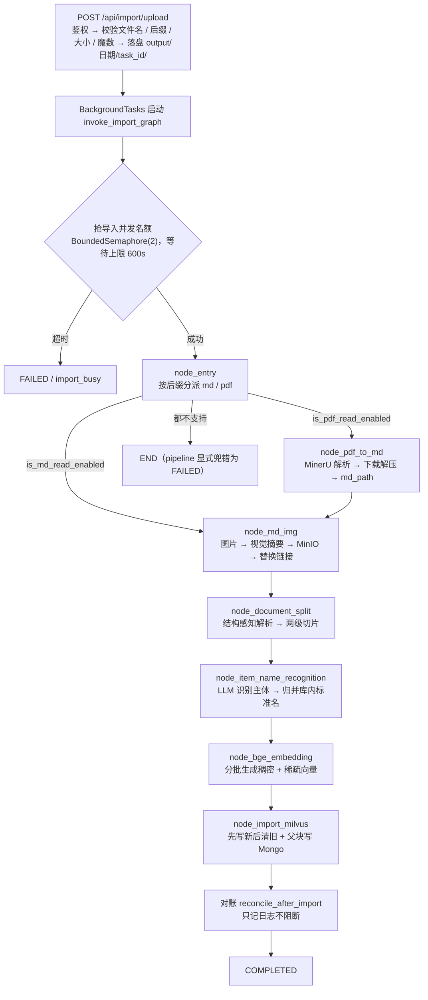
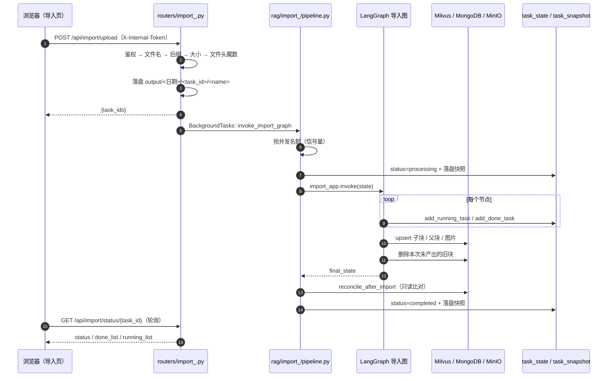
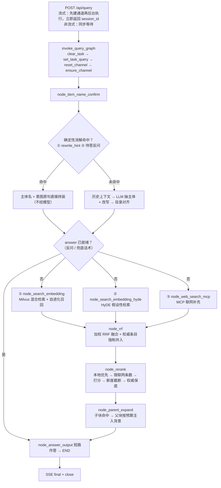
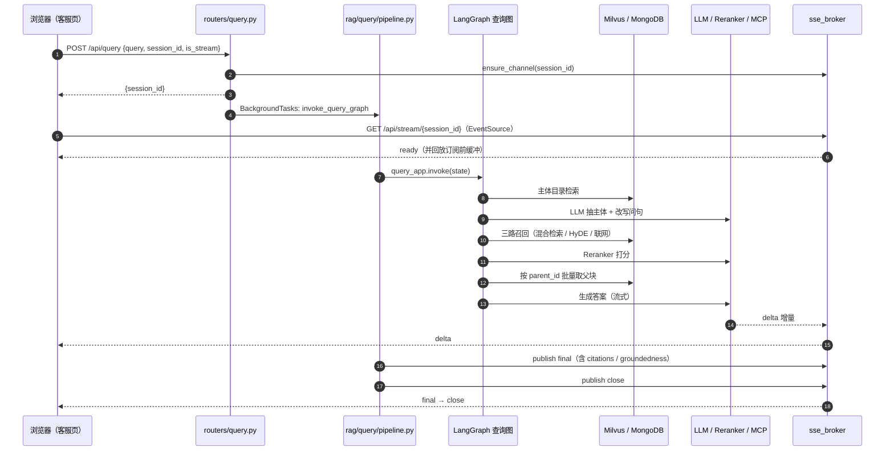
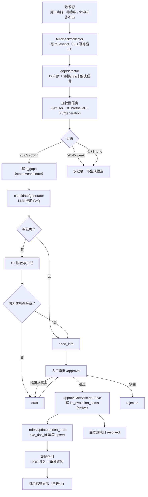
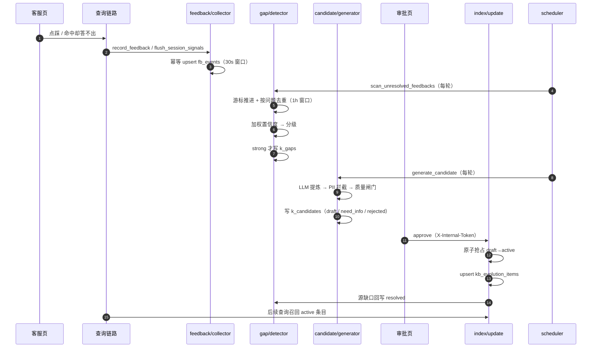
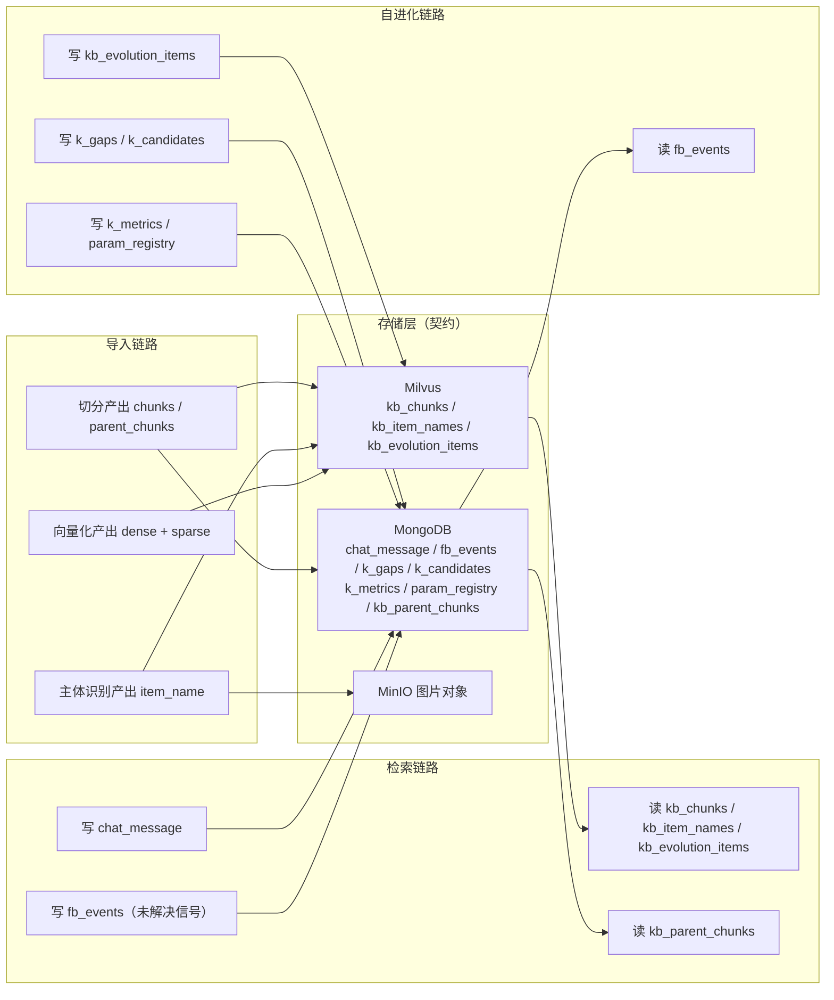
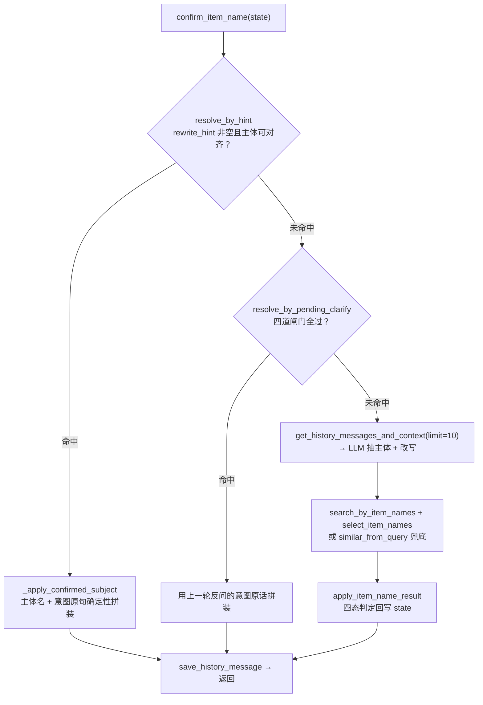
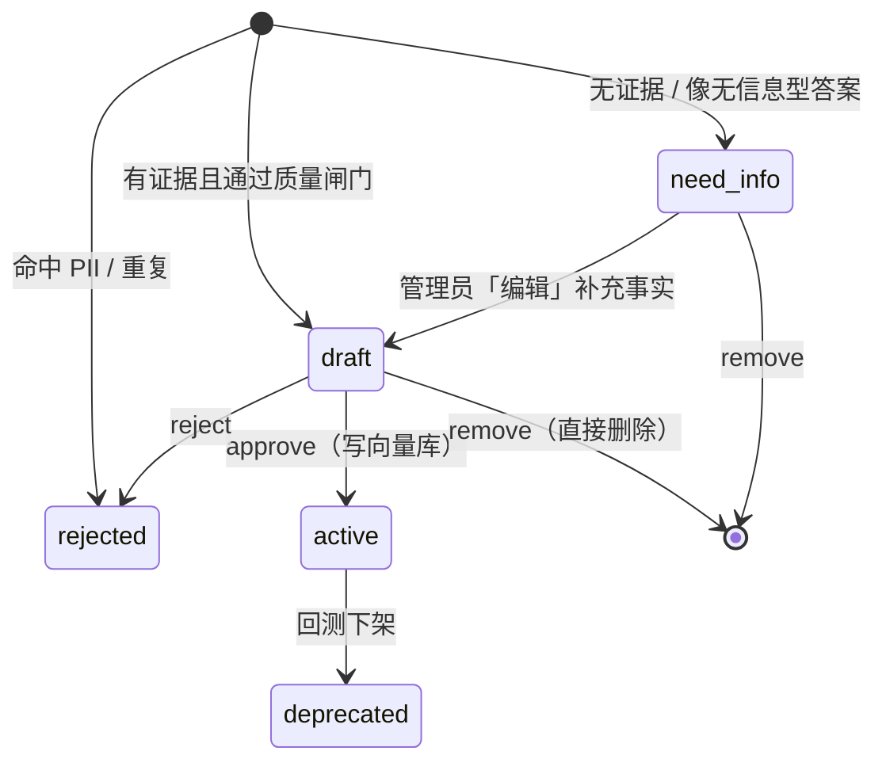

# se_rag 技术讲解文档

> 本文面向要接手或评审这套系统的工程师。目标是回答三个问题：
> **它由哪些部分构成**、**一次请求在代码里具体怎么走**、**为什么这么设计**。
> 所有路径、函数名、常量与代码片段均取自仓库真实内容。

## 目录

- [阅读指南](#阅读指南)
- [第一部分 业务流程图与代码定位](#第一部分-业务流程图与代码定位)
- [第二部分 逐步深度解读](#第二部分-逐步深度解读)
- [第三部分 补充内容](#第三部分-补充内容)
- [附录](#附录)

## 阅读指南

**按角色选读路径**：

| 你的目标 | 建议顺序 |
| --- | --- |
| 先建立整体印象 | 1.1 → 1.5 → 3.1 → 3.2 |
| 要改检索效果 | 1.3 → 2.2 → 附录 A.2 |
| 要改导入 / 切分 | 1.2 → 2.1 → 附录 A.1 |
| 要改自进化规则 | 1.4 → 2.3 → 附录 A.3 |
| 要部署上线 | 3.5 → 3.6 → 3.4 |

**三条主链路**：导入（文档进库）、检索（提问作答）、自进化（知识回流）。
三者通过存储层解耦，只在数据契约上耦合——这也是本文反复强调「契约优先」的原因。

**约定**：正文中的 `文件:行号` 指向当前仓库状态；常量默认值写在括号里。
标为「设计取舍」的小节解释反直觉的实现，跳过它们会看不出代码为何长成这样。

---

# 第一部分 业务流程图与代码定位

## 1.1 全局架构与分层依赖

### 分层与依赖方向

```
app/api         服务组装、路由、Pydantic 契约、统一错误体、页面与静态资源
   ↓
app/process     LangGraph 图与节点（薄编排，只做参数转发与进度登记）
   ↓
app/rag         业务实现：解析 / 切分 / 主体识别 / 召回 / 融合 / 重排 / 作答
app/evolution   业务实现：反馈 / 缺口 / 候选 / 审批 / 回流 / 指标 / 自调 / 回测
   ↓
app/shared      唯一底座：配置单点、外部客户端、模型门面、日志、工具
   ↓
外部系统        Milvus · MongoDB · MinIO · 模型服务 · MCP · MinerU
```

依赖严格单向：`shared` 不反向依赖任何业务层，`process` 不含业务逻辑。
`app/rag_eval` 是独立的离线评估包，只依赖 `rag` 与 `shared`。

### 进程与端口

| 服务 | 端口 | 挂载内容 |
| --- | --- | --- |
| 导入服务 `app/api/http/import_server.py` | 8000 | 上传、任务状态、导入页、静态资源 |
| 查询服务 `app/api/http/query_server.py` | 8001 | 提问、SSE、历史、自进化接口、审批页、客服页、**调度器** |

两个服务共用同一份 `app/`，只是挂载的路由集合与 lifespan 不同。
**调度器只随查询服务启动**，因此同一套库不应同时跑多个查询服务实例。

### 规模分布

| 分层 | 文件 / 行数 | 说明 |
| --- | --- | --- |
| `app/api` | 14 / 886 | 路由与契约 |
| `app/process` | 26 / 480 | 图与节点，平均约 18 行/文件 |
| `app/rag` | 40 / 4366 | 业务主体 |
| `app/evolution` | 26 / 1501 | 闭环主体 |
| `app/shared` | 28 / 2191 | 底座 |
| `app/rag_eval` | 7 / 1402 | 离线评估 |
| `app/resources` | 3 HTML + 4 CSS + 4 JS + 7 提示词 | 前端与提示词 |

### 架构图



## 1.2 导入流程

### 1.2.1 流程图



### 1.2.2 时序图



### 1.2.3 代码定位表

| 环节 | 文件 | 入口 |
| --- | --- | --- |
| 上传与鉴权 | `app/api/routers/import_.py` | `upload` / `validate_upload_files` / `require_import_admin_token` |
| 编排与重试 | `app/rag/import_/pipeline.py` | `invoke_import_graph` |
| 图定义 | `app/process/import_/agent/main_graph.py` | `import_graph_builder` |
| 类型分派 | `app/rag/import_/entry_service.py` | `resolve_input_file` |
| PDF 解析 | `app/rag/import_/pdf_parse_service.py` | `parse_pdf_to_markdown` |
| 图片增强 | `app/rag/import_/enrich_markdown_images.py` | `enrich_markdown_images` |
| 两级切片 | `app/rag/import_/split_service.py` + `section_splitter.py` | `split_document` / `split_blocks` |
| 主体识别 | `app/rag/import_/item_name_service.py` | `recognize_and_index_item_name` |
| 向量生成 | `app/rag/import_/embedding_service.py` | `generate_chunk_embeddings` |
| 入库 | `app/rag/import_/index_service.py` | `index_chunks` |
| 父块入库 | `app/rag/import_/parent_index_service.py` | `index_parent_chunks` |
| 对账 | `app/rag/import_/reconcile.py` | `reconcile_after_import` |
| 错误分类 | `app/rag/import_/errors.py` | `classify_error` / `is_retryable` |
| ID 生成 | `app/rag/import_/ids.py` | `make_doc_id` / `make_parent_id` / `make_chunk_id` |

## 1.3 检索流程

### 1.3.1 流程图



### 1.3.2 时序图



### 1.3.3 代码定位表

| 环节 | 文件 | 入口 |
| --- | --- | --- |
| 接口 | `app/api/routers/query.py` | `query` / `stream` / `query_status` / `get_history` |
| 编排 | `app/rag/query/pipeline.py` | `invoke_query_graph` |
| 图定义 | `app/process/query/agent/main_graph.py` | `query_graph_builder` |
| 主体确认 | `app/rag/query/item_name_confirm_service.py` | `confirm_item_name` / `resolve_by_hint` / `resolve_by_pending_clarify` |
| 主体目录 | `app/rag/item_name/catalog.py` + `match.py` | `load_catalog` / `select_item_names` |
| 向量召回 | `app/rag/query/chunk_search.py` | `search_chunks` |
| HyDE | `app/rag/query/hyde_search_service.py` | `search_by_hyde` |
| 联网 | `app/rag/query/web_search_service.py` | `web_search` |
| RRF | `app/rag/query/rrf_service.py` | `use_by_rrf` |
| 重排 | `app/rag/query/rerank_service.py` | `rerank_documents` |
| 父块回溯 | `app/rag/query/parent_expand_service.py` | `expand_docs_with_parents` |
| 作答 | `app/rag/query/answer_service.py` | `generate_answer` |
| 引用 | `app/rag/query/citations.py` | `build_citations` |
| SSE | `app/shared/utils/sse_broker.py` | `publish` / `stream_events` |
| 进度 | `app/shared/utils/task_state.py` | `snapshot` / `track_node_task` |

## 1.4 自进化闭环流程

### 1.4.1 流程图



### 1.4.2 时序图



### 1.4.3 代码定位表

| 环节 | 文件 | 入口 |
| --- | --- | --- |
| 接口 | `app/api/routers/evolution.py` | `feedback` / `candidates` / `status` / `approve` / `reject` / `edit` / `remove` |
| 反馈采集 | `app/evolution/feedback/collector.py` | `record_feedback` / `flush_session_signals` |
| 缺口检测 | `app/evolution/gap/detector.py` | `scan_unresolved_feedbacks` / `grade_signals` |
| 候选生成 | `app/evolution/candidate/generator.py` | `generate_candidate` |
| PII | `app/evolution/candidate/pii.py` | `redact` / `contains_pii` |
| 质量闸门 | `app/evolution/quality.py` | `looks_like_non_answer` |
| 审批 | `app/evolution/approval/service.py` | `approve` / `reject` / `edit` / `remove_candidate` |
| 回流 | `app/evolution/index/update.py` | `upsert_item` / `deactivate` |
| 读侧召回 | `app/evolution/retrieval.py` | `search_evolution_items` |
| 指标 | `app/evolution/online_eval/metrics.py` | `compute_snapshot` / `record_metric` |
| 接地性 | `app/evolution/online_eval/grounding.py` | `compute_groundedness` |
| 参数自调 | `app/evolution/tuning/controller.py` + `param_registry.py` | `adjust_step` / `get_param` |
| 回测 | `app/evolution/backtest/runner.py` | `run_backtest` |
| 调度 | `app/evolution/scheduler.py` | `run_evolution_cycle_once` / `evolution_scheduler_loop` |

## 1.5 三流程的衔接与数据契约

三条链路不直接互相调用，只通过存储层交接。这决定了改动的爆炸半径。



**交接点逐个说明**：

| 交接 | 载体 | 关键字段 |
| --- | --- | --- |
| 导入 → 检索（知识） | `kb_chunks` | `item_name` 用于过滤、`content` 用于检索、`parent_id` 用于回溯 |
| 导入 → 检索（目录） | `kb_item_names` | `item_name` 是主体消解的锚点 |
| 导入 → 检索（背景） | `kb_parent_chunks` | `parent_id` 关联子块 |
| 检索 → 自进化 | `fb_events` | `adopt` / `thumbs` / `cited_chunk_ids` / `item_names` |
| 自进化 → 检索（知识） | `kb_evolution_items` | `status=active` 才被召回 |
| 自进化 → 检索（参数） | `param_registry` | `RRF_K` / `RRF_TOP` / `RERANK_TOP_K` |
| 检索 ↔ 前端 | `chat_message` + 进程内 `task_state` | `pending_subject_ask` 支撑跨轮意图 |

**三条不变式**（改动前必须想清楚）：

1. 集合名、字段名、LangGraph `state` 键名、SSE 事件名都属于**契约**，改名要同步迁移存量数据与前端。
2. `kb_chunks` 按 `file_title` 先写新后清旧；`kb_parent_chunks` 按 `doc_id` 同理；`chunk_id` 是确定性哈希，重复导入不会重新分配。
3. `EVOLUTION_*` 开关语义与 `app/rag_eval` 的包边界保持不变。

---

# 第二部分 逐步深度解读

## 2.1 导入业务

### 2.1.0 编排层：任务入口与状态机

**文件**：`app/rag/import_/pipeline.py`（109 行）

导入的图执行不直接在请求里跑，而是交给 `BackgroundTasks`，由编排层统一管理并发、重试与状态。

```python
def invoke_import_graph(task_id: str, local_file_path: str, local_dir: str) -> None:
    """执行一次导入：抢并发名额 → 跑图（可重试）→ 落状态与快照。"""
    slots = _import_slots()
    if not slots.acquire(timeout=max(1, settings.import_.acquire_timeout_seconds)):
        update_task_status(task_id, TASK_STATUS_FAILED)
        set_task_error(task_id, "import_busy", "导入并发已满，等待名额超时")
        _persist(task_id)
        return
    ...
```

四个加固点：

| 加固 | 做法 | 常量 |
| --- | --- | --- |
| 并发闸门 | 懒加载 `threading.BoundedSemaphore`，抢不到名额就置 `import_busy` | `IMPORT_MAX_CONCURRENT_TASKS`（2）、`IMPORT_ACQUIRE_TIMEOUT_SECONDS`（600） |
| 有界重试 | 只对可重试错误码退避重试，退避时长 `backoff × attempt` | `IMPORT_MAX_RETRY_ATTEMPTS`（3）、`IMPORT_RETRY_BACKOFF_SECONDS`（1.0） |
| 错误分类 | 异常统一过 `classify_error` 落成稳定机器码 | `app/rag/import_/errors.py` |
| 磁盘快照 | 每次状态迁移调用 `_persist`，进程重启后状态接口仍可回读终态 | `output/tasks/<task_id>.json` |

**设计取舍：为什么不用消息队列。**
引入 MQ 会带来第三个进程、一套投递语义和一份运维成本，而当前是单机单进程部署形态。
进程内信号量 + 磁盘快照已能覆盖「并发打满」与「进程重启」两个真实故障。
代价写在模块 docstring 里：信号量与快照都是单进程语义，多 worker 下并发限制不跨进程。

**设计取舍：为什么不立即清理进度记录。**
导入完成后前端仍要轮询到终态。所以记录保留到 `TASK_STATE_TTL_SECONDS`（21600 秒）后由 TTL 回收，
而不是在任务结束时删掉。

**一处防御性校验**：

```python
def _run_graph_once(state: ImportGraphState) -> None:
    """跑一次导入图；不支持的文档类型在此显式抛错。"""
    final_state = import_app.invoke(state)
    # 防御：图对不支持的文档类型会静默走到 END，这里显式校验是否真的解析过该文件
    if not (final_state.get("md_path") or final_state.get("pdf_path")):
        raise ValueError("不支持的文档类型（仅支持 md / pdf）")
```

图的 `node_entry` 对不支持的扩展名会走 `END`，图本身不报错。若不在编排层兜这一刀，
任务会停在「已完成但什么也没入库」——这是最难排查的一种状态。

### 2.1.1 node_entry — 文件类型分派

**文件**：`app/rag/import_/entry_service.py`（32 行）

```python
def resolve_input_file(state: ImportGraphState) -> ImportGraphState:
    # 按 .md / .pdf 后缀写 md_path / pdf_path 与对应开关
    # 都不匹配则两个开关都为 False，图在条件边处直接 END
    state["file_title"] = Path(state["local_file_path"]).stem
    return state
```

`file_title` 取文件名主干，它是后续**所有**存储操作的分组键：Milvus 按它先写新后清旧、
Mongo 父块按 `doc_id`（由 `file_title` 哈希而来）分组、MinIO 图片按它做前缀。
所以改文件名等价于换一份文档。

**图上的条件边**（`app/process/import_/agent/main_graph.py:29-45`）：

```python
def node_entry_after(state: ImportGraphState):
    if state.get("is_md_read_enabled"):
        return "node_md_img"      # md 不需要云端解析，直接进图片增强
    if state.get("is_pdf_read_enabled"):
        return "node_pdf_to_md"   # pdf 先解析
    return END
```

### 2.1.2 node_pdf_to_md — MinerU 云端 PDF 解析

**文件**：`app/rag/import_/pdf_parse_service.py`（234 行）

```
validate_pdf_paths（校验存在 / 建输出目录）
  → checkpoint_enabled 且旧 md 比 PDF 新 → 直接复用，跳过云端
  → upload_pdf_and_poll
       POST /file-urls/batch        申请上传地址（5xx 抛 ConnectionError 交重试；4xx 直接失败）
       Session(trust_env=False).put 上传预签名地址
       轮询 /extract-results/batch/{id} 直到 done / failed
  → download_and_extract_markdown（先 rmtree 清残留，再解压；解压后无 md 抛 ValueError）
  → 回写 md_path
```

**超时分层**（`app/rag/import_/config.py:14-22`）：

| 常量 | 默认 | 覆盖范围 |
| --- | --- | --- |
| `MINERU_POLL_TIMEOUT_SECONDS` | 600 | 轮询总时长上限 |
| `MINERU_POLL_INTERVAL_SECONDS` | 3 | 轮询间隔 |
| `MINERU_DOWNLOAD_TIMEOUT_SECONDS` | 60 | 结果 zip 下载 |
| `MINERU_REQUEST_TIMEOUT_SECONDS` | 30 | 申请地址、查询状态等短请求 |
| `MINERU_UPLOAD_TIMEOUT_SECONDS` | 120 | 向预签名地址上传 PDF |

模型版本固定为 `MINERU_MODEL_VERSION = "vlm"`。

**设计取舍：上传用 `trust_env=False` 的会话。**
预签名地址对请求头敏感。系统代理会注入额外头，导致签名校验失败。
所以上传走一个不读环境代理的独立 `Session`，而其余请求照常走默认会话。

**设计取舍：产物复用（`IMPORT_CHECKPOINT_ENABLED`）。**
云端解析是整条链路最贵的一步。重试时若已拿到产物，就不该再付一次。
复用判据是「旧 md 的 mtime 比源 PDF 新」——简单、无额外状态，且天然避免复用过期产物。

### 2.1.3 node_md_img — 图片视觉摘要与 MinIO 外链

**文件**：`app/rag/import_/enrich_markdown_images.py`（201 行）

```
validate_markdown_source → 无图片引用直接返回（绝大多数文档走这条快路径）
  → scan_images：正则定位引用，取前后各 200 字符上下文（CONTEXT_WINDOW）
  → summarize_images：视觉模型生成说明，ThreadPoolExecutor(max_workers=4)
  → upload_images_and_replace：逐张上传 MinIO（同名覆盖），成功后替换链接
  → remove_stale_images(stem, keep_names)：清掉不再被引用的旧图
  → backup_new_md_content：落 <stem>_new.md 并改 md_path
```

**设计取舍：整批并发失败就回退串行。**
并发调视觉模型可能整批被限流。此时清空并发、改串行重跑，单张失败则跳过并保留原引用——
保证「少数图片没说明」而不是「整篇文档导入失败」。

**设计取舍：先上传后清理，而不是先清空目录。**
若先清空再上传，中途失败会留下「文档在、图片全丢」的空窗。
现在的顺序是：新图逐张覆盖上传 → 全部成功后按 `keep_names` 删旧图。
上传全失败则保留原 md 不动。

### 2.1.4 node_document_split — 两级切片（核心）

**文件**：`app/rag/import_/split_service.py`（132 行）+ `section_splitter.py`（333 行）+ `content_list.py`（211 行）+ `markdown_blocks.py`（139 行）

这是整条导入链路最需要读懂的一段。

**第一步：解析输入**（`split_service.resolve_blocks`）

优先消费 MinerU 的结构化产物 `*_content_list.json`（`content_list.py:177`），
缺失时回退 Markdown 解析（`markdown_blocks.py:29`）。两者产出同一种 `Block`：

```python
@dataclass
class Block:
    type: str    # heading / text / table / code / image
    text: str
    level: int   # 标题层级
    page: int    # 页码，用于溯源
```

结构化产物能拿到 block 类型、标题层级、页码与表格 HTML，信息量远高于渲染后的 Markdown，
因此优先使用；缺失时不中断导入，自动降级。

解析时会丢弃页眉、页脚、页码、脚注、旁注（`_DROPPED_TYPES`），
把 `<table>` 转成 Markdown（并展开 `colspan` / `rowspan`），
把 `text_level > 0` 的块识别为标题。

**第二步：构建父块**（`section_splitter.build_sections`）

用层级栈切章节：一个标题的章节边界，是「层级 ≤ 本标题」的下一个标题之前。
父块的 `content` 是**整棵子树**的文本；没有正文的纯标题章节也会产出父块。
前言部分归为 `level=0` 的章节，标题取 `file_title`。

**第三步：切子块**（`split_section_children`）

子块只取**本章节自身**的块，**不含嵌套子章节**的文本。否则同一段内容会在父章节与子章节各存一份。

打包规则（`_pack_blocks` + `_merge_short_parts` + `_split_oversized`）：

| 常量 | 默认 | 作用 |
| --- | --- | --- |
| `CHUNK_SIZE` | 600 | **软目标**：决定多个原子块如何打包 |
| `CHUNK_MAX_SIZE` | 1000 | **硬上限**：只有单个原子块超过它才从中间切开；合并结果也不得超过 |
| `CHUNK_OVERLAP` | 50 | 仅在「单个原子块必须切开」时生效 |
| `CHUNK_MIN` | 400 | 同章节内过短的块向后合并的门槛 |

贪心打包的逻辑：逐个追加原子块，累计超过 `CHUNK_SIZE` 就换段；
单个原子块长度落在 `[CHUNK_SIZE, CHUNK_MAX_SIZE]` 之间时**不切**——它本身已是语义完整的单元，
按字符切开只会制造纯重叠的碎片尾巴。超过 `CHUNK_MAX_SIZE` 才按分隔符切，
表格切分时复制表头与分隔行，代码块切分时补齐围栏。

**设计取舍：长度口径一律按正文比较（不含标题前缀）。**
子块最终形态是 `f"{title}\n{body}"`。若用「含标题前缀」的长度判断短块合并，
标题越长越容易误判，该步骤会退化甚至永不触发。口径统一为正文后，
阈值才和人的直觉一致。

**第四步：父子关联**

子块带 `parent_id`；`split_blocks` 用 `Counter` 统计每个父块被多少子块引用，回填 `child_count`。

**确定性 ID**（`app/rag/import_/ids.py`）：

```python
make_doc_id     = sha1(file_title.strip().lower())
section_key     = f"{heading_path}#{occurrence}"
make_parent_id  = sha1(f"{doc_key}#{section_key}")
make_chunk_id   = sha1(f"{doc_key}#{section_key}#{part}")
make_content_hash = sha1(content)
```

**设计取舍：`chunk_id` 只编码结构，不编码内容。**
若把内容也算进哈希，用户改一个错别字，全库 `chunk_id` 都会变，
挂在旧 ID 上的标注、引用、反馈全部失效。只编码结构后，内容微调不影响 ID；
内容变更由独立的 `content_hash` 字段感知。
`occurrence` 用于消歧重名标题——手册里 `## 设备` 可能出现多次。

**一个必须守住的约束**：切分产出为空时直接失败（`fail("chunks", "切分后为空")`），
不允许静默回退到磁盘上的旧备份。否则下游会拿上一次的切片继续跑，产出「导入成功但内容是旧的」。

### 2.1.5 node_item_name_recognition — 主体识别与归并

**文件**：`app/rag/import_/item_name_service.py`（144 行）

```
load_chunks + load_subject(file_title)
  → recognize_item_name_by_chunks：LLM 读前 CHUNKS_SPLIT_TOP_NUMBER（10）块，抽不出则回退 file_title
  → prepare_item_name_collection：确保 kb_item_names 存在
  → resolve_item_name_against_catalog：归并到库内标准名
  → 回填 chunks 与 parent_chunks 的 item_name 字段
  → upsert_item_name：写 kb_item_names
```

**设计取舍：主体名必须归并到库内标准名。**
用户问「hak180 怎么安装」时，检索要靠 `item_name` 做过滤。
若导入侧写「Brother HAK 180 烫金机」而查询侧抽出「hak180」，过滤条件就对不上。
所以两侧共用同一套阈值口径（`app/rag/item_name/config.py`），导入侧把识别结果归并成库内已有的标准名。

**一处绕不开的实现细节**：`kb_item_names` 的 `pk` 是 `auto_id=True`，无法按业务键 upsert。
所以做法是「先 insert 取回新自增 pk，再删除同 `file_title` 下 pk ≠ 新 pk 的旧记录」；
取不到 ids 才回退「先删后插」并告警。这样即使中途崩溃，最坏结果是留下重复行，
而不会丢掉主体名——重复可以事后清理，丢失会导致检索直接失效。

### 2.1.6 node_bge_embedding — BGE-M3 双向量生成

**文件**：`app/rag/import_/embedding_service.py`（49 行）

```python
text = f"主体:{item_name},内容:{content}"
```

**设计取舍：向量化文本要带主体前缀，且查询侧必须一致。**
把主体名拼进被编码的文本，能让同一段手册文本在「安装」与「保养」两类提问下都更容易命中；
但导入与查询两侧的拼接格式必须逐字一致，否则向量空间对不齐。这是隐式契约。

`EMBEDDING_BATCH_SIZE`（6）分批调用，避免显存溢出；单批失败走 `retry_call` 轻量重试。
BGE-M3 一次前向同时产出稠密与稀疏向量，两路都用得上。

### 2.1.7 node_import_milvus — 幂等入库与对账

**文件**：`app/rag/import_/index_service.py`（189 行）+ `parent_index_service.py`（31 行）+ `reconcile.py`（158 行）

入库分四步，顺序不可颠倒：

**① 对齐 schema**（`_align_to_schema`）

按 `CHUNK_VARCHAR_LIMITS` 截断超长字段（`chunk_id` 40 / `doc_id` 64 / `parent_id` 40 /
`file_title`·`item_name`·`title`·`parent_title` 512 / `heading_path` 1024 / `content` 65535 / `content_hash` 40），
补齐缺省字段（`part=1` / `seq=0` / `page=0`），校验向量存在，剔除多余键。
Milvus 的 `VARCHAR` 上限按**字节**计，`truncate_utf8` 保证不切碎多字节字符。

**② 分批 upsert**（`_batch_upsert`）

按 `MILVUS_INSERT_BATCH_SIZE`（500）分批。因为 `chunk_id` 是确定性哈希，重复导入是幂等覆盖。

**③ 对账条数**

```python
if written != len(rows):
    fail("insert_count", f"对账失败：期望 {len(rows)} 条，实际写入 {written} 条")
```

**④ 删除陈旧块**（`_delete_stale_chunks`）

查同 `file_title` 下现有 ID，删掉本次未产出的那些（章节被删或改名时产生）。
**查询失败只告警，绝不回退成「先删后插」**——那会制造数据空窗。

**设计取舍：为什么是「先写新后清旧」而不是「先清后写」。**
一次导入要写三处存储（Milvus 子块、Mongo 父块、MinIO 图片），彼此没有事务。
「先删后插」在中途失败时会留下空库；「先写新后清旧」最坏结果是新旧并存，
而新数据已经可查。所有三处都遵循这个顺序：

| 存储 | 写法 |
| --- | --- |
| Milvus | upsert 新块 → 删同 `file_title` 下非新 ID |
| MongoDB | `parent_id` upsert 新块 → 删 `parent_id $nin new_ids` 旧块 |
| MinIO | 上传新图 → `remove_stale_images` 清未引用旧图 |

**父块写 Mongo 且失败不阻断**：父块只用于补章节背景。写失败只记 error，
子块已在 Milvus 中可用，最坏结果是答案少了跨段落的上下文，不影响能否作答。

**对账口径**（`reconcile_after_import`，只读、只记日志、绝不阻断）：

| 对象 | 口径 | 理由 |
| --- | --- | --- |
| Milvus 子块 | 比对 **chunk_id 集合**，不是条数 | 按 `file_title` 计数会把上一次导入的旧块算进去，旧块数恰好等于期望值时「假通过」；集合比对直接回答「本次产出的每个 ID 是否可查」 |
| MongoDB 父块 | 条数比较 | Mongo 强一致读，口径明确 |
| MinIO 图片 | 只输出对象计数，**不判定** | 无法从 state 推出期望图片数（Markdown 里的引用才是权威），判定会误报 |

Milvus 对尚未 seal 的 growing segment 存在可见性延迟，刚 upsert 完立刻查可能稳定读到 0 行。
因此对账先重试，从第 2 次起先 `flush` 再重查，避免把延迟误报成「对账不符」。

**错误分类**（`app/rag/import_/errors.py`）

可重试码（`RETRYABLE_CODES`）：`mineru_timeout` / `mineru_failed` / `storage_unavailable` / `internal_error`。

全部错误码：

| 码 | 含义 |
| --- | --- |
| `unsupported_type` | 扩展名不支持 |
| `import_busy` | 并发名额等待超时 |
| `mineru_timeout` | MinerU 轮询超时（可重试） |
| `mineru_failed` | MinerU 返回失败（可重试） |
| `parse_failed` | 解析产物异常 |
| `split_empty` | 切分产出为空 |
| `index_count_mismatch` | 入库条数对账不符 |
| `storage_unavailable` | 存储不可用（可重试） |
| `embedding_failed` | 向量化失败 |
| `item_name_failed` | 主体识别失败 |
| `index_failed` | 入库失败 |
| `internal_error` | 兜底（可重试） |

**设计取舍：确定性错误刻意不列入可重试。**
「切分后为空」「类型不支持」「对账不符」重试三次结果完全相同，只会把失败时间拉长三倍。
只有网络与外部服务类故障才值得重试。

## 2.2 检索业务

### 2.2.0 编排层：任务入口与 SSE

**文件**：`app/rag/query/pipeline.py`（84 行）+ `app/shared/utils/sse_broker.py`（205 行）

```python
def invoke_query_graph(session_id, original_query, is_stream, rewrite_hint=None):
    clear_task(session_id)                 # 清上一轮进度
    set_task_query(session_id, original_query)   # 记本轮提问，供刷新后重建气泡
    reset_channel(session_id)              # 丢掉上一轮残留的缓冲事件
    ensure_channel(session_id)             # 确保通道存在（非流式也要，刷新后靠它续传）
    update_task_status(session_id, TASK_STATUS_PROCESSING, push_queue=is_stream)
    result_state = query_app.invoke(state)
    update_task_status(session_id, TASK_STATUS_COMPLETED, push_queue=is_stream)
    publish(session_id, SSEEvent.FINAL, {...})   # 收尾事件不分流式都推
    publish(session_id, SSEEvent.CLOSE, {})
```

**设计取舍：收尾事件对非流式也推送。**
「流式输出」是用户可关的开关。关掉后刷新页面，POST 响应与 SSE 连接会同时丢掉，
只有通道里留有本轮事件，前端才能重新接管。所以 `final` / `close` 无条件推。

**SSE 通道的设计**（`sse_broker.py`）

| 机制 | 实现 | 解决的问题 |
| --- | --- | --- |
| 订阅前缓冲 | `pending` 双端队列（上限 512） | `POST /api/query` 与 `GET /api/stream` 存在竞态；订阅时回放缓冲，`final` 不会丢 |
| 不占线程 | `asyncio.Queue` + `loop.call_soon_threadsafe` | 旧实现用 `queue.Queue` + 轮询，每个连接长期占用一个线程池线程 |
| 空闲回收 | `_CHANNEL_IDLE_SECONDS`（30 分钟） | 无人订阅的通道不会永久堆积 |
| 断线续传 | 断开时只解绑 `queue/loop`，任务仍在跑则不销毁通道 | 页面刷新时后台查询继续，重连能拿到缓冲的 `final` |

**一个容易写错的细节**：断开连接时若只保留通道、不解绑 `queue`，
后续 `publish` 会把事件投递到那个**无人读取的旧队列**上，事件静默丢失。
所以顺序必须是「先解绑订阅者，再按任务是否在跑决定是否回收通道」。

**任务进度**（`app/shared/utils/task_state.py`，236 行）

- 状态常量：`pending` / `processing` / `completed` / `failed`
- `_NODE_NAME_TO_CN`：节点名 → 中文展示名，前端进度条直接用它
- `_prune_locked`：按 `TASK_STATE_TTL_SECONDS`（21600）回收超期记录
- `track_node_task` 装饰器：在节点执行前后自动登记 `running` / `done`
- `snapshot(task_id)`：返回 `{status, done_list, running_list, error_code, message, query}`，
  **读取前先 prune**——否则遗留的 `processing` 记录会让前端永远显示等待中

**刷新续传接口**（`app/api/routers/query.py`）：

```python
@router.get("/query/status/{session_id}")
def query_status(session_id: str) -> QueryTaskStatusResponseSchema:
    record = task_snapshot(session_id)
    if not record:
        return QueryTaskStatusResponseSchema(session_id=session_id)  # status=""
    ...
```

前端加载时先读它：`pending` / `processing` 就用快照里的 `done_list` / `running_list`
重建阶段进度，再重新订阅 SSE 收尾；否则只回显历史。

### 2.2.1 node_item_name_confirm — 主体确认与查询改写

**文件**：`app/rag/query/item_name_confirm_service.py`（347 行）

这是查询链路的第一个节点，也是最复杂的一个。它的任务是：**确定用户在问哪个商品主体，以及要问什么**。

**三条消解路径，优先级从高到低**



**路径①：`resolve_by_hint`（L145-175）**

```python
def resolve_by_hint(state: QueryGraphState) -> bool:
    hint = (state.get("rewrite_hint") or "").strip()
    original_query = require_state_str(state, "original_query")
    if not hint:
        return False
    confirmed_name = _align_subject(original_query)
    if not confirmed_name:
        return False
    _apply_confirmed_subject(state, confirmed_name, hint)
    return True
```

**设计取舍：这条路径刻意不让模型参与。**
用户点选主体（或手输主体名）时，前端完全知道「意图是什么」，只有主体名缺失。
此时把意图放进独立字段直传，比让模型从历史里推断可靠得多——
模型会顺着历史话题把意图改写成别的问题。把信息结构化直传，模型就没有推断的余地。

**路径②：`resolve_by_pending_clarify`（L197-231）**

四道闸门，按成本从低到高排列：

| 闸门 | 判据 | 成本 |
| --- | --- | --- |
| ① | `find_pending_clarify`：读历史 `limit=1`，末条为 assistant 且 `pending_subject_ask.intent/options` 齐备 | 1 次 Mongo 读 |
| ② | query 能对齐到目录标准主体 | 向量检索 |
| ③ | 该标准名 ∈ 反问候选 `options` | 纯内存 |
| ④ | `_strip_subject_alias(query, confirmed_name)` 后为空（用户没带自己的意图） | 纯文本 |

闸门① 最便宜，绝大多数轮次在这里早退，**不会白跑向量检索**。

**为什么需要这条路径。** 路径① 依赖前端传 `rewrite_hint`，而这份信息活在浏览器内存里，
刷新即丢；非浏览器客户端也没有。所以反问轮会把
`{"intent": 触发反问的原话, "options": [候选主体名]}` 落库到助手消息的 `pending_subject_ask`，
下一轮由服务端自己取回。`find_pending_clarify` **只读最近一条**——
更早的反问若被当成「上一轮意图」，就正好复现「答成之前的问题」。

**拼装函数**（`compose_query_with_hint`，L45-74）

```python
def compose_query_with_hint(subject: str, hint: str) -> str:
    # 原句已含完整主体名 → 直接用原句，避免重复拼接
    if compact_subject and compact_subject in compact(hint):
        return hint
    # 剔除原句里的主体别名（型号片段 / 品类词），剩下的才是纯意图
    remainder = _strip_subject_alias(hint, subject)
    if not remainder:
        return subject
    return f"{subject}{remainder}"
```

`_strip_subject_alias`（L77-99）分两轮剔别名：

1. **型号片段**：正则 `[A-Za-z]+\s*\d+|\d+\s*[A-Za-z]+|[A-Za-z]+`，按长度降序，短于 3 字符跳过（防误伤正文）；
2. **中文品类词**：`[\u4e00-\u9fff]{2,}`，同样按长度降序。

`_drop_first_match` 匹配时允许跳过空格、`-`、`_`、`·`、`.`，且忽略大小写——
这样 `haK-180` 也能命中。效果：`("Brother HAK 180 烫金机", "hak180是什么")` → `Brother HAK 180 烫金机是什么`。

**路径③：常规 LLM 改写**

提示词 `rewritten_query_and_itemnames.prompt`，核心规则是
「问题意图以当前问题为准，历史只用于补主体名」。
历史上下文由 `history_utils.build_history_context` 组装，**只保留 `item_names` 非空的消息**——
未确认主体的轮次进上下文会让模型把「候选」当「已确认主体」误消解。

**四态判定**（`app/rag/item_name/match.py`，`select_item_names`）

| 判定 | 条件 | 行为 |
| --- | --- | --- |
| 确认（绝对） | anchor 是目录精确名，且 `margin ≥ ITEM_NAME_CONFIRM_MARGIN`（0.02） | 进入多路召回 |
| 确认（相对） | `anchor_score ≥ ITEM_NAME_CONFIRM_MIN_SCORE`（0.65）且 `margin ≥ 0.02` | 进入多路召回 |
| 可选 | `score ≥ ITEM_NAME_OPTION_MIN_SCORE`（0.60），归一化去重后取前 2 | 列出候选供点选 |
| 相似 | 目录子串（≥3 字符）/ token 前缀 / 低分向量候选；小目录（≤5）直接列全 | 列相似主体供点选 |
| 无主体 | 以上都不成立 | 提示补充产品名称 |

`anchor` 取目录精确名对应的行，否则取向量 top1；`other_score` 取**不同实体**的次优分
（`is_same_entity` 会跳过同一设备的别名写法），`margin = anchor_score - other_score`。
没有次优主体时 `margin = inf`。

`catalog.py`（225 行）用 60 秒 TTL 缓存主体目录，异常一律回退空目录而不抛——
目录读不到只影响消解质量，不该让整次提问失败。

### 2.2.2 node_search_embedding — 向量混合检索 + 自进化召回

**文件**：`app/rag/query/chunk_search.py`（123 行）、`app/process/query/agent/nodes/node_search_embedding.py`（40 行）、`app/evolution/retrieval.py`（116 行）

```python
search_chunks(...)   # Milvus 混合检索
  dense  : BGE-M3 稠密向量，metric = CHUNK_DENSE_METRIC（COSINE）
  sparse : BGE-M3 稀疏向量，metric = IP
  ranker_weights = (0.6, 0.4)，norm_score = True
  候选数 = max(limit * 2, SEARCH_CANDIDATE_LIMIT=10)，返回 top SEARCH_TOP_K=5
  过滤   : expand_item_names(item_names) 或 GLOBAL_ITEM_NAME
```

**设计取舍：dense 用 COSINE 而不是 IP。**
该集合由导入侧以 `metric_type="COSINE"` 创建，而混合检索请求的默认值是 IP。
口径不一致会让 Milvus 报 `metric type not match` 并**静默返回 None**。
BGE-M3 稠密向量已 L2 归一化，两者排序等价，所以统一成 COSINE 即可，且必须与建表一致。

`expand_item_names` 把主体名展开成别名集合（含品类词、型号写法），
这样用户说「烫金机」也能命中「Brother HAK 180 烫金机」名下的切片。

同一节点里复用**同一份向量**去调自进化召回（`search_evolution_items`）：
一次提问只对 `rewritten_query` 编码一次向量，两路复用。

自进化召回的额外处理：只取 `status=active` 的条目；带主体时按主体过滤；
**空命中则放开主体重查**，再用 `name_equivalent` 在本地裁决，避免别名写法差异漏召回。

### 2.2.3 node_search_embedding_hyde — HyDE 假设性检索

**文件**：`app/rag/query/hyde_search_service.py`（46 行）

HyDE（Hypothetical Document Embeddings）先让模型写一段「假设的答案」，
再用它去检索。这样能缩小「问题」与「文档」之间的词汇鸿沟。

```python
def _skip_hyde(query: str) -> bool:
    if not HYDE_GATE_ENABLED:      # 默认 False
        return False
    return len(query) <= HYDE_GATE_SHORT_CHARS and _hit_fact_marker(query)
```

**设计取舍：分流开关默认关闭。**
短事实型查询（如「额定功率是多少」）的词汇鸿沟本来就小，
生成的假设文档容易「具体但错误」，反而把检索语义拉偏。
而 HyDE 与主检索在 RRF 中权重相同（各 1.0），噪声会和真实召回升职同权。
所以开关默认关闭，保持三路无条件扇出的行为不变；需要时再按查询形态分流。

提示词 `hyde_prompt` 限制在 300 字以内，检索文本是 `f"{query}:{hypothetical_answer}"`。

### 2.2.4 node_web_search_mcp — 联网兜底

**文件**：`app/rag/query/web_search_service.py`（71 行）

调用百炼 MCP 的 `bailian_web_search`，`count=5`，
整体超时 `settings.mcp.timeout_seconds + 5`（默认 35 秒）。

**任何异常、解析失败或空内容都返回 `[]`，绝不阻断主链路。**
联网是补充手段，本地知识库才是权威来源。

### 2.2.5 node_rrf — RRF 融合

**文件**：`app/rag/query/rrf_service.py`（79 行）

```python
score += weight * 1 / (k + rank)     # k = NODE_RRF_K = 60
```

权重：主检索 1.0、HyDE 1.0、自进化 `settings.evolution.rrf_weight`（默认 1.0）。
融合后取 top `NODE_RRF_LIMIT_TOP`（5）。`RRF_K` / `RRF_TOP` 可被参数注册表覆盖。

**RRF 的价值**：它只用「排名」不用「分数」，因此不同检索器（稠密、稀疏、联网）
的分数尺度差异不会影响融合结果，不需要做归一化。

**权威条目强制并入**（L68-72）：已被召回的进化 FAQ 若未进入 RRF top-N，按
`EVOLUTION_RECALL_LIMIT`（10）补齐。否则人工审批过的权威 FAQ 会被主库的弱相关分片竞争掉，
出现「明明入库了却永远进不了答案上下文」。

三路全空时只告警不抛错——空结果也要走完流程，让答案生成给出兜底话术。

### 2.2.6 node_rerank — Cross-Encoder 精排（核心）

**文件**：`app/rag/query/rerank_service.py`（286 行）

```python
def rerank_documents(state):
    deal_rrf_and_web_result(...)        # 统一文档形态：evolution 用 title\ncontent，web 用 snippet
    create_question_answer_lists(...)   # 长文本压缩 + token 预算截断
    use_reranker_deal_score(...)        # BGE-Reranker compute_score(normalize=True)，降序
    prefer_local_docs(...)              # 本地优先排序
    cap_web_docs(...)                   # 限联网条数
    dyn_limit_reranker_docs(...)        # 累计断崖截断
    ensure_evolution_docs(...)          # 权威条目保底
```

**① 长文本压缩 + token 预算**

`RERANK_MAX_INPUT_TOKENS`（512）是重排模型的输入预算。
问题与分隔符先占位（固定 4 个分隔符 token），剩余预算才给文档。
超限的文档先让 LLM 压缩（提示词 `rerank_text_refine`），
压缩结果长度不可控，所以**统一再按 token 预算硬截断**。
压缩并发上限 `RERANK_SUMMARY_MAX_WORKERS`（4），单条失败回退原文。

**② 本地优先**（`prefer_local_docs`）

本地（知识库 / 自进化）有命中时，联网文档的排序分被压到不超过本地最高分，同分时本地排前。

**设计取舍：为什么必须做这件事。**
联网检索的分数尺度与本地不同，曾出现联网结果拿到 0.999x 把本地手册与已审批 FAQ
全部挤出上下文的情况，表现为「明明入库了却仍答无法作答且无引用」。
本地知识是企业自有资产，应当永远优先。

**③ 联网条数上限**：`WEB_MAX_IN_CONTEXT`（2），仅在本地有命中时生效。

**④ 累计断崖截断**（`dyn_limit_reranker_docs`）

前 `RERANK_MIN_TOPK`（2）条无条件保留；从第 2 条起以 `running_max` 为基准累计下跌，
满足 `abs(diff) > RERANK_GAP_ABS`（0.2）或 `ratio(diff) > RERANK_GAP_RATIO`（0.2）即截断；
上限 `get_rerank_topk()`（默认 `RERANK_MAX_TOPK` = 6，可被 `param_registry` 覆盖）。

**设计取舍：用「累计」而不是「相邻」判断断崖。**
相邻两条的分数波动很常见，用相邻差判断会把长尾里的相关文档误切。
以最高分为基准累计下跌，才反映「整体已经掉出相关区间」。

**⑤ 权威条目保底**（`ensure_evolution_docs`）：截断后把被切掉的进化条目前置补回。

全零命中时跳过重排直接返回，避免对空列表做无意义调用。

### 2.2.7 node_parent_expand — 父块回溯（Small-to-Big）

**文件**：`app/rag/query/parent_expand_service.py`（65 行）

```python
def expand_docs_with_parents(state):
    # 只对本地子块（非 web、非 evolution、有 parent_id）处理
    # 单次 $in 批量取回父块
    # 按 score 降序分配预算
```

| 常量 | 默认 | 作用 |
| --- | --- | --- |
| `PARENT_MAX_CHARS` | 1200 | 单个父块的背景注入上限（超长从**头部**截断） |
| `PARENT_TOTAL_BUDGET_CHARS` | 4000 | 全部父块的合计预算 |

同一 `parent_id` 被多个子块命中时只注入一次。命中的子块写入 `parent_content` / `parent_title`。

**设计取舍：重排用子块打分，父块只补背景。**
子块短、主题集中，Cross-Encoder 的打分精度高；父块长，把它一并喂给重排会稀释相关性分数，
反而把精确命中的子块压下去。所以父块**不参与打分**，只在答案上下文里补足跨段落的语义连续性。
联网结果与自进化条目没有父块，自动跳过。

### 2.2.8 node_answer_output — 答案生成、引用与接地性

**文件**：`app/rag/query/answer_service.py`（170 行）+ `citations.py`（100 行）

```python
def generate_answer(state):
    if not state_exists_answer(state):        # 已有反问/兜底话术则短路
        prompt = load_answer_prompt(state)     # 逐条拼上下文
        call_llm_deal_answer(state, prompt)    # 流式或同步
        extract_text_image_url(state)          # 抽图片
    backfill_evolution_outputs(state)          # 引用 / 信号 / 接地性
    save_answer_message_history(state)         # 落库
    return state
```

**提示词组装**（`load_answer_prompt`）：每个文档拼成

```
第N部分,标题:…,来源:网络搜索|向量库,置信度:…,页码:…,章节背景:…,内容:…
```

本地子块会附带所属章节的背景与页码：子块负责精确命中，章节背景补足跨子块的语义连续性。
联网结果与自进化条目没有父块，字段自动省略。

**短路机制**（`state_exists_answer`）：主体未确认时 `apply_item_name_result` 已经写好
`state["answer"]`（反问话术或兜底话术）。此时不再调用模型，直接按流式约定推一次 `delta` 就返回。

**图片抽取**（`extract_text_image_url`）：从重排结果的 URL 扩展名与 Markdown `` 语法中抽取。

**设计取舍：兜底话术与图片互斥。**
切片正文常是「零碎文字 + 配图」。模型据文字判断答不出时，图片却会被照常渲染，
形成「说答不出、界面却给出图」的自相矛盾。所以命中兜底话术时抑制图片回填。
判定逻辑在 `app/shared/utils/answer.py:is_no_answer`，查询端与自进化共用同一份标记。

**引用构造**（`citations.py`）：`split_cited` 把重排结果拆成
知识库切片（`kb`）、自进化条目（`evolution`）、联网文档（`web`）三类，
`build_citations` 统一成前端契约。联网引用只接受 `http(s)` 链接。

**接地性**（`compute_groundedness`）：仅当自进化开启且有证据时计算；
否则返回 `None`。前端把 `None` 显示为「未评估」，而不是 0%——
「证据为空」与「答案不接地」是两件不同的事，混在一起会误导排查。

**检索信号**（`retrieval_signals`）：`zero_hit`（零命中）/ `no_retrieval`（未做检索）/
`evolution_hit`（命中进化条目）/ `web_hit`（命中联网），是自进化缺口检测的输入之一。

**落库**（`save_answer_message_history`）：写助手消息时附带
`pending_subject_ask`——仅当本轮 `item_name_options` 非空（即确实给出了可点选主体）。
这个字段是 2.2.1 路径② 的唯一依据。

## 2.3 自进化业务

### 2.3.1 反馈采集 — 闭环入口

**文件**：`app/evolution/feedback/collector.py`（67 行）

```python
def record_feedback(...):        # 用户显式反馈（👍/👎）→ 幂等 upsert
def flush_session_signals(state): # 读链路的隐式信号 → adopt=False, thumbs=-1
```

两类信号来源：

| 来源 | 触发 | 写入字段 |
| --- | --- | --- |
| 用户显式反馈 | 点 👍 / 👎 | `thumbs` = 1 / -1，附带 `cited_chunk_ids`、`item_names` |
| 读链路隐式信号 | 零命中 / 未做检索 / 命中兜底话术 | `adopt=False`、`thumbs=-1` |

`_DEDUP_WINDOW_SECONDS`（30）是幂等窗口：同一会话同一问题在 30 秒内重复上报只记一条。
窗口存在的意义是防止前端重试或用户连点造成信号重复。

**设计取舍：反馈载荷剔除联网引用。**
联网引用没有知识库 ID，只有 URL。若把 URL 当作 `cited_chunk_ids` 传下去，
会污染「哪些切片被引用」的统计，进而影响缺口判定。所以前端提交反馈时
只带 `source != "web"` 且有 `faq_id` 的引用。

### 2.3.2 缺口检测 — 信号聚合与分级

**文件**：`app/evolution/gap/detector.py`（138 行）

```python
def scan_unresolved_feedbacks(...):
    # 查询条件：{"$or": [{"adopt": False}, {"thumbs": {"$lt": 0}}]}
    # 按 ts 升序 + 游标推进
    # 按问题去重（1 小时窗口）
    # detect_and_classify → grade_signals
```

**加权置信度**：

```
confidence = 0.4 × user + 0.3 × retrieval + 0.3 × generation
```

| 分量 | 取 1 的条件 |
| --- | --- |
| `user` | 用户点踩或差评 |
| `retrieval` | 没有任何 `cited_chunk_ids`（检索没给出可用证据） |
| `generation` | 差评**且**有命中（检索给了证据但没答好） |

权重可配：`EVOLUTION_GAP_WEIGHT_USER` / `_RETRIEVAL` / `_GENERATION`。

**分级**：`strong ≥ 0.65`、`weak ≥ 0.45`、否则 `none`（`EVOLUTION_GAP_STRONG_THRESHOLD` / `_WEAK_THRESHOLD`）。
**只有 strong 才生成候选**，weak 仅记录。

**设计取舍：缺口去重按「问题」而不是按「会话」。**
若按会话去重，同一会话里用户后续提出的新问题就永远扫不到——
因为会话已经被标记处理过。按问题去重 + 1 小时窗口（`_DEDUP_WINDOW` = 3600）才能既防重复又不错过。

**设计取舍：扫描用游标而不是「取最新一批」。**
按 `ts` 升序 + 游标推进，并在窗口扫完后复扫。
若始终取最新 N 条，积压的早期未解决信号会被新信号不断顶掉，永远得不到处理。

扫描命中的缺口写 `k_gaps`（`status=candidate`），并把 `gap_id` 回填到对应的反馈事件上。

### 2.3.3 候选生成 — LLM 提炼 FAQ

**文件**：`app/evolution/candidate/generator.py`（117 行）

```python
def generate_candidate(...):
    if not context:
        return _store_need_info(...)      # 没有证据 → need_info
    draft = llm_json(...)                 # LLM 提炼 FAQ（JSON 模式，_MAX_RETRY = 2）
    draft = sanitize_candidate(draft)     # PII 脱敏
    if contains_pii(draft): status = rejected
    elif looks_like_non_answer(draft): status = need_info
    else: status = draft
```

**设计取舍：没有证据时直接落 `need_info`，不调模型。**
让模型在没有原文的情况下「凭常识」写 FAQ，产出的就是伪知识。
宁可让管理员看到「需要补充信息」，也不能让编造的内容进库。

### 2.3.4 PII 脱敏与拦截

**文件**：`app/evolution/candidate/pii.py`（45 行）

```python
_PATTERNS = [手机号, 身份证, 邮箱, HK\w{4,}, 长数字]   # 顺序替换
def redact(text): ...          # 全部替换成占位符
def contains_pii(text): ...    # 只对邮箱 / 身份证 / 手机号判真
```

**设计取舍：`contains_pii` 刻意不把「长数字」判真。**
设备型号里常有长数字（如 `180`、`20240423`），把它们一律判成 PII 会大面积误杀合法候选。
所以脱敏阶段覆盖长数字，但拦截判定只看三类高置信模式。

命中 PII 的候选直接落 `status=rejected, reason="PII detected"`，需人工介入。

### 2.3.5 质量闸门 — 挡住「无信息」型答案

**文件**：`app/evolution/quality.py`（53 行）

```python
_MIN_ANSWER_CHARS = 8
_NON_ANSWER_PATTERNS = [未提及, 未说明, 无法作答, 建议联系, not mentioned, insufficient information, ...]
```

判据：正文短于 8 字符，或命中任一「非答案」模式。

**三处生效**：

| 位置 | 作用 |
| --- | --- |
| 候选生成时 | 命中则降级为 `need_info` |
| 审批通过时 | 命中则拒绝通过（需先「编辑」补充事实） |
| 读侧召回时（`retrieval.py:38`） | 命中则跳过，防历史脏数据占引用位 |

**设计取舍：同一份判据复用在三处。**
只在生成时挡，历史脏数据仍会通过召回进入答案；只在召回时挡，管理员仍会看到垃圾候选。
三处共用一份判据，语义才不会漂移。

### 2.3.6 人工审批 — 状态机

**文件**：`app/evolution/approval/service.py`（159 行）



| 操作 | 入口 | 前置校验 |
| --- | --- | --- |
| 通过 | `approve` | 原子抢占 `draft → active`；写向量库失败则回滚状态 |
| 驳回 | `reject` | 回写源缺口为 `rejected` |
| 编辑 | `edit` | `need_info` 补事实后转 `draft` |
| 下架 | `remove_candidate` | 已入库条目同时从向量库移出 |

**设计取舍：`approve` 先原子抢占状态再写向量库。**
两个管理员同时点「通过」时，用状态抢占保证只有一次写入生效。
若先写库再改状态，重复写入会产生重复条目。

所有写操作需请求头 `X-Internal-Token` 等于 `EVOLUTION_ADMIN_TOKEN`，
未配置时 503（fail-closed），不匹配时 401。

### 2.3.7 索引回流 — 写入 kb_evolution_items

**文件**：`app/evolution/index/update.py`（97 行）

```python
def upsert_item(...):    # 主键 evo_doc_id（evo_<12hex>）幂等 upsert
def deactivate(...):     # 置为 deprecated
def create_evolution_collection(...)
```

`kb_evolution_items` 的 dense 用 **IP**（内积）：BGE-M3 稠密向量已 L2 归一化，IP 与 COSINE 排序等价。
注意这与 `kb_chunks` 的 COSINE 不同——**每个集合的 metric 必须与建表时一致**。

回流完成后，源缺口回写 `resolved`，形成闭环。

### 2.3.8 读侧召回

已在 2.2.2 详述。要点复述：`search_evolution_items` 只取 `status=active`，
与主检索共用同一份向量，结果经 `rrf_weight`（默认 1.0）进入 RRF，
并在重排阶段受「权威条目保底」保护。

### 2.3.9 指标快照与参数自调

**文件**：`app/evolution/online_eval/metrics.py`（52 行）+ `tuning/controller.py`（73 行）+ `tuning/param_registry.py`（65 行）

```python
compute_snapshot()   # 24 小时窗口的采纳率 / 缺口率
record_metric()      # 写 k_metrics
adjust_step()        # 按指标差异调整参数
get_param()          # 读参数（10 秒 TTL 缓存 + 常量回退）
```

**自调规则**：

| 参数 | 步长 | 下限 | 上限 |
| --- | --- | --- | --- |
| `RRF_K` | 10 | 20 | 200 |
| `RRF_TOP` | 1 | 2 | 20 |
| `RERANK_TOP_K` | 1 | 2 | 6 |

判据（`diff` = 本轮采纳率 − 基线采纳率）：

| 条件 | 动作 |
| --- | --- |
| `diff ≤ -0.10`（`EVOLUTION_ALARM_ADOPT_DROP`） | 回退到下限（视为参数跑偏） |
| `diff ≥ +0.05` | 上调一个步长 |
| `diff ≤ -0.05` | 下调一个步长 |

**设计取舍：自调基线取「历史」快照，排除本轮。**
若拿本轮快照和本轮结果自比，`diff` 恒为 0，自调永远不会触发。
所以 `_baseline_adopt_rate(snapshot.ts)` 只查 `ts < 本轮 ts` 的最近 3 条快照取均值。

`get_param` 读失败时回退常量，且**失败也计入 TTL**——避免参数注册表不可用时每次查询都重试 Mongo。

### 2.3.10 回测止损

**文件**：`app/evolution/backtest/runner.py`（92 行）

| 常量 | 默认 | 作用 |
| --- | --- | --- |
| `EVOLUTION_OBSERVE_WINDOW_DAYS` | 7 | 观察窗 |
| `EVOLUTION_BACKTEST_MIN_HITS` | 3 | 最小命中数门槛 |
| `EVOLUTION_ATTAIN_RATE_MIN` | 0.60 | 采纳率下限 |
| `EVOLUTION_REJECT_RATE_MAX` | 0.30 | 拒绝率上限 |

判定：命中次数 `< 3` → 只观察（hold）；`reject_rate > 0.30` → 下架为 `deprecated`。

**设计取舍：命中数不足时不下架。**
单条差评不足以否定一份人工审批过的知识。只有在足够多的真实使用数据上表现持续不佳，
才值得下架。

### 2.3.11 调度编排 — 闭环的中枢

**文件**：`app/evolution/scheduler.py`（160 行）

```python
def run_evolution_cycle_once():
    run_scan_and_generate_once()        # 每轮都跑
    if _due(metric_interval_minutes):   # 默认 60 分钟
        run_metrics_and_tuning_once()   # 快照与自调共用同一份快照
    if _due(backtest_interval_hours):   # 默认 24 小时
        run_backtest_once()

async def evolution_scheduler_loop():
    # 按 EVOLUTION_SCHEDULE_INTERVAL_MINUTES（30）周期触发，内部走 asyncio.to_thread
```

`_due` 的判据：间隔 ≤ 0 表示每轮都跑。

**设计取舍：指标快照与参数自调共用同一份快照。**
分成两次计算会出现「自调用的快照」与「记录的快照」不一致，
导致指标曲线与参数变化无法对照分析。

**整个闭环的失败姿态统一为「降级不阻断」**：缺口扫描、候选生成、指标、自调、
回测任一环节异常都只 warning，不影响查询主链路。
自进化是增值能力，不能成为主链路的单点故障。

---

# 第三部分 补充内容

## 3.1 整体架构与模块划分

### 3.1.1 目录职责梳理

```
app/
├── api/
│   ├── http/            query_server.py / import_server.py —— 两个服务的组装点
│   ├── routers/         query / evolution / import_ / pages / health
│   ├── schema/          Pydantic 请求与响应契约
│   └── errors.py        统一错误模型与异常处理器
├── process/
│   ├── query/agent/     查询图的 state / nodes / main_graph
│   └── import_/agent/   导入图的 state / nodes / main_graph
├── rag/
│   ├── query/           主体确认、召回、融合、重排、父块回溯、作答、引用、历史
│   ├── import_/         解析、切分、主体识别、向量化、入库、对账、schema 迁移
│   ├── item_name/       主体目录缓存、检索判定、相似兜底
│   └── config.py        检索侧共享常量（图片扩展名等）
├── evolution/
│   ├── feedback/        反馈采集
│   ├── gap/             缺口检测与分级
│   ├── candidate/       候选生成 + PII
│   ├── approval/        审批状态机
│   ├── index/           回流向量库
│   ├── online_eval/     指标快照 + 接地性
│   ├── tuning/          参数自调 + 注册表
│   ├── backtest/        回测止损
│   ├── scheduler.py     调度编排
│   └── retrieval.py     读侧召回
├── shared/
│   ├── config/          common.py（唯一读环境变量）+ settings.py（聚合）
│   ├── clients/         mongo / milvus_gateway / minio_gateway / 两个仓储
│   ├── models/          llm / embedding / reranker / providers 门面
│   ├── runtime/         logger / prompts
│   └── utils/           sse_broker / task_state / task_snapshot / retry / text / …
├── rag_eval/            离线评估（独立包边界）
└── resources/           html / css / js / prompts
```

### 3.1.2 分层依赖与设计模式

| 模式 | 体现 | 收益 |
| --- | --- | --- |
| 依赖单向 | `api → process → rag/evolution → shared` | 换模型只改 `shared`，换流程只改 `process` |
| 配置单点 | 只有 `config/common.py` 调 `os.getenv`，业务只读 `settings` | 同一环境变量不会在两处被解析成不同值 |
| 薄编排 | `process` 层节点平均约 18 行，只做转发与进度登记 | 流程结构可读，业务逻辑集中在 `rag` |
| 门面 | `llm_providers` / `history_repository` / `parent_chunk_repository` | 上层不感知底层客户端细节 |
| 仓储 | Milvus / Mongo 访问都收在 `shared/clients` | 数据契约变更只需改一处 |
| 降级不阻断 | 联网、HyDE、自进化召回、父块回溯失败均降级为空 | 增值能力不成为单点故障 |
| 先写后清 | 三处存储统一「写新 → 清旧」 | 无事务场景下不产生数据空窗 |

## 3.2 核心数据模型与存储方案

### 3.2.1 Milvus 三个集合

| 集合 | 主键 | 关键字段 | 向量 / metric |
| --- | --- | --- | --- |
| `kb_chunks` | `chunk_id` VARCHAR(40) | `doc_id` / `parent_id` / `file_title` / `item_name` / `title` / `parent_title` / `heading_path` / `part`(INT16) / `seq` / `page` / `content` / `content_hash` | dense **COSINE** + sparse IP |
| `kb_item_names` | `pk` INT64（auto_id） | `file_title` / `item_name` | dense **COSINE** + sparse IP |
| `kb_evolution_items` | `evo_doc_id` VARCHAR(128) | `faq_question` / `faq_answer` / `source_refs` / `item_name` / `status` / `file_title` | dense **IP** |

索引：HNSW（`M=64` / `efConstruction=100`），稀疏用 `SPARSE_INVERTED_INDEX`，
dense 维度 1024（BGE-M3）。

**为什么 `kb_evolution_items` 用 IP 而 `kb_chunks` 用 COSINE。**
BGE-M3 稠密向量已 L2 归一化，IP 与 COSINE 排序等价，两种口径都正确。
关键是**每个集合的 metric 必须与其建表时一致**——不一致时 Milvus 会报
`metric type not match` 并静默返回 `None`，表现为「召回 0 条」。

### 3.2.2 MongoDB 七个集合

| 集合 | 内容 | 唯一写入者 |
| --- | --- | --- |
| `chat_message` | 会话历史（`citations` / `groundedness` / `pending_subject_ask`） | `history_repository.save_message` |
| `fb_events` | 反馈事件（`adopt` / `thumbs` / `cited_chunk_ids` / `item_names` / `source`） | `feedback/collector.py` |
| `k_gaps` | 知识缺口（`confidence` / `signals` / `status` / `gap_id`） | `gap/detector.py` |
| `k_candidates` | 候选知识（`status` / `draft` / `reason`） | `candidate/generator.py` + `approval/service.py` |
| `k_metrics` | 指标快照（`adopt_rate` / `gap_rate` / `params_snapshot` / `ts`） | `online_eval/metrics.py` |
| `param_registry` | 参数注册表（`RRF_K` / `RRF_TOP` / `RERANK_TOP_K` / `rev`） | `tuning/param_registry.py` |
| `kb_parent_chunks` | 章节级父块（`parent_id` / `doc_id` / `title` / `heading_path` / `page` / `content` / `child_count`） | `parent_chunk_repository.py` |

索引：`param_registry.key` 唯一；`kb_parent_chunks.parent_id` 唯一。

**为什么父块存 Mongo 而不是 Milvus。**
父块只按 `parent_id` 批量取回，从不参与向量检索。存 Milvus 会撞上 `VARCHAR(65535)` 的
字节上限，长章节存不下；而且还要为父块额外生成向量，纯属浪费。
放 Mongo 后长章节可完整存储，也不需要向量。

### 3.2.3 MinIO 与本地磁盘

| 位置 | 内容 |
| --- | --- |
| MinIO 桶 | 导入文档的图片对象（公开只读），键前缀用原始 `file_title` |
| `output/<日期>/<task_id>/` | 上传的原始文件与导入中间产物 |
| `output/tasks/<task_id>.json` | 任务状态磁盘快照（进程重启后回读终态） |
| `logs/app_YYYYMMDD.log` | 按天轮转的运行日志 |

`build_image_url` 与 `object_key` 的口径统一收在 `minio_gateway.py`，
避免出现「键里有前导斜杠、URL 里没有」这类不一致。

### 3.2.4 进程内存

| 结构 | 位置 | 生命周期 |
| --- | --- | --- |
| SSE 通道与缓冲 | `sse_broker._channels` | 空闲 30 分钟回收 |
| 任务进度 | `task_state._tasks` | TTL 21600 秒回收 |
| 导入并发信号量 | `import_/pipeline._IMPORT_SLOTS` | 进程级 |
| 主体目录缓存 | `item_name/catalog._CACHE` | TTL 60 秒 |
| 参数注册表缓存 | `tuning/param_registry` | TTL 10 秒 |
| 模型实例 | `shared/models` | 进程级单例 |

**这些内存结构共同决定了「必须单进程部署」**，详见 3.4.3。

## 3.3 关键依赖与外部集成

### 3.3.1 核心依赖

| 依赖 | 版本约束 | 用途 |
| --- | --- | --- |
| `fastapi` / `uvicorn` | ≥0.135 / ≥0.42 | 两个 HTTP 服务 |
| `langgraph` / `langchain` / `langchain-openai` | ≥1.1 / ≥1.2 / ≥1.1 | 图编排与模型调用 |
| `pymilvus[model]` / `pymilvus-model` | ≥2.6 / ≥0.3 | 向量库与混合检索 |
| `pymongo` | ≥4.16 | 文档库 |
| `minio` | ≥7.2 | 对象存储 |
| `flagembedding` / `transformers` / `torch` | ≥1.3 / ≥4.57 / ≥2.10 | BGE-M3 与 BGE-Reranker |
| `openai-agents` / `requests` | ≥0.4 / ≥2.32 | MCP 联网检索 |
| `beautifulsoup4` | ≥4.12 | 表格 HTML → Markdown |
| `loguru` | ≥0.7 | 日志 |
| 开发依赖 | `pytest` / `mongomock` | 离线单测 |

### 3.3.2 外部服务与模型

| 服务 | 用途 | 失败姿态 |
| --- | --- | --- |
| Milvus | 三集合混合检索 | 连接失败返 `None` → 调用方降级为空结果 |
| MongoDB | 会话、反馈、缺口、候选、指标、参数、父块 | 仓储写失败返空串/0，不抛 |
| MinIO | 图片外链 | 清理失败仅告警 |
| BGE-M3（本地） | 稠密 + 稀疏向量 | 加载失败则服务起不来（硬依赖） |
| BGE-Reranker-Large（本地） | Cross-Encoder 精排 | 同上 |
| DashScope Qwen（云端） | 生成、视觉摘要、接地性评估 | 重试 2 次，失败归入错误分类 |
| MinerU（云端） | PDF → Markdown | 超时 600s，可重试 |
| 百炼 MCP | 联网检索 | 任何异常返回 `[]` |

### 3.3.3 提示词模板

| 模板 | 用途 | 使用方 |
| --- | --- | --- |
| `answer_out` | RAG 作答约束，含兜底话术约定 | `answer_service` |
| `rewritten_query_and_itemnames` | 主体提取 + 问句改写（意图以当前问题为准） | `item_name_confirm_service` |
| `hyde_prompt` | 生成假设性文档 | `hyde_search_service` |
| `item_name_recognition` | 从切片正文识别主体名 | `import_/item_name_service` |
| `image_summary` | 图片生成文字说明 | `enrich_markdown_images` |
| `rerank_text_refine` | 重排前压缩超长文本 | `rerank_service` |
| `product_recognition_system` | 商品识别系统提示 | 复用 |

加载由 `shared/runtime/prompts.py:load_prompt` 负责，带 `lru_cache(64)`。

## 3.4 性能、可扩展性与潜在瓶颈

### 3.4.1 性能设计

| 手段 | 位置 | 效果 |
| --- | --- | --- |
| 三路并行召回 | 查询图条件边返回三元组 | 三路检索同时进行，总耗时取最长者 |
| 向量只编码一次 | `node_search_embedding` 复用同一份向量 | 省掉一次 embedding 调用 |
| 批量写入 | `MILVUS_INSERT_BATCH_SIZE`（500） | 减少 RPC 次数 |
| 批量取父块 | 单次 `$in` 查询 | 避免 N+1 |
| 有界并发压缩 | `RERANK_SUMMARY_MAX_WORKERS`（4） | 防打爆模型侧限流 |
| 图片并发摘要 | `IMAGE_SUMMARY_MAX_WORKERS`（4） | 与串行相比明显提速 |
| 目录 / 参数缓存 | TTL 60s / 10s | 避免每次提问都查库 |
| 日志定位优化 | `sys._getframe` 逐层回溯 | 比 `inspect.stack()` 快一个量级 |
| 导入并发闸门 | 信号量（2） | 防线程池被打满 |

### 3.4.2 潜在瓶颈

| 瓶颈 | 说明 | 缓解方向 |
| --- | --- | --- |
| 重排是串行大头 | Cross-Encoder 逐条打分，条数受 `RERANK_TOP_K` 限制 | 已用断崖截断控制输入条数 |
| 本地模型占显存 | BGE-M3 + Reranker 常驻 | 单进程部署下无法水平扩展 |
| 长文本压缩依赖 LLM | 超 512 token 的文档要压缩，增加延迟 | 已有并发上限与失败回退 |
| SSE 单通道单订阅者 | 同一 `session_id` 只支持一个订阅者 | 多标签页同会话会互相顶替 |
| 缺口扫描是单进程 | 无分布式锁 | 见 3.4.3 |
| 导入是串行图 | 7 节点全串行 | 依赖关系使然，并行收益有限 |

### 3.4.3 可扩展性

**当前明确是单进程形态**，以下结构都在进程内存里：

- SSE 通道与订阅者绑定
- 任务进度（`task_state`）
- 导入并发信号量
- 主体目录缓存、参数注册表缓存
- 调度器（无分布式锁）

**因此多 worker 会出问题**：丢流、进度错乱、调度重复扫描。
要水平扩展需要先把上述状态外移到 Redis（通道、进度、锁），
并把调度器改成单实例选举。

另一个必须注意的点：**Windows 允许两个进程绑定同一端口**。
若 `POST /api/query` 与 `GET /api/stream` 被随机分发到不同进程，流式回答会卡住。
用 `Get-NetTCPConnection -State Listen | Where-Object LocalPort -eq 8001` 确认只有一行。

## 3.5 部署、运行方式与配置项说明

### 3.5.1 依赖服务

启动前需要可访问的 Milvus、MongoDB、MinIO，以及 DashScope API Key 与本地模型文件。

### 3.5.2 启动方式

```bash
uv sync                     # 安装依赖

# 导入服务（:8000）
uvicorn app.api.http.import_server:app --host 0.0.0.0 --port 8000

# 查询服务（:8001，含客服 + 审批 + 自进化接口 + 调度器）
uvicorn app.api.http.query_server:app --host 0.0.0.0 --port 8001
```

也可用模块入口（端口取 `.env`）：`python -m app.api.http.query_server`。

| 页面 | 地址 |
| --- | --- |
| 客服对话 | `http://127.0.0.1:8001/` |
| 自进化审批 | `http://127.0.0.1:8001/approval` |
| 文件导入 | `http://127.0.0.1:8000/import` |

首次启动较慢（要加载 BGE-M3 与 BGE-Reranker），属正常现象。

### 3.5.3 配置项清单（分组）

配置全部经 `app/shared/config/common.py` 读取，聚合在 `settings.py`。
`load_dotenv(override=True)` 意味着 **`.env` 会覆盖同名系统环境变量**。

| 分组 | 变量（默认值） |
| --- | --- |
| LLM | `OPENAI_API_KEY` / `OPENAI_BASE_URL` / `LLM_DEFAULT_MODEL` / `VL_MODEL` / `LLM_DEFAULT_TEMPERATURE` / `LLM_TIMEOUT_SECONDS`(60) / `LLM_MAX_RETRIES`(2) |
| 嵌入 / 重排 | `BGE_M3` / `BGE_M3_PATH` / `BGE_DEVICE` / `BGE_FP16` / `BGE_RERANKER_LARGE` / `BGE_RERANKER_DEVICE` / `BGE_RERANKER_FP16` |
| Milvus | `MILVUS_URL` / `CHUNKS_COLLECTION` / `ITEM_NAME_COLLECTION` / `EVOLUTION_COLLECTION`(kb_evolution_items) / `MILVUS_TIMEOUT_SECONDS`(15) / `MILVUS_INSERT_BATCH_SIZE`(500) |
| MongoDB | `MONGO_URL` / `MONGO_DB_NAME` / `MONGO_CHAT_COLLECTION` / `PARENT_CHUNKS_COLLECTION` / 四个 `EVOLUTION_K_*_COLLECTION` / `EVOLUTION_PARAM_REGISTRY_COLLECTION` |
| MinIO | `MINIO_ENDPOINT` / `MINIO_ACCESS_KEY` / `MINIO_SECRET_KEY` / `MINIO_BUCKET_NAME` / `MINIO_IMG_DIR` / `MINIO_SECURE` |
| 外部服务 | `MINERU_BASE_URL` / `MINERU_API_TOKEN` / `MCP_DASHSCOPE_BASE_URL` / `MCP_TIMEOUT_SECONDS`(30) / `IMAGE_SUMMARY_MAX_WORKERS`(4) |
| 服务 | `APP_HOST` / `IMPORT_APP_PORT`(8000) / `QUERY_APP_PORT`(8001) / `CORS_ORIGINS` / `APP_ENV` / `IMPORT_APP_NAME` / `QUERY_APP_NAME` |
| 导入链路 | `IMPORT_ADMIN_TOKEN` / `IMPORT_MAX_UPLOAD_MB`(50) / `IMPORT_MAX_CONCURRENT_TASKS`(2) / `IMPORT_ACQUIRE_TIMEOUT_SECONDS`(600) / `IMPORT_MAX_RETRY_ATTEMPTS`(3) / `IMPORT_RETRY_BACKOFF_SECONDS`(1.0) / `IMPORT_RECONCILE_ENABLED` / `IMPORT_CHECKPOINT_ENABLED` |
| 日志 | `LOG_CONSOLE_ENABLE` / `LOG_CONSOLE_LEVEL` / `LOG_FILE_ENABLE` / `LOG_FILE_LEVEL` / `LOG_FILE_RETENTION` |
| 运行期 | `TASK_STATE_TTL_SECONDS`(21600) / `WEB_MAX_IN_CONTEXT`(2) / `CHUNK_DENSE_METRIC`(COSINE) |
| 主体判定 | `ITEM_NAME_CONFIRM_MIN_SCORE`(0.65) / `ITEM_NAME_CONFIRM_MARGIN`(0.02) / `ITEM_NAME_OPTION_MIN_SCORE`(0.60) / `ITEM_NAME_CATALOG_TTL_SECONDS`(60) / `ITEM_NAME_SEARCH_LIMIT`(10) |
| 切分 | `CHUNK_MAX_SIZE`(1000) / `CHUNK_SIZE`(600) / `CHUNK_OVERLAP`(50) / `CHUNK_MIN`(400) / `CHUNKS_SPLIT_TOP_NUMBER`(10) / `EMBEDDING_BATCH_SIZE`(6) |
| MinerU | `MINERU_POLL_TIMEOUT_SECONDS`(600) / `MINERU_POLL_INTERVAL_SECONDS`(3) / `MINERU_DOWNLOAD_TIMEOUT_SECONDS`(60) / `MINERU_REQUEST_TIMEOUT_SECONDS`(30) / `MINERU_UPLOAD_TIMEOUT_SECONDS`(120) |
| 自进化 | `EVOLUTION_ENABLED`(false) / `EVOLUTION_ADMIN_TOKEN` / `EVOLUTION_SCHEDULE_ENABLED` / `EVOLUTION_SCHEDULE_INTERVAL_MINUTES`(30) / `EVOLUTION_METRIC_INTERVAL_MINUTES`(60) / `EVOLUTION_BACKTEST_*` / `EVOLUTION_GAP_*` / `EVOLUTION_RRF_WEIGHT`(1.0) / `EVOLUTION_RECALL_LIMIT`(10) 等 |

## 3.6 安全、权限与可观测性

### 3.6.1 已有安全设计

| 措施 | 位置 |
| --- | --- |
| 写操作令牌鉴权 | 导入：`X-Internal-Token` == `IMPORT_ADMIN_TOKEN`（未配置则 503） |
| | 审批：`X-Internal-Token` == `EVOLUTION_ADMIN_TOKEN`（未配置则 503） |
| 上传白名单 | 后缀只允许 `.md` / `.pdf`；文件名只取 basename 防路径穿越；大小上限 |
| 文件头魔数校验 | PDF 必须是 `%PDF-`；md 拒绝含 `\x00` 且必须是 UTF-8 |
| Milvus 表达式转义 | `escape_milvus_string` / `eq_expr` / `in_expr`，防过滤表达式注入 |
| 前端 XSS 防护 | `escapeHtml` 统一转义；外链只接受 `http(s)` |
| 静态资源白名单 | `/static/{asset}` 只服务登记过的文件 |
| PII 拦截 | 候选知识命中手机号 / 身份证 / 邮箱即拒绝 |
| 密钥不入库 | `.env` 已在 `.gitignore` 中 |

**两处鉴权的形态不同，容易混淆**：

- 导入读 `settings.import_.admin_token`，而 `settings.py` 给它带了一个**硬编码的开发默认令牌**。
  「没配」也能跑通，生产部署必须覆盖。
- 审批由 `app/api/routers/evolution.py` **直接读 `os.getenv("EVOLUTION_ADMIN_TOKEN")`**，不走 `settings`。
  未配置时写操作一律 503。

### 3.6.2 已知安全短板（客观陈述）

- 无用户体系与登录态：会话仅靠前端生成的 `session_id` 区分，任何人猜到 ID 即可读取该会话历史。
- 读接口无鉴权：`/api/history`、`/api/query` 等读操作不需要令牌。
- CORS 默认 `*`：部署到公网必须显式收敛 `CORS_ORIGINS`。
- 令牌是单一静态值：无轮换、无过期、无审计日志。
- 导入令牌有硬编码默认值：若忘记覆盖，等于公开。

上生产前至少要补齐：用户登录与会话归属校验、读接口鉴权、CORS 收敛、令牌改为密钥管理服务下发。

### 3.6.3 可观测性

| 手段 | 说明 |
| --- | --- |
| 双通道日志 | 控制台 + `logs/app_YYYYMMDD.log`（按天轮转，`LOG_FILE_RETENTION` 默认 7 天） |
| 调用点定位 | `_fix_log_position` 用 `sys._getframe` 回溯，把日志的 `name/function/line` 改成真实调用点 |
| 节点埋点 | `@node_log`（INFO，LangGraph 节点）与 `@step_log`（DEBUG，服务函数） |
| 任务进度 | `task_state` 记录每个节点的 `running` / `done`，前端实时展示 |
| 闭环状态 | `GET /api/evolution/status` 返回缺口 / 候选计数、调度进度、最近指标快照 |
| 引用与置信度 | 前端展示引用来源与接地性；`None` 显示为「未评估」而非 0% |
| 导入对账 | 每次导入后比对 Milvus 集合、Mongo 条数、MinIO 计数 |

## 3.7 设计权衡小结

### 3.7.1 值得称道的设计

1. **确定性优先于模型推断。** 主体消解的两条路径都把「意图」当作结构化字段直传，
   而不是让模型从历史里猜。模型只在真正需要语义理解的地方出现。
2. **契约显式化。** 集合名、字段名、state 键名、SSE 事件名都被当作契约对待，
   改动时能立刻判断爆炸半径。
3. **无事务场景下的「先写新后清旧」。** 三处存储统一这个顺序，最坏结果是新旧并存而非数据空窗。
4. **降级边界统一。** 增值能力（联网、HyDE、自进化、父块）失败一律降级为空，不阻断主链路；
   硬依赖（`rewritten_query`）缺失才失败。
5. **确定性 ID。** `chunk_id` 只编码结构，重复导入不重新分配，标注与引用长期有效。
6. **同一判据复用在多处。** 「无信息型答案」的判定在生成、审批、召回三处共用一份，
   语义不漂移。

### 3.7.2 主要权衡与代价

| 权衡 | 代价 |
| --- | --- |
| 单进程换取实现简洁 | 无法水平扩展；多 worker 会丢流、重复调度 |
| 进程内存缓存换取低延迟 | 重启后缓存与进度丢失；多实例间不一致 |
| 先写新后清旧换取无空窗 | 需要额外的删除步骤与对账来发现残留 |
| 断崖截断换取上下文精简 | 参数不当会切掉长尾里的相关文档 |
| 本地优先换取权威性 | 本地命中质量差时会压制更准确的联网结果 |
| 反问兜底只看「最近一条」 | 不支持跨多轮的意图继承 |
| 候选成员判定从严 | 用户输入不在候选内的主体时退回模型改写 |

### 3.7.3 建议的改进方向（如需上生产）

| 优先级 | 方向 |
| --- | --- |
| 高 | 引入用户体系与会话归属校验；读接口加鉴权；CORS 收敛 |
| 高 | 把 SSE 通道、任务进度、调度锁外移到 Redis，支持多 worker |
| 中 | 引入消息队列承载导入任务，支持跨进程并发控制与任务重放 |
| 中 | 主体消解引入更稳的指代消解，减少对「最近一条反问」的依赖 |
| 中 | 补充切分质量与检索质量的持续评测（`app/rag_eval` 已具备基础） |
| 低 | 令牌改为密钥管理服务下发并支持轮换 |

---

# 附录

## 附录 A 关键参数总表

### A.1 导入链路

| 参数 | 默认 | 作用 |
| --- | --- | --- |
| `CHUNK_SIZE` | 600 | 子块软目标：决定多个原子块如何打包 |
| `CHUNK_MAX_SIZE` | 1000 | 子块硬上限：仅单个原子块超过它才中切 |
| `CHUNK_OVERLAP` | 50 | 中切时的重叠长度 |
| `CHUNK_MIN` | 400 | 短块向后合并的门槛 |
| `CHUNKS_SPLIT_TOP_NUMBER` | 10 | 主体识别读取的切片数 |
| `EMBEDDING_BATCH_SIZE` | 6 | 向量化批大小 |
| `MILVUS_INSERT_BATCH_SIZE` | 500 | 入库分片大小 |
| `IMAGE_SUMMARY_MAX_WORKERS` | 4 | 图片摘要并发 |
| `IMPORT_MAX_UPLOAD_MB` | 50 | 单文件大小上限 |
| `IMPORT_MAX_CONCURRENT_TASKS` | 2 | 导入并发上限 |
| `IMPORT_MAX_RETRY_ATTEMPTS` | 3 | 重试次数 |
| `IMPORT_RETRY_BACKOFF_SECONDS` | 1.0 | 退避基准 |
| `MINERU_POLL_TIMEOUT_SECONDS` | 600 | MinerU 轮询上限 |

### A.2 检索链路

| 参数 | 默认 | 作用 |
| --- | --- | --- |
| `ITEM_NAME_CONFIRM_MIN_SCORE` | 0.65 | 主体自动确认下限 |
| `ITEM_NAME_CONFIRM_MARGIN` | 0.02 | top1–top2 间距门槛 |
| `ITEM_NAME_OPTION_MIN_SCORE` | 0.60 | 可选候选下限 |
| `ITEM_NAME_CATALOG_TTL_SECONDS` | 60 | 目录缓存 TTL |
| `ITEM_NAME_SEARCH_LIMIT` | 10 | 目录检索条数 |
| `SEARCH_CANDIDATE_LIMIT` / `SEARCH_TOP_K` | 10 / 5 | 混合检索候选数与返回数 |
| `NODE_RRF_K` / `NODE_RRF_LIMIT_TOP` | 60 / 5 | RRF 平滑常数与保留条数（可被 `param_registry` 覆盖） |
| `RERANK_MAX_TOPK` / `RERANK_MIN_TOPK` | 6 / 2 | 重排保留上限与无条件保留数 |
| `RERANK_GAP_RATIO` / `RERANK_GAP_ABS` | 0.2 / 0.2 | 累计断崖截断门槛 |
| `RERANK_MAX_INPUT_TOKENS` | 512 | 重排输入 token 预算 |
| `WEB_MAX_IN_CONTEXT` | 2 | 联网条数上限 |
| `HYDE_GATE_ENABLED` / `HYDE_GATE_SHORT_CHARS` | false / 24 | HyDE 分流开关与短查询阈值 |
| `CHUNK_DENSE_METRIC` | COSINE | 混合检索 dense metric |
| `PARENT_MAX_CHARS` / `PARENT_TOTAL_BUDGET_CHARS` | 1200 / 4000 | 父块注入预算 |
| `TASK_STATE_TTL_SECONDS` | 21600 | 任务进度回收 |

### A.3 自进化链路

| 参数 | 默认 | 作用 |
| --- | --- | --- |
| `EVOLUTION_ENABLED` | false | 总开关 |
| `EVOLUTION_GAP_WEIGHT_USER` / `_RETRIEVAL` / `_GENERATION` | 0.4 / 0.3 / 0.3 | 缺口加权 |
| `EVOLUTION_GAP_STRONG_THRESHOLD` / `_WEAK_THRESHOLD` | 0.65 / 0.45 | 缺口分级 |
| `EVOLUTION_OBSERVE_WINDOW_DAYS` | 7 | 观察窗 |
| `EVOLUTION_SCAN_BATCH` | 50 | 每轮扫描批量 |
| `EVOLUTION_GEN_CONTEXT_ENABLED` | true | 生成候选时是否带上下文 |
| `EVOLUTION_RRF_WEIGHT` | 1.0 | 进化条目在 RRF 中的权重 |
| `EVOLUTION_RECALL_LIMIT` | 10 | 权威条目保底条数 |
| `EVOLUTION_SCHEDULE_INTERVAL_MINUTES` | 30 | 调度循环周期 |
| `EVOLUTION_METRIC_INTERVAL_MINUTES` | 60 | 指标与自调周期 |
| `EVOLUTION_BACKTEST_INTERVAL_HOURS` | 24 | 回测周期 |
| `EVOLUTION_BACKTEST_MIN_HITS` | 3 | 回测下架的最小命中数 |
| `EVOLUTION_ATTAIN_RATE_MIN` / `EVOLUTION_REJECT_RATE_MAX` | 0.60 / 0.30 | 采纳率下限与拒绝率上限 |
| `EVOLUTION_ALARM_ADOPT_DROP` | 0.10 | 采纳率下跌回退线 |
| 内部常量 | 反馈幂等 30s / 缺口去重 3600s / 候选最小正文 8 字符 | `collector.py` / `detector.py` / `quality.py` |

### A.4 底座与运行期

| 参数 | 默认 | 作用 |
| --- | --- | --- |
| `LLM_TIMEOUT_SECONDS` / `LLM_MAX_RETRIES` | 60 / 2 | 模型调用超时与重试 |
| `MILVUS_TIMEOUT_SECONDS` | 15 | Milvus RPC 超时（每次调用都要传） |
| `MCP_TIMEOUT_SECONDS` | 30 | 联网检索超时（实际再加 5 秒） |
| `TASK_STATE_TTL_SECONDS` | 21600 | 任务状态回收 |
| `LOG_*` | INFO / `7 days` | 日志级别与保留 |
| 内部常量 | SSE 缓冲 512 / 通道空闲 30 分钟 | `sse_broker.py` |
| 内部常量 | Mongo 选主超时 5000ms | `mongo.py` |
| 内部常量 | 参数注册表缓存 10s | `param_registry.py` |
| 内部常量 | 重试默认 3 次，退避 `backoff × n` | `retry.py` |

## 附录 B 关键文件索引

| 关注点 | 文件 |
| --- | --- |
| 服务组装 | `app/api/http/query_server.py`、`import_server.py` |
| 统一错误体 | `app/api/errors.py` |
| 查询图 / 导入图 | `app/process/query/agent/main_graph.py`、`app/process/import_/agent/main_graph.py` |
| 查询 state / 导入 state | `app/process/*/agent/state.py` |
| 主体消解（最复杂） | `app/rag/query/item_name_confirm_service.py` |
| 两级切片（最复杂） | `app/rag/import_/section_splitter.py` |
| 精排 | `app/rag/query/rerank_service.py` |
| 入库与对账 | `app/rag/import_/index_service.py`、`reconcile.py` |
| SSE 通道 | `app/shared/utils/sse_broker.py` |
| 任务进度 | `app/shared/utils/task_state.py` |
| 配置单点 | `app/shared/config/common.py` + `settings.py` |
| 自进化调度 | `app/evolution/scheduler.py` |
| 提示词 | `app/resources/prompts/` |

## 附录 C 术语表

| 术语 | 含义 |
| --- | --- |
| 主体 / item_name | 商品名。检索时作为过滤维度，也是主体消解的目标 |
| 主体消解 | 把用户输入对齐到库内标准主体名的过程 |
| 子块 / chunk | 检索单元，长度受 `CHUNK_SIZE` 约束 |
| 父块 / parent | 章节级背景单元，只补上下文不参与检索 |
| Small-to-Big | 用子块精确命中、用父块补背景的检索策略 |
| RRF | Reciprocal Rank Fusion，只用排名做多路融合 |
| HyDE | 先写假设答案再检索，用于缩小词汇鸿沟 |
| Cross-Encoder | 逐对打分模型（BGE-Reranker），精度高于向量相似度 |
| 断崖截断 | 以最高分为基准累计下跌到阈值即停止保留 |
| 接地性 / groundedness | 答案是否有检索证据支撑 |
| 缺口 / gap | 客服答不出或答得差的问题，是自进化的输入 |
| 候选 / candidate | 由缺口生成、待人工审批的 FAQ |
| 回流 | 审批通过的候选写入向量库并参与召回 |
| 权威条目 | 已审批的自进化 FAQ，在 RRF 与重排中受保护 |
| 反问 | 主体无法确认时，列出候选请用户点选 |
| 待答反问 | 反问后用户尚未回答的状态，落库为 `pending_subject_ask` |
| 意图原句 | 触发反问的那句用户提问，用于确定性拼装完整问句 |

## 附录 D 未接线 / 预留配置说明

以下配置项在 `settings.py` 中已定义，但**当前代码没有任何引用**。
它们不产生行为，改动它们不会有任何效果。列在这里是为了避免排查时误判。

| 配置 | 位置 | 说明 |
| --- | --- | --- |
| `EVOLUTION_GRAY_ENABLED` / `settings.evolution.gray_enabled` | `settings.py:291` | 注释提到「候选低权重观察灰度」，但代码无引用 |
| `EVOLUTION_GROUNDEDNESS_MIN` / `settings.evolution.groundedness_min` | `settings.py:290` | 接地性阈值，代码无引用 |
| `EMBEDDING_DIM` | `.env` | 未被任何 Python 代码引用；实际维度来自建表时的 `dense_dim=1024` |

> 核查方法：`grep -rn "\.gray_enabled\|\.groundedness_min" app/ --include=*.py` 应无业务侧命中。

---

> **文档结束**。本文档基于源码实际内容撰写，所有路径、函数名、行号与代码片段均来自项目真实代码。
> 如需针对某一模块展开更细的行级走读，可在此基础上继续补充。
