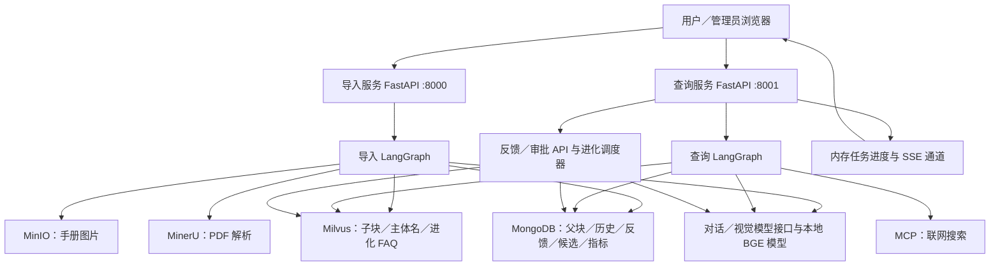
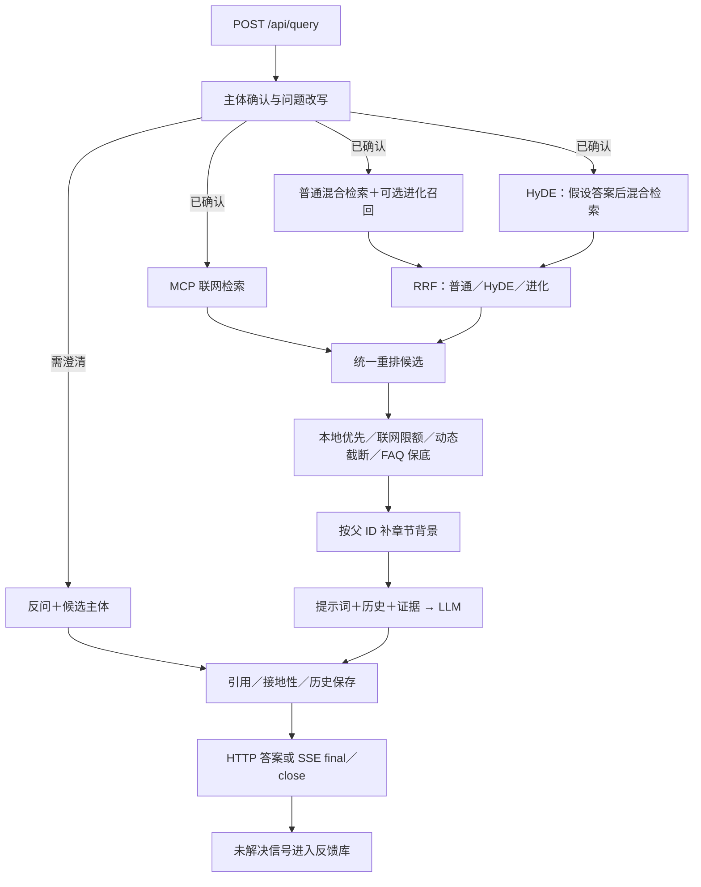
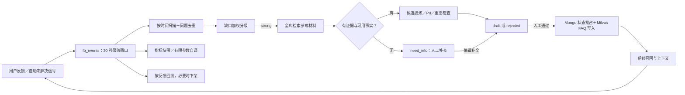

# se_rag 技术讲解：架构、数据流与核心源码

面向能读 Python、正在入门 RAG 的读者，按“先看全景 → 理解模块 → 跟踪数据 → 深入源码 → 判断风险”的顺序解释项目。安装、配置和启动方法见 [README](../README.md)。

面向多员工、多知识库的适用性判断与分阶段改进建议，见[企业级架构评估与优化路线](se_rag-企业级架构评估.md)。

源码核对日期：**2026-10-18**。本文以现存实现为依据，区分已实现行为、静态确认问题、架构约束与待验证风险；改进建议不代表功能已经实现。示例文档和对话仅用于解释数据流，不是实际模型输出或设备操作建议。

配置表列出源码默认值，不代表某个部署环境的生效值；正文不包含真实 `.env` 值。文档核对未启动服务、执行项目测试或连接外部服务。

## 阅读目录

- [1. 概述与定位](#1-概述与定位)
- [2. 架构总览](#2-架构总览)
- [3. 模块、分层与相互关系](#3-模块分层与相互关系)
- [4. 关键数据流与源码路径](#4-关键数据流与源码路径)
- [5. 设计思想与模式](#5-设计思想与模式)
- [6. 技术栈与关键配置](#6-技术栈与关键配置)
- [7. 为什么采用这些技术](#7-为什么采用这些技术)
- [8. 替代技术栈对比与建议](#8-替代技术栈对比与建议)
- [9. 风险、问题与改进建议](#9-风险问题与改进建议)
- [10. 证据边界、测试与待验证项](#10-证据边界测试与待验证项)
- [11. 附录：阅读路线、文件索引与掌握检验](#11-附录阅读路线文件索引与掌握检验)

## 1. 概述与定位

### 1.1 一句话理解

这是一个“把产品手册整理成可检索知识，再用这些知识回答客户问题，并把未解决的问题交给人工补充”的系统。它不是只把问题发给大模型：主要工作发生在**知识整理、主体确认、证据筛选、对话恢复和反馈治理**上。

RAG 是 Retrieval-Augmented Generation，即“检索增强生成”：先找资料，再让语言模型依据资料组织答案。这里的大模型负责理解和表达，Milvus 负责找相似材料，MongoDB 保存会话与业务记录，MinIO 保存图片。[项目声明](../pyproject.toml#L1)、[查询图](../app/process/query/agent/main_graph.py#L16)、[导入图](../app/process/import_/agent/main_graph.py#L16)

项目采用两个 HTTP 服务共享同一个 Python 代码库和底层存储的部署形态。将它称为“模块化应用、双服务入口”更准确；源码没有显示两个服务之间通过 RPC 协作，也没有体现一组完全独立的微服务。

### 1.2 项目结构快照与阅读边界

截至 2026-10-18，业务目录包含 142 个 Python 文件（含空包标记）；测试目录包含 56 个单元测试模块、1 个 E2E 模块及共享配置。前端有 3 个 HTML 页面、4 个 JS、4 个 CSS，另有 7 个提示词。数量仅用于认识项目规模，后续维护不应把它们视为固定指标。

本文件深入解释核心执行路径；第三方源码、样本文档正文、运行日志和生成结果不作为业务模块逐文件展开。全部重要结论通过仓库相对链接关联实现，文件职责见第 3 节，源码走读见第 11 节。

### 1.3 先抓住这八件事

1. **主体名是路由条件。** 系统通常先确认“问的是哪台设备”，再在相关知识中检索；主体错了，后面检索再好也可能答错。
2. **父子块分工不同。** 子块负责精准检索，父块负责补背景，父块不做向量检索。
3. **有两层融合。** Milvus 混合稠密/稀疏向量；RRF 再混合普通检索、HyDE、自进化结果。联网在重排阶段加入。
4. **图状态不是数据库。** `QueryGraphState`、任务进度和 SSE 通道多为进程内状态，重启不能自动恢复执行。
5. **“自进化”是知识与参数更新。** 它会补充 FAQ、调检索参数，没有训练大模型或自动修改模型权重。
6. **引用、重排分和接地性是不同东西。** 引用代表送入上下文的材料；重排分代表相关性；接地性是另一次模型评估，均不等于正确率保证。
7. **幂等不等于事务。** 稳定 ID 与 upsert 能减少重复和空窗，但不能保证多次并发导入或跨存储的一致提交。
8. **生产部署边界非常关键。** 当前会话隔离、管理鉴权、单进程约束和知识下架一致性应优先处理，之后再做效果调优。

## 2. 架构总览

### 2.1 用“资料员、检索员、审核员”理解系统

导入服务像资料员，把手册转换为正文、图片和索引；查询服务像检索员，确定产品、找证据、组织回答；自进化模块像审核员，把失败反馈变成待审核知识，再回流给检索员。三者共用模型和存储工具。



端口是源码默认值。图中箭头表示代码访问关系，不表示外部依赖已经连通。[服务装配](../app/api/http/query_server.py#L26)、[导入服务装配](../app/api/http/import_server.py#L22)、[配置](../app/shared/config/settings.py#L204)

### 2.2 从启动到第一次请求

1. `query_server.py`、`import_server.py` 创建 FastAPI，注册 CORS、错误处理器、页面和业务路由。
2. 导入配置模块时，`.env` 被加载并构造全局 `settings`；根路径工具、日志模块也在模块导入期间工作。
3. lifespan 尝试建立 Mongo 索引；失败告警后仍允许应用继续。
4. 仅查询服务在 `evolution.enabled` 与 `scheduler_enabled` 同时开启时启动进化循环。循环通过 `asyncio.to_thread` 把同步业务移到线程执行。
5. BGE-M3、重排模型、LLM 客户端及存储客户端主要按需创建。因此“HTTP 服务可响应”与“模型已经预热、所有数据库可用”是不同状态。[生命周期](../app/api/http/query_server.py#L26)、[模型延迟加载](../app/shared/models/embedding.py#L14)、[健康检查](../app/api/routers/health.py#L12)

### 2.3 当前部署能力的准确界限

导入服务和查询服务可以作为两个进程运行，但**查询服务本身依赖单 worker 语义**：SSE、查询进度、目录缓存、参数缓存、扫描游标和调度时间都在各自进程里。简单加 `--workers 4` 不能获得正确的四倍扩容。

导入端的信号量同样只限制当前进程；后台任务是 Web 进程中的工作，不是持久化消息队列。磁盘快照保存状态，不能让进程崩溃前的 Python 调用从断点自动续跑。[导入编排](../app/rag/import_/pipeline.py#L64)、[SSE](../app/shared/utils/sse_broker.py#L25)、[任务状态](../app/shared/utils/task_state.py#L48)、[调度](../app/evolution/scheduler.py#L116)

## 3. 模块、分层与相互关系

### 3.1 各层分别负责什么

| 模块 | 职责 | 读代码时的关注点 |
| --- | --- | --- |
| `app/api` | HTTP 入参、返回模型、鉴权、页面、服务生命周期 | 请求是否合法、谁能调用、何时转后台 |
| `app/process` | LangGraph 图、状态与薄节点 | 执行顺序、分支、并行结果写回哪些字段 |
| `app/rag/import_` | 解析、图片、结构切分、识别、向量化、索引与对账 | 文档如何变为知识，重复导入如何处理 |
| `app/rag/query` | 主体消解、召回、融合、重排、背景、答案与引用 | 问题如何变为证据和回答 |
| `app/rag/item_name` | 标准名目录、别名归一化、相似主体判定 | 写入与查询主体名是否一致 |
| `app/evolution` | 反馈、缺口、候选、审批、回流、指标、自调、回测 | 状态机是否闭合，错误知识能否可靠退出 |
| `app/shared` | 配置、模型门面、存储网关、仓储、日志与运行工具 | 外部依赖及横切能力在哪里集中 |
| `app/rag_eval` | 题库、真实切分、分层检索指标、报告 | 评估实际覆盖哪一段链路 |
| `app/resources` | HTML/CSS/JS 与提示词 | 用户操作如何映射接口，模型接到什么指令 |

### 3.2 以一次提问看分层

`query 路由`负责接收问题；`pipeline`负责整轮执行与收尾；`main_graph`规定节点连接；节点把任务进度与日志包在业务函数外；业务服务组织检索策略；模型门面与仓储完成外部访问。[路由](../app/api/routers/query.py#L32)、[编排](../app/rag/query/pipeline.py#L23)、[节点](../app/process/query/agent/nodes/node_search_embedding.py#L14)、[模型门面](../app/shared/models/providers.py#L13)

一个典型节点只返回自己负责的状态字段。例如普通召回节点只返回 `embedding_chunks`、`evolution_chunks`；HyDE 节点只返回 `hyde_embedding_chunks`。三条并行分支写不同字段，减少并发更新同一个状态键的问题。后续节点再读取合并后的图状态。

### 3.3 实际边界比目录图更复杂

静态导入盘点中，`rag → process` 有 17 处导入位置，主要涉及状态类型与流程入口；`process → rag` 有 15 处，节点调用业务服务。`rag → evolution` 与 `evolution → rag` 也双向存在，分别用于反馈/召回/评估和补充上下文/参数。

这说明分层有帮助，但还不是严格的单向依赖。**导入双向不等于已经发生 Python 循环导入错误**，也不能仅凭次数判断设计差；它意味着状态模型和跨模块业务约定比较集中地绑定了两边。长期演进可把公共状态/证据类型移入独立契约层，再把进化能力注入查询流程。当前规模下无需为了“干净架构”把每个函数都改成接口。

`LLMProvider` 是门面而非可自由插拔的完整插件系统：它统一获取模型，但业务仍依赖 LangChain 消息、返回对象以及全局实例。`EvolutionRepository` 也主要是集合访问器，领域服务里仍直接写 Mongo 查询。理解这些实际边界，比给项目贴 DDD 等标签更有价值。[模型门面](../app/shared/models/providers.py#L13)、[进化仓储](../app/evolution/repositories.py#L18)

## 4. 关键数据流与源码路径

### 4.1 导入：把手册变为可检索知识


**第一步：上传和异步任务。** `POST /api/import/upload` 要求 `X-Internal-Token`。入口只接受一个 md/pdf；检查文件名、大小和前 1024 字节，之后保存到 `output/日期/task_id/`。返回 `task_ids` 表示上传已接收，**不表示知识已经可用**；实际处理交给 `BackgroundTasks`，前端轮询状态。[上传接口](../app/api/routers/import_.py#L132)

**第二步：文档解析。** Markdown 直接读取；PDF 先申请 MinerU 上传 URL，上传原文件，再轮询解析结果，下载 ZIP、解压并定位主 Markdown。这里包含外发原文的行为，是否适合某类内部资料取决于部署的数据处理约定，外部服务的数据处理策略需由部署方另行确认。[解析](../app/rag/import_/pdf_parse_service.py#L59)

**第三步：图片变得可检索。** 只扫描 Markdown 同目录下 `images` 里的受支持图片，并检查是否被正文引用；视觉模型结合图片及前后各 200 字上下文生成说明。图片上传 MinIO 后，原引用替换为 ``，另存 `_new.md`。检索模型此后“看见”的是说明文字；回答页面可以利用图片 URL 展示原图。它不是在 Milvus 中直接检索图像向量。[图片增强](../app/rag/import_/enrich_markdown_images.py#L184)

**第四步：保留文档结构。** 优先读取同目录 `*_content_list.json`，保留标题级别、页码、表格等，过滤页眉页脚；没有有效产物则用 Markdown 状态机识别标题、段落、表格、围栏代码和图片，产出同一种 `Block`。两条解析路径随后共用切分器。[结构解析](../app/rag/import_/content_list.py#L112)、[Markdown 解析](../app/rag/import_/markdown_blocks.py#L29)

**第五步：父子块。** 每个章节产生父块，正文包含自身及后代章节的文本；子块只打包本章节自身的原子块，避免子章节正文重复向量化。无正文的上级标题仍能有父块；前言作为独立章节保存。子块附带标题、路径、父 ID、页码、序号和内容指纹。[切分入口](../app/rag/import_/split_service.py#L101)、[两级切分核心](../app/rag/import_/section_splitter.py#L119)

切分阈值默认按正文字符数计算：软目标 600、单原子块拆分阈值 1000、过短合并阈值 400、必要拆分时重叠 50。字符数不是 token 数。表格长时重复表头、代码长时补围栏；这些策略能保留语义，但一个超长表格行等特殊原子仍需单独验证，不能把 1000 理解成所有输出都绝不超限的断言。[切分配置](../app/rag/import_/config.py#L11)

**第六步：主体和向量。** 模型读取前 10 个子块识别产品，识别空则用文件标题。名称尽量归并到目录标准名，并回填父子块，再更新主体名索引。子块按默认每批 6 条向量化，文本为 `主体:名称,内容:正文`，获得 1024 维稠密向量和稀疏词权重。[主体写入](../app/rag/import_/item_name_service.py#L125)、[向量化](../app/rag/import_/embedding_service.py#L15)、[索引维度](../app/shared/clients/milvus_gateway.py#L58)

**第七步：写入与完成。** 子块先按确定性主键 upsert，检查写入数量，再删除同 `file_title` 下此次导入不再产生的旧 ID。父块写 Mongo，图片此前已经写入 MinIO；跨存储对账主要记录日志。父块写失败不会让导入失败，因此 `completed` 的语义是“主链路完成”，不是所有增强数据都已一致提交。[索引写入](../app/rag/import_/index_service.py#L156)、[父块](../app/rag/import_/parent_index_service.py#L15)、[对账](../app/rag/import_/reconcile.py#L108)

### 4.2 用一个文档理解 ID 与存储

假设导入 `demo-manual.md`：

```markdown
# 示例设备
## 电源
输入电压为 24V。
## 清洁
清洁前请断开电源。
```

这些值仅用于讲解，不是对真实设备的建议。`file_title` 是 `demo-manual`，`doc_id = sha1(file_title 去首尾空白并转小写)`。例如电源章节的 `heading_path` 是 `示例设备 / 电源`，第一次出现的 `occurrence` 是 0，首个子块 `part` 是 1。父 ID 编码文档、路径和 occurrence；子 ID 再加 part；`content_hash` 单独编码文本。[ID 公式](../app/rag/import_/ids.py#L27)、[章节元数据](../app/rag/import_/section_splitter.py#L184)

- **Milvus 子块**：`chunk_id/doc_id/parent_id/file_title/item_name/title/heading_path/part/seq/page/content/content_hash/dense_vector/sparse_vector`。
- **Mongo 父块**：`parent_id/doc_id/file_title/item_name/title/heading_path/page/child_count/content`。
- **Milvus 主体目录**：自增 `pk`、`file_title`、`item_name` 和两种向量。
- **MinIO 图片**：`image_dir/stem/image_name`，返回浏览器可访问 URL。

同一结构内容小改时 ID 可以保持；标题、章节顺序消歧或分块边界变了，部分 ID 也会变化。更重要的是：ID 稳定不代表历史引用的内容版本稳定，同一 ID 的内容可能已被覆盖。

### 4.3 问答：从用户语言到证据



**入口和两种返回方式。** `query` 为去空白后 1～4096 字符；`session_id` 可由客户端提供，未提供则生成 UUID。`is_stream=false` 等待结果；为 true 时返回会话 ID，后台跑图，浏览器另开 SSE 接收事件。这里的“后台”指响应后的任务，不是单独的任务服务。[请求模型](../app/api/schema/query_schema.py#L17)、[查询路由](../app/api/routers/query.py#L32)

**主体确认的三条优先路径：**

1. 有 `rewrite_hint`：把用户选择的主体对齐到目录标准名，再和前一问的意图拼起来，不让模型猜意图。
2. 没 hint，但最近一条助手消息含 `pending_subject_ask`，且当前只输入候选主体名：从历史取回意图，做服务端兜底。
3. 其他情况：取最近有效历史，让 LLM 识别主体并改写，再用目录和向量判定。阈值默认是 0.65、与次优不同主体间距 0.02；可选阈值 0.60。未确认则反问，直接跳到回答节点，不做知识检索。[主体消解](../app/rag/query/item_name_confirm_service.py#L302)、[名称判定](../app/rag/item_name/match.py#L191)、[阈值](../app/rag/item_name/config.py#L14)

有效历史只包含带已确认 `item_names` 的消息，避免把待选产品误当已确认。读取结果按时间倒序取最近若干条，喂模型时再反转成自然时间顺序；助手历史只保留前 50 字。这是有意限制上下文，但复杂跨轮指代可能因此丢掉关键细节。[历史上下文](../app/rag/query/history_utils.py#L12)

**第一层混合：一个检索入口内的 dense + sparse。** dense 擅长语义相近表达，sparse 保留词项匹配信号；代码用两组检索请求、默认 0.6/0.4 权重，返回每路最终 Top 5。主体过滤会扩展同一实体的已有写法，并放行 `default_item_name` 全局条目。普通召回与进化召回复用一份问题向量。[混合检索](../app/rag/query/chunk_search.py#L47)、[节点向量复用](../app/process/query/agent/nodes/node_search_embedding.py#L14)

导入嵌入包含“主体:…，内容:…”前缀，而查询嵌入直接使用 `rewritten_query`；它们没有完全相同的字符串模板。两侧是否匹配良好，应通过评估确认，不能照抄导入模块里“与查询端构造保持一致”的注释。

**HyDE：先猜一份用于搜索的答案。** 模型先生成假设答案，把“问题＋假设答案”再向量化找真实材料。假设文本不是直接返回给用户的事实来源；它用来跨越问法与手册用词的差异。代价是额外模型调用，也可能把搜索方向引偏。短事实型查询跳过 HyDE 的开关默认关闭。[HyDE](../app/rag/query/hyde_search_service.py#L31)

**第二层混合：RRF。** 同一 chunk 在多个排名出现时，累计 `weight/(k+rank)`，默认 k=60、Top=5。这样不用强行比较不同召回路的原始分数。联网不参与此处 RRF；进化 FAQ 可以参与，并有防挤出补回。[RRF](../app/rag/query/rrf_service.py#L50)

**重排：让问题与每份候选共同打分。** 普通向量检索像“先圈定相关书架”，cross-encoder 重排像“把问题与候选段落放在一起精读”。代码合并 RRF 与联网片段，对过长材料先用 LLM 压缩以供打分，再按 token 预算截断；最终生成上下文仍用原文。问题本身过长时也需要验证，因为当前硬截断主要针对候选正文。[重排](../app/rag/query/rerank_service.py#L253)

重排后并非只按模型分数取 Top K：联网分可能被压到本地最高分，同分本地优先；本地有命中时联网默认最多 2 条；默认至少保留前 2 条，再按累计分差截断，上限默认 6；被截掉的进化 FAQ 再被补回。因此最终条数可能超过 6，分数也经过业务策略修改，不能解释为自然概率。

**父块补背景。** 只对有 `parent_id` 的普通本地子块取 Mongo 父块；同父只注入一次，单父默认 1200 字、总预算 4000 字。它在重排之后执行，避免长章节干扰子块相关性。预算从章节开头截取，并非围绕命中位置截取；章节尾部问题仍可能缺少相邻解释。[父块回溯](../app/rag/query/parent_expand_service.py#L27)

**生成与收尾。** 提示词把问题、主体、历史、候选正文及父背景交给模型，要求有依据作答、无依据拒答。引用由最终候选集构造，覆盖 kb/evolution/web。开启自进化且有证据时才另调模型算 groundedness。助手消息保存后，pipeline 发布 final/close；符合未解决条件的状态再写反馈。[生成](../app/rag/query/answer_service.py#L43)、[提示词](../app/resources/prompts/answer_out.prompt#L1)、[引用](../app/rag/query/citations.py#L17)、[接地性](../app/evolution/online_eval/grounding.py#L27)

### 4.4 多轮实例：为什么 hint 很重要

假设用户先问“设备怎么清洁？”，目录里有两台相似设备：

1. 第一轮 `original_query="设备怎么清洁？"`；无法唯一确定主体，返回 `item_name_options` 和反问。
2. 用户消息不把候选列表写成已确认 `item_names`；助手消息记录 `pending_subject_ask={intent, options}`。
3. 用户点击“示例设备 A”，前端提交 `query="示例设备 A"`，另传 `rewrite_hint="设备怎么清洁？"`。
4. 服务端对齐标准名，拼成含清洁意图的完整问题，清空反问答案与选项，进入召回。
5. 如果刷新页面丢了前端内存，但用户手输的只是上一轮候选名，服务端仍可从最近助手消息复原意图；若用户同时输入新意图，则不接管。
6. 检索结果、引用、图片、接地性连同答案返回并写历史，供下一轮使用。

这解决的是**把主体与动作分开传递**的问题：仅把“示例设备 A”发给模型，模型可能顺着更早的话题改写。确定性字段传递比增加一段“不要猜错”的提示词更可控。[确定性消解](../app/rag/query/item_name_confirm_service.py#L145)、[前端发送](../app/resources/js/chat.js#L519)

### 4.5 自进化：它如何学习，哪里需要人工



**反馈事件。** 显式点赞/点踩由前端提交；自动信号来自零命中、普通/HyDE 均未检索、或识别到无法作答。30 秒内同会话、问题、thumbs、source 尽量去重。自进化总开关关闭时反馈接口仍接受，但不落库。[反馈](../app/evolution/feedback/collector.py#L17)

**缺口判断。** 默认权重 user=0.4、retrieval=0.3、generation=0.3，strong≥0.65、weak≥0.45。实际不是三次独立测量：负反馈将 user 置 1，无 cited IDs 将 retrieval 置 1，负反馈且有引用将 generation 置 1。默认下典型负反馈会得到 0.7，进入 strong；因此它是工程启发式，不是统计置信概率。[缺口](../app/evolution/gap/detector.py#L55)

扫描是按时间升序、每轮默认 50 条，配合进程内时间游标和一小时问题去重。代码只把 strong 缺口写入 `k_gaps`；weak/none 会被计算但未在此处落库，这与模块说明“其余归档”不同。

**候选与人工门。** 调度器为缺口做不带主体过滤的全库检索，生成器最多消费末 5 段、每段前 300 字，提炼 FAQ；无证据或非事实答案转 need_info；检测到 PII 或同问题候选则 rejected。人工补足 need_info 后可回到 draft，通过时才进入在线索引。[调度上下文](../app/evolution/scheduler.py#L31)、[候选生成](../app/evolution/candidate/generator.py#L66)

**审批回流。** approve 用 Mongo `find_one_and_update(status=draft)` 抢占为 active，分配 `evo_doc_id`，再写 Milvus；写失败尝试回滚为 draft，成功后回写缺口 resolved。这比无条件覆盖安全，但 Mongo 与 Milvus 没有一个共同事务，崩溃窗口仍存在。[审批](../app/evolution/approval/service.py#L40)

**效果与参数。** 指标按反馈事件计算采纳率、缺口率；调参只影响 `RRF_K/RRF_TOP/RERANK_TOP_K`，有步长与上下限。默认扫描间隔 30 分钟、指标 60 分钟、回测 24 小时，回测最低命中数 3。实际触发由扫描循环检查到期，非精确整点调度。[指标](../app/evolution/online_eval/metrics.py#L13)、[控制器](../app/evolution/tuning/controller.py#L36)、[回测](../app/evolution/backtest/runner.py#L37)

“回测”在这里是历史反馈聚合，不是重新执行一套标注问答；`promote` 是统计结论，没有进一步训练或更新模型的操作。

### 4.6 接口与运行状态契约

| 服务与接口 | 输入/输出要点 | 当前鉴权 |
| --- | --- | --- |
| 查询 `POST /api/query` | query/session_id/is_stream/rewrite_hint；返回会话或完整答案 | 应用层未要求用户身份 |
| 查询 `GET /api/query/status/{session_id}` | status、中文 done/running、query、错误 | 无会话所有者校验 |
| 查询 `GET /api/stream/{session_id}` | ready/progress/delta/final/error/close | 无会话所有者校验 |
| 查询 `GET/DELETE /api/history/{session_id}` | 最近消息（limit 限 1～100）/删除数量 | 无会话所有者校验 |
| 进化 `POST /api/evolution/feedback` | 客户端提交的 FeedbackEvent | 无身份及回答归属校验 |
| 进化 `GET .../candidates`、`GET .../status` | 候选内容与运行统计 | 未要求管理令牌 |
| 进化 `POST .../{id}/approve/reject/edit`、`DELETE .../{id}` | 审批、编辑、下架 | EVOLUTION_ADMIN_TOKEN |
| 导入 `POST /api/import/upload`、`GET /api/import/status/{task_id}` | 上传、轮询 | IMPORT_ADMIN_TOKEN |
| 两服务 `GET /api/health` | 存活与 asset_version | 无；不检测存储和模型 |

鉴权描述仅针对源码，无法排除实际部署在反向代理设置了额外保护。[查询接口](../app/api/routers/query.py#L32)、[进化接口](../app/api/routers/evolution.py#L55)、[上传接口](../app/api/routers/import_.py#L132)

HTTP 错误统一为 `{code,message}`；非流式查询失败仍返回通用 `query_failed/500`，详细分类在任务状态和 SSE error 中。流式 HTTP 连接已经建立后，业务失败通过事件表达，不能只看 HTTP 200 判定查询成功。[错误处理](../app/api/errors.py#L40)、[查询错误分类](../app/rag/query/errors.py#L41)

`QueryGraphState` 是一次执行携带的字典，有原问题、改写问题、各路候选、最终文档、答案与信号。`_TaskRecord` 是给前端看的运行进度；Mongo 历史是跨轮消息；这三者不同步保存，也不互相替代。[图状态](../app/process/query/agent/state.py#L5)、[任务状态](../app/shared/utils/task_state.py#L48)、[历史仓储](../app/shared/clients/history_repository.py#L14)

### 4.7 SSE 与刷新续接

1. pipeline 清掉本会话上一轮任务状态与缓冲，创建通道，保存本轮问题。
2. 节点装饰器在执行前后更新 running/done；流式生成发布 delta。
3. 无订阅者时缓冲最多 512 个事件；有订阅者时用 `call_soon_threadsafe` 把事件送入 asyncio 队列。
4. 前端先 POST，再用 EventSource 接 GET 流；final 回传完整答案、引用、主体选项等，close 关闭连接。
5. 刷新后先读任务状态、再读历史；若判断仍在执行且历史未见助手回答，则补气泡并订阅。
6. 断开时任务若仍执行，则解绑订阅者、保留后续缓冲；完成后按条件回收通道。

当前实现是**每会话一个 queue/loop 订阅槽**，并非真正的多订阅者广播；它也不是带事件序号和 Last-Event-ID 的可靠重放日志。刷新续接解决了常见路径，但存在窗口与多标签页限制，见风险 F06～F08。[SSE 实现](../app/shared/utils/sse_broker.py#L25)、[前端恢复](../app/resources/js/chat.js#L585)

## 5. 设计思想与模式

### 5.1 项目中确实能看到的模式

- **图式管道**：把业务阶段建成 LangGraph，导入有类型分支，查询有并行扇出和后续汇合。好处是流程可读、节点进度明确；代价是业务服务与图状态紧密相关。
- **门面与网关**：LLMProvider、MilvusGateway、MinioGateway 减少重复初始化和表达式拼接；好处是复用与测试打桩，代价是全局对象和部分直接客户端访问让边界仍可被绕开。
- **仓储**：会话与父块使用专门读写入口；进化仓储提供集合入口。它们降低持久化细节散落程度，但不是所有集合写操作都收敛在仓储方法中。
- **装饰器实现横切能力**：`node_log/step_log/track_node_task` 记录耗时与进度；节点函数更薄，但装饰器在 finally 中登记 done，done 不等同成功。
- **检索适配**：多种结果归一为业务文档结构，RRF 按 ID 融合，再统一重排；新增召回源应遵守 ID、source、正文和引用约定。
- **幂等＋补偿**：稳定 ID、upsert、先写后清、审批失败回滚。适合降低失败损失；不能替代事务、版本隔离和持久化重试。
- **可选能力降级**：联网、HyDE、进化召回、父块、历史部分故障可退化运行。代价是“接口成功但答案质量下降”，需要可观察性标识。

上述判断来自实际函数和调用，而非仅凭类名推测。[节点](../app/process/query/agent/nodes/node_search_embedding.py#L14)、[进度装饰器](../app/shared/utils/task_state.py#L217)、[先写后清](../app/rag/import_/index_service.py#L156)、[审批补偿](../app/evolution/approval/service.py#L40)

### 5.2 目前不宜作出的设计判断

没有证据说明项目已经实施多租户、严格 DDD、事件溯源、持久化工作流或分布式事务。这里“agent”主要是图节点命名：查询图固定，模型没有自由决定使用什么工具、无限循环探索。把它理解为可控的 RAG 工作流更贴近代码。

## 6. 技术栈与关键配置

### 6.1 声明依赖、锁定版本与实际用途

以下版本来自当前 `uv.lock`，不是联网查询的最新版本，也没有确认当前 `.venv` 与锁文件完全一致。

| 类别 | 当前锁定技术 | 在项目中做什么 |
| --- | --- | --- |
| 语言/依赖 | Python ≥3.11；`.python-version` 为 3.12；uv | Python 应用与可重建依赖解析 |
| HTTP | FastAPI 0.135.1、Uvicorn 0.42.0、python-multipart 0.0.22 | 路由、模型校验、上传、流式响应 |
| 工作流/模型调用 | LangGraph 1.1.3、LangChain 1.2.13、langchain-openai 1.1.11 | 固定业务图、消息、提示词与 OpenAI 兼容模型协议 |
| 切分/解析 | langchain-text-splitters 1.1.2、BeautifulSoup 4.14.3 | 长文本细分、HTML 表格归一 |
| 本地模型 | FlagEmbedding 1.3.5、Torch 2.10.0、Transformers 4.57.6 | BGE-M3 和 BGE-Reranker 推理 |
| 向量数据库 | pymilvus 2.6.10 及 model 扩展 | 混合召回、向量集合、索引 |
| 文档数据库 | PyMongo 4.16.0 | 历史、父块、进化业务状态 |
| 对象存储 | MinIO SDK 7.2.20 | 图片上传与 URL |
| 外部搜索 | openai-agents 0.4.2 的 `agents.mcp` | 调 MCP 搜索工具；未用其 Agent 接管整体流程 |
| 运行辅助 | Loguru 0.7.3、python-dotenv 1.2.2、Requests 2.32.5 | 日志、配置、MinerU HTTP |
| 测试 | pytest 9.1.1、mongomock 4.3.0 | 离线函数测试、Mongo 替身、显式 E2E |

来源：[依赖清单](../pyproject.toml#L1)、[锁文件](../uv.lock#L1)、[实际模型调用](../app/shared/models/llm.py#L15)、[搜索](../app/rag/query/web_search_service.py#L18)。

项目业务代码直接使用 `pydantic/langchain_core/starlette/grpc/openai/typing_extensions` 等传递依赖。短期锁文件能约束解析结果，长期宜声明直接使用的关键包或明确约束来源。`numpy/torch/transformers` 等可能主要服务模型依赖链，不能因业务没有直接 import 就武断删除。

### 6.2 配置从哪里来

`common.py` 使用 `load_dotenv(override=True)`，同名 `.env` 值覆盖既有进程环境变量；`settings` 在导入时构造，修改文件后不会自动重建所有缓存。根路径优先取 `PROJECT_ROOT`，否则从源码目录向上寻找 `.env`。缺失 `.env` 且未设置 PROJECT_ROOT 时，根路径工具会抛错，即使想仅靠其他环境变量启动也可能受影响。[配置工具](../app/shared/config/common.py#L14)、[根路径](../app/shared/utils/paths.py#L15)

配置集中是设计目标，实际还存在查询/导入/主体 config、日志、Mongo、根路径与进化 API 直接读取环境的例外。报告与排障必须覆盖这些入口，不能只看 `settings.py`。[配置聚合](../app/shared/config/settings.py#L204)

### 6.3 最影响行为的默认值

| 参数组 | 源码默认值 | 改动影响 |
| --- | --- | --- |
| 主体 | 0.65 确认下限、0.02 间距、0.60 可选下限；目录缓存 60 秒 | 自动确认和反问比例 |
| 切分 | 600 软目标、1000 原子拆分阈值、400 合并阈值、50 重叠；批量向量化 6 | 语义完整性、召回粒度、显存与导入成本 |
| 普通检索 | 每次 Top 5；dense/sparse 0.6/0.4 | 候选多样性与召回 |
| RRF | K=60、Top=5；进化开时注册表可覆盖 | 多路排名融合和后续候选数 |
| 重排 | 上限 6、至少前 2、差值/比例阈值均 0.2、打分预算 512 tokens | 上下文数量与相关性；FAQ 保底可突破条数上限 |
| 背景/联网 | 单父 1200 字、合计 4000 字；本地命中时最多 2 条联网 | 证据完整性与模型输入成本 |
| 上传/导入 | 50 MB、同时执行 2、等待名额 600 秒、最多尝试 3 次 | 磁盘、排队、线程占用 |
| 超时 | LLM 60 秒/SDK 重试 2；Milvus 15 秒；MCP 30 秒＋外层 5 秒裕量 | 单次依赖等待；不等于整轮查询时限 |
| MinerU | 请求 30 秒、上传 120 秒、轮询上限 600 秒、轮询间隔 3 秒、下载 60 秒 | PDF 任务耗时与失败恢复 |
| 进化 | 总开关 false；扫描 30 分钟、指标 60 分钟、回测 24 小时、观察窗 7 天 | 闭环是否运行与更新节奏 |
| 清理 | 任务状态 TTL 6 小时；SSE 空闲 30 分钟、无人订阅缓冲 512 条 | 内存记录生命周期，不是数据保留政策 |

出处：[查询参数](../app/rag/query/config.py#L7)、[主体参数](../app/rag/item_name/config.py#L14)、[导入参数](../app/rag/import_/config.py#L11)、[settings](../app/shared/config/settings.py#L204)、[SSE](../app/shared/utils/sse_broker.py#L25)。

### 6.4 运行资源与部署资料

需要 Python 环境、模型文件/可用模型来源、LLM 接口，以及 Milvus/MongoDB/MinIO；PDF 需要 MinerU，联网补充需要 MCP。BGE 模型配置可选 CPU/GPU、FP16。源码不足以给出可信的最低显存、吞吐或并发容量，这里不提供未经实际硬件与负载测试验证的容量结论。

两个服务是不同进程，本地模型的“单例”只在各自进程内成立；它们可能各加载一份模型。模型首次并发初始化缺少锁，也应关注重复加载峰值。[嵌入模型](../app/shared/models/embedding.py#L14)、[重排模型](../app/shared/models/reranker.py#L12)

版本库内未发现 Dockerfile、Compose 或 CI 工作流；这表示**仓库没有提供这些交付物**，不表示外部一定没有部署系统。`.env` 已被 Git 忽略，锁文件随仓库维护；安装与启动方法见 [README](../README.md)。

## 7. 为什么采用这些技术

以下是根据实现推断的适配理由，除源码注释明确说明者外，不代表原作者的选型陈述。

- **FastAPI**：Pydantic 入参模型、文件上传和 StreamingResponse 能直接覆盖当前交互；两入口共用路由很自然。当前没有必要因为缺少传统全栈后台就换 Web 框架。
- **LangGraph**：查询存在条件分支、并行召回和共享状态，图比散落的嵌套 if 更易对应前端进度。它的代价是图状态契约与节点执行语义需要专门理解；当前 compile 未配置持久化 checkpointer，不能因此推断具备故障续跑。
- **BGE-M3＋Milvus**：同一模型产生 dense/sparse，数据库支持对应索引与混合查询；产品型号与自然语言同时出现，混合匹配有实际用途。1024 维、度量和存量 schema 是绑定关系，换 embedding 模型不只是换一个配置值。
- **独立 reranker**：召回优先找全，重排再精细筛选。它增加本地推理与压缩调用成本，所以必须用分层评估确认收益。
- **MongoDB**：会话、候选、指标等结构容易扩展；父块按 ID 读取且可能很长，不需要再向量化。仓储注释明确指出父块放 Mongo 可避开 Milvus 文本字段字节上限。[父块设计](../app/shared/clients/parent_chunk_repository.py#L1)
- **MinIO**：把图片与向量正文分离，答案只带 URL；有利于浏览器展示和对象清理。公开 URL 的便利性与敏感手册访问控制存在取舍。
- **外部 MinerU 与视觉模型**：把 PDF 布局与图片语义处理委托专门组件，项目专注切分、索引和问答；代价是延迟、费用、外发数据与外部可用性。
- **原生 JS 三页面**：交互范围较小，直接 fetch/EventSource 即可完成，不需要前端构建流程；共享 `app.js` 减少重复，状态恢复复杂后也需要浏览器级测试。

## 8. 替代技术栈对比与建议

本节不评价候选产品的当前市场、维护状态或未经测量的性能。建议依据是本项目现有代码、状态边界和迁移成本。

| 当前方案 | 可选方向 | 适用场景与收益 | 代价、迁移风险 | 结论 |
| --- | --- | --- | --- | --- |
| FastAPI＋原生 JS | 保持；复杂管理后台再评估前端框架 | 当前三页足够，团队继续使用现有 Python/JS 能力 | 换框架要重做交互、鉴权、恢复流程，不能自动修复业务一致性 | **保持不变** |
| LangGraph | 普通显式 Python 流程 | 若流程长期固定，可减少框架概念和状态转换成本 | 要重写并行、分支、节点进度；对当前已有图收益未证实 | **保持不变** |
| Web 进程内任务与 SSE | Redis＋持久化任务执行器/事件通道 | 需要跨进程、重启恢复、多实例时，解决实际状态共享问题 | 增加运维、任务幂等、取消、事件顺序和重放设计；仅加 Redis 不会自动完成迁移 | **值得试点** |
| 三存储分别写入 | 版本化写入＋outbox/补偿任务 | 降低候选审批和文档更新跨库不一致 | 增加中间状态、修复队列与对账成本，但可逐步落地 | **优先于更换数据库** |
| Milvus 混合检索 | PostgreSQL＋向量扩展或其他检索后端 | 若数据规模与运维更适合合并存储，可做隔离样本验证 | 稀疏召回、索引、打分尺度、过滤和全部向量迁移都需重验；性能未知 | **当前无需替换** |
| 本地 BGE 推理 | 独立模型服务 | 两入口/多实例共享模型，便于统一资源与批处理 | 多一次网络依赖，需队列、超时、协议与模型版本治理；索引兼容仍需保证 | **有资源压力再试点** |
| 真实题库上固定 HyDE 的评估 | 分层确定性回归＋真实完整链路评估 | 同时回答“代码是否退化”和“客服是否真的有效” | 需要独立数据集、人工标注与预算隔离，增加维护成本 | **建议补齐评估层次** |

不建议一上来迁移为微服务、Kubernetes 或更换向量数据库。当前最紧迫的问题大多来自权限、状态机和跨库一致性，换产品本身不能解决。

## 9. 风险、问题与改进建议

### 9.1 阅读方法

P1 表示在对应触发条件下可造成明显数据、权限或核心功能风险，应优先处理；P2 表示功能可靠性、效果或运维风险；P3 表示契约与维护欠账。优先级用于安排排查与改进顺序，不是已发生事故的证明。

“静态确认”表示代码存在相应路径；“风险推断”表示实际影响仍依赖部署、数据或时序。没有运行故障注入或在线攻击。每项代价只作低/中/高的工程量级估计。

### F01 · P1：会话与候选读取缺少应用层身份边界

**证据与触发：** 查询、历史读取/删除、状态和 SSE 直接使用传入 session_id；没有用户身份或 owner 过滤。候选列表直接返回 FAQ 全文；反馈中的引用、主体、时间和采纳信息由客户端提供。若接口可被不可信客户端访问，持有或自行选择同一会话 ID 即可访问/扰动该会话；反馈还可被伪造来影响指标和自动下架。[查询路由](../app/api/routers/query.py#L32)、[进化路由](../app/api/routers/evolution.py#L55)、[反馈模型](../app/evolution/models.py#L18)

**现有防护：** 前端默认随机 UUID、历史条数上限；管理写接口有令牌。UUID 降低猜中概率，但没有建立所有权。实际外层网关是否隔离，待确认。

**建议：** 绑定服务端用户与会话，所有读写都按 owner 校验；候选读取纳入管理权限；反馈使用服务端 answer_id 校验引用、时间和归属，并做限额。收益是权限边界与指标可信度；代价中。

### F02 · P1：导入管理令牌有固定非空默认值

**静态确认：** `settings.py:272` 在未设置 IMPORT_ADMIN_TOKEN 时仍提供固定默认字符串，鉴权函数只检查是否为空及是否相等。“未配置即 fail-closed”的说明因此不成立，只有明确置空才拒绝。[默认令牌位置](../app/shared/config/settings.py#L272)、[鉴权](../app/api/routers/import_.py#L43)

**触发与影响：** 部署漏配且上传接口可达时，可用源码中的默认凭据调用管理导入。报告不复述其值，也未判断线上是否使用。

**建议：** 去掉非空默认；生产启动检查有效配置，已有部署更换凭据。现有 fail-closed 校验可以保留。收益直接，代价低。

### F03 · P1：下架失败仍删除候选记录，可能留下在线孤儿知识

**静态确认：** remove_candidate 调用 deactivate 却不检查布尔返回值，随后删除 Mongo 候选并返回成功。deactivate 在向量删除异常时返回 False；在线召回只查 Milvus 的 active。[删除流程](../app/evolution/approval/service.py#L149)、[向量下架](../app/evolution/index/update.py#L85)、[在线召回](../app/evolution/retrieval.py#L80)

**触发与影响：** 向量库暂时删除失败时，页面显示已下架，内容仍可能进入回答，同时用于重试/治理的候选记录已经消失。现有测试只覆盖 deactivate 成功。[当前测试](../tests/unit/test_approval_service.py#L113)

**建议：** 保留 deactivating/failed 状态与 ID，成功移除在线知识后再完成删除，后台重试并对账。收益是可靠撤回；代价中。

### F04 · P1：候选编辑、驳回与审批并发未组成完整状态机

**静态确认：** edit/reject 不限制原状态，也不检查更新匹配数；active 条目可经 API 修改 Mongo 文本而不更新向量，或标 rejected 而不下架。approve 先 active 后写向量，在此间崩溃可留下 active 未索引；另一个 approve 看到 active 即返回成功。[审批状态](../app/evolution/approval/service.py#L40)、[编辑与驳回](../app/evolution/approval/service.py#L106)

**现有防护：** 页面只给 draft/need_info 编辑，active 仅提供下架；approve 有原子抢占和普通失败回滚。页面限制不能约束直接 API 调用或进程崩溃。

**建议：** 服务端限制状态转移；引入 indexing 中间态、版本号及失败修复；active 编辑采用重新审批/重新索引；驳回 active 要明确撤回行为。收益是元数据与在线知识一致；代价中。

### F05 · P1：文件名承担文档身份，同名与并发重导入可互相覆盖

**静态确认：** file_title 取 basename 的 stem，doc_id 基于其归一化哈希；子块清理按 file_title，图片按 stem，父块按 doc_id。同名不同手册会共享数据空间；全局允许两个导入同时执行，却没有按文档锁或版本隔离。[入口命名](../app/rag/import_/entry_service.py#L12)、[ID](../app/rag/import_/ids.py#L27)、[清旧块](../app/rag/import_/index_service.py#L125)、[图片键](../app/shared/clients/minio_gateway.py#L77)、[父块覆盖](../app/shared/clients/parent_chunk_repository.py#L38)

**风险推断：** 两个不同版本同名并发导入，各自认为另一版本独有的块是旧块并删除，可得到混合或缺失结果。大小写在 doc_id 上归一、file_title 过滤未统一，还存在身份口径差异。

**建议：** 用独立 document_id/命名空间与版本号；同文档串行更新，写完版本后切换可见指针再清旧版本。稳定主键已减少单次重试重复；跨版本原子性仍需补齐。代价中到高。

### F06 · P1（部署约束）：单进程状态不能直接扩成多 worker

**静态确认：** SSE、任务进度、信号量、扫描游标与调度时钟均在进程内。POST 与 SSE 若落在不同查询 worker，可找不到通道；每个查询 worker 都可能启动调度器。一个 session 同时提交两问还会共享并重置状态和通道。[SSE](../app/shared/utils/sse_broker.py#L25)、[查询编排](../app/rag/query/pipeline.py#L23)、[调度生命周期](../app/api/http/query_server.py#L26)

**现有防护：** 有线程锁、TTL、前端发送按钮防重复；没有进程间协调或服务端每会话执行门。

**建议：** 近期明确单 worker/单调度器部署并在服务端拒绝同会话并行问答；扩容时分离 conversation_id 与 request_id，持久化任务、事件和分布式调度租约。代价：近期低，扩容中到高。

### F07 · P2：SSE 只有一个订阅槽，活跃队列无上限

**静态确认：** 新 stream_events 为同会话覆盖 queue/loop；旧连接 finally 又无条件清空当前槽。两个标签页连接同会话时可能让新旧连接互相断供。512 上限仅用于 pending，活跃 `asyncio.Queue()` 没有 maxsize。[订阅槽](../app/shared/utils/sse_broker.py#L156)、[投递](../app/shared/utils/sse_broker.py#L117)

**影响与防护：** 单页顺序查询通常可用，慢消费/多标签页时可能丢流或堆积。未验证实际内存峰值。没有事件序号，也没有 SSE 心跳帧，长时间无事件时代理超时策略待验证。

**建议：** 明确单订阅拒绝旧连接，或实现订阅者集合及连接身份清理；有界队列、背压/溢出重同步策略、事件序号与心跳。代价中。

### F08 · P2：刷新恢复仍存在“新问题尚未写历史”的窗口

**静态路径：** pipeline 先记录 status/query，主体确认末尾才存用户消息；restoreSession 看到 history 最后一条是 assistant 就直接返回。若旧对话最后是助手、新一轮已 processing 但用户记录尚未落库，刷新会把旧助手当成新轮已完成，从而不接 SSE。[保存问题](../app/rag/query/item_name_confirm_service.py#L289)、[执行顺序](../app/rag/query/pipeline.py#L23)、[恢复判断](../app/resources/js/chat.js#L585)

**另一窗口：** 读快照时仍 processing、随后任务完成并回收通道，再连接可能收到 stream_not_found；当前前端没有自动重拉历史收敛。

**建议：** 使用 request_id 与本轮消息 ID/时间配对，接口返回可判定的结果状态；连流失败或过期时重新读状态与历史。现有恢复测试覆盖常见断开路径，未证明这些跨层窗口闭合。代价中。

### F09 · P2：PDF 检查点路径与实际产物路径不一致

**静态确认：** 下载函数在 `local_dir/file_name/` 下解压并返回其中 Markdown；复用函数却仅检查 `local_dir/<stem>.md`。正常产物没有复制到被检查的位置，所以后续整图重试往往无法复用解析结果。单测手工创建了根目录 Markdown，未覆盖真实解压布局。[解压位置](../app/rag/import_/pdf_parse_service.py#L173)、[复用位置](../app/rag/import_/pdf_parse_service.py#L200)、[测试布置](../tests/unit/test_import_timeouts.py#L101)

**影响与建议：** 后续存储失败可能触发重复外部解析与费用。把实际产物路径及源文件指纹写入 manifest，再复用它；补下载→复用的串联测试。已有 mtime 检查可辅助，但不足以代表内容版本。代价低。

### F10 · P2：入口格式校验与后续解析口径不同

**静态确认：** 上传校验将后缀转小写，实际 entry_service 用大小写敏感 endswith；`MANUAL.PDF`/`.MD` 可先接受、后失败。UTF-8 文件头只取 1024 字节再严格解码，若边界切在多字节字符中间，也会把合法文件误拒绝。[上传校验](../app/api/routers/import_.py#L82)、[文件分派](../app/rag/import_/entry_service.py#L12)

**建议：** 全链路使用同一个 suffix 解析；嗅探时区分“不完整末尾字符”和非法编码，再对实际文本读取做校验。已有后缀与编码用例提供基础，需补边界用例。代价低。

### F11 · P2：历史落库把“未评估”变为 0

**静态确认：** answer_service 在不开启评估或无证据时返回 None；HistoryRepository 使用 `groundedness or 0.0` 落库，GET history 再把 0 传给前端，前端按数字展示百分比。[未评估返回](../app/rag/query/answer_service.py#L107)、[落库转换](../app/shared/clients/history_repository.py#L58)、[前端数值显示](../app/resources/js/chat.js#L216)

**影响与建议：** 同一个答案实时显示未评估，刷新后可能显示 0%。保留 nullable 值，给历史仓储增加 None 往返用例；旧数据中“未评估”和真实 0 已不可仅凭数值区分，需要谨慎处理。代价低到中。[现有测试边界](../tests/unit/test_grounding_unknown.py#L54)

### F12 · P2：状态快照不是重启恢复，处理中快照可长期残留

**静态确认：** 导入只在整体状态迁移时保存 JSON；进程被终止后，磁盘 processing 不会自动变 failed，也不自动恢复任务。load_snapshot 不检查过期时间，写入也不是临时文件原子替换。[快照](../app/shared/utils/task_snapshot.py#L21)、[导入调用点](../app/rag/import_/pipeline.py#L64)、[状态回退](../app/api/routers/import_.py#L173)

**影响与建议：** 重启后可能一直看到处理中；快照损坏则回退空状态。增加 started_at/heartbeat/worker_generation，启动时处理过期任务；原子替换快照并设置产物清理策略。现有内存 TTL 不管理磁盘快照。代价中。

### F13 · P2：参数快照的字典合并顺序覆盖了真实自调值

**静态确认：** get_all_params 返回 `cached | dict(_FALLBACKS)`，同名键由右侧默认值覆盖；单参数 get_param 却优先用缓存。因此实际检索可使用自调值，指标 params_snapshot 记录默认值。[参数合并](../app/evolution/tuning/param_registry.py#L52)、[指标取快照](../app/evolution/online_eval/metrics.py#L13)

**建议：** 合并顺序改为默认值后叠加缓存，验证 get_param/get_all_params 一致。还应校验人工写入范围，刷新时清理已删除缓存。收益是排障与实验可追溯；代价低。

### F14 · P2：缺口扫描的时间游标与问题去重有边界缺口

**静态确认：** 仅以 ts 游标推进且下一批用 `ts > cursor`；一批在相同时间戳中截断时，剩余同时间事件会被当前推进跳过。游标归零后可能重扫到，持续有新信号时则可能长时间延迟。去重只用 query，不含主体；weak/none 也没有按注释归档。[扫描](../app/evolution/gap/detector.py#L96)、[去重](../app/evolution/gap/detector.py#L32)

**建议：** 用 `(ts,_id)` 稳定复合游标；以主体＋规范化问题作为去重键；明确 weak/none 是否需要保留与重新升级。当前升序扫描已经改善旧事件饥饿，但不构成严格逐条一次处理。代价中。

### F15 · P2：自动信号与反馈指标不等于实际解决率

**静态确认：** 自动未解决信号也写 adopt=False/thumbs=-1，与用户负反馈同库统计；成功但用户没反馈的回答一般不形成对应正事件。无主体反问的空证据也可能被当成未解决知识缺口。compute_snapshot 的 recall_k/precision/groundedness 字段没有在此函数中填充，保留模型默认值。[自动信号](../app/evolution/feedback/collector.py#L17)、[输出信号](../app/rag/query/answer_service.py#L107)、[指标计算](../app/evolution/online_eval/metrics.py#L13)

**影响与建议：** 越积极记录失败，采纳率可能越低；同一回答的系统/用户事件还可能重复计数，从而牵动调参和回测。区分 event_type、answer_id、clarification、真实回答曝光与显式评价；未计算的指标用未评估语义。现有阈值和最低命中数能防单条误杀，不能消除采样偏差。代价中。

### F16 · P2：已审批 FAQ 被无条件保底，相关性约束不足

**静态确认：** 进化召回无明确最低相关性阈值，RRF 补回缺失 FAQ，重排截断后再把所有遗漏进化候选放回前面。人工审批保证了内容经过审核，不能保证它与每个新问题相关。[FAQ 召回](../app/evolution/retrieval.py#L80)、[融合保底](../app/rag/query/rrf_service.py#L50)、[重排保底](../app/rag/query/rerank_service.py#L123)

**风险与建议：** 同主体内弱相关 FAQ 也可能占用上下文并偏转回答，最终条数突破上限。增加“权威性＋相关性”双门、总 token 预算、冲突规则和负样本评估。现有无事实答案过滤与本地优先策略值得保留。代价中，效果需要真实样本验证。

### F17 · P2：候选隐私与来源校验没有覆盖整条写入链路

**静态确认：** PII 检查在自动生成路径；need_info 人工编辑后与 approve 路径未再做同样检查。正则覆盖有限，长数字替换也可能损失设备事实。调度上下文只携带 text，生成器的 source_refs 来自模型自由输出，未核查真实 ID 或证据支持。[生成与 PII](../app/evolution/candidate/generator.py#L66)、[正则范围](../app/evolution/candidate/pii.py#L9)、[编辑](../app/evolution/approval/service.py#L106)、[上下文](../app/evolution/scheduler.py#L31)

**风险与建议：** 人工补充的敏感内容可绕过生成阶段规则；候选来源可能无法追溯。将隐私/质量检查放到所有激活写入前；传递真实证据 ID、版本、主体并校验 source_refs 子集。人工审核仍是重要防线，但不是代码级校验的替代。代价中。

### F18 · P2：局部超时与并发限制未形成整体资源预算

**静态确认：** 混合检索及目录查询显式传超时，但导入建集合、upsert、旧块 query/delete、进化索引操作有不少直接客户端调用未显式传业务 timeout。查询没有总体时限、请求并发闸门或全局模型配额；导入只限制执行槽，等待槽的后台任务本身仍占资源。[RPC 防护](../app/shared/clients/milvus_gateway.py#L103)、[直接写操作](../app/rag/import_/index_service.py#L156)、[进化写入](../app/evolution/index/update.py#L58)、[导入闸门](../app/rag/import_/pipeline.py#L64)

**风险推断：** 外部卡顿、长文档、多次局部重试、并发模型加载可能累积长尾和内存/显存压力；未测量具体上限。下载 ZIP 使用 response.content，无解压体积/文件数预算；上传大小检查也发生在 multipart 已接收之后，不能代替代理级请求限额。[下载解压](../app/rag/import_/pdf_parse_service.py#L173)

**建议：** 每个远端操作显式预算，整轮 deadline、取消和分级并发限制；有界等待队列、模型初始化锁、流式下载与归档限额；不要单纯增大线程池。现有超时/批处理为基础，代价中。

### F19 · P2：日志与图片访问需要部署级数据边界

**静态确认：** 日志启用 backtrace/diagnose，主体确认 INFO 记录问题与意图；异常的局部变量可能带业务内容。新建 MinIO 桶设置全桶 GetObject 公共只读策略，并直接拼可访问 URL；已有桶不会在这里重新设置策略。[日志配置](../app/shared/runtime/logger.py#L46)、[问题日志](../app/rag/query/item_name_confirm_service.py#L302)、[桶策略](../app/shared/clients/minio_gateway.py#L22)

**影响与建议：** 若用于敏感手册，日志和图片 URL 可能成为旁路泄露通道；实际日志内容与现有桶权限需在部署环境核查。生产关闭 diagnose、结构化脱敏、限制日志权限，图片按需要改受控下载/短期签名地址与专用桶。已有前端文本使用 textContent、引用 URL 限 http(s)，不应笼统判为任意 HTML 注入。代价低到中。

### F20 · P2：结构化产物转换失败不一定按说明回退

**静态确认：** resolve_blocks 的 try 只围住 JSON 读取，normalize_content_list 在 try 外；HTML colspan/rowspan 直接 int 转换，非数字会抛错而中断导入。结构化 table 无法转换时直接 continue，也可能在其他块有效时局部丢掉表格。[回退范围](../app/rag/import_/split_service.py#L53)、[表格转换](../app/rag/import_/content_list.py#L112)

**建议：** 转换错误进入可观测的块级保留或整文回退，报告丢块数量；用异常表格属性、空表格和超长单行测试验证。当前 Markdown 回退与解析质量测试已有基础，代价低到中。

### F21 · P3：配置、注释、观测能力存在漂移

**静态确认：** gray_enabled、groundedness_min 只定义/读取，未发现消费点；EMBEDDING_DIM 名称出现在 `.env`，向量 schema 却固定 1024；“唯一环境变量入口”有多个例外；节点说明把联网算入 RRF，实际未参与；父块仓储顶部仍写“先删后插”，方法已改为 upsert。LLM temperature 使用 `value or 0.1`，显式 0 无法生效。[配置](../app/shared/config/settings.py#L204)、[向量 schema](../app/shared/clients/milvus_gateway.py#L58)、[RRF 节点注释](../app/process/query/agent/nodes/node_rrf.py#L9)、[父块仓储](../app/shared/clients/parent_chunk_repository.py#L1)、[温度](../app/shared/models/llm.py#L15)

**影响与建议：** 调开关可能没有效果，指标/说明让人误判实际行为；健康检查只证明存活。梳理配置消费表，移除或实现未接线项，用 is None 区分 0 与未配置，分开 liveness/readiness 并补运行说明。未发现仓库 CI 证据，建议把验证门禁和依赖锁同步流程写清。代价低到中。

### 9.2 RAG 的另外三项固有限制

- **提示词隔离：风险推断。** 答案提示词虽要求仅用参考内容，但规则、用户输入、历史与检索文本最终拼进 HumanMessage；没有看到独立的注入检测或不可信证据权限边界。恶意文档可能干扰回答，是否能成功需要对抗样本验证。这里不应仅靠增加“必须遵守”字样宣称解决。[生成消息](../app/rag/query/answer_service.py#L43)
- **引用粒度：静态事实。** 当前引用来自上下文候选全集，未解析模型逐句引用，也未证明模型真的使用了每一块。把它叫“参考来源”更准确；可进一步用证据编号和逐句校验增强归因。[引用构造](../app/rag/query/citations.py#L17)
- **接地性覆盖：静态事实。** 评估每段只取前 500 字，答案最多 4000 字，而且传入 evidence 不含后加的 parent_content。来自父背景或段落尾部的合法事实可能被评为不支持；同一类模型自评也不是独立真值。[接地评估](../app/evolution/online_eval/grounding.py#L27)、[证据取值](../app/rag/query/answer_service.py#L107)

### 9.3 建议修复顺序

1. **先建立数据边界与可靠撤回**：F01/F02/F03/F04；明确应用实际暴露范围。
2. **再固定部署与执行身份**：F05/F06，随后处理 SSE 多订阅和刷新窗口 F07/F08。
3. **修低成本确定性问题**：F09/F10/F11/F13，补能跨模块串联的回归用例。
4. **完善恢复与资源预算**：F12/F18，补故障注入和存储对账。
5. **最后用独立评估改效果**：F14～F17/F20，完善指标含义、证据质量和 FAQ 相关性；同步处理日志与文档治理。

## 10. 证据边界、测试与待验证项

### 10.1 现有测试说明了什么

现有单测主题较丰富：切分回归、父子块、ID、主体候选与意图、RRF、重排截断与来源优先、故障降级、SSE 缓冲、刷新恢复、上传防护、导入原子性、引用和进化审批等。`offline_guard` 用 monkeypatch 阻断 Mongo/Milvus/MinIO 真实客户端，并清理部分全局缓存；它是重要防护，但不能仅凭该夹具推断每一种 HTTP/模型调用都被普遍阻断。[测试配置](../tests/conftest.py#L25)

E2E 模块需要 `E2E_ENABLED=1` 且显式选择 marker，使用真实服务、真实写入和清理。它主要直接调用 pipeline、仓储和流生成器，不能等同真实浏览器＋网络代理＋HTTP 鉴权全过程验证。[E2E](../tests/e2e/test_import_query_flow.py#L1)

**验证边界：2026-10-18 的文档核对未运行项目测试。** 测试状态应以当前环境的实际执行结果为准；不沿用历史通过数，也不把语法解析或存在测试文件当成测试通过。

### 10.2 现有 RAG 评估的适用边界

评估使用真实切分器及真实检索节点，是检查“切分—召回—融合—重排”退化的良好基础。但 query eval 直接给 expected_item_names，绕开实际主体确认；HyDE 固定为指定文本；联网用占位文档；不执行完整答案、父块、历史/SSE 与在线人工满意度流程。因此它是**受控分层检索评估**，不能直接证明真实端到端客服效果。[评估入口](../app/rag_eval/runner.py#L243)

评估数据写入复用真实导入节点和已配置集合，不是天然沙箱。`insert_batch_eval_dataset` 还会生成题库/报告产物。未确认独立环境前不要把它当纯只读脚本执行。[评估写入](../app/rag_eval/runner.py#L155)

### 10.3 建议的验收与回归场景

1. **鉴权与归属**：两个用户访问/删除彼此会话；匿名读取候选；构造他人反馈/未来 ts；期望边界明确拒绝或由外层可靠隔离。
2. **缺省配置**：删除 IMPORT_ADMIN_TOKEN、设置空值、设置 temperature=0；核对实际行为与约定。
3. **下架与状态机**：注入 deactivate=False，确认候选可重试且在线条目不会被误报已撤回；active 编辑/驳回、并发 approve 与崩溃窗口。
4. **导入身份**：两个不同内容同名文件及同名不同大小写并发更新，检查三类存储是否属于同一完整版本。
5. **PDF 恢复**：真实函数配合模拟 ZIP，先解压成功，再模拟后续失败，重试应复用实际 Markdown 路径而不重发 MinerU。
6. **上传边界**：大写后缀、UTF-8 第 1024 字节处于多字节字符中间、未知长度流、代理级体积限制。
7. **历史契约**：groundedness=None 经保存、读取、前端刷新仍保持未评估；0 仍表示确实评为 0。
8. **刷新时序**：新问题尚未写历史但旧助手存在；快照读取与完成事件之间刷新；中途网络错误后自动从历史收敛。
9. **SSE 并发**：两连接同会话、旧连接后关闭、慢消费者、超缓冲长度、反向代理空闲超时；完整 final 应可恢复。
10. **进化队列与指标**：batch+1 条相同 ts 事件、同问不同主体、同回答自动/人工双事件、未反馈成功样本；确认游标与分母含义。
11. **RAG 效果**：独立标注集包含相似型号、无答案、恶意文档、无关 active FAQ、表格尾部、跨章节问题与真实多轮；分别测召回、答案支持、错误引用、拒答、延迟与成本。
12. **恢复与压力**：隔离环境中断库、重启、超时、磁盘满与模型初始化并发；评估单 worker 容量后再决定队列和分布式方案。

以上是待验证的验收场景，不表示对应测试已经补齐或通过。

### 10.4 已确认与仍不能确认

- 已确认：源码结构、函数调用、配置默认值、锁文件版本、API/SSE 字段、存储身份公式、风险中的明确代码路径。
- 推断：技术选型适配理由、并发时序下的实际影响、生产优先级及迁移收益。
- 待确认：真实 `.env` 生效状态、反向代理身份保护、服务端数据库版本与索引、网络拓扑、桶权限、已存数据质量、模型效果/费用/资源、是否已有外部 CI 和备份恢复。
- 图示使用 Mermaid。请用支持 Mermaid 的 Markdown 阅读器或代码托管平台查看；纯文本环境可按图中的节点和箭头阅读。

### 10.5 注释、测试与实现之间的主要差异

- “配置只经 settings/common”与业务/日志/路径中的读取例外。
- “RRF 含联网”与实际联网只在重排加入。
- “父块先删后插”与实际先 upsert 再清旧。
- “未配令牌关闭接口”与固定非空默认令牌。
- “PDF 检查点可复用”单测的目录布局与真实解压布局。
- “未评估为 None”与历史仓储转换为 0。
- “弱缺口归档”与仅 strong 写库。
- “参数快照反映自调”与默认值覆盖缓存的合并顺序。

## 11. 附录：阅读路线、文件索引与掌握检验

### 11.1 推荐源码走读顺序

**第一遍，建立地图（理解调用，不纠结算法）。**

读 [query_server](../app/api/http/query_server.py#L26) → [query 路由](../app/api/routers/query.py#L32) → [query pipeline](../app/rag/query/pipeline.py#L23) → [query main_graph](../app/process/query/agent/main_graph.py#L16) → [QueryGraphState](../app/process/query/agent/state.py#L5)。读完能解释“请求为什么返回会话 ID”“节点如何串联”“哪几个字段装候选”。

**第二遍，先理解资料如何产生。**

读 [import main_graph](../app/process/import_/agent/main_graph.py#L16) → [split_document](../app/rag/import_/split_service.py#L101) → [section_splitter](../app/rag/import_/section_splitter.py#L119) → [ID](../app/rag/import_/ids.py#L27) → [index_chunks](../app/rag/import_/index_service.py#L156)。然后补 [PDF](../app/rag/import_/pdf_parse_service.py#L59) 和 [图片增强](../app/rag/import_/enrich_markdown_images.py#L184)。读完能手画一份手册对应的父子块与三类存储。

**第三遍，沿证据筛选深入问答。**

读 [主体确认](../app/rag/query/item_name_confirm_service.py#L302) → [主体名判定](../app/rag/item_name/match.py#L191) → [chunk_search](../app/rag/query/chunk_search.py#L47) → [HyDE](../app/rag/query/hyde_search_service.py#L31) → [RRF](../app/rag/query/rrf_service.py#L50) → [rerank](../app/rag/query/rerank_service.py#L253) → [parent_expand](../app/rag/query/parent_expand_service.py#L27) → [answer_service](../app/rag/query/answer_service.py#L43) → [citations](../app/rag/query/citations.py#L17)。每步都记录输入字段和新增字段。

**第四遍，理解用户看到的状态。**

读 [chat.js](../app/resources/js/chat.js#L519)、[app.js](../app/resources/js/app.js#L99)、[SSE](../app/shared/utils/sse_broker.py#L25)、[task_state](../app/shared/utils/task_state.py#L48)、[history_repository](../app/shared/clients/history_repository.py#L14)。重点思考“刷新发生在这个位置会怎样”，而不只是顺着成功流程阅读。

**第五遍，理解治理闭环。**

读 [scheduler](../app/evolution/scheduler.py#L116) → [collector](../app/evolution/feedback/collector.py#L17) → [detector](../app/evolution/gap/detector.py#L55) → [generator](../app/evolution/candidate/generator.py#L66) → [approval](../app/evolution/approval/service.py#L40) → [index](../app/evolution/index/update.py#L58) → [retrieval](../app/evolution/retrieval.py#L80) → [metrics](../app/evolution/online_eval/metrics.py#L13) → [controller](../app/evolution/tuning/controller.py#L36) → [backtest](../app/evolution/backtest/runner.py#L37)。再用 [rag_eval](../app/rag_eval/runner.py#L243) 判断现在的效果证据覆盖什么。

### 11.2 故障现象应该去哪一层找

- 总是要求明确产品：主体提取、目录缓存、标准名与阈值；先看 confirm/match，别先调答案提示词。
- 主体正确但召回为空：集合名、向量维度/metric、主体过滤、网关错误与全局条目；区分“没资料”和“数据库故障被降级为空”。
- 召回有、答案没用：看 RRF 后是否被截掉，重排来源策略、FAQ 保底、父块背景与生成提示词。
- 实时正常、刷新异常：看历史持久化、nullable 字段、request/session 区分及 SSE 恢复窗口。
- 导入完成却缺背景/图：查父块与图片警告、跨存储对账；completed 不证明增强存储全部成功。
- 审批已通过但检索不到：核对 Mongo 状态、evo_doc_id、Milvus 条目、主体名和 schema，而不是只刷新页面。
- 显示已下架仍回答旧知识：先核查实际向量删除及候选记录是否被提前删掉。
- API 健康但业务失败：health 不检测数据库和模型，需要分依赖查日志与 readiness。

### 11.3 用这些问题检验是否真正掌握

1. 为什么父块放 Mongo、子块放 Milvus？为什么父块在重排之后补？
2. dense/sparse 混合、RRF、rerank 各解决什么问题，联网在哪里加入？
3. item_names 与 item_name_options 有什么区别？为什么不能把候选主体写进已确认历史？
4. 原问题、改写问题、rewrite_hint 分别保存什么？刷新后意图从哪里恢复？
5. doc_id/chunk_id/content_hash 分别代表身份、结构还是内容？同名文件为什么危险？
6. 一次查询中的图状态、进度状态、SSE 缓冲和 Mongo 历史分别什么时候存在、什么时候丢失？
7. “引用了”“重排高分”“接地性高”“答案正确”为什么不是同一结论？
8. 自进化为什么仍需要人工？它更新知识、参数还是模型权重？
9. 为什么现有检索评估很有价值，却不足以证明真实客服效果？
10. 如果要支持多用户、多实例与重启恢复，最先要改变的是哪些状态和权限边界？

能够不用看本文回答这些问题，并从文件索引定位对应函数，就已经掌握了项目最重要的机制。

### 11.4 维护本文的规则

- 修改业务图、图状态、接口、集合字段或参数默认值时，同步核对第 2～6 节及 README。
- 第 9 节记录核对日期时的已知行为；只有实现变更和相应验证支持后，才将问题标记为已修复或删除。
- 涉及身份与存储版本时，检查 HTTP、前端、历史、反馈、向量索引和清理逻辑的整条链路。
- 引用采用相对源码路径及 `#L行号`。代码移动后应校正链接，函数名与实际行为优先于可能过期的注释。
- 配置示例不包含真实密钥、内网地址或本机绝对路径；不把模型自评、历史样本报告或未执行用例写成运行保证。

