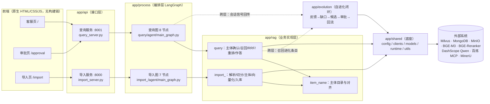
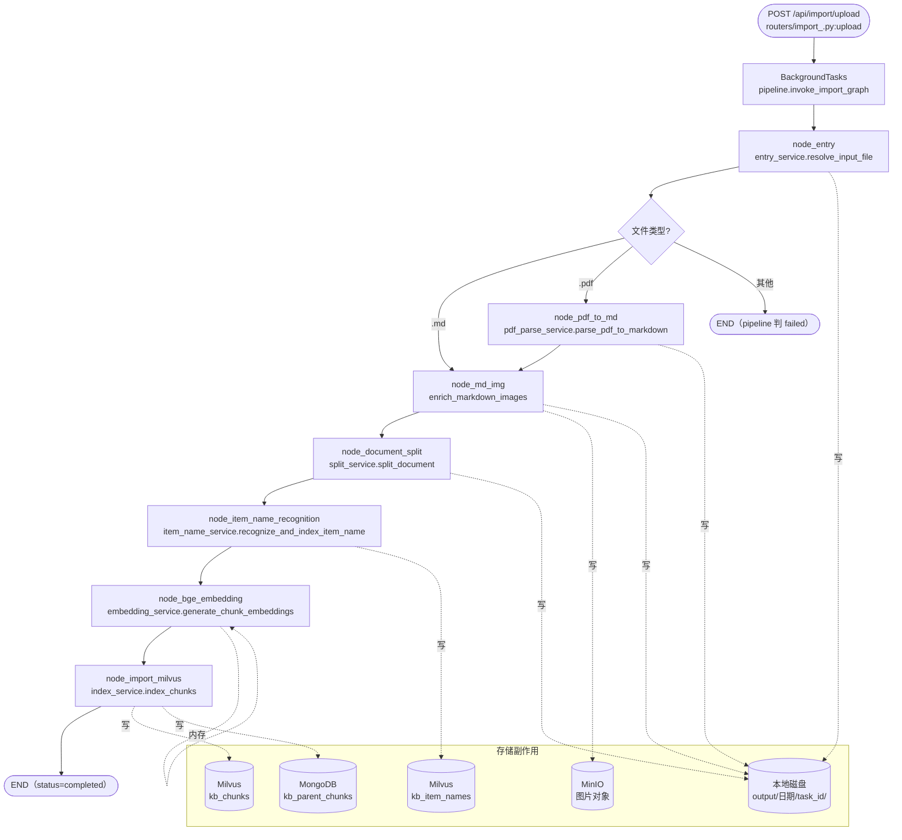
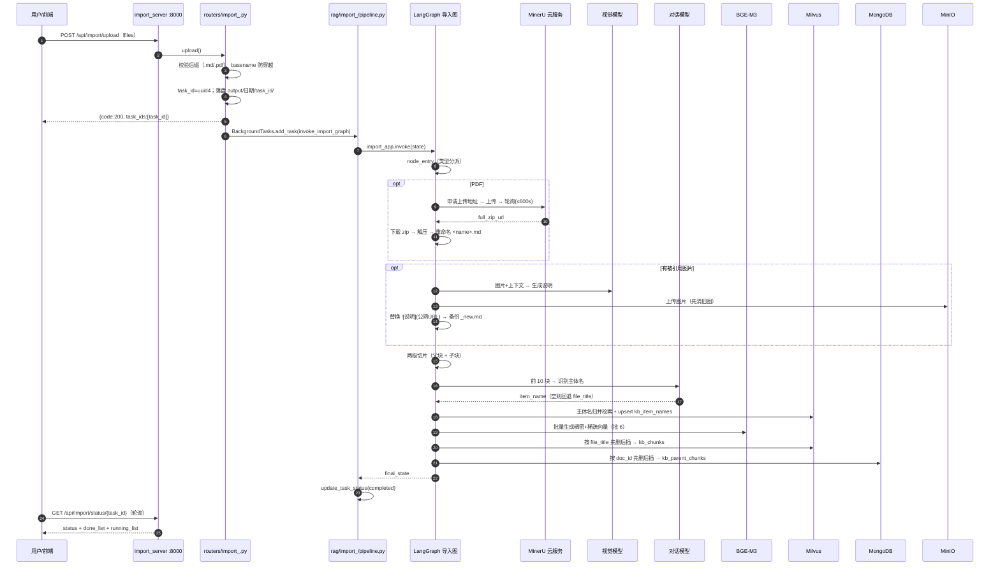
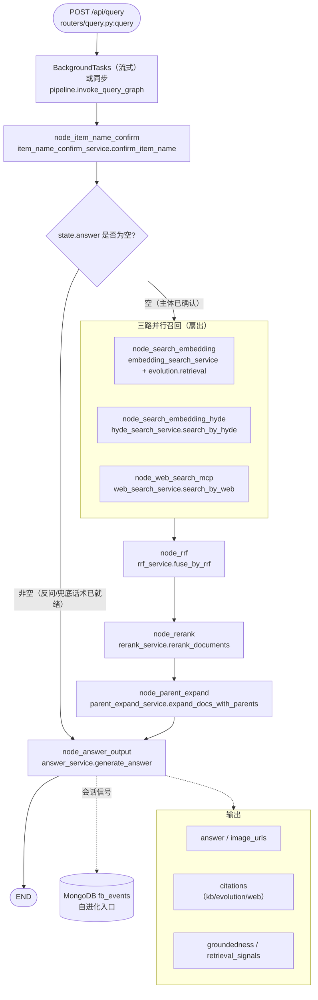
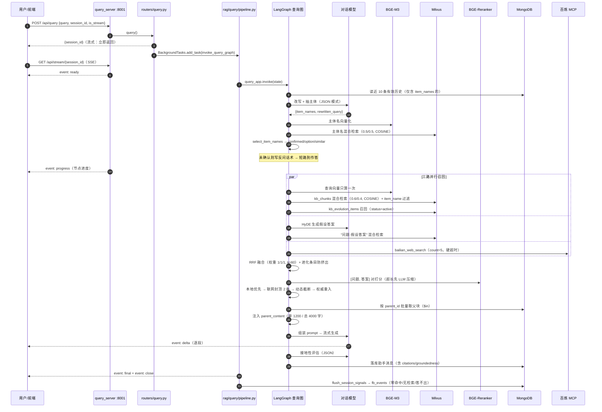
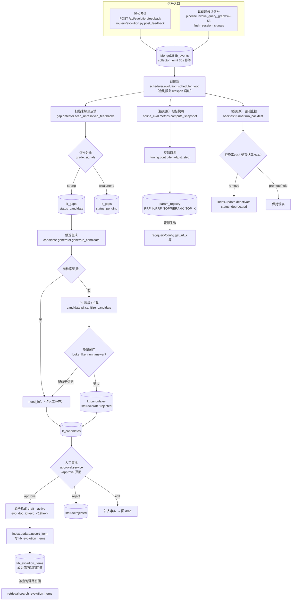
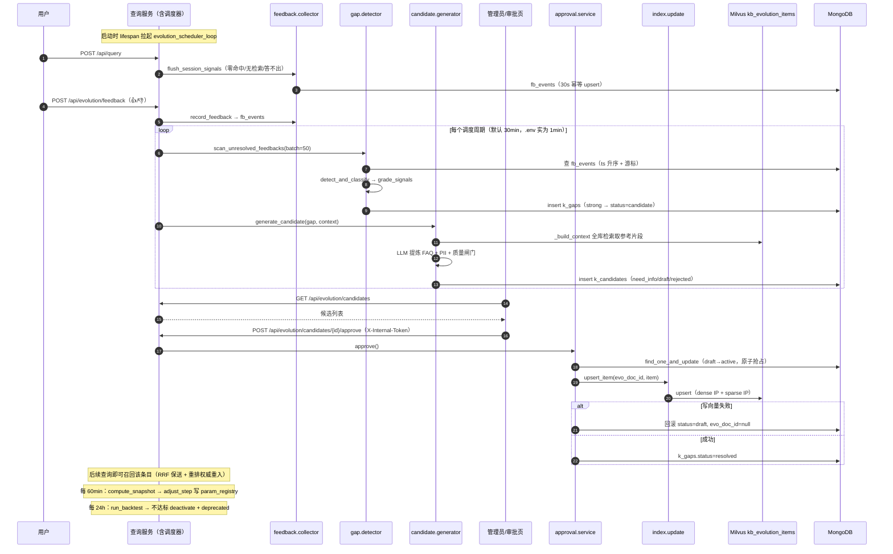
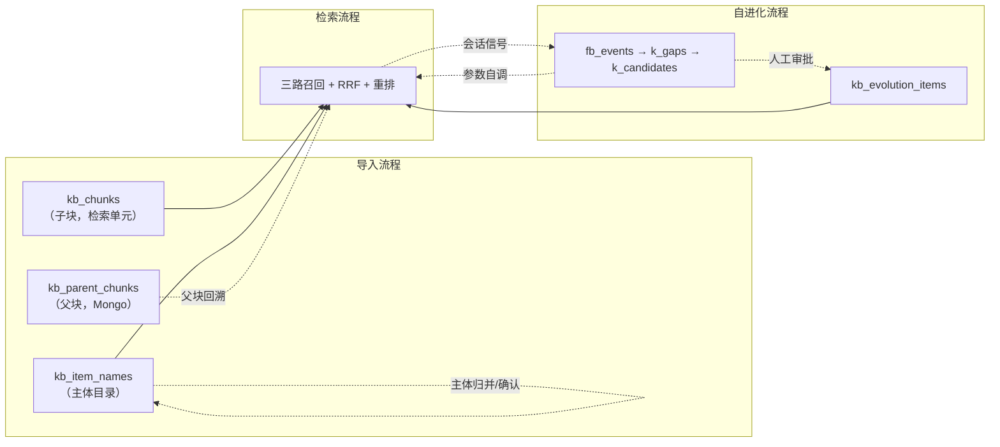

# se_rag 技术讲解文档

> **项目定位**：企业化 RAG 知识库客服系统，核心特色是「知识自进化」闭环——自动发现客服答不出的问题、生成知识候选，经人工审批后回流知识库，成为后续检索的召回源。
>
> **文档定位**：这是一份**教学式源码导读**。与项目内既有的两份文档互补：
> - `README.md`（35KB）：使用手册 + 架构速览，含 1 张总架构图与数据契约表；
> - `docs/project-review-20261004.md`（24KB）：代码审查报告，重点是风险清单与工程化评估；
> - **本文档**：以「流程图 ↔ 代码定位 ↔ 三维解读（做什么/怎么做/为什么）」为主轴，深入到算法、参数、数据结构与异常边界。
>
> **写作原则**：全部结论、文件路径、函数名、行号与代码片段均来自真实源码，未作虚构；`.env` 中的密钥/口令一律以占位符表示。
>
> **代码规模**：`app/` 下 137 个 Python 文件、约 9,400 行；另有前端 18 个文件与 7 个提示词模板。

---

## 目录

- [第一部分 业务流程图与代码定位](#第一部分-业务流程图与代码定位)
  - [1.1 全局架构与分层依赖](#11-全局架构与分层依赖)
  - [1.2 导入流程](#12-导入流程)
  - [1.3 检索流程](#13-检索流程)
  - [1.4 自进化闭环流程](#14-自进化闭环流程)
  - [1.5 三流程的衔接与数据契约](#15-三流程的衔接与数据契约)
- [第二部分 逐步深度解读](#第二部分-逐步深度解读)
  - [2.1 导入业务](#21-导入业务)
  - [2.2 检索业务](#22-检索业务)
  - [2.3 自进化业务](#23-自进化业务)
- [第三部分 补充内容](#第三部分-补充内容)
  - [3.1 整体架构与模块划分](#31-整体架构与模块划分)
  - [3.2 核心数据模型与存储方案](#32-核心数据模型与存储方案)
  - [3.3 关键依赖与外部集成](#33-关键依赖与外部集成)
  - [3.4 性能、可扩展性与潜在瓶颈](#34-性能可扩展性与潜在瓶颈)
  - [3.5 部署、运行方式与配置项说明](#35-部署运行方式与配置项说明)
  - [3.6 安全、权限与可观测性](#36-安全权限与可观测性)
  - [3.7 已知问题与设计权衡小结](#37-已知问题与设计权衡小结)
- [附录](#附录)

---

## 阅读指南

本文档的三大部分存在固定的呼应关系：

| 部分 | 内容 | 怎么读 |
|---|---|---|
| **第一部分** | 7 张 Mermaid 图（架构 / 三流程 × 流程图+时序图）+ 代码定位表 | 先看图建立全局认知，再顺着定位表跳到源码 |
| **第二部分** | 导入 7 节点、检索 8 节点、自进化 9 环节的三维解读 | 与第一部分的图逐一对应，深入实现细节 |
| **第三部分** | 架构、存储、依赖、性能、部署、安全 | 横向补充，回答「为什么这样搭」 |

第二部分统一采用三维模板：

- **做了什么（业务目标）**：该步骤解决什么问题、产生什么结果；
- **怎么做（实现逻辑）**：执行流程、核心代码片段与关键算法；
- **为什么这么做（设计意图）**：架构考量、参数选择理由、取舍策略。

并单列 **数据结构 / 关键参数 / 异常与边界** 三个小节的要点。

> 说明：文中形如 `app/rag/query/rrf_service.py:19-43` 的引用均指「文件:起始行-结束行」。行号基于撰写时的源码快照。

---

# 第一部分 业务流程图与代码定位

## 1.1 全局架构与分层依赖

项目采用**严格单向依赖**的五层结构：`api → process → rag/evolution → shared → 外部系统`。`shared` 不反向依赖任何业务层。



**两处有意的跨层例外**（其余依赖方向均严格成立）：

1. `app/rag/query/pipeline.py:4` 引用 `app.evolution.feedback.collector`——查询结束回传会话未解决信号；
2. `app/process/query/agent/nodes/node_search_embedding.py:6` 引用 `app.evolution.retrieval`——查询时召回已审批的自进化条目。

这两处正是「自进化闭环」与「主检索链路」的缝合点，也是本项目区别于普通 RAG 的关键。

**各层职责速览**（详细文件清单见 [3.1](#31-整体架构与模块划分)）：

| 分层 | 规模 | 职责 |
|---|---|---|
| `app/api` | 14 文件 / 578 行 | 服务组装、路由、Pydantic 契约、统一错误体、页面与静态资源 |
| `app/process` | 25 文件 / 371 行 | LangGraph 图与节点（薄编排，平均 15 行/文件） |
| `app/rag` | 30 文件 / 2275 行 | 业务实现：解析、切分、主体识别、召回、融合、重排、作答 |
| `app/evolution` | 26 文件 / 1250 行 | 反馈 → 缺口 → 候选 → 审批 → 回流；指标 / 自调 / 回测 |
| `app/shared` | 26 文件 / 1453 行 | 唯一底座：配置单点、外部客户端、模型门面、日志、工具 |
| `app/rag_eval` | 5 文件 / 866 行 | 离线评估子系统（独立包边界，可整体迁移） |
| `app/resources` | 18 文件 / 1888 行 | 三页 HTML + 4 CSS + 4 JS + 7 个提示词模板 |

---

## 1.2 导入流程

### 1.2.1 流程图



> **注意执行顺序**：切分（`node_document_split`）在主体识别（`node_item_name_recognition`）**之前**。`app/shared/utils/task_state.py:26-45` 的中文展示映射把「主体名称识别」排在「文档切分」前，那只是**前端展示顺序**，不是执行顺序。

### 1.2.2 时序图



### 1.2.3 代码定位表

| # | 节点 | 节点壳文件 | 业务入口函数 | 关键子步骤（文件:行） | 读 state | 写 state |
|---|---|---|---|---|---|---|
| 0 | 上传 | `app/api/routers/import_.py` | `upload`（29-65） | 后缀白名单 `_ALLOWED_SUFFIXES`（26）；basename 防穿越（39）；落盘（46-48） | — | 磁盘 + 后台任务 |
| 1 | entry | `nodes/node_entry.py` | `entry_service.resolve_input_file`（11-32） | 类型分派（16-29）；`file_title=Path.stem`（31） | `local_file_path` | `md_path`/`pdf_path`/`is_*_read_enabled`/`file_title` |
| 2 | pdf_to_md | `nodes/node_pdf_to_md.py` | `pdf_parse_service.parse_pdf_to_markdown`（164-171） | `validate_pdf_paths`（35-53）、`upload_pdf_and_poll`（56-133）、`download_and_extract_markdown`（136-161） | `pdf_path`/`local_dir` | `md_path` |
| 3 | md_img | `nodes/node_md_img.py` | `enrich_markdown_images.enrich_markdown_images`（142-159） | `validate_markdown_source`（43-56）、`scan_images`（59-75）、`summarize_images`（78-97）、`upload_images_and_replace`（100-130）、`backup_new_md_content`（133-139） | `md_path` | `md_content`、`md_path`（→`_new.md`） |
| 4 | document_split | `nodes/node_document_split.py` | `split_service.split_document`（101-124） | `load_markdown_content`（30-50）、`resolve_blocks`（53-82）、`split_blocks`（section_splitter:234-248）、`backup_chunks_json`（85-90）、`backup_parents_json`（93-98） | `md_content`/`md_path`/`file_title` | `chunks`、`parent_chunks` |
| 5 | item_name_recognition | `nodes/node_item_name_recognition.py` | `item_name_service.recognize_and_index_item_name`（96-115） | `recognize_item_name_by_chunks`（23-42）、`resolve_item_name_against_catalog`（45-58）、`prepare_item_name_collection`（61-77）、`upsert_item_name`（80-93） | `chunks`/`parent_chunks`/`file_title` | `item_name`、回填 `chunks`/`parent_chunks`；写 `kb_item_names` |
| 6 | bge_embedding | `nodes/node_bge_embedding.py` | `embedding_service.generate_chunk_embeddings`（35-41） | `batch_generate_embeddings`（13-32） | `chunks`/`item_name` | `embeddings_content` |
| 7 | import_milvus | `nodes/node_import_milvus.py` | `index_service.index_chunks`（100-116） | `prepare_chunks_collection`（48-71）、`_align_to_schema`（74-97）、`parent_index_service.index_parent_chunks`（15-31） | `embeddings_content`/`file_title`/`parent_chunks` | 写 `kb_chunks` + `kb_parent_chunks` |

**图编排**（`app/process/import_/agent/main_graph.py`）：节点注册 17-23；入口 `set_entry_point` 26；条件边 `node_entry_after` 29-38 与注册 41-45；静态边 48-53；`compile()` 55。

---

## 1.3 检索流程

### 1.3.1 流程图



**关键机制**：

- **唯一分支点**是 `after_node_item_name_confirm`（`main_graph.py:31-37`），判据是 `state["answer"]` 是否为空。返回**元组** → LangGraph 并行触发三路召回。
- 三路都指向 `node_rrf`，LangGraph 会**等待三路全部完成**再执行 RRF（fan-in）。
- 自进化条目召回（`app/evolution/retrieval.py`）挂在 `node_search_embedding` 内部，不是独立节点——它复用同一份查询向量。

### 1.3.2 时序图



### 1.3.3 代码定位表

| # | 节点 | 节点壳文件 | 业务入口函数 | 关键子步骤（文件:行） | 主要 state 读写 |
|---|---|---|---|---|---|
| 1 | item_name_confirm | `nodes/node_item_name_confirm.py` | `item_name_confirm_service.confirm_item_name`（109-137） | `call_llm_item_name_and_rewritten`（27-40）、`match.search_by_item_names`（107-168）、`match.select_item_names`（191-297）、`similar_from_query`（64-104）、`apply_item_name_result`（43-93）、`save_history_message`（96-106） | 读 `session_id`/`original_query`；写 `item_names`/`rewritten_query`/`answer`/`item_name_options` |
| 2 | search_embedding | `nodes/node_search_embedding.py`（14-40） | `embedding_search_service.search_by_embedding`（13-20）→ `chunk_search.search_chunks`（46-88） | `expand_item_names`（catalog:107-114）、`in_expr` 过滤（chunk_search:67）、`to_chunks`（91-116）；自进化召回 `evolution.retrieval.search_evolution_items`（79-114） | 写 `embedding_chunks`/`evolution_chunks` |
| 3 | search_embedding_hyde | `nodes/node_search_embedding_hyde.py` | `hyde_search_service.search_by_hyde`（20-25） | `call_llm_answer`（13-17）→ `search_chunks(问题:假设答案)` | 写 `hyde_embedding_chunks` |
| 4 | web_search_mcp | `nodes/node_web_search_mcp.py` | `web_search_service.search_by_web`（54-71） | `_call_bailian_web_search`（18-42）、`_connect_and_call`（45-51） | 写 `web_search_docs` |
| 5 | rrf | `nodes/node_rrf.py` | `rrf_service.fuse_by_rrf`（46-72） | `_require_retrieval_chunks`（11-16）、`use_by_rrf`（19-43）、防挤出（61-65） | 读三路；写 `rrf_chunks` |
| 6 | rerank | `nodes/node_rerank.py` | `rerank_service.rerank_documents`（253-277） | `deal_rrf_and_web_result`（38-79）、`create_question_answer_lists`（175-215）、`use_reranker_deal_score`（218-224）、`prefer_local_docs`（94-120）、`cap_web_docs`（82-91）、`dyn_limit_reranker_docs`（227-250）、`ensure_evolution_docs`（123-140） | 读 `rewritten_query`/`rrf_chunks`/`web_search_docs`；写 `reranked_docs` |
| 7 | parent_expand | `nodes/node_parent_expand.py` | `parent_expand_service.expand_docs_with_parents`（27-65） | `is_local_chunk`（16-18）、`fetch_parents`（21-24） | 读/写 `reranked_docs`（追加 `parent_content`） |
| 8 | answer_output | `nodes/node_answer_output.py` | `answer_service.generate_answer`（150-158） | `state_exists_answer`（28-40）、`load_answer_prompt`（43-68）、`call_llm_deal_answer`（71-84）、`extract_text_image_url`（87-104）、`backfill_evolution_outputs`（107-133）、`save_answer_message_history`（136-147） | 读 `reranked_docs`；写 `answer`/`image_urls`/`citations`/`groundedness`/`retrieval_signals`/`cited_chunk_ids` |

**图编排**（`app/process/query/agent/main_graph.py`）：节点注册 18-25；入口 28；条件边 `after_node_item_name_confirm` 31-37 与注册 40-45；静态边 48-54；`compile()` 56。

---

## 1.4 自进化闭环流程

### 1.4.1 流程图



### 1.4.2 时序图



### 1.4.3 代码定位表

| # | 环节 | 文件 | 关键函数（行） | 数据读写 |
|---|---|---|---|---|
| 1 | 反馈采集 | `app/evolution/feedback/collector.py` | `_emit`（17-30）、`record_feedback`（33-40）、`flush_session_signals`（43-67）；幂等窗口 `_DEDUP_WINDOW_SECONDS=30`（14） | 写 `fb_events` |
| 2 | 缺口检测 | `app/evolution/gap/detector.py` | `_is_duplicated`（32-52）、`grade_signals`（55-67）、`detect_and_classify`（70-93）、`scan_unresolved_feedbacks`（96-138）；`_DEDUP_WINDOW=3600`（16） | 读 `fb_events`；写 `k_gaps` |
| 3 | 候选生成 | `app/evolution/candidate/generator.py` | `_call_llm`（26-30）、`_exists_question`（33-38）、`_store_need_info`（41-63）、`generate_candidate`（66-117） | 读 `k_gaps`；写 `k_candidates` |
| 4 | PII 拦截 | `app/evolution/candidate/pii.py` | `redact`（24-30）、`contains_pii`（33-37）、`sanitize_candidate`（40-45） | 纯函数 |
| 5 | 质量闸门 | `app/evolution/quality.py` | `looks_like_non_answer`（41-53）；`_NON_ANSWER_PATTERNS`（16-35） | 纯函数 |
| 6 | 人工审批 | `app/evolution/approval/service.py` | `list_candidates`（21-28）、`get_candidate`（31-37）、`approve`（40-93）、`_mark_gap`（96-103）、`reject`（106-118）、`edit`（121-146）、`remove_candidate`（149-159） | 读/写 `k_candidates`、`k_gaps` |
| 7 | 索引回流 | `app/evolution/index/update.py` | `canonical_subject`（20-31）、`create_evolution_collection`（34-55）、`upsert_item`（58-82）、`deactivate`（85-97） | 写 `kb_evolution_items` |
| 8 | 读侧召回 | `app/evolution/retrieval.py` | `_format`（27-56）、`_search`（59-76）、`search_evolution_items`（79-114） | 读 `kb_evolution_items` |
| 9 | 指标快照 | `app/evolution/online_eval/metrics.py` | `compute_snapshot`（13-32）、`record_metric`（35-43）、`latest_metrics`（46-52） | 读 `fb_events`/`k_gaps`；写 `k_metrics` |
| 10 | 参数自调 | `app/evolution/tuning/controller.py` | `_baseline_adopt_rate`（20-33）、`adjust_step`（36-73）；`_STEP`/`_MIN`/`_MAX`（15-17） | 读 `k_metrics`；写 `param_registry` |
| 11 | 参数读侧缓存 | `app/evolution/tuning/param_registry.py` | `_reload`（26-40）、`get_param`（43-49）、`get_all_params`（52-57）、`set_param`（60-65） | 读/写 `param_registry` |
| 12 | 回测止损 | `app/evolution/backtest/runner.py` | `_active_items`（26-34）、`run_backtest`（37-92） | 读 `k_candidates`/`fb_events`；写 `k_candidates`、Milvus |
| 13 | 调度编排 | `app/evolution/scheduler.py` | `_build_context`（31-46）、`run_scan_and_generate_once`（49-75）、`run_metrics_and_tuning_once`（78-97）、`run_backtest_once`（100-108）、`_due`（111-113）、`run_evolution_cycle_once`（116-135）、`loop_status`（138-149）、`evolution_scheduler_loop`（152-160） | 编排 |
| 14 | HTTP 入口 | `app/api/routers/evolution.py` | `require_admin_token`（33-39）、`post_feedback`（55-59）、`list_candidates`（62-66）、`get_status`（79-106）、`approve`（109-117）、`reject`（120-126）、`edit`（129-135）、`remove_candidate`（138-144） | — |
| 15 | 接地性评估 | `app/evolution/online_eval/grounding.py` | `compute_groundedness`（27-39） | 纯函数（调 LLM） |

**调度器启动点**：`app/api/http/query_server.py:26-47` 的 `lifespan`——仅当 `settings.evolution.enabled and settings.evolution.scheduler_enabled` 时，用 `asyncio.create_task` 拉起 `evolution_scheduler_loop`。

---

## 1.5 三流程的衔接与数据契约

三条流程通过**三组存储**串成一个闭环：



**契约要点**：

| 契约 | 内容 | 为什么重要 |
|---|---|---|
| 主体名口径 | 导入端「归并到库内标准名」与查询端「确认到标准名」共用 `app/rag/item_name/match.py` 同一套阈值/间距 | 保证「导入时归并到 A，提问时确认到 A」一致，避免进化条目召回不到 |
| 向量化文本口径 | 导入/自进化统一为 `主体:{item_name},内容:{content}`；查询端 `embed_text(rewritten_query)` | 两端文本构造一致，向量空间可比 |
| `chunk_id` 契约 | `sha1(doc_id#heading_path#occurrence#part)`，只编码结构 | 重复导入 id 稳定，引用/反馈不失效 |
| 引用 id 类型 | `cited_chunk_ids` 统一转 `str`（`answer_service.py:118`） | Milvus 数值主键会解析为 int，不转 str 会让 `FeedbackEvent` 校验失败、信号静默丢弃 |
| 兜底话术口径 | `NO_ANSWER_MARKERS`（`app/shared/utils/answer.py:10`） | 查询端据此不渲染图片；自进化端据此记为未解决信号 |
| 集合 metric 口径 | `kb_chunks`/`kb_item_names` = COSINE，`kb_evolution_items` = IP | metric 不一致会让 Milvus 报错并静默返回 None（召回为 0） |

---

# 第二部分 逐步深度解读

## 2.1 导入业务

导入链路的目标：把 `.md` / `.pdf` 文档转化为**可检索、可溯源、可幂等覆盖**的向量知识，并同时建立主体目录与章节父块。执行主体是一条 7 节点的 LangGraph 静态流水线（`app/process/import_/agent/main_graph.py`）。

### 2.1.0 编排层：任务入口与状态机

**做了什么**：接收 HTTP 上传、落盘、投递后台任务；执行图并维护 `processing → completed / failed` 状态机。

**怎么做**：

- HTTP 入口 `app/api/routers/import_.py:upload`（29-65）：
  - 只取 `files[0]`（38）——接口签名收列表，实现只处理首个文件；
  - `safe_name = Path(upload_file.filename or "").name`（39）仅取 basename，防路径穿越；
  - 后缀白名单 `_ALLOWED_SUFFIXES = (".md", ".pdf")`（26），非法后缀抛 `ApiError("unsupported_type", 422)`（43）；
  - `task_id = str(uuid.uuid4())`（45）；落盘目录 `PROJECT_ROOT/output/<YYYYMMDD>/<task_id>/`（46-48）；
  - `BackgroundTasks.add_task(invoke_import_graph, ...)`（59-64）异步执行。
- 编排 `app/rag/import_/pipeline.py:invoke_import_graph`（15-33）：

```python
def invoke_import_graph(task_id: str, local_file_path: str, local_dir: str) -> None:
    try:
        update_task_status(task_id, TASK_STATUS_PROCESSING)
        state: ImportGraphState = create_default_state(
            task_id=task_id, local_file_path=local_file_path, local_dir=local_dir
        )
        final_state = import_app.invoke(state)
        # 防御：图对不支持的文档类型会静默走到 END，这里显式校验是否真的解析过该文件
        if not (final_state.get("md_path") or final_state.get("pdf_path")):
            update_task_status(task_id, TASK_STATUS_FAILED)
            logger.warning(f"导入任务[{task_id}]中止：文件类型不支持（md/pdf 以外）")
            return
        update_task_status(task_id, TASK_STATUS_COMPLETED)
    except Exception as exc:  # noqa: BLE001
        update_task_status(task_id, TASK_STATUS_FAILED)
        logger.exception(f"导入模块执行发生异常：{exc}")
```

**为什么这么做**：

1. **异常全部吞并标记 failed，不向上抛**。后台任务无法把异常回传 HTTP 响应，若抛出只会变成无人接收的堆栈；统一落成任务状态，前端轮询即可感知。
2. **刻意不立即清理进度记录**（32-33 注释）：前端仍需轮询到最终状态；内存增长由 `task_state` 的 TTL（`TASK_STATE_TTL_SECONDS`，默认 6 小时）回收。
3. **入口即校验扩展名**：避免「上传成功但入库失败」的静默成功——不支持的类型在 HTTP 层就 422。
4. **`create_default_state` 深拷贝**（`state.py:52-64`）：`default_state` 是全局唯一对象，浅拷贝会让多次导入共享嵌套 list，必须 `deepcopy` 隔离。

**数据结构**：`ImportGraphState`（`app/process/import_/agent/state.py:5-31`）为 `TypedDict`，13 个字段：

| 字段 | 类型 | 含义 |
|---|---|---|
| `task_id` | str | 任务标识（进度追踪 ID） |
| `local_file_path` | str | 上传文件落盘路径 |
| `md_path` / `pdf_path` | str | 解析产物路径（互斥） |
| `is_md_read_enabled` / `is_pdf_read_enabled` | bool | 类型分派开关 |
| `file_title` | str | 文件名去后缀（幂等删除键 + 主体兜底） |
| `local_dir` | str | 产物输出目录 |
| `md_content` | str | Markdown 正文（图片增强后） |
| `chunks` | list | **子块**（检索单元） |
| `parent_chunks` | list | **父块**（章节级，回填背景） |
| `item_name` | str | 文档主体名 |
| `embeddings_content` | list | 带双向量的子块 |

**异常与边界**：不支持类型 → 两开关全关 → 条件边 `node_entry_after` 走 `END` → `pipeline` 显式判 failed（24-27）。

---

### 2.1.1 node_entry — 文件类型分派

**做了什么**：判断后缀，写入 `md_path`/`pdf_path` 与对应开关，并设置 `file_title`。

**怎么做**（`app/rag/import_/entry_service.py:11-32`）：

```python
@step_log("resolve_input_file")
def resolve_input_file(state: ImportGraphState) -> ImportGraphState:
    local_file_path = require_state_str(state, "local_file_path")
    if local_file_path.endswith(".md"):
        state["md_path"] = local_file_path
        state["is_md_read_enabled"] = True
        state["is_pdf_read_enabled"] = False
    elif local_file_path.endswith(".pdf"):
        state["pdf_path"] = local_file_path
        state["is_pdf_read_enabled"] = True
        state["is_md_read_enabled"] = False
    else:
        # 不支持的格式：开关全关，图内条件边直接跳到 END，由 API 层判定为失败
        logger.warning(f"{local_file_path} 类型无法解析，仅支持 md/pdf，流程提前结束")
        state["is_pdf_read_enabled"] = False
        state["is_md_read_enabled"] = False
        return state
    state["file_title"] = Path(local_file_path).stem
    return state
```

路由函数（`main_graph.py:29-38`）据此返回 `node_md_img` / `node_pdf_to_md` / `END`。

**为什么这么做**：

1. **用「两个布尔开关」而非一个枚举承载类型**：LangGraph 条件边只能返回字符串标签，布尔开关让路由函数读起来是「md 就直接增强、pdf 就先转换」，且天然表达「都不支持」这一第三态。
2. **`file_title` 用 `Path.stem`（去后缀）而非全名**：它是后续**幂等删除键**（`kb_chunks`/`kb_item_names`/MinIO 均按 `file_title` 先删后插），必须稳定且不含扩展名。

**异常与边界**：不支持类型时**不抛异常**，仅把开关全关——因为图内抛异常会中断整个 LangGraph 执行，而这里希望「安静地结束并由 API 层统一判定」。`require_state_str` 在 `local_file_path` 缺失时抛 `ValueError`。

**关键参数**：无。

---

### 2.1.2 node_pdf_to_md — MinerU 云端 PDF 解析

**做了什么**：把 PDF 上传到 MinerU 云服务，轮询解析状态，下载结果 zip，解压并把主 Markdown 重命名为 `<文件名>.md`，回写 `state["md_path"]`。

**怎么做**（`app/rag/import_/pdf_parse_service.py`）：

四个阶段，入口 `parse_pdf_to_markdown`（164-171）串联：

```python
@step_log("parse_pdf_to_markdown")
def parse_pdf_to_markdown(state: ImportGraphState) -> ImportGraphState:
    pdf_path_obj, local_dir_obj = validate_pdf_paths(state)
    zip_url = upload_pdf_and_poll(pdf_path_obj)
    md_path_obj = download_and_extract_markdown(zip_url, local_dir_obj, pdf_path_obj.stem)
    state["md_path"] = str(md_path_obj)
    return state
```

**(a) 申请预签名上传地址**（61-80）：

```python
response = requests.post(
    url=f"{base_url}/file-urls/batch",
    headers=_headers(),
    json={"files": [{"name": pdf_path_obj.name}], "model_version": MINERU_MODEL_VERSION},
)
...
data = response_dict.get("data", {})
batch_id = data.get("batch_id")
file_upload_urls = data.get("file_urls", [])
```

**(b) 上传 PDF**（84-89）——关键细节：

```python
# 预签名地址对请求头敏感，故使用 trust_env=False 的会话，避免系统代理注入额外头
if file_upload_urls:
    with requests.Session() as session:
        session.trust_env = False
        upload_response = session.put(url=file_upload_urls[0], data=pdf_path_obj.read_bytes())
```

**(c) 轮询状态**（92-133）：`while True` 循环，超时上限 600s；网络异常与 5xx 都按重试处理（`time.sleep(3)` 后 `continue`）；`state == "done"` 返回 `full_zip_url`，`state == "failed"` 抛 `ValueError`。

**(d) 下载解压重命名**（136-161）：下载 zip → 写 `<file_name>.zip` → 若 `extract_dir` 已存在先 `shutil.rmtree`（147-148）→ `unpack_archive` → 优先取 `stem == file_name` 的 md，否则取 `stem == "full"` 或第一个，重命名为 `<file_name>.md`。

**为什么这么做**：

1. **委托云端 MinerU 而非本地解析**：PDF 版式还原（表格、多栏、图片）是重活，云端 `model_version="vlm"` 用视觉语言模型解析，质量远高于本地规则解析；代价是引入网络依赖与最长 600s 的等待。
2. **`trust_env=False`**：预签名 URL（如 AWS S3 签名）会把请求头纳入签名校验，系统代理注入的 `Proxy-Connection` 等头会导致 403。这是一个**只在特定网络环境才复现**的坑，故显式注释。
3. **网络抖动/5xx 按重试而非失败处理**：云端解析是长任务，瞬时抖动不应让整次导入失败；但 4xx 与业务状态码非 0 立即抛错，避免无限重试。
4. **解压前 `rmtree`**：同一文件重复导入时，上次解压目录仍在，残留的旧 md 与 images 会污染本次结果。
5. **主 md 选择策略**（156-158）：MinerU 输出文件名可能是 `<原名>.md` 或 `full.md`，两种都要兼容。

**数据结构**：输入 `pdf_path`/`local_dir`；输出 `md_path`（指向解压出的 Markdown）。解压目录内还含 `images/` 与 `*_content_list.json`——后者是 2.1.4 切片的关键输入。

**关键参数**（`app/rag/import_/config.py:5-14`）：

| 参数 | 默认 | 说明 |
|---|---|---|
| `MINERU_MODEL_VERSION` | `"vlm"` | 解析模型版本 |
| `MINERU_POLL_TIMEOUT_SECONDS` | 600 | 轮询最长等待 |
| `MINERU_POLL_INTERVAL_SECONDS` | 3 | 轮询间隔 |
| `MINERU_DOWNLOAD_TIMEOUT_SECONDS` | 60 | zip 下载超时 |
| `PDF_PARSE_SERVICE_LOCAL_DIR` | `"output"` | `local_dir` 缺省目录名 |

**异常与边界**：文件不存在 → `FileNotFoundError`（46-48）；轮询超时 → `TimeoutError`（95-96）；任务 failed → `ValueError`（131-132）；解压无 md → `ValueError`（153-154）。

---

### 2.1.3 node_md_img — 图片视觉摘要与 MinIO 外链

**做了什么**：扫描被 Markdown 引用的本地图片，用视觉模型为每张图生成中文说明，上传 MinIO，并把 `` 替换为 ``，另存为 `<原名>_new.md`。

**怎么做**（`app/rag/import_/enrich_markdown_images.py`）：

入口 `enrich_markdown_images`（142-159）带**两级短路**：

```python
@step_log("enrich_markdown_images")
def enrich_markdown_images(state: ImportGraphState) -> ImportGraphState:
    md_content, images_dir, md_path_obj = validate_markdown_source(state)
    if not images_dir.exists() or images_dir.is_file() or not any(images_dir.iterdir()):
        logger.info(f"{md_path_obj} 没有待处理图片，跳过图片增强")
        return state

    image_content = scan_images(images_dir, md_content)
    if not image_content:
        logger.info(f"{md_path_obj} 的图片均未被引用，跳过图片增强")
        return state

    image_summaries = summarize_images(image_content, md_path_obj.stem)
    md_content_new = upload_images_and_replace(md_content, image_summaries, image_content, md_path_obj.stem)
    state["md_content"] = md_content_new
    state["md_path"] = backup_new_md_content(md_content_new, md_path_obj)
    return state
```

**(a) 上下文抽取**（21-41）：

```python
CONTEXT_WINDOW = 200
_IMAGE_REF_TEMPLATE = r"\!\[.*?\]\(.*?%s.*?\)"

def _extract_context(md_content: str, anchor: int, window: int, *, pre: bool) -> str:
    if pre:
        return md_content[max(0, anchor - window):anchor].strip()
    return md_content[anchor:min(len(md_content), anchor + window)].strip()
```

注释明确：**不做句界对齐**——图片通常独占一行，紧邻的换行就是最近句界，按句界收缩会得到空串。

**(b) 视觉摘要**（78-97）：

```python
vision_client = llm_providers.vision_chat()
chain = vision_client | StrOutputParser()
for image_name, image_path_str, image_context in image_content:
    prompt_text = load_prompt("image_summary", root_folder=stem, image_content=image_context)
    image_base64 = base64.b64encode(Path(image_path_str).read_bytes()).decode(encoding="utf-8")
    message = HumanMessage(content=[
        {"type": "text", "text": prompt_text},
        {"type": "image_url", "image_url": {"url": f"data:{guess_type(image_name)[0]};base64,{image_base64}"}},
    ])
    summary = chain.invoke([message])
```

提示词 `image_summary.prompt` 要求「中文简要总结，用于 Markdown 图片标题，控制在 50 字以内」。

**(c) 上传与替换**（100-130）：

```python
minio_gateway.remove_images(stem)          # 先清理旧图（幂等）
image_urls: dict[str, str] = {}
for image_name, image_path_str, _ in image_content:
    try:
        image_urls[image_name] = minio_gateway.upload_image(
            stem, image_name, image_path_str, guess_type(image_name)[0])
    except Exception as exc:  # noqa: BLE001 - 单张图片失败继续处理其余图片
        logger.warning(f"{image_name} 上传 MinIO 失败（跳过）：{exc}")

if not image_urls:
    logger.warning("图片全部上传失败，保留原始 Markdown")
    return md_content

for image_name, image_url in image_urls.items():
    summary = summaries_images.get(image_name) or ""
    pattern = _image_ref_pattern(image_name)
    md_content = pattern.sub(lambda _: f"", md_content)
```

**为什么这么做**：

1. **图片说明即检索语料**：把 `` 写进正文后，图片的**语义**也进入向量库（检索得到），而**地址**供答案展示图片——一份数据同时服务检索与呈现。
2. **替换而非删除**：保留 Markdown 图片语法，使下游 `content_list.build_image_ref_map` 能通过「URL 末段 = 原文件名」反查回视觉说明（见 2.1.4）。
3. **单张失败不阻断**：图片是增强项，一张失败不应让整次导入失败；全部失败则保留原始 Markdown（此时图片不会被检索到，但导入仍成功）。
4. **先清旧图再上传**：重复导入时，旧图片对象若不清会残留（且可能因同名覆盖留下孤儿对象）。
5. **上下文窗口 200 字符**：给视觉模型的语义线索——单独一张接线图无法判断语境，前后 200 字（通常是「图 x-x 电源接线示意」）能显著提升说明质量。

**数据结构**：`scan_images` 返回 `[(图片名, 路径, (上文, 下文)), ...]`；`summarize_images` 返回 `{图片名: 说明}`。输出 URL 形如 `http://<内网IP>:<端口>/knowledge-base-files/upload-images/<stem>/<原名>.jpg`——**这个结构是下游反查的契约**。

**关键参数**：`CONTEXT_WINDOW = 200`（21）；`SUPPORTED_IMAGE_EXTENSIONS`（`app/rag/config.py:8`，导入/查询共享）。

**异常与边界**：md 不存在 → `FileNotFoundError`；md 内容为空 → `ValueError`（52-53）；无 images 目录/目录空/图片均未被引用 → 直接返回原 state；图片全失败 → 保留原 Markdown。

**MinIO 对象键与 URL**（`app/shared/clients/minio_gateway.py`）：

```python
def object_key(self, stem: str, image_name: str) -> str:
    return f"{self.image_dir}/{stem}/{image_name}"          # 77-79

def build_image_url(self, stem: str, image_name: str) -> str:
    scheme = "https" if settings.minio.secure else "http"
    return f"{scheme}://{settings.minio.endpoint}/{self.bucket_name}/{self.object_key(stem, image_name)}"  # 85-88
```

`image_dir` 用 `.strip("/")`（70）去掉前导斜杠——历史缺陷是对象键带前导 `/` 而 URL 不带，导致上传后的图片链接 404。桶采用**公开只读策略**（`_bucket_policy`，22-32），因为图片需被浏览器直接访问。

---

### 2.1.4 node_document_split — 两级切片（核心）

这是导入链路**最核心、设计最密集**的一步。目标是产出两类数据：**子块**（检索单元，写入 Milvus）与**父块**（章节级，写入 Mongo，命中后回填背景）。

**做了什么**（`app/rag/import_/split_service.py:101-124`）：

```python
@step_log("split_document")
def split_document(state: ImportGraphState) -> ImportGraphState:
    md_content, file_title = load_markdown_content(state)
    blocks, source = resolve_blocks(md_content, state.get("md_path"))

    doc_key = make_doc_id(file_title)
    parents, children = split_blocks(blocks, doc_key, file_title)

    # 空产出必须显式失败：否则下游 load_chunks 会静默回退到上一次导入的陈旧备份，
    # 用旧内容覆盖新内容且无告警。
    if not children:
        fail("chunks", "切分后为空")

    state["chunks"] = children
    state["parent_chunks"] = parents
    ...
    backup_chunks_json(children, state["md_path"])
    backup_parents_json(parents, state["md_path"])
    return state
```

#### (1) 两条解析路径产出同构 Block 流

`resolve_blocks`（53-82）**优先消费 MinerU 结构化产物**，缺失/损坏则回退 Markdown 解析，**绝不中断导入**：

```python
content_list_path = find_content_list(md_path)
if content_list_path is not None:
    raw_blocks = json.loads(content_list_path.read_text(encoding="utf-8"))   # 失败则回退
    if isinstance(raw_blocks, list) and raw_blocks:
        blocks = normalize_content_list(raw_blocks, build_image_ref_map(md_content))
        if blocks:
            return blocks, "content_list"
        logger.warning(f"结构化产物归一化后无有效块，回退 Markdown 解析：{content_list_path}")
    ...
return normalize_markdown(md_content), "markdown"
```

**路径 A：`content_list.py`（结构感知）**

- `find_content_list`（31-43）：`glob("*_content_list.json")` **只匹配 v1**——`*_content_list*.json` 会同时命中结构不同的 `*_content_list_v2.json`；
- 丢弃页眉页脚噪声（25）：

```python
_DROPPED_TYPES = {"header", "footer", "page_number", "page_footnote", "aside_text", "discarded"}
```

- `build_image_ref_map`（46-60）：从增强后 md 的图片 URL 末段取原名，建立 `{文件名: }` 映射；
- `html_table_to_markdown`（112-151）：BeautifulSoup 解析 `table_body`，`_expand_cells`（70-109）展开 `colspan`/`rowspan`，输出 Markdown 表格；
- `normalize_content_list`（177-211）：`table`→表格块、`image`→图片块（优先视觉说明引用）、`text_level>0`→heading、否则 text。

**路径 B：`markdown_blocks.py`（回退）**

`normalize_markdown`（29-139）是一个**状态机**，逐行解析，修掉了历史实现的四类失真（模块 docstring 明确）：行内容不再 `strip`（保住代码缩进）、空行不再丢弃（保住段落边界）、代码块整段保真、表格原子化。

```python
_HEADING_RE = re.compile(r"^(#{1,6})\s+(.*)$")
_IMAGE_LINE_RE = re.compile(r"^!\[.*?\]\(.*?\)\s*$")
_TABLE_DIVIDER_RE = re.compile(r"^\|[\s:|-]+\|$")
```

**为什么优先结构化产物**：`content_list.json` 能拿到三样 Markdown 里拿不到或不可靠的信息——`type`（可丢弃页眉页脚）、`table_body`（HTML 表格，可整表原子化）、`text_level`/`page_idx`（标题层级与页码）。而回退路径保证**存量文档未重跑 MinerU 时仍可正常入库**。

#### (2) 父块构建：`build_sections`（`section_splitter.py:251-333`）

用**栈**维护标题层级，章节边界为「本标题起，到下一个层级 ≤ 本标题层级的标题前」：

```python
stack: list[int] = [0]
for block in blocks:
    if block.type == "heading":
        level = block.level or 1
        while len(stack) > 1 and sections[stack[-1]]["level"] >= level:
            stack.pop()
        ancestors = [sections[index]["title"] for index in stack[1:]]
        heading_path = " / ".join([*ancestors, block.text])
        sections.append(_new_section(level=level, title=block.text, heading_path=heading_path,
                                     occurrence=next_occurrence(heading_path), page=block.page))
        stack.append(len(sections) - 1)
    else:
        sections[stack[-1]]["blocks"].append(block)
```

父块 `content` = **整棵子树文本**（`subtree_blocks`，301-311）；无正文的标题也产父块（`content` 退化为标题本身，330）——因此「章标题丢失」不再发生。

#### (3) 子块打包：`_pack_blocks`（119-158）—— 双长度口径

```python
for block in blocks:
    text = (block.text or "").strip()
    if not text:
        continue
    if len(text) > CHUNK_MAX_SIZE:          # 单个原子块超硬上限才切
        flush()
        parts.extend(_split_oversized(block))
        continue
    added = len(text) + (2 if current else 0)
    if current and current_len + added > CHUNK_SIZE:   # 软目标
        flush()
        added = len(text)
    current.append(text)
    current_len += added
flush()
```

**超长原子块拆分**（68-116）：

- `_split_table`（68-95）：拆分超长表格并**为每块复制表头与分隔行**；
- `_split_code`（98-107）：按行切，**为每块补围栏**；
- `_split_oversized`（110-116）分派。

**短块合并** `_merge_short_parts`（161-181）：任一侧正文 < `CHUNK_MIN` 且合并后 ≤ `CHUNK_MAX_SIZE` 则合并。

**子块字段**（`split_section_children`，184-219）：

```python
children.append({
    "chunk_id": make_chunk_id(doc_key, heading_path, occurrence, part),
    "doc_id": doc_key,
    "parent_id": section["parent_id"],
    "file_title": file_title,
    "title": title,
    "parent_title": title,          # 兼容既有字段语义（最近标题文本）
    "heading_path": heading_path,
    "part": part,
    "seq": seq_start + offset,
    "page": page if page is not None else 0,
    "content": f"{title}\n{body}",  # 前置标题
    "content_hash": make_content_hash(content),
})
```

#### (4) 确定性 ID：`ids.py`

```python
def make_doc_id(file_title):  return _sha1((file_title or "").strip().lower())
def section_key(heading_path, occurrence): return f"{heading_path or ''}#{int(occurrence)}"
def make_parent_id(doc_key, heading_path, occurrence): return _sha1(f"{doc_key}#{section_key(heading_path, occurrence)}")
def make_chunk_id(doc_key, heading_path, occurrence, part): return _sha1(f"{doc_key}#{section_key(heading_path, occurrence)}#{int(part)}")
def make_content_hash(content): return _sha1(content or "")
```

**为什么这么做**（这是整份文档最值得细读的设计）：

1. **两级切片 = 「小检索、大上下文」**：
   - **子块**（`CHUNK_SIZE`=600 字量级）主题集中，向量检索精度高；
   - **父块**（整棵子树）提供跨子块的语义连续性。
   若只存父块，长父块会稀释检索相关性；若只存子块，答案会缺上下文。二者分工是 RAG 的经典 Small-to-Big 策略。
   **关键约束**：子块只取**章节自身**的原子块，**不含**嵌套子章节文本（否则同一段文本会重复入库）；父块取整棵子树（提供完整背景）。

2. **双长度口径**（`CHUNK_SIZE` 软目标 vs `CHUNK_MAX_SIZE` 硬上限）：
   - `CHUNK_SIZE` 决定**多个**原子块如何打包；
   - `CHUNK_MAX_SIZE` 只有**单个**原子块超过它才从中间切开。
   单个原子块落在 `[CHUNK_SIZE, CHUNK_MAX_SIZE]` 之间时**不切**——它本身已是语义完整的段落/表格/代码，按字符切开只会制造「纯重叠的碎片尾巴」。历史缺陷是「正文仅超出阈值 1 个字符就产出 `[600, 56]` 两块」。

3. **所有阈值按「正文口径」比较**（不含前置标题）：历史实现用「含标题前缀」的长度判断短块合并，导致短块合并永远不可达（死代码），且正文仅超阈值 1 字符就产出碎片。

4. **重叠策略刻意保守**：`CHUNK_OVERLAP=50` **仅在单个原子块必须从中间切开时**生效；原子块之间的打包边界本身已落在段落/表格/代码边界上，不再额外重叠（命中后由父块提供上下文）。

5. **表格复制表头 / 代码补围栏**：历史缺陷是长表格被字符切割后，后续分块只剩无表头的行碎片——对检索与作答都是噪声；代码块切开后若围栏不闭合，Markdown 渲染与后续解析都会出错。

6. **确定性 ID 只编码结构、不编码内容**：`doc_id#heading_path#occurrence#part`。因此文档内容微调或重复导入时 id 保持稳定，**绑在 id 上的标注、反馈、引用不会失效**；内容是否变化由独立的 `content_hash` 感知。
   - `occurrence` 消歧重名标题（硬件手册中 `## 设备`、`## 电源线` 会在不同父章节下重复出现，仅靠 `heading_path` 无法区分）；
   - 选 **40 位十六进制字符串**而非整数主键：`milvus_gateway.in_expr` 只产出字符串字面量，字符串主键可直接复用于父块批量回取；十六进制不含引号与换行，天然免转义。

7. **中文标点分隔符全量补齐 + 点号要求后接空白**（`TEXT_SEPARATORS`，32）：

```python
TEXT_SEPARATORS = ["\n\n", "\n", "。", "！", "？", "；", "，", "、", "：", "…", r"\.\s", r"[!?;,]\s", ""]
CODE_SEPARATORS = ["\n\n", "\n", ""]
```

历史实现缺「，、：」，无句末标点的中文长句会退化为按字符硬切；而 `r"\.\s"`（点号后必须接空白）避免在 `config.py` / `3.5` / `10.1.1.1` 处误切。

8. **`split_blocks` 是纯函数且被评估链路复用**（234-248）：

```python
def split_blocks(blocks: list[Block], doc_key: str, file_title: str) -> tuple[list[dict], list[dict]]:
    parents, sections = build_sections(blocks, doc_key, file_title)
    children: list[dict[str, Any]] = []
    for section in sections:
        children.extend(split_section_children(section, seq_start=len(children)))
    counts = Counter(child["parent_id"] for child in children)
    for parent in parents:
        parent["child_count"] = counts.get(parent["parent_id"], 0)
    return parents, children
```

导入链路（`split_service`）与评估链路（`rag_eval.split_dataset`）共用本函数，保证「评估用的切片」与「线上入库的切片」出自同一套逻辑。

**数据结构**：`Block`（`@dataclass(frozen=True)`，38-55）—— `type ∈ {heading,text,table,code,image}`、`text`、`level`、`page`。

**关键参数**（`app/rag/import_/config.py:24-34`）：

| 参数 | 默认 | 语义 |
|---|---|---|
| `CHUNK_MAX_SIZE` | 1000 | 硬上限（单原子块超过才切） |
| `CHUNK_SIZE` | 600 | 软目标（多原子块打包） |
| `CHUNK_OVERLAP` | 50 | 仅超长原子块切开时生效 |
| `CHUNK_MIN` | 400 | 短碎片合并阈值 |
| `CHUNKS_SPLIT_TOP_NUMBER` | 10 | 主体识别取前 N 块 |
| `EMBEDDING_BATCH_SIZE` | 6 | 向量化批大小 |

**异常与边界**：`md_content` 为空且无法从 `md_path` 读取 → `fail`（40-41）；`content_list.json` 读取失败/结构异常/归一化后无块 → 回退 Markdown；切分后子块为空 → `fail("chunks", "切分后为空")`（112-113，防陈旧备份污染）。

**本地产物**：子块备份 `<stem>.json`（85-90）；父块备份 `<stem>_parents.json`（93-98）。

---

### 2.1.5 node_item_name_recognition — 主体识别与归并

**做了什么**：用 LLM 从文档前 10 个切片识别「商品主体名」，归并到库内标准名，写入 `kb_item_names`，并把 `item_name` 回填到所有子块与父块。

**怎么做**（`app/rag/import_/item_name_service.py`）：

入口 `recognize_and_index_item_name`（96-115）：

```python
@step_log("recognize_and_index_item_name")
def recognize_and_index_item_name(state: ImportGraphState) -> ImportGraphState:
    chunks = load_chunks(state)
    file_title = load_subject(state, "file_title", default_name="default_title")

    item_name = recognize_item_name_by_chunks(chunks, file_title)
    prepare_item_name_collection()  # 归并检索要求集合已存在
    item_name = resolve_item_name_against_catalog(item_name)

    for chunk in chunks:
        chunk["item_name"] = item_name
    # 父块在切分阶段早于主体识别生成，此处必须一并回填，否则父块集合的 item_name 为空
    for parent in state.get("parent_chunks") or []:
        parent["item_name"] = item_name
    upsert_item_name(item_name, file_title)

    state["chunks"] = chunks
    state["item_name"] = item_name
    return state
```

**(a) LLM 识别**（23-42）：

```python
chain_client = llm_providers.chat()
system_prompt_text = load_prompt("product_recognition_system")
used_chunks = chunks[:CHUNKS_SPLIT_TOP_NUMBER]           # 前 10 块
user_context = "".join(
    f"第{index}部分: 标题为:{chunk.get('title')} , 内容为: {chunk.get('content')} \n"
    for index, chunk in enumerate(used_chunks, start=1))
user_prompt_text = load_prompt("item_name_recognition", file_title=file_title, context=user_context)
chain = chain_client | StrOutputParser()
item_name = chain.invoke([SystemMessage(content=system_prompt_text), HumanMessage(content=user_prompt_text)])
if not item_name:
    logger.warning(f"模型未识别到主体名，使用 file_title 兜底：{file_title}")
    item_name = file_title
```

提示词 `item_name_recognition.prompt` 要求「返回带品牌、型号和名称的完整商品名称；识别不出返回空字符串」。

**(b) 归并**（45-58）→ `match.resolve_existing_item_name`（300-318）：

```python
hit = match_catalog_name(name)                 # 目录命中（精确同名 / 同一实体）
if hit:
    return hit[0], {"item_name": hit[0], "score": None, "matched_by": hit[1]}
confirmed = select_item_names(search_by_item_names([name])).get("confirmed_list") or []
if not confirmed:
    return name, None
resolved = confirmed[0]
return str(resolved.get("item_name") or name), resolved
```

**(c) 主体名集合**（61-77）：`kb_item_names` 主键 `pk` 为**自增 INT64**（`auto_id=True`，与子块集合的确定性哈希主键不同），字段 `file_title`/`item_name` + 双向量。

**(d) 幂等写入**（80-93）：按 `file_title` 先删后插，向量化文本就是 `item_name` 本身。

**为什么这么做**：

1. **主体识别放在导入期**：查询期需要按主体过滤（`item_name in [...]`），若导入期不建立主体索引，查询期就无法把问题对齐到产品，会出现跨产品误召回。
2. **只喂前 10 块**（`CHUNKS_SPLIT_TOP_NUMBER=10`）：产品名通常出现在文档开头（封面、概述、前言）；喂全文既浪费 token 又可能被无关内容干扰。
3. **写入端归并到库内标准名**：同一产品的手册可能分多个文件、或文件名写法不同，若每次都新建主体名，库内会出现近重复主体（`Brother HAK 180` vs `HAK180`），导致查询期「确认不到」。归并从源头避免——这是「写入端归并」与「读取端确认」**共用同一套阈值/间距口径**（`match.py`）的原因。
4. **父块也必须回填 `item_name`**（109-110）：父块在切分阶段生成，早于主体识别；若不回填，父块集合的 `item_name` 为空，未来按主体检索父块（或统计）会缺字段。
5. **识别为空回退 `file_title`**：宁可给一个「文件名」主体，也不要空主体——空主体会让该文档在查询期永远无法被过滤命中。

**数据结构**：`kb_item_names`（`pk` INT64 自增主键、`file_title` VARCHAR(512)、`item_name` VARCHAR(512)、dense COSINE + sparse IP）。

**关键参数**（`app/rag/item_name/config.py:13-25`）：

| 参数 | 默认 | 说明 |
|---|---|---|
| `GLOBAL_ITEM_NAME` | `"default_item_name"` | 未打标签条目的占位主体，视为全局可召回 |
| `ITEM_NAME_CONFIRM_MIN_SCORE` | 0.65 | 自动确认的 top1 下限 |
| `ITEM_NAME_CONFIRM_MARGIN` | 0.02 | top1/top2 间距门槛 |
| `ITEM_NAME_OPTION_MIN_SCORE` | 0.60 | 可选区间下限 |
| `ITEM_NAME_CATALOG_TTL_SECONDS` | 60.0 | 目录进程内缓存 TTL |
| `ITEM_NAME_SEARCH_LIMIT` | 10 | 检索返回条数（需覆盖 top2） |
| `ITEM_NAME_DENSE_METRIC` | `"COSINE"` | 必须与集合索引一致 |

**异常与边界**：识别为空 → 回退 `file_title`；`load_chunks` 在 chunks 为空时回退读 `<md_path 同名>.json` 备份（**显式告警「可能是陈旧数据」**，`inputs.py:33`）；目录加载失败 → 降级空目录并告警，**绝不抛异常**（`catalog.py:73-75`）。

---

### 2.1.6 node_bge_embedding — BGE-M3 双向量生成

**做了什么**：对每个子块生成**稠密 + 稀疏**双向量，回填到 `dense_vector` / `sparse_vector`。

**怎么做**（`app/rag/import_/embedding_service.py:13-41`）：

```python
@step_log("batch_generate_embeddings")
def batch_generate_embeddings(chunks, item_name, batch_size=EMBEDDING_BATCH_SIZE):
    length = len(chunks)
    for start in range(0, length, batch_size):
        current_chunks = chunks[start:start + batch_size]
        texts = [f"主体:{item_name},内容:{chunk.get('content')}" for chunk in current_chunks]
        result = llm_providers.generate_embeddings(texts)
        for index, chunk in enumerate(current_chunks):
            chunk["dense_vector"] = result["dense"][index]
            chunk["sparse_vector"] = result["sparse"][index]
    logger.info(f"向量生成完成：{length} 条（批大小 {batch_size}）")
    return chunks
```

底层 `app/shared/models/embedding.py`：

```python
_bge_m3_ef = BGEM3EmbeddingFunction(
    model_name=model_name, device=device,
    use_fp16=settings.embedding.fp16,
    normalize_embeddings=True,  # 模型原生对稠密+稀疏向量做 L2 归一化（适配 Milvus IP）
)
...
embeddings = model.encode_documents(texts)
sparse = embeddings["sparse"]
for i in range(len(texts)):
    start, end = sparse.indptr[i], sparse.indptr[i + 1]
    indices = sparse.indices[start:end].tolist()
    data = sparse.data[start:end].tolist()
    processed_sparse.append(dict(zip(indices, data)))     # 稀疏矩阵按行拆成 {特征索引: 权重}
```

**为什么这么做**：

1. **双向量（稠密 + 稀疏）**：BGE-M3 同时输出语义稠密向量（1024 维）与词法稀疏向量。稠密负责语义相似，稀疏负责关键词精确匹配（型号、编号），二者混合检索能兼顾「意思相近」与「字面命中」——对硬件手册这类「型号 + 术语」密集的语料尤其重要。
2. **向量化文本 = `主体:{item_name},内容:{content}`**：把主体名拼进待编码文本，使向量天然携带产品上下文；查询端用同样口径，两端可比。
3. **批大小 6**（`EMBEDDING_BATCH_SIZE`）：BGE-M3 在 CPU 上推理，批量过大会显著抬高峰值内存；6 是吞吐与内存的折中。注释写明「避免显存溢出」（本机 `BGE_DEVICE=cpu`）。
4. **`normalize_embeddings=True`**：模型原生对双向量做 L2 归一化，使稠密向量的 IP 与 COSINE 排序等价（这是 3.2 中集合 metric 选择的前提）。
5. **稀疏矩阵按行拆成 `{索引: 权重}`**：Milvus 的 `SPARSE_FLOAT_VECTOR` 字段需要 dict 形式；且需转 Python 原生类型以便序列化。

**数据结构**：`generate_embeddings` 返回 `{"dense": [[float...]...], "sparse": [{int: float}...]}`；`embed_text` 返回单元素列表（便于多路检索复用同一份向量）。

**关键参数**：`EMBEDDING_BATCH_SIZE=6`；稠密维度 1024（`milvus_gateway.py:59` 默认 `dense_dim=1024`）；模型 `BAAI/bge-m3`，device=`cpu`，fp16=0（`.env`）。

**异常与边界**：`texts` 非字符串列表或为空 → `ValueError`（embedding.py:44-47）；模型初始化/编码失败 → 抛异常（不吞，交由调用方决定）。

> 注：`.env` 中的 `EMBEDDING_DIM=1024` **未被任何 Python 代码引用**（全仓 grep 无匹配），实际维度来自 `register_vector_fields_and_indexes` 的默认参数 `dense_dim=1024`。属预留配置。

---

### 2.1.7 node_import_milvus — 幂等入库

**做了什么**：把带向量的子块写入 Milvus `kb_chunks`（按 `file_title` 先删后插），并把父块写入 MongoDB `kb_parent_chunks`（按 `doc_id` 先删后插）。

**怎么做**（`app/rag/import_/index_service.py`）：

**子块集合 schema**（48-71）：

```python
schema = client.create_schema(auto_id=False, enable_dynamic_field=True)   # 注意 auto_id=False
for field_name, max_length in CHUNK_VARCHAR_LIMITS.items():
    schema.add_field(field_name=field_name, datatype=DataType.VARCHAR,
                     max_length=max_length, is_primary=(field_name == "chunk_id"))
for field_name in CHUNK_SCALAR_DEFAULTS:
    datatype = DataType.INT16 if field_name == "part" else DataType.INT32
    schema.add_field(field_name=field_name, datatype=datatype)
index_params = client.prepare_index_params()
register_vector_fields_and_indexes(schema, index_params, dense_metric="COSINE")
```

**VARCHAR 字节上限**（28-39）：

```python
CHUNK_VARCHAR_LIMITS = {
    "chunk_id": 40, "doc_id": 64, "parent_id": 40,
    "file_title": 512, "item_name": 512, "title": 512, "parent_title": 512,
    "heading_path": 1024, "content": 65535, "content_hash": 40,
}
CHUNK_SCALAR_DEFAULTS = {"part": 1, "seq": 0, "page": 0}
```

**对齐护栏** `_align_to_schema`（74-97）：VARCHAR 走 `truncate_utf8` 按字节截断；标量缺省补默认；向量缺失 `fail`；schema 外字段丢弃并告警。

**幂等覆盖** `index_chunks`（100-116）：

```python
embeddings_content = require_state_list(state, "embeddings_content")
prepare_chunks_collection()
file_title = state.get("file_title", "")
if file_title:
    client.delete(collection_name=collection_name, filter=eq_expr("file_title", file_title))
result = client.insert(collection_name=collection_name, data=_align_to_schema(embeddings_content))
index_parent_chunks(state)     # 父块写 Mongo
```

**父块入库**（`parent_index_service.py:15-31` → `parent_chunk_repository.py:37-47`）：按 `doc_id` 先删后插；**写入失败不阻断导入**（仅 error 日志，返回 0）。

**向量字段与索引**（`milvus_gateway.py:58-85`）：

```python
schema.add_field(field_name="dense_vector", datatype=DataType.FLOAT_VECTOR, dim=dense_dim)   # 默认 1024
schema.add_field(field_name="sparse_vector", datatype=DataType.SPARSE_FLOAT_VECTOR)
index_params.add_index(field_name="dense_vector", index_type="HNSW", index_name="dense_vector_index",
                       metric_type=dense_metric, params={"M": 64, "efConstruction": 100})
index_params.add_index(field_name="sparse_vector", index_type="SPARSE_INVERTED_INDEX",
                       index_name="sparse_vector_index", metric_type="IP",
                       params={"inverted_index_algo": "DAAT_MAXSCORE"})
```

**为什么这么做**：

1. **`auto_id=False` + 确定性字符串主键**：重复导入时 id 稳定（见 2.1.4），且可用 `eq_expr`/`in_expr` 直接过滤。历史实现是自增 INT64，重复导入会不断新增记录。
2. **`_align_to_schema` 护栏**：Milvus 的 `insert` 只认字段名，历史实现无任何校验，dict 键与 schema 不一致时会**静默写入错误数据**。护栏统一补齐缺省、按字节截断、剔除多余键。
3. **`truncate_utf8` 按字节截断且不切多字节字符**（`ids.py:52-62`）：Milvus 的 `max_length` 按**字节**计（中文 3 字节），超限会插入失败；直接 `text[:n]` 会切断多字节字符产生乱码。
4. **`part` 用 INT16 而非 INT8**（注释 8）：INT8 上限 127，单章节切块数超限会导致插入失败。
5. **按 `file_title` 先删后插**：同一文件重复上传不产生重复数据。这也是为什么 `file_title` 必须稳定（用 `Path.stem`）。
6. **父块写入失败不阻断导入**：父块是「命中后回填背景」的增强数据，不属于主检索产物；缺父块只会退化为「无章节背景」，不应让整次导入失败。但以 **error** 级别记录，避免系统性故障被静默掩盖。
7. **父块存 Mongo 而非 Milvus**（`settings.py:98-100` 注释）：父块只按 `parent_id` 批量取回、**从不参与向量检索**，存 Mongo 可避开 Milvus `VARCHAR(65535)` 的字节上限（长章节可完整存储），且无需为父块生成向量。
8. **HNSW 参数 `M=64, efConstruction=100`**：`M` 是每个节点的最大连接数（越大召回越高、内存越多），`efConstruction` 是建索引时的候选队列大小（越大索引质量越高、构建越慢）。64/100 是偏「召回优先」的取值，适合知识库规模不大但要求高召回的客服场景。
9. **稀疏索引 `DAAT_MAXSCORE`**：Document-At-A-Time 的 MaxScore 算法，对稀疏向量按上界剪枝，比朴素 DAAT 快。

**数据结构**：`kb_chunks` 完整字段见 [3.2.1](#321-milvus-三个集合)；`kb_parent_chunks` 字段 `parent_id / doc_id / file_title / title / heading_path / page / child_count / content / item_name`。

**关键参数**：见上表 `CHUNK_VARCHAR_LIMITS` / `CHUNK_SCALAR_DEFAULTS`；HNSW `M=64, efConstruction=100`；稀疏 `DAAT_MAXSCORE`。

**异常与边界**：`embeddings_content` 为空 → `require_state_list` 抛 `ValueError`；缺失向量 → `fail`；VARCHAR 超长 → 按字节截断；schema 外字段 → 丢弃并告警；父块写入失败 → 不阻断；集合已存在 → `prepare_chunks_collection` 直接返回（**schema 变更不会自动生效**，需显式迁移，见 `schema_migration.py`）。

**Schema 迁移**（`app/rag/import_/schema_migration.py:17-43`）：唯一迁移入口 `migrate_chunk_schema(force=False)`，**默认只告警不执行**；`force=True` 才 `drop_collection` 重建（**破坏性**，需重导文档）。因为全仓所有 `create_*_collection` 都是「集合存在即跳过」，schema 变更无法自动生效。

---

## 2.2 检索业务

检索链路的目标：把用户自然语言问题，转化为**主体明确、多路召回、精排收敛、带引用与图片**的答案。执行主体是一条 8 节点的 LangGraph 图（`app/process/query/agent/main_graph.py`），含一处条件分支与一次三路并行扇出。

### 2.2.0 编排层：任务入口与 SSE

**做了什么**：接收提问、执行图、推送 SSE 事件、写入会话未解决信号。

**怎么做**（`app/rag/query/pipeline.py:20-62`）：

```python
def invoke_query_graph(session_id: str, original_query: str, is_stream: bool) -> QueryGraphState | None:
    try:
        clear_task(session_id)
        if is_stream:
            ensure_channel(session_id)
        update_task_status(session_id, TASK_STATUS_PROCESSING, push_queue=is_stream)

        query_state = create_query_default_state(
            session_id=session_id, original_query=original_query, is_stream=is_stream
        )
        result_state = query_app.invoke(query_state)
        update_task_status(session_id, TASK_STATUS_COMPLETED, push_queue=is_stream)

        if is_stream:
            publish(session_id, SSEEvent.FINAL, {
                "answer": result_state.get("answer"), "status": "completed",
                "image_urls": result_state.get("image_urls", []),
                "item_names": result_state.get("item_names", []),
                "citations": result_state.get("citations") or citations_from_reranked_docs(result_state.get("reranked_docs")),
                "groundedness": result_state.get("groundedness"),
                "item_name_options": result_state.get("item_name_options", []),
            })
            publish(session_id, SSEEvent.CLOSE, {})

        if settings.evolution.enabled:
            try:
                flush_session_signals(result_state)
            except Exception as exc:  # noqa: BLE001
                logger.warning(f"写入会话信号失败（忽略）：{exc}")
        return result_state
    except Exception as exc:  # noqa: BLE001 - 统一转成失败状态 + SSE 错误事件
        update_task_status(session_id, TASK_STATUS_FAILED, push_queue=is_stream)
        publish(session_id, SSEEvent.ERROR, {"code": "query_failed", "message": f"{session_id} 业务失败，原因：{exc}"})
        logger.exception(f"执行查询流程报错：{exc}")
        return None
```

HTTP 层（`app/api/routers/query.py:28-65`）：流式模式立即返回 `session_id`，图在后台线程执行，前端再连 `GET /api/stream/{session_id}`（`StreamingResponse(..., media_type="text/event-stream")`）；非流式同步等待。

**SSE 事件序列**：`ready → progress → delta → final → close`（`app/shared/utils/sse_broker.py:31-39`）。

**为什么这么做**：

1. **流式走「先返回 session_id、后台跑图、再连 SSE」**：LLM 生成可能持续数秒，同步等待会让用户看到长时间空白；SSE 让答案逐段到达。
2. **`ensure_channel` 生产者/订阅者任意一方先建**（`sse_broker.py` docstring）：旧实现要求「先建队列再连流」，存在 POST 与 GET 的竞态；新实现由任一方先建通道，**订阅前的事件进入有界缓冲并在订阅时回放**，保证 `final` 不丢。
3. **`asyncio.Queue` + `call_soon_threadsafe` 替代 `queue.Queue` + 阻塞轮询**：旧实现每个 SSE 连接长期占用一个线程池线程；新实现连接不再占用线程。
4. **异常统一转 `query_failed` + 500 / SSE error**：图内任一步抛错都不应让 HTTP 层悬空。
5. **`flush_session_signals` 放在最后且吞异常**：会话信号是自进化的输入，但绝不能让自进化失败影响主链路。

**关键参数**：`_BUFFER_SIZE = 512`、`_CHANNEL_IDLE_SECONDS = 30*60`（sse_broker:26,28）。

**数据结构**：`QueryGraphState`（`app/process/query/agent/state.py:5-42`）为 `TypedDict`，字段分组：

| 分组 | 字段 |
|---|---|
| 输入 | `session_id`、`original_query`、`is_stream` |
| 主体 | `item_names`、`rewritten_query`、`item_name_options` |
| 召回中间态 | `embedding_chunks`、`hyde_embedding_chunks`、`web_search_docs`、`evolution_chunks` |
| 排序中间态 | `rrf_chunks`、`reranked_docs` |
| 生成 | `prompt`、`answer`、`image_urls` |
| 自进化辅助输出 | `cited_chunk_ids`、`faq_evo_ids`、`citations`、`groundedness`、`retrieval_signals` |

> **`answer` 是唯一路由开关**：非空即跳过检索直接作答（主体未确认时的反问话术）。

---

### 2.2.1 node_item_name_confirm — 主体确认与查询改写

**做了什么**：结合历史对话提取商品名、改写问题；在 `kb_item_names` 中混合检索并打分；自动确认标准主体，或生成反问让用户点选；同时把本轮提问写入会话历史。

**怎么做**（`app/rag/query/item_name_confirm_service.py`）：

入口 `confirm_item_name`（109-137）：

```python
@step_log("confirm_item_name")
def confirm_item_name(state: QueryGraphState) -> QueryGraphState:
    session_id = require_state_str(state, "session_id")
    original_query = require_state_str(state, "original_query")
    logger.info(f"主体确认开始：session_id={session_id}, query={original_query}")

    history_text = get_history_messages_and_context(session_id)      # limit=10
    result = call_llm_item_name_and_rewritten(history_text, original_query)

    list_dict: dict[str, list] = {}
    if result.get("item_names"):
        milvus_result = search_by_item_names(result["item_names"])
        list_dict = select_item_names(milvus_result)
    else:
        # 模型没抽出主体（例如只说了品类「烫金机」）：仍然要用问句本身在目录里找相似主体
        similar = similar_from_query(original_query, result.get("rewritten_query") or "")
        if similar:
            list_dict = {"confirmed_list": [], "option_list": [], "similar_list": similar}
        else:
            logger.info(f"模型未抽出主体，且问句中未出现库内关键词：query={original_query}")

    apply_item_name_result(state, list_dict, result.get("rewritten_query"))
    save_history_message(state)
    return state
```

**(a) 查询改写 + 主体抽取**（27-40，JSON 模式）：

```python
json_llm_client = llm_providers.chat(json_mode=True)
history_prompt_text = load_prompt("rewritten_query_and_itemnames", query=original_query, history_text=history_text)
response = json_llm_client.invoke([HumanMessage(content=history_prompt_text)])
result_dict = parse_json_object(response.content)
result_dict.setdefault("item_names", [])
if not result_dict.get("rewritten_query"):
    result_dict["rewritten_query"] = original_query
```

提示词 `rewritten_query_and_itemnames.prompt` 的**最高优先级规则**：「主体以当前问题为准」——只从当前问题提取商品名，历史仅用于消解代词；反例明确写出（当前问 B 型号、历史讨论 A 型号 → 必须提取 B）。改写不超过 100 字。

**(b) 三级判定 `select_item_names`**（`match.py:191-297`）——这是主体确认的核心算法：

```python
ranked = sorted([hit for hit in (mivlus_result_list_dict or []) if hit.get("item_name")],
                key=lambda hit: float(hit.get("score") or 0.0), reverse=True)
if not ranked:
    hit = match_catalog_name(item_name)          # 向量零命中：目录兜底直通
    ...
# 锚点：库内标准名优先于向量 top1
hit = match_catalog_name(item_name)
exact_name = hit[0] if hit else None
anchor = next((r for r in ranked if r["item_name"] == exact_name), None) if exact_name else None
anchor_is_exact = anchor is not None
if anchor is None:
    anchor = ranked[0]
anchor_score = float(anchor["score"])
other_score = best_other_score(ranked, anchor_name)
margin = float("inf") if other_score is None else round(anchor_score - other_score, 4)

# 1) 目录命中 + 间距达标 → 确认
if anchor_is_exact and margin >= ITEM_NAME_CONFIRM_MARGIN:
    confirmed_list.append({**anchor, "matched_by": hit[1]}); continue
# 2) 相对判定：top1 达下限 + 间距达标 → 确认
if anchor_score >= ITEM_NAME_CONFIRM_MIN_SCORE and margin >= ITEM_NAME_CONFIRM_MARGIN:
    confirmed_list.append({**anchor, "matched_by": "relative"}); continue
# 3) 可选区间：score ≥ ITEM_NAME_OPTION_MIN_SCORE，去重后取 top2 → 反问
...
# 4) 相似兜底：给不出确认/可选时，列出相似主体让用户点选
fallback = _similar_fallback(item_name, ranked)
```

**(c) 三分支回写** `apply_item_name_result`（43-93）：确认非空 → 进入多路召回（`answer` 置空）；可选/相似非空 → 写候选与 `item_name_options` 并置**反问话术**为 `answer`；都为空 → 「请补充产品名称后再提问」。

**为什么这么做**：

1. **不用单一绝对阈值判定主体**（`item_name/config.py:10-12` 注释）：item_name 向量检索的分数量级依赖 Milvus 版本与 `norm_score` 语义（实测「提问与库内主体名完全相同」也仅 0.662~0.664），一刀切下调会把「永远反问」换成「静默认错」。故判定以「**top1 下限 + top1/top2 间距**」为主，精确同名再叠加**目录直通**。
2. **间距用「非同一实体」的次优分计算**（`best_other_score`，171-188）：同一实体的不同写法（`brotherhak180烫金机` vs `hak180烫金机`）向量分几乎相同，间距恒为 0，会导致永远无法自动确认。判据见 `text.is_same_entity`。
3. **保留父/子型号歧义**（`is_same_entity` 注释）：刻意**不**把「短名是长名的前缀」视为同一实体，让 `HAK 180` 与 `HAK 180 烫金机` 必须反问——因为二者可能是不同产品。
4. **相似兜底而非直接丢弃**（`_similar_fallback`，29-61）：事故背景是用户输入型号前缀 `hak180` 时向量分只有 0.409（低于可选阈值 0.60），旧实现直接回「请您明确主体再提问」；其实库里只有一个 `Brother HAK 180 烫金机`，应当直接列出来让用户点选。
5. **模型没抽出主体时用问句本身兜底**（`similar_from_query`，64-104）：事故背景是「烫金机怎么安装」返回空 `item_names`，链路完全跳过目录匹配，只回「也没有找到相似主体」——对用户来说就是「问 hak180 有选项、问烫金机怎么安装没有」的不一致体验。
6. **反问也写入 `item_names` 与 `rewritten_query`**（67-80）：随消息落库后，用户下一轮回「是 X」时才能被消解。
7. **历史只取「带有效主体名」的消息**（`history_utils.list_valid_history`，12-18）：无主体的历史（如纯寒暄）对主体消解无价值，反而干扰。

**数据结构**：`search_by_item_names` 返回 `{item_name: [{item_name, score}, ...]}`；`select_item_names` 返回 `{confirmed_list, option_list, similar_list}`；选项结构 `{item_name, score, matched_by}`，`matched_by ∈ {catalog_exact, catalog_entity, catalog_contains, catalog_token_prefix, catalog_mentioned, catalog_all, vector_low_score, relative}`。

**关键参数**：`ITEM_NAME_CONFIRM_MIN_SCORE=0.65`、`ITEM_NAME_CONFIRM_MARGIN=0.02`、`ITEM_NAME_OPTION_MIN_SCORE=0.60`、`ITEM_NAME_SEARCH_LIMIT=10`、`ITEM_NAME_DENSE_METRIC="COSINE"`；主体混合检索权重 `(0.5, 0.5)`（`match.py:147`）、`norm_score=True`、请求 `limit=max(10*2, 10)=20`；历史条数 10；`SIMILAR_OPTION_LIMIT=3`、`CATALOG_SUGGEST_MAX=5`。

**异常与边界**：向量生成失败 → `search_by_item_names` 返回空 dict（`match.py:120-122`，避免 `NoneType` 下标抛 500）；混合检索失败 → 网关返回 None → 该项目结果为空；目录加载失败 → 降级空目录；模型未抽主体 → 问句兜底；零命中 + 目录未命中 → 相似主体点选。

**目录模块**（`app/rag/item_name/catalog.py`）：

- `_ensure_loaded`（34-79）：从 Milvus 拉全量主体名（`_QUERY_LIMIT=16384`），**进程内 TTL 缓存 60s**，任何异常回退空目录并告警，**失败同样计入 TTL**（避免异常期高频重试）；
- `match_catalog_name`（128-142）：先归一化精确同名（`catalog_exact`），再 `is_same_entity`（`catalog_entity`）；
- `find_similar_names`（149-180）：`catalog_contains`（子串，`_MIN_CONTAINS_LEN=3`）/ `catalog_token_prefix`；
- `find_names_mentioned_in`（187-220）：问句里出现库内 token（`_MENTION_MIN_TOKEN_LEN=2`）。

---

### 2.2.2 node_search_embedding — 向量混合检索 + 自进化召回

**做了什么**：用改写后的问题在 `kb_chunks` 做稠密+稀疏混合检索（按主体过滤）；并在自进化开启时，用**同一份查询向量**召回 `kb_evolution_items`。

**怎么做**（`app/process/query/agent/nodes/node_search_embedding.py:14-40`）：

```python
@node_log("node_search_embedding")
@track_node_task("node_search_embedding")
def node_search_embedding(state):
    rewritten_query = state.get("rewritten_query", "")
    # 查询向量只算一次，供知识库与自进化两路检索共用
    embedding = llm_providers.embed_text(rewritten_query) if rewritten_query else None

    embedding_chunks = search_by_embedding(state, embedding=embedding)

    evolution_chunks: list = []
    if settings.evolution.enabled:
        try:
            evolution_chunks = search_evolution_items(
                rewritten_query=rewritten_query, item_names=state.get("item_names", []),
                limit=settings.evolution.recall_limit, embedding=embedding,
            )
        except Exception as exc:  # noqa: BLE001 - 自进化召回失败不影响主链路
            logger.warning(f"自进化条目召回失败，按空结果继续：{exc}")
            evolution_chunks = []

    return {"embedding_chunks": embedding_chunks, "evolution_chunks": evolution_chunks}
```

**核心检索**（`app/rag/query/chunk_search.py:46-88`）：

```python
vectors = embedding or llm_providers.embed_text(query_text)          # 复用传入向量
filter_names = expand_item_names(item_names) if item_names else []   # 扩展为同一实体的全部写法
expr = in_expr("item_name", filter_names) if filter_names else None
reqs = milvus_gateway.create_requests(
    dense_vector=vectors["dense"][0], sparse_vector=vectors["sparse"][0],
    dense_params={"metric_type": dense_metric}, expr=expr,
    limit=max(limit * 2, SEARCH_CANDIDATE_LIMIT),
)
milvus_result = milvus_gateway.hybrid_search(
    collection_name=collection_name or milvus_gateway.chunk_collection_name,
    reqs=reqs, ranker_weights=(0.6, 0.4), norm_score=True,
    limit=limit, output_fields=output_fields or CHUNK_OUTPUT_FIELDS,
)
return milvus_result[0] if milvus_result else []
```

`to_chunks`（91-116）把 Milvus 原始命中统一为业务 chunk 结构（含 `source="milvus"`、`type="milvus"`）。

**自进化召回**（`app/evolution/retrieval.py:79-114`）：

```python
if not milvus_gateway.milvus_client.has_collection(collection_name=milvus_gateway.evolution_collection_name):
    return []                                    # 集合未创建，避免每次检索刷 "collection not found"
active_expr = eq_expr("status", "active")
if item_names:
    names = expand_item_names(item_names)
    expr = f"{active_expr} and ({in_expr('item_name', names)} or {eq_expr('item_name', GLOBAL_ITEM_NAME)})"
    hits = _search(rewritten_query, expr, limit, embedding)
    if hits:
        return hits
    # 兜底：放开主体过滤重查，再按 token 前缀等价在本地裁决
    wide = _search(rewritten_query, active_expr, max(limit * 4, 40), embedding)
    return [h for h in wide if name_equivalent(h.get("item_name"), item_names, global_item=GLOBAL_ITEM_NAME)][:limit]
return _search(rewritten_query, active_expr, limit, embedding)
```

**为什么这么做**：

1. **混合检索权重 `(0.6, 0.4)`**：稠密（语义）0.6、稀疏（词法）0.4。相对主体名检索的 0.5/0.5，正文检索更偏语义——因为正文表达方式多样，而型号/术语的精确匹配由稀疏侧补足。
2. **`expr` 主体过滤 + `expand_item_names` 扩展**：把「确认到的主体名」扩展为**同一实体的全部已知写法**，避免库内存在 `Brother HAK 180 烫金机` 而查询过滤 `HAK 180 烫金机` 时漏召回。这是「读取端兜底存量数据」的手段，与写入端归并互为补充。
3. **查询向量只算一次**：知识库检索与自进化召回复用同一份向量（`embedding` 参数），避免同一段文本被编码两次——BGE-M3 在 CPU 上编码是显著开销。
4. **请求 `limit=max(limit*2, 10)` 但返回 `limit`**：先多取候选（给 ranker 更多输入），再收敛到最终条数。
5. **`has_collection` 前置判断**：自进化集合在「还没有审批通过的条目」时不存在，若不判断会每次检索都刷 `collection not found` 日志。
6. **兜底「放开主体过滤重查 + 本地裁决」**：当目录不可用导致 `expand_item_names` 退化时，仍能召回权威 FAQ，避免跨商品误召回（`name_equivalent` 按 token 前缀等价裁决）。
7. **`GLOBAL_ITEM_NAME` 放行**：未打商品标签的条目视为全局可召回。
8. **`_format` 跳过无事实条目**（`retrieval.py:27-56`）：历史数据里可能残留「未提及…建议联系官方」这类没有事实的条目（修复前误批入库的），被召回只会占掉引用位并让模型继续答「无法作答」，故直接跳过。

**数据结构**：chunk 结构（`chunk_search.py:96-114`）——`chunk_id / score / title / file_title / parent_title / part / item_name / content / doc_id / parent_id / heading_path / seq / page / source / type / url`。自进化条目同构，但 `chunk_id=evo_doc_id`、`title=faq_question`、`content=faq_answer`、`source="evolution"`、`file_title="__evolution__"`。

**关键参数**：`SEARCH_CANDIDATE_LIMIT=10`、`SEARCH_TOP_K=5`、混合权重 `(0.6, 0.4)`、`CHUNK_DENSE_METRIC="COSINE"`、`evolution.recall_limit=10`、自进化检索权重 `(0.6, 0.4)`。

**异常与边界**：`item_names`/`rewritten_query` 任一为空 → `require_query_and_items` 抛 `ValueError`；Milvus 客户端不可用 → 网关返回 None → 空结果；metric 不匹配 → 网关返回 None → 空结果；自进化召回异常 → 降级空。

---

### 2.2.3 node_search_embedding_hyde — HyDE 假设性检索

**做了什么**：先让 LLM 生成一个「假设性答案」，再用「问题:假设答案」拼接文本去检索。

**怎么做**（`app/rag/query/hyde_search_service.py:13-25`）：

```python
def call_llm_answer(rewritten_query: str) -> str:
    prompt_text = load_prompt("hyde_prompt", rewritten_query=rewritten_query)
    chain = llm_providers.chat() | StrOutputParser()
    return chain.invoke([HumanMessage(content=prompt_text)])

def search_by_hyde(state: QueryGraphState) -> list:
    item_names, rewritten_query = require_query_and_items(state)
    hypothetical_answer = call_llm_answer(rewritten_query)
    milvus_list = search_chunks(item_names, f"{rewritten_query}:{hypothetical_answer}")
    return to_chunks(milvus_list)
```

提示词 `hyde_prompt.prompt`：要求生成简洁专业范文，禁用「假设/可能」等不确定词，≤300 字。

**为什么这么做**：

1. **HyDE 补足「短问题 vs 长文档」的语义鸿沟**：用户问「烫金机怎么安装」（短、口语），而文档片段是「安装步骤…」（长、书面）。直接把问题向量化，与文档片段在向量空间的距离可能较远；先生成一个「像答案的长文本」，再检索，能显著拉近与目标片段的距离。
2. **用「问题 + 假设答案」而非只用一个**：拼接保留了问题本身的词法信息（型号、术语），避免假设答案「跑偏」时完全丢失原始意图。
3. **与向量检索并行**：HyDE 是一次额外的 LLM 调用（有延迟），但与其他两路并行执行，不阻塞整体。

**关键参数**：HyDE 模型用默认对话模型；提示词上限 300 字。

**异常与边界**：与向量检索共用 `require_query_and_items` 校验；LLM 失败会抛异常，由图的整体异常处理转为 `query_failed`。

---

### 2.2.4 node_web_search_mcp — 联网兜底

**做了什么**：通过 MCP 协议调用百炼 `bailian_web_search`，补充实时信息；**失败降级为空结果，不阻断主链路**。

**怎么做**（`app/rag/query/web_search_service.py`）：

```python
_MCP_TIMEOUT_MARGIN_SECONDS = 5

async def _call_bailian_web_search(rewritten_query: str):
    timeout_seconds = settings.mcp.timeout_seconds
    mcp_server = MCPServerStreamableHttp(
        name="Streamable HTTP Python Server",
        params={"url": settings.mcp.base_url,
                "headers": {"Authorization": f"Bearer {settings.mcp.api_key}"},
                "timeout": timeout_seconds},
        cache_tools_list=True, max_retry_attempts=3,
    )
    try:
        # 整体超时兜底：MCP 客户端超时只覆盖单次请求，连接/握手卡住时会一直阻塞
        return await asyncio.wait_for(_connect_and_call(mcp_server, rewritten_query),
                                      timeout=timeout_seconds + _MCP_TIMEOUT_MARGIN_SECONDS)
    except Exception as exc:  # noqa: BLE001 - 联网失败必须降级而非中断主链路
        logger.exception(f"MCP 联网搜索调用失败：{exc}")
        return None
    finally:
        await mcp_server.cleanup()

async def _connect_and_call(mcp_server, rewritten_query):
    await mcp_server.connect()
    return await mcp_server.call_tool(tool_name="bailian_web_search",
                                      arguments={"query": rewritten_query, "count": 5})

def search_by_web(state: QueryGraphState) -> list[dict]:
    rewritten_query = require_state_str(state, "rewritten_query")
    try:
        mcp_result = asyncio.run(_call_bailian_web_search(rewritten_query))
    except Exception as exc:  # noqa: BLE001
        logger.warning(f"联网搜索不可用，降级为纯本地召回：{exc}")
        return []
    if mcp_result is None or not mcp_result.content:
        return []
    try:
        payload = json.loads(mcp_result.content[0].text)
    except (ValueError, AttributeError, IndexError) as exc:
        logger.warning(f"联网搜索结果解析失败，降级为空：{exc}")
        return []
    return payload.get("pages", []) or []
```

**为什么这么做**：

1. **本节点无条件执行（非条件触发）**：三路并行时联网总是尝试，真正的「兜底/降级」体现在失败返回空列表——这简化了图的拓扑（无需为「是否联网」再加条件边）。
2. **双层超时**（`timeout_seconds + 5s` 的 `asyncio.wait_for` 包裹）：MCP 客户端超时只覆盖单次请求，连接/握手卡住时会一直阻塞，进而把整条查询链路拖住（注释写明实测过该现象）。故再加一层硬超时。
3. **`count=5`**：联网结果只作补充，不宜过多（下游还有 `WEB_MAX_IN_CONTEXT=2` 的上下文封顶）。
4. **`asyncio.run` 的脆弱耦合**：同步函数里调 `asyncio.run()`，仅因节点跑在线程池（无线程内事件循环）才安全；若从有运行中 loop 的线程调用即抛 `RuntimeError`。这是已知的架构约束（见 [3.7](#37-已知问题与设计权衡小结)）。
5. **用 `openai-agents` 的 MCP 客户端**：这是项目中第二套 Agent 框架（与 LangGraph 并存），仅为 MCP 联网搜索所用。

**关键参数**：`settings.mcp.timeout_seconds` 默认 30（`settings.py:212`）；`_MCP_TIMEOUT_MARGIN_SECONDS=5`；`count=5`。

**异常与边界**：连接/超时/解析失败 → 全部降级 `[]`；MCP 返回对象的字段是属性而非字典（67 注释）。

---

### 2.2.5 node_rrf — RRF 融合

**做了什么**：把多路召回（向量 / HyDE / 自进化）按 **Reciprocal Rank Fusion** 加权合并，并对自进化条目做「防挤出」。

**怎么做**（`app/rag/query/rrf_service.py`）：

**公式实现**（19-43）：

```python
def use_by_rrf(rrf_list: list, top: int = NODE_RRF_LIMIT_TOP, k: int = NODE_RRF_K) -> list:
    score_dict: dict[str, float] = {}
    chunk_dict: dict[str, dict] = {}
    for weight, current_chunks in rrf_list:
        for rank, chunk in enumerate(current_chunks, start=1):
            chunk_id = chunk.get("chunk_id")
            if chunk_id is None:
                continue
            score_dict[chunk_id] = score_dict.get(chunk_id, 0.0) + weight * (1 / (k + rank))
            # 同一 chunk 在多路命中时保留首次出现的实体内容
            chunk_dict.setdefault(chunk_id, chunk)

    chunk_list = []
    for chunk_id, score in score_dict.items():
        chunk = chunk_dict[chunk_id]
        chunk["score"] = score  # 用融合分替换单路检索分
        chunk_list.append(chunk)
    chunk_list.sort(key=lambda x: x.get("score", 0), reverse=True)
    return chunk_list[:top]
```

即 **`RRF(chunk) = Σ_route weight_route × 1/(k + rank_route)`**。

**编排 + 防挤出**（46-72）：

```python
embedding_chunks, hyde_chunks = _require_retrieval_chunks(state)
rrf_list = [(1.0, embedding_chunks), (1.0, hyde_chunks)]

evolution_chunks = state.get("evolution_chunks", []) if settings.evolution.enabled else []
if evolution_chunks:
    rrf_list.append((settings.evolution.rrf_weight, evolution_chunks))

rrf_chunks = use_by_rrf(rrf_list, top=get_rrf_top(), k=get_rrf_k())

# 自进化权威条目防挤出：已召回的演进 FAQ 若未被 RRF top-N 收录则强制并入，交由重排裁决。
# 否则权威 FAQ 会被主库弱相关分片竞争掉，出现「已入库却永远进不了答案上下文、客服仍无法作答」。
if evolution_chunks:
    existing_ids = {c.get("chunk_id") for c in rrf_chunks}
    missing = [c for c in evolution_chunks if c.get("chunk_id") not in existing_ids]
    if missing:
        rrf_chunks = rrf_chunks + missing[:settings.evolution.recall_limit]

state["rrf_chunks"] = rrf_chunks
```

**为什么这么做**：

1. **为什么用 RRF 而不是加权分数**：不同检索路的分数量级不可比（向量距离、HyDE 距离、稀疏分），直接加权求和会被某一路的量纲主导。RRF 只用**排名**（rank），天然跨路可比，且对异常分数鲁棒——这是多路融合的工业标准做法。
2. **`k=60`**（`NODE_RRF_K`）：平滑参数。`1/(k+rank)` 中 k 越大，各排名的差异越小（融合越平滑）。60 是 RRF 论文（Cormack et al.）的经典取值，兼顾「前排优势」与「平滑」。
3. **两路权重均 1.0，自进化路权重 `rrf_weight` 默认 1.0**：向量与 HyDE 视为同等可信；自进化条目可单独调权（`EVOLUTION_RRF_WEIGHT`），便于灰度。
4. **「防挤出」是自进化闭环的关键缝合**：已审批的 FAQ 是**人工确认过的权威知识**，但在 RRF 里仍可能与主库的弱相关泛化分片（设备/电源线等）竞争而落选。若不强制并入，会出现「已入库却永远进不了答案上下文、客服仍无法作答」——这是把自进化与主链路缝合的必需手段。
5. **`k` 与 `top` 走 `get_rrf_k()`/`get_rrf_top()`**：优先读 `param_registry` 缓存（自调生效），回退常量——这是「指标 → 自调 → 读侧生效」闭环的落点。

**数据结构**：`rrf_chunks`——多路命中的 chunk 保留**首次出现的实体内容**，`score` 被替换为融合分。

**关键参数**：`NODE_RRF_K=60`、`NODE_RRF_LIMIT_TOP=5`、两路权重 `1.0`、`evolution.rrf_weight=1.0`、`evolution.recall_limit=10`。

**异常与边界**：`embedding_chunks`/`hyde_embedding_chunks` 为空列表 → `_require_retrieval_chunks` 的 `require_state_list`（默认 `allow_empty=False`）抛 `ValueError` → 图失败 → 500。即**无召回是硬失败**（因为后续重排无输入）。`chunk_id` 为 None 的条目被跳过。

---

### 2.2.6 node_rerank — Cross-Encoder 精排（核心）

这是检索链路**最复杂**的一步，包含合并、超长压缩、打分、本地优先、联网封顶、动态截断、权威重入七个环节。

**做了什么**（`app/rag/query/rerank_service.py:253-277`）：

```python
@step_log("rerank_documents")
def rerank_documents(state: QueryGraphState) -> QueryGraphState:
    rewritten_query, rrf_chunks, web_search_docs = _require_rerank_inputs(state)
    reranker_docs = deal_rrf_and_web_result(rrf_chunks, web_search_docs)
    question_answer_pair_list = create_question_answer_lists(rewritten_query, reranker_docs)
    use_reranker_deal_score(question_answer_pair_list, reranker_docs)
    # 本地知识优先排序 → 联网只作补充（限条数）→ 动态截断 → 权威条目保底
    reranker_docs = prefer_local_docs(reranker_docs)
    reranker_docs = cap_web_docs(reranker_docs)
    scored_docs = list(reranker_docs)  # 截断前的完整候选（权威条目保底用）
    reranker_docs = dyn_limit_reranker_docs(reranker_docs)
    reranker_docs = ensure_evolution_docs(reranker_docs, scored_docs)
    state["reranked_docs"] = reranker_docs
    return state
```

**(a) 合并本地与联网**（38-79）：

```python
reranker_docs = [{
    "chunk_id": chunk.get("chunk_id"),
    # 自进化条目是「问题 + 答案」结构：只喂答案会让很短的答案（如“配对码123456”）
    # 与问句不匹配、被重排压低甚至截断；带上 FAQ 问题才符合它的语义。
    "text": (f"{chunk.get('title')}\n{chunk.get('content')}"
             if chunk.get("source") == "evolution" and chunk.get("title")
             else chunk.get("content")),
    "title": chunk.get("title"), "score": 0, "type": "milvus", "source": chunk.get("source"),
    "url": None, "parent_id": chunk.get("parent_id"), "page": chunk.get("page"),
    "heading_path": chunk.get("heading_path"), "file_title": chunk.get("file_title"),
} for chunk in rrf_chunks]
reranker_docs.extend({
    "chunk_id": None, "text": doc.get("snippet"), "title": doc.get("title"),
    "score": 0, "type": "web", "source": "web", "url": doc.get("url"),
} for doc in web_search_docs)
```

**(b) 超长文本压缩 + token 预算**（175-215）：

```python
tokenizer = llm_providers.reranker_model().tokenizer
query_token_len = len(_encode_capped(tokenizer, rewritten_query, RERANK_MAX_INPUT_TOKENS))
# reranker 固定 4 个分隔符 token，为「问题 + 分隔符」预留后再算可用长度
available = RERANK_MAX_INPUT_TOKENS - 4 - query_token_len
limit = max(RERANK_MIN_SUMMARY_CHARS, int(available / RERANK_SUMMARY_CHAR_RATIO))

for index, doc in enumerate(reranker_docs):
    answer = doc.get("text") or ""
    answer_token_len = len(_encode_capped(tokenizer, answer, RERANK_MAX_INPUT_TOKENS))
    if query_token_len + answer_token_len + 4 > RERANK_MAX_INPUT_TOKENS:
        tasks.append((index, answer))
    pairs.append([rewritten_query, answer])

if tasks:
    max_workers = min(RERANK_SUMMARY_MAX_WORKERS, len(tasks))
    try:
        with ThreadPoolExecutor(max_workers=max_workers) as pool:
            results = list(pool.map(lambda item: _summarize_for_rerank(rewritten_query, item[1], limit), tasks))
        for (index, _), summary in zip(tasks, results):
            if summary:
                pairs[index][1] = summary
    except Exception as exc:  # noqa: BLE001 - 压缩属优化项，失败则退回原文
        logger.warning(f"重排长文本压缩失败，回退原文打分：{exc}")

# 压缩结果长度不可控（或压缩失败），统一按 token 预算硬截断
budget = RERANK_MAX_INPUT_TOKENS - 4 - query_token_len
for pair in pairs:
    pair[1] = _hard_truncate(tokenizer, pair[1], budget)
return pairs
```

**(c) 打分排序**（218-224）：

```python
scores_list = llm_providers.reranker_model().compute_score(question_answer_pair_list, normalize=True)
for score, doc in zip(scores_list, reranker_docs):
    doc["score"] = score
reranker_docs.sort(key=lambda x: x.get("score", 0), reverse=True)
```

**(d) 本地优先**（94-120）：

```python
local_scores = [float(d.get("score") or 0.0) for d in docs if d.get("type") != "web"]
if local_scores:
    best_local = max(local_scores)
    for doc in docs:
        if doc.get("type") == "web" and float(doc.get("score") or 0.0) > best_local:
            doc["score"] = best_local          # 联网分压到本地最高分
return sorted(docs, key=lambda d: (float(d.get("score") or 0.0), d.get("type") != "web"), reverse=True)
```

**(e) 联网封顶**（82-91）：本地有命中时联网只留前 `WEB_MAX_IN_CONTEXT=2` 条。

**(f) 动态截断**（227-250）：

```python
top_max = min(get_rerank_topk(), len(reranker_docs))
topk = top_max
running_max = reranker_docs[0].get("score", 0.0)
for i in range(RERANK_MIN_TOPK, top_max):
    score = reranker_docs[i].get("score", 0.0)
    if score > running_max:
        running_max = score
        continue
    abs_score = running_max - score
    ratio = abs_score / running_max if running_max else 0.0
    if abs_score > RERANK_GAP_ABS or ratio > RERANK_GAP_RATIO:
        topk = i
        break
return reranker_docs[:topk]
```

**(g) 权威重入**（123-140）：截断后被切掉的自进化条目强制补回。

**为什么这么做**：

1. **为什么需要 Cross-Encoder 精排**：混合检索（双塔）是「问题与文档分别编码」，快但精度有限；Cross-Encoder（BGE-Reranker）把「问题 + 文档」**拼在一起**编码，能捕捉细粒度交互，精度显著更高但慢——所以只用于对**少量候选**（RRF 后）做精排。这是 RAG 的经典「粗排 + 精排」两阶段。
2. **超长文本先 LLM 压缩再打分**：reranker 输入上限 512 token，长片段会被截断而丢失关键信息；先压缩到预算内，能保住语义要点。
   - `RERANK_SUMMARY_CHAR_RATIO=1.3`：字符/token 的经验比（中文约 1.3 字符 ≈ 1 token），用于把 token 预算换算成字符上限；
   - 预留 **4 个分隔符 token**（reranker 固定 `[CLS] q [SEP] d [SEP]`）；
   - **并发 4**（`RERANK_SUMMARY_MAX_WORKERS`）：压缩要调 LLM，串行会明显拖慢重排；
   - **失败回退原文 + 硬截断兜底**：压缩是优化项，不能因它失败而让重排失败；压缩结果长度不可控，必须按 token 硬截断（否则 reranker 报索引越界）。
3. **本地优先（`prefer_local_docs`）的真实事故**：某次提问的 4 条联网结果分数 0.999x，压过本地手册切片排到最前，答案便主要摘自媒体片段——而联网来源不参与引用回填，界面表现为「答了却无引用、置信度 0%」。`cap_web_docs` 只限条数、限不了排名，故补上排名约束：**本地有命中时，联网文档的排序分被压到不超过本地最高分，同分时本地排前**（排序键第二项显式标注来源，不依赖排序稳定性）。本地无命中时联网保持原分（纯联网问答仍可用）。
4. **动态截断而非固定 Top-K**（`dyn_limit_reranker_docs`）：固定取前 6 条可能把「头尾质量接近的低分长尾」也放进上下文。动态截断以**重排峰值作基准逐项累计下跌**，达到阈值即截断；前 `RERANK_MIN_TOPK=2` 无条件保留。相比仅比较相邻两项，累计口径能捕捉「相邻分差细小、但相对头部已明显下滑的慢坡」。
   - `RERANK_GAP_ABS=0.2` **或** `RERANK_GAP_RATIO=0.2` 任一超限即截断（绝对差与相对差双口径，兼顾高分与低分场景）。
5. **权威重入（`ensure_evolution_docs`）**：与 RRF 阶段的「防挤出」对齐——否则会出现「审批入库了，但重排把 FAQ 切掉、客服仍答不出」。自进化条目带问题一起打分（(a) 中 `text` 拼接）也是为了让短答案（如「配对码 123456」）能被正确匹配。
6. **`_encode_capped` 用 `truncation=True`**（150-162）：直接 `tokenizer.encode(超长文本)` 会让 transformers 打印「Token indices sequence length is longer than…」告警（旧实现每次重排都刷），统一走受限编码既拿到长度又不产生告警。

**数据结构**：重排输入 doc `{chunk_id, text, title, score, type, source, url, parent_id, page, heading_path, file_title}`；联网 doc `{chunk_id:None, text:snippet, type:"web", source:"web", url}`。

**关键参数**（`app/rag/query/config.py:11-23`）：

| 参数 | 默认 | 语义 |
|---|---|---|
| `RERANK_MAX_TOPK` | 6 | 重排后最多保留（可被 `param_registry` 覆盖） |
| `RERANK_MIN_TOPK` | 2 | 无条件保留条数 |
| `RERANK_GAP_RATIO` / `RERANK_GAP_ABS` | 0.2 / 0.2 | 动态截断阈值 |
| `RERANK_MAX_INPUT_TOKENS` | 512 | reranker 输入上限 |
| `RERANK_SUMMARY_CHAR_RATIO` | 1.3 | 字符/token 比 |
| `RERANK_MIN_SUMMARY_CHARS` | 50 | 压缩结果最小字符 |
| `RERANK_SUMMARY_MAX_WORKERS` | 4 | 压缩并发 |
| `WEB_MAX_IN_CONTEXT` | 2 | 联网结果上下文条数上限 |

Reranker 模型：`BAAI/bge-reranker-large`，device=cpu，fp16=0（`.env`）；`app/shared/models/reranker.py` 单例 `FlagReranker`。

**异常与边界**：`rewritten_query`/`rrf_chunks` 缺失 → `require_state_list` 抛错；`web_search_docs` 允许空（空则告警，仅本地重排）；压缩失败 → 回退原文 + 硬截断；截断丢权威条目 → `ensure_evolution_docs` 补回。

---

### 2.2.7 node_parent_expand — 父块回溯（Small-to-Big）

**做了什么**：给命中的本地子块挂上其所属章节的完整背景（`parent_content` / `parent_title`）。

**怎么做**（`app/rag/query/parent_expand_service.py:27-65`）：

```python
def expand_docs_with_parents(docs: list[dict]) -> list[dict]:
    candidates = [doc for doc in docs or [] if is_local_chunk(doc)]
    if not candidates:
        return docs
    parents = fetch_parents([doc["parent_id"] for doc in candidates])   # 单次 $in
    if not parents:
        logger.warning(f"命中 {len(candidates)} 个本地子块但未取到任何父块，本次不注入章节背景")
        return docs

    remaining = PARENT_TOTAL_BUDGET_CHARS
    injected: set[str] = set()
    for doc in sorted(candidates, key=lambda item: float(item.get("score") or 0.0), reverse=True):
        parent_id = doc["parent_id"]
        if parent_id in injected:        # 同一父块只注入一次
            continue
        parent = parents.get(parent_id)
        if not parent:
            continue
        budget = min(PARENT_MAX_CHARS, remaining)
        if budget <= 0:
            break
        content = str(parent.get("content") or "").strip()
        if len(content) > budget:
            content = f"{content[:budget]}…"    # 从头部截断
        doc["parent_content"] = content
        doc["parent_title"] = parent.get("title") or ""
        injected.add(parent_id)
        remaining -= len(content)
    return docs
```

`is_local_chunk`（16-18）：`type != "web" and source != "evolution" and bool(parent_id)`——联网与自进化条目无父块，自动跳过。

**为什么这么做**：

1. **为什么放在重排之后**（模块 docstring）：重排仍以**子块**文本打分（子块短、主题集中，打分精度高）；父块只作为最终上下文的补充。若把父块一并喂给重排，**长父块会稀释相关性分数**，把精确命中的子块压下去。
2. **预算按重排分数降序分配**：`PARENT_MAX_CHARS=1200`（单父块上限）、`PARENT_TOTAL_BUDGET_CHARS=4000`（合计上限）。高分子块优先拿到背景，避免低分子块占满预算。
3. **超出从头部截断**：章节开头通常是定义与前提，信息密度最高。
4. **同一父块只注入一次**：多个子块可能命中同一章节，重复注入会白白占用 token。
5. **单次 `$in` 批量取回**（`parent_chunk_repository.fetch_by_ids`，49-60）：避免逐个子块查询（N+1）。投影只取 `parent_id/title/heading_path/content/page`（20-27），不把整章冗余数据带回。
6. **失败降级为「不注入章节背景」**：父块是上下文增强，不可阻断问答。

**关键参数**：`PARENT_MAX_CHARS=1200`、`PARENT_TOTAL_BUDGET_CHARS=4000`。

**异常与边界**：无候选 → 原样返回；取不到父块 → 告警并原样返回；预算耗尽 → `break`。

---

### 2.2.8 node_answer_output — 答案生成、引用与接地性

**做了什么**：组装上下文 prompt → LLM 流式/非流式生成 → 抽取图片 → 回填引用/信号/接地性 → 落库助手消息。

**怎么做**（`app/rag/query/answer_service.py:150-158`）：

```python
def generate_answer(state: QueryGraphState) -> QueryGraphState:
    if not state_exists_answer(state):          # 已有答案（反问/兜底）则短路
        answer_prompt_text = load_answer_prompt(state)
        call_llm_deal_answer(state, answer_prompt_text)
        extract_text_image_url(state)
    backfill_evolution_outputs(state)
    save_answer_message_history(state)
    return state
```

**(a) 短路**（28-40）：`answer` 非空时，流式推一次 delta 后返回，避免重复调模型。

**(b) 上下文拼装**（43-68）：

```python
for index, doc in enumerate(state.get("reranked_docs", []), start=1):
    source = "网络搜索" if doc.get("type") == "web" else "向量库"
    page_text = f",页码:{page}" if isinstance(page, int) and page > 0 else ""
    background_text = f",章节背景:{background}" if background else ""
    context += (f"第{index}部分,标题:{doc.get('title')},来源:{source} ,"
                f"置信度: {doc.get('score')}{page_text}{background_text},内容:{doc.get('text')}\n")
history_text = build_history_context(state.get("session_id"), limit=6)
```

提示词 `answer_out.prompt`：**作答唯一信息来源限定**为四类素材（用户问题 / 参考内容 / item_names / 历史对话）；无匹配输出固定话术 `"现有参考内容与历史对话中未查询到该问题相关信息，无法作答"`。

**(c) 流式生成**（71-84）：

```python
if state.get("is_stream", False):
    answer = ""
    for chunk in llm_client.stream(messages):
        if chunk.content:
            publish(session_id, SSEEvent.DELTA, {"delta": chunk.content})
            answer += chunk.content
    state["answer"] = answer
else:
    state["answer"] = llm_client.invoke(messages).content
```

**(d) 图片抽取**（87-104）：

```python
if is_no_answer(state.get("answer")):
    state["image_urls"] = []
    logger.info("命中无法作答兜底话术，已抑制检索图片回填")
    return
for doc in state.get("reranked_docs", []):
    url = doc.get("url")
    if url and url.endswith(SUPPORTED_IMAGE_EXTENSIONS):
        image_urls.append(url)
    image_urls.extend(_IMAGE_MARKDOWN_RE.findall(doc.get("text") or ""))
```

**(e) 回填引用/信号/接地性**（107-133）：

```python
cited, evolution_ids, web_docs = split_cited(reranked_docs)
state["cited_chunk_ids"] = [str(c) for c in cited]     # 统一转 str
state["faq_evo_ids"] = [str(c) for c in evolution_ids]
state["citations"] = build_citations(cited, evolution_ids, web_docs, build_doc_meta(reranked_docs))
state["retrieval_signals"] = {
    "zero_hit": len(reranked_docs) == 0,
    "no_retrieval": not state.get("embedding_chunks") and not state.get("hyde_embedding_chunks"),
    "evolution_hit": bool(evolution_ids),
    "web_hit": bool(web_docs),
}
if settings.evolution.enabled and reranked_docs:
    evidence = [str(d.get("text") or "") for d in reranked_docs]
    state["groundedness"] = compute_groundedness(state.get("answer", ""), evidence)
else:
    state["groundedness"] = None       # 未开启自进化时不做接地性评估
```

**引用构造**（`citations.py`）：`build_citations`（40-81）覆盖三类来源——`kb`（知识库）、`evolution`（自进化）、`web`（联网）；联网引用只接受 `http://`/`https://`（14，避免把 `javascript:`/`data:` 写进前端 `<a href>`），去重保序。

**为什么这么做**：

1. **四类素材强约束 + 固定兜底话术**：企业客服场景下，**幻觉的代价高于答不出**。提示词把作答限定在「问题 + 检索内容 + 主体 + 历史」四类，无匹配就输出固定话术——这句固定话术同时是自进化缺口检测的信号源（`is_no_answer`）。
2. **兜底话术与图片互斥**（87-97）：切片正文常是「零碎文字 + 配图」（如说明书安装步骤），模型据文字判为答不出、图片却会被照常渲染，形成「说答不出、界面却给出图」的自相矛盾。
3. **`cited_chunk_ids` 统一转 `str`**（118）：Milvus 数值型主键会被解析成 int，不转 str 会让 `FeedbackEvent.cited_chunk_ids(list[str])` 校验失败，**自动会话信号被静默丢弃（缺口漏检）**——这是一个隐蔽但影响闭环的坑。
4. **`groundedness` 用 `None` 而非 0 表示「未评估」**（130-132）：证据为空或评估失败时，若返回 0.0，前端一律渲染「回答置信度 0%」，与「答案确实不接地（评分为 0）」无法区分，用户会误判为系统坏了。用 `None` 表示「未评估」，前端显示「未评估」。
5. **历史条数 6**（作答）vs **10**（主体确认）：作答需要更短的上下文（避免历史主导当前答案），主体消解需要更长（跨轮指代可能隔多轮）。
6. **联网引用单独标 `source="web"`**：避免「靠联网答出来却显示无引用」——用户需判断答案出处。

**数据结构**：`CitationModel`（`app/evolution/schema.py:38-46`）：`faq_id / score / source / title / page / heading`。`retrieval_signals`：`{zero_hit, no_retrieval, evolution_hit, web_hit}`。

**关键参数**：历史条数 6；`NO_ANSWER_MARKERS = ("未查询到该问题相关信息", "无法作答")`（`answer.py:10`）；grounding 证据上限 500/答案上限 4000（`grounding.py:23-24`）。

**异常与边界**：已有答案 → 短路（不重复调模型）；兜底话术 → 抑制图片；grounding 评估失败 → `None`；`save_answer_message_history` 在回填之后（保证 citations/groundedness 可持久化）。

---

## 2.3 自进化业务

自进化闭环的目标：让知识库「越用越聪明」——从客服答不出的问题里发现知识缺口，自动生成候选 FAQ，经人工审批后回流，成为检索的第四路召回源；并用指标驱动参数自调与回测止损。

**闭环全景**：`反馈采集 → 缺口检测 → 候选生成 → PII/质量闸门 → 人工审批 → 索引回流 → 读侧召回`，另有 `指标快照 → 参数自调` 与 `回测止损` 两条支路。全部由 `app/evolution/scheduler.py` 定时驱动。

### 2.3.1 反馈采集 — 闭环入口

**做了什么**：把**显式反馈**（👍/👎）与**读链路会话信号**（零命中/无检索直达/答不出）统一写入 `fb_events`。

**怎么做**（`app/evolution/feedback/collector.py`）：

**30s 幂等写入**（14-30）：

```python
_DEDUP_WINDOW_SECONDS = 30

def _emit(event: FeedbackEvent) -> None:
    now = time.time()
    evolution_repo.fb_events.update_one(
        {
            "session_id": event.session_id, "query": event.query,
            "thumbs": event.thumbs, "source": event.source,
            "ts": {"$gte": now - _DEDUP_WINDOW_SECONDS},
        },
        {"$setOnInsert": event.document()},
        upsert=True,
    )
```

**显式反馈**（33-40）：`settings.evolution.enabled` 为假时仅幂等接受、不落库；异常仅告警。

**会话信号**（43-67）：

```python
def flush_session_signals(state: dict[str, Any]) -> None:
    if not settings.evolution.enabled:
        return
    try:
        session_id = state.get("session_id")
        if not session_id:
            return
        signals = state.get("retrieval_signals") or {}
        no_answer = is_no_answer(state.get("answer"))
        if not (signals.get("zero_hit") or signals.get("no_retrieval") or no_answer):
            return
        _emit(FeedbackEvent(
            session_id=session_id,
            query=state.get("original_query", ""),
            rewritten_query=state.get("rewritten_query", ""),
            cited_chunk_ids=state.get("cited_chunk_ids") or [],
            item_names=state.get("item_names") or [],
            adopt=False, thumbs=-1,
            source="evolution" if signals.get("evolution_hit") else "kb",
        ))
        logger.info(f"会话 {session_id} 已写入未解决信号到 fb_events")
    except Exception as exc:  # noqa: BLE001
        logger.warning(f"写入会话信号失败：{exc}")
```

**为什么这么做**：

1. **两类信号统一为一种事件结构**：显式反馈（用户主动点踩）与隐式信号（系统自动判定答不出）都归入 `FeedbackEvent`，下游缺口检测无需区分来源。
2. **30s 幂等窗口**：用户可能连点、或前端重试，若不去重会**放大信号**（同一问题被记多次，导致缺口置信度虚高）。用 `update_one` + `$setOnInsert` + `upsert` 实现「窗口内只留一条」。
3. **`source` 字段区分来源**：`evolution`（自进化条目命中却仍答不出，说明该条目质量存疑）/ `kb`（知识库命中不足）——为回测提供区分度。
4. **`item_names` 透传**：从查询链路的 `item_names` 一路传到缺口与候选，保证候选 FAQ 能挂到正确主体上。
5. **`flush_session_signals` 全程吞异常**：会话信号是自进化的输入，但绝不能让自进化失败影响主链路。

**数据结构**：`FeedbackEvent`（`models.py:18-30`）—— `session_id / query / rewritten_query / cited_chunk_ids / item_names / adopt / thumbs / source / ts`；`adopt: None=未知, True=采纳, False=拒绝`；`thumbs: +1/-1/0`。

**关键参数**：`_DEDUP_WINDOW_SECONDS=30`。

**异常与边界**：未开启自进化 → 不落库；异常 → 告警。

---

### 2.3.2 缺口检测 — 信号聚合与分级

**做了什么**：扫描观察窗内未解决的反馈，量化置信度并分级（strong/weak/none）；**仅 strong 生成候选**。

**怎么做**（`app/evolution/gap/detector.py`）：

**信号赋值 + 分级**（70-93）：

```python
def detect_and_classify(fb_doc: dict[str, Any], transcript_slice: str = "") -> KnowledgeGap:
    signals = GapSignal()
    user_bad = fb_doc.get("adopt") is False or (fb_doc.get("thumbs") or 0) < 0
    has_cited = bool(fb_doc.get("cited_chunk_ids"))
    if user_bad:
        signals.user = 1.0
    if not has_cited:
        signals.retrieval = 1.0
    # generation：差评但检索命中，说明「答案生成/供给未达标」，作为接地性低的代理信号
    if user_bad and has_cited:
        signals.generation = 1.0
    grade, confidence = grade_signals(signals)
    return KnowledgeGap(..., status="candidate" if grade == "strong" else "pending")

def grade_signals(signals: GapSignal) -> tuple[str, float]:
    cfg = settings.evolution
    confidence = (cfg.gap_weight_user * signals.user
                  + cfg.gap_weight_retrieval * signals.retrieval
                  + cfg.gap_weight_generation * signals.generation)
    if confidence >= cfg.gap_strong_threshold:
        return "strong", confidence
    if confidence >= cfg.gap_weak_threshold:
        return "weak", confidence
    return "none", confidence
```

**扫描（ts 升序 + 游标）**（96-138）：

```python
since = time.time() - settings.evolution.observe_window_days * 86400
cursor_ts = max(_CURSOR["ts"], since - _CURSOR_EPSILON)
events = (evolution_repo.fb_events.find({
        "ts": {"$gt": cursor_ts},
        "$or": [{"adopt": False}, {"thumbs": {"$lt": 0}}],     # 两类未采纳信号
    }).sort("ts", 1).limit(batch))
...
_CURSOR["ts"] = last_ts if scanned else 0.0   # 窗口扫完 → 归零复扫
```

**去重（按问题，非按会话）**（32-52）：

```python
if evolution_repo.k_gaps.find_one({"query": text, "status": "pending"}):
    return True
recent = evolution_repo.k_gaps.find_one({"query": text, "ts": {"$gte": ts - _DEDUP_WINDOW}})
return recent is not None
```

**为什么这么做**：

1. **三类信号加权（0.4/0.3/0.3）**：`user`（用户点踩/差评）、`retrieval`（零命中）、`generation`（命中却答不出）。用户显式不满是最强信号（权重最高）；零命中说明知识缺失；命中却答不出说明生成/供给未达标。三者加权得到置信度，再按阈值分级。
2. **`generation` 用「差评 + 有命中」作代理**（79-82 注释）：`fb_events` 不含答案正文，无法直接调用 `compute_groundedness`，故用「有引用却仍被差评」作为「接地性低」的代理信号。
3. **为什么用「top1 下限 + 分级」而非二值判定**：知识缺口有强弱之分。只有 `strong`（置信度 ≥ 0.65）才生成候选，避免为噪声信号生成大量低质候选、淹没人工审批。`weak/none` 归档为 `pending` 留痕。
4. **`ts` 升序 + 游标**（18-22 注释）：真实事故是早期实现 `.sort("ts", -1).limit(batch)` 只取「最新 batch 条」，反馈一多，**更早的未解决信号永远排不进窗口（永远扫不到）**。改为升序 + 游标前进后，窗口内的信号一定会在有限轮次内被逐条看到；游标用尽时归零复扫，重复由问题级去重兜住。进程重启丢游标只会多扫一轮，故不为此新增 Mongo 字段。
5. **按问题去重而非按会话**（32-42 注释）：真实事故是早期实现按 session 判定「已有 pending/candidate 缺口就跳过」，而缺口在候选通过后不会复位，于是**同一会话里后续的所有问题永远扫不到**。
6. **查询条件必须含 `thumbs<0`**（107-109 注释）：只查 `adopt=False` 会漏掉「用户点踩产生的事件」（其 `adopt` 为 None），导致「点踩」永远进不了缺口扫描（实测缺陷 D1）。

**数据结构**：`GapSignal`（`{user, retrieval, generation, confidence, grade}`）；`KnowledgeGap`（`{gap_id, session_id, query, item_names, confidence, signals, transcript_slice, status, ts}`）。

**关键参数**（`settings.py:247-251`）：`gap_weight_user=0.4`、`gap_weight_retrieval=0.3`、`gap_weight_generation=0.3`、`gap_strong_threshold=0.65`、`gap_weak_threshold=0.45`；`_DEDUP_WINDOW=3600`；`observe_window_days=7`（代码默认，`.env` 实为 1）；`scan_batch=50`。

**异常与边界**：去重查询失败 → 按「不重复」处理（交由后续去重兜底）；整个扫描失败 → 告警返回空；`transcript_slice` 截断至 2000 字。

---

### 2.3.3 候选生成 — LLM 提炼 FAQ

**做了什么**：用 LLM 从缺口会话与命中切片提炼候选 Q/A，做质量闸门 + PII 拦截后写入 `k_candidates`。

**怎么做**（`app/evolution/candidate/generator.py:66-117`）：

```python
_PROMPT = (
    "你是企业知识库的候选知识点提炼器。根据'用户问题'和'参考片段'，提炼一条标准 FAQ。\n"
    "只输出 JSON，禁止多余文字，格式：{{\"faq_question\":\"\",\"faq_answer\":\"\",\"source_refs\":[\"\"]}}。\n"
    "要求：答案忠实于参考片段与事实，不臆造；长度 60~300 字；faq_question 为该问题的规范化表述。\n"
    "用户问题：{question}\n参考片段：\n{context}\n"
)

def generate_candidate(gap, context_docs):
    question = gap.get("query") or gap.get("session_id", "")
    snippet = gap.get("transcript_slice") or question
    context = "\n".join(str(doc.get("text") or doc.get("content") or "")[:300] for doc in context_docs[-5:])
    item_names = list(gap.get("item_names") or [])

    # 无证据：不臆造，交人工补充
    if not context.strip():
        return _store_need_info(question, item_names, "无检索证据，需人工补充事实", str(gap.get("gap_id") or "") or None)

    last_error = None
    for _ in range(_MAX_RETRY):
        try:
            raw = _call_llm(snippet or question, context)
            faq_question = str(raw.get("faq_question", "")).strip()
            faq_answer = str(raw.get("faq_answer", "")).strip()
            if not faq_question or not faq_answer:
                continue
            faq_question, faq_answer, has_pii = sanitize_candidate(faq_question, faq_answer)
            if not has_pii and looks_like_non_answer(faq_answer):
                return _store_need_info(faq_question, item_names, "生成答案未包含事实（疑似“无信息”结论）", ...)
            candidate = KnowledgeCandidate(..., status="rejected" if has_pii else "draft",
                                           reason="PII detected" if has_pii else "", ...)
            if _exists_question(faq_question):
                candidate.status = "rejected"; candidate.reason = "duplicate"
            evolution_repo.k_candidates.insert_one(candidate.document())
            return candidate
        except Exception as exc:  # noqa: BLE001 - 重试后仍失败则放弃该缺口
            last_error = exc
    ...
    return None
```

**为什么这么做**：

1. **上下文取「最后 5 条 × 每条 300 字」**（76）：缺口来自查询链路，`context_docs` 是调度器为该问题临时检索的参考片段。取最后 5 条（通常是最相关的）、每条截 300 字，控制 prompt 长度与成本。
2. **`_MAX_RETRY=2`**：LLM JSON 输出偶发格式错误或字段缺失，重试一次提高成功率；重试后仍失败则放弃该缺口（`return None`），**单个缺口失败不影响本轮其余缺口**。
3. **无证据 → `need_info`**（80-82）：这是本模块的**核心防线**。此前正是在这里生成了「未提及…建议联系官方」的伪知识。没有检索证据时，LLM 会「编」一个听起来合理但无信息的答案；此时不生成 draft，而是登记 `need_info`（待人工补充），**绝不可能被误批为知识**。
4. **质量闸门在生成后再次校验**（94-97）：即使有证据，LLM 仍可能生成「无法确定/建议咨询」型答案，此时同样转 `need_info`。
5. **PII 命中 → `rejected`**（103-104）：以 `rejected` 落库留痕（便于事后审计），而非静默丢弃。
6. **问题重复 → `rejected/duplicate`**（107-109）：按 `faq_question` 去重，避免同一问题反复生成候选。
7. **`_store_need_info` 也会查重**（41-63）：避免重复登记同一问题。

**数据结构**：`KnowledgeCandidate`（`models.py:58-70`）—— `faq_question / faq_answer / source_refs / item_names / status / evo_doc_id / reason / gap_id / ts`。
> 注意：`models.py:63` 的注释写 `draft|active|deprecated|rejected`，但代码**实际还使用 `need_info`**（生成器新增）。

**关键参数**：`_MAX_RETRY=2`、`_CONTEXT_CHAR_LIMIT=3000`、上下文取最后 5 条 × 300 字。

**异常与边界**：LLM 调用失败/JSON 解析失败 → 重试 → 放弃；`faq_question` 或 `faq_answer` 为空 → 重试；无证据 → `need_info`；PII → `rejected`；重复 → `rejected`。

---

### 2.3.4 PII 脱敏与拦截

**做了什么**：把候选 Q/A 中的手机号/身份证/单号/邮箱/主机编号替换为占位符；命中硬标识则拦截。

**怎么做**（`app/evolution/candidate/pii.py`）：

```python
_PATTERNS: list[tuple[str, str]] = [
    (r"\b1[3-9]\d{9}\b", "[手机号]"),                      # 大陆手机号
    (r"\b\d{6}[- ]?\d{8}[- ]?\d{1}\b", "[身份证]"),        # 身份证
    (r"\b\d{17}[\dXx]\b", "[身份证]"),
    (r"[A-Za-z0-9._%+-]+@[A-Za-z0-9.-]+\.[A-Za-z]{2,}", "[邮箱]"),
    (r"\bHK\w{4,}\b", "[主机编号]"),                       # 设备/主机编号类前缀
    (r"\b\d{6,}\b", "[单号]"),                             # 长数字串
]

EMAIL_OR_ID = re.compile(
    r"[A-Za-z0-9._%+-]+@[A-Za-z0-9.-]+\.[A-Za-z]{2,}|\b\d{17}[\dXx]\b|\b1[3-9]\d{9}\b"
)

def contains_pii(text: str) -> bool:
    hits = EMAIL_OR_ID.findall(text or "")
    # 单号/长数字串按须脱敏，不直接判 PII（可能为产品型号）
    return bool(hits)

def sanitize_candidate(faq_question: str, faq_answer: str) -> tuple[str, str, bool]:
    has_pii = contains_pii(faq_question) or contains_pii(faq_answer)
    return redact(faq_question), redact(faq_answer), has_pii
```

**为什么这么做**：

1. **「脱敏」与「拦截」分离**：`_PATTERNS`（6 条）用于**替换**，`EMAIL_OR_ID`（仅邮箱/身份证/手机号）用于**判定**。长数字串与 `HK` 前缀只脱敏、不判 PII——因为它们**可能是产品型号**（如 `HK123456`），误判会让正常候选被拒。
2. **按顺序替换、先长后短**（10 注释）：身份证（18 位）先于手机号（11 位），避免身份证的一部分被手机号规则先吃掉。
3. **`\b` 边界**：避免在长数字串中误匹配子串。
4. **PII 候选以 `rejected` 落库留痕**：便于审计「为什么这条候选被拒」。

**关键参数**：6 条正则模式 + `EMAIL_OR_ID` 判定模式。

**异常与边界**：空文本 → 返回原值；`has_pii=True` → 候选状态 `rejected`。

---

### 2.3.5 质量闸门 — 挡住「无信息」型答案

**做了什么**：判定答案是否为「无信息/无法作答」型，若是则不作为知识入库。

**怎么做**（`app/evolution/quality.py`）：

```python
_NON_ANSWER_PATTERNS: tuple[re.Pattern[str], ...] = tuple(
    re.compile(pattern, re.IGNORECASE)
    for pattern in (
        r"未提及", r"未说明", r"未包含", r"未提供", r"未找到",
        r"没有(?:提及|说明|提供|找到|相关)", r"无法(?:确定|作答|回答|判断)",
        r"未查询到", r"资料中无", r"文档中无", r"信息缺失",
        r"建议(?:查阅|咨询|联系)", r"请(?:查阅|咨询|联系)",
        r"not\s+(?:mentioned|specified|provided|found)", r"insufficient\s+information",
    )
)
_MIN_ANSWER_CHARS = 8

def looks_like_non_answer(answer: str | None, *, patterns=None) -> bool:
    text = str(answer or "").strip()
    if not text or len(text) < _MIN_ANSWER_CHARS:
        return True
    for pattern in (patterns if patterns is not None else _NON_ANSWER_PATTERNS):
        if pattern.search(text):
            return True
    return False
```

**为什么这么做**（模块 docstring 记录了真实事故）：

- **背景**：缺口候选在**没有检索证据**时，大模型会把「文档里没有 / 建议联系官方」写成 FAQ 答案；管理员审批后它作为「知识」入库，客服提问时虽然能召回（引用标签显示「自进化」），但答案模型读到的是「未说明、去问官方」，于是仍然回答「无法作答」。
- **结论**：候选必须携带事实。凡是疑似「无信息」结论的答案，一律不给 `draft`，而是登记为 `need_info`（待人工补充），由管理员补充真实答案后再通过。
- **`_MIN_ANSWER_CHARS=8`**：短于 8 字的答案基本不可能承载事实。
- **同一函数被三处复用**：候选生成（生成后校验）、审批（approve 前校验）、读侧召回（`retrieval._format` 跳过历史遗留的无事实条目）——**口径统一**是它能同时守住「入库前」与「入库后」两个关口的关键。

**关键参数**：15 条正则 + `_MIN_ANSWER_CHARS=8`。

**异常与边界**：空/短文本 → 视为无信息；可传入自定义 `patterns`（测试用）。

---

### 2.3.6 人工审批 — 状态机

**做了什么**：管理候选状态（`draft → active / rejected / deprecated`），通过时触发索引回流；幂等键为 `k_candidates._id`。

**怎么做**（`app/evolution/approval/service.py`）：

**审批通过**（40-93）：

```python
def approve(candidate_id: str, reason: str = "") -> tuple[bool, str]:
    try:
        object_id = ObjectId(candidate_id)
    except Exception:  # noqa: BLE001 - 非法 id 视为不可审批
        return False, "候选 ID 不合法"

    current = evolution_repo.k_candidates.find_one({"_id": object_id})
    if current is None:
        return False, "候选不存在"
    if current.get("status") == "active":
        return True, ""  # 幂等：已入库视为成功
    if current.get("status") != "draft":
        if current.get("status") == "need_info":
            return False, "该候选没有可用事实，请先「编辑」补充答案后再通过"
        return False, f"候选当前状态为 {current.get('status')}，不可审批"
    if looks_like_non_answer(current.get("faq_answer")):
        return False, "候选答案未包含可入库的事实（疑似“无信息”结论），请先编辑补充后再通过"

    evo_doc_id = f"evo_{uuid.uuid4().hex[:12]}"
    result = evolution_repo.k_candidates.find_one_and_update(
        {"_id": object_id, "status": "draft"},
        {"$set": {"status": "active", "evo_doc_id": evo_doc_id, "reason": reason}},
        return_document=ReturnDocument.AFTER,
    )
    if not result:
        if evolution_repo.k_candidates.find_one({"_id": object_id, "status": "active"}):
            return True, ""
        return False, "候选已被其他操作处理，请刷新后重试"

    item = KnowledgeCandidate(**{k: v for k, v in result.items() if k != "_id"})
    item.evo_doc_id = evo_doc_id
    item.status = "active"
    item.source_refs = item.source_refs or []
    if not upsert_item(evo_doc_id, item):
        # 向量写入失败：回滚抢占，避免残留 active 却检索不到
        evolution_repo.k_candidates.update_one(
            {"_id": object_id}, {"$set": {"status": "draft", "evo_doc_id": None, "reason": ""}})
        return False, "写入向量库失败，候选已回滚为待审批"
    _mark_gap(item.gap_id, "resolved")
    return True, ""
```

**编辑**（121-146）：若原为 `need_info` 且补齐了非「无信息」事实 → 自动回 `draft`。

**为什么这么做**：

1. **人工审批是闭环唯一强制的人工环节**：自动生成的候选可能有误，入库前必须由人确认。这是「自进化」在安全与质量上的最后一道闸门。
2. **`find_one_and_update` 原子抢占**（67-71）：并发下两个请求可能同时审批同一候选，`{"_id": object_id, "status": "draft"}` 作为条件保证**只有一个能成功**，避免生成两个 `evo_doc_id`。
3. **写向量失败回滚**（82-91）：若不回滚，会出现「候选状态 active 但检索不到」——向量库里没有该条目，而 Mongo 里标记为已入库。回滚为 `draft` 后管理员可重试。
4. **`approve` 二次校验 `looks_like_non_answer`**（63-64）：即使生成器放行了，审批前再挡一次（防御性编程——防止历史遗留数据或人工编辑引入无信息答案）。
5. **拒绝 `need_info`**（60-61）：`need_info` 是「无事实」候选，必须先编辑补充事实。
6. **`evo_doc_id` 格式 `evo_<12hex>`**：12 位十六进制足够避免碰撞，且短、可读。
7. **`_mark_gap` 回写缺口状态**（96-103）：审批通过 → `resolved`，驳回 → `rejected`，避免缺口永久残留（否则缺口会一直被扫描重复处理）。

**数据结构**：`k_candidates.status` 实际取值：`need_info / draft / active / rejected / deprecated`；`k_gaps.status` 实际取值：`pending / candidate / resolved / rejected`。

**关键参数**：`evo_doc_id` = `evo_` + 12 位 hex。

**异常与边界**：非法 ObjectId → 拒绝；候选不存在 → 拒绝；已 active → 幂等成功；非 draft → 拒绝；`need_info` → 拒绝（提示先编辑）；无信息答案 → 拒绝；并发抢占失败 → 提示刷新；写向量失败 → 回滚；`_mark_gap` 失败 → 不影响审批结果。

---

### 2.3.7 索引回流 — 写入 kb_evolution_items

**做了什么**：建 `kb_evolution_items` 集合并按 `evo_doc_id` upsert / 下架。

**怎么做**（`app/evolution/index/update.py`）：

**集合 schema**（34-55）：

```python
schema = client.create_schema(auto_id=False, enable_dynamic_field=True)
schema.add_field(field_name="evo_doc_id", datatype=DataType.VARCHAR, max_length=128, is_primary=True)
schema.add_field(field_name="faq_question", datatype=DataType.VARCHAR, max_length=512)
schema.add_field(field_name="faq_answer", datatype=DataType.VARCHAR, max_length=65535)
schema.add_field(field_name="source_refs", datatype=DataType.VARCHAR, max_length=2048)
schema.add_field(field_name="item_name", datatype=DataType.VARCHAR, max_length=512)
schema.add_field(field_name="status", datatype=DataType.VARCHAR, max_length=32)
schema.add_field(field_name="file_title", datatype=DataType.VARCHAR, max_length=512)
index_params = client.prepare_index_params()
# dense 用 IP：BGE-M3 稠密向量已 L2 归一化，IP 与 COSINE 排序等价
register_vector_fields_and_indexes(schema, index_params, dense_metric="IP")
```

**upsert**（58-82）：

```python
def upsert_item(evo_doc_id: str, item: KnowledgeCandidate) -> bool:
    try:
        create_evolution_collection()
        subject = canonical_subject(item.item_names)
        embedding = llm_providers.embed_text(f"主体:{subject},内容:{item.faq_answer}")
        row = {
            "evo_doc_id": evo_doc_id, "faq_question": item.faq_question,
            "faq_answer": item.faq_answer, "source_refs": ",".join(item.source_refs),
            "item_name": subject, "status": item.status, "file_title": "__evolution__",
            "dense_vector": embedding["dense"][0], "sparse_vector": embedding["sparse"][0],
        }
        milvus_gateway.milvus_client.upsert(collection_name=milvus_gateway.evolution_collection_name, data=[row])
        return True
    except Exception as exc:  # noqa: BLE001
        logger.error(f"自进化条目写入失败：{exc}")
        return False
```

**主体名对齐**（20-31）：

```python
def canonical_subject(item_names: list[str]) -> str:
    from app.rag.item_name.catalog import match_catalog_name
    resolved: list[str] = []
    for raw in item_names or []:
        name = str(raw or "").strip()
        if not name:
            continue
        hit = match_catalog_name(name)
        resolved.append(hit[0] if hit else name)
    return join_subjects(resolved) or "default_item_name"
```

**为什么这么做**：

1. **`auto_id=False` + 显式 VARCHAR 主键 `evo_doc_id`**：可以幂等 upsert 与按主键删除——这是审批通过/回滚/下架的基础。
2. **`canonical_subject` 对齐到目录标准名**：写入端/读取端主体名口径必须一致，否则查询时按主体过滤会召不回该条目（跨商品误过滤）。空则用 `GLOBAL_ITEM_NAME` 兜底（全局可召回）。
3. **dense 用 IP 而非 COSINE**：BGE-M3 稠密向量已 L2 归一化，IP 与 COSINE 排序等价；这里选 IP 是历史建库口径（`kb_chunks`/`kb_item_names` 用 COSINE）。**metric 必须与建库时一致**，否则 Milvus 报错并静默返回 None。
4. **`file_title="__evolution__"`**：用一个特殊值标记「非文档来源」，便于区分与统计。
5. **向量化文本 `主体:{subject},内容:{faq_answer}`**：与导入端子块口径一致（`主体:xxx,内容:yyy`），保证与查询端可比。

**关键参数**：`dense_metric="IP"`；`max_length` 见上；`file_title="__evolution__"`。

**异常与边界**：集合不存在 → 创建；写入失败 → 返回 False（触发审批回滚）；`deactivate` 时集合不存在 → 视为成功。

---

### 2.3.8 读侧召回（已在 2.2.2 详述）

`search_evolution_items`（`retrieval.py:79-114`）在查询时召回 `status="active"` 的条目，见 [2.2.2](#222-node_search_embedding-向量混合检索-自进化召回)。此处补充其在闭环中的角色：

- **它把「审批入库」与「实际生效」连起来**：审批只写了向量库，真正让条目影响答案的是这一步的召回 + RRF 融合 + 重排。
- **`_format` 跳过无事实条目**（27-56）：既是数据清理（历史遗留），也是防御（万一有漏网的无信息答案入库，读侧再挡一次）。

---

### 2.3.9 指标快照与参数自调

**做了什么**：周期性计算采纳率/缺口率等指标写入 `k_metrics`；并依据指标增量小幅自调 `RRF_K`/`RRF_TOP`/`RERANK_TOP_K`，写 `param_registry`，读侧即时生效。

**怎么做**：

**指标快照**（`online_eval/metrics.py:13-32`）：

```python
def compute_snapshot(window_hours: int = 24) -> MetricSnapshot:
    since = time.time() - window_hours * 3600
    snapshot = MetricSnapshot()
    try:
        total_fb = evolution_repo.fb_events.count_documents({"ts": {"$gte": since}})
        adopted = evolution_repo.fb_events.count_documents(
            {"ts": {"$gte": since}, "$or": [{"adopt": True}, {"thumbs": {"$gt": 0}}]})
        rejected = evolution_repo.fb_events.count_documents(
            {"ts": {"$gte": since}, "$or": [{"adopt": False}, {"thumbs": {"$lt": 0}}]})
        gap_count = evolution_repo.k_gaps.count_documents({"ts": {"$gte": since}})
        resolved = adopted + rejected
        snapshot.adopt_rate = adopted / resolved if resolved else 0.0
        snapshot.gap_rate = gap_count / total_fb if total_fb else 0.0
        snapshot.params_snapshot = param_registry.get_all_params()
    except Exception as exc:  # noqa: BLE001
        logger.warning(f"online_eval 计算失败：{exc}")
    return snapshot
```

**参数自调**（`tuning/controller.py`）：

```python
_STEP = {"RRF_K": 10, "RRF_TOP": 1, "RERANK_TOP_K": 1}
_MIN = {"RRF_K": 20, "RRF_TOP": 2, "RERANK_TOP_K": 2}
_MAX = {"RRF_K": 200, "RRF_TOP": 20, "RERANK_TOP_K": 6}

def adjust_step(snapshot: MetricSnapshot | None = None) -> bool:
    snapshot = snapshot or compute_snapshot()
    baseline = _baseline_adopt_rate(snapshot.ts)
    if baseline is None or baseline <= 0.0:
        return False
    diff = snapshot.adopt_rate - baseline
    drop_line = settings.evolution.alarm_adopt_rate_drop
    small = drop_line / 2.0
    changed = False

    if diff <= -drop_line:                 # 骤降 → 回退全部下限
        for key, low in _MIN.items():
            param_registry.set_param(key, low, updated_by="metric")
        return True
    if diff >= small:                      # 改善 → 各步长上调（不越 _MAX）
        for key, step in _STEP.items():
            nxt = int(param_registry.get_param(key) or 0) + step
            if nxt <= _MAX[key]:
                param_registry.set_param(key, nxt, updated_by="metric"); changed = True
    elif diff <= -small:                   # 小幅恶化 → 各步长下调（不越 _MIN）
        for key, step in _STEP.items():
            nxt = int(param_registry.get_param(key) or 0) - step
            if nxt >= _MIN[key]:
                param_registry.set_param(key, nxt, updated_by="metric"); changed = True
    return changed
```

**基线**（20-33）：

```python
def _baseline_adopt_rate(before_ts: float | None = None) -> float | None:
    """取最近 3 条历史指标快照的平均采纳率作为基线。
    before_ts 用于排除「本轮刚写入的快照」：否则自己与自己比较，diff 恒为一个被自身拉平的小值，
    自调几乎永不触发（接线时的经典隐形坑）。
    """
    query = {"ts": {"$lt": before_ts}} if before_ts is not None else {}
    rows = list(evolution_repo.k_metrics.find(query).sort("ts", -1).limit(3))
    if not rows:
        return None
    return sum(row.get("adopt_rate", 0.0) for row in rows) / len(rows)
```

**读侧生效**（`app/rag/query/config.py:40-67`）：

```python
def _read_param(key: str):
    if not settings.evolution.enabled:
        return None
    try:
        from app.evolution.tuning.param_registry import get_param
        return get_param(key)
    except Exception:  # noqa: BLE001 - 参数注册表属增强能力，异常回退常量
        return None

def get_rrf_k() -> int:
    value = _read_param("RRF_K")
    return int(value) if isinstance(value, (int, float)) else NODE_RRF_K
```

**读侧缓存**（`tuning/param_registry.py`）：进程内 `_CACHE` + `_CACHE_TTL=10.0`，`_FALLBACKS` 回退查询链常量，**失败也计入 TTL**（防 Mongo 不可用时热路径反复重试）。

**为什么这么做**：

1. **闭环的「自动调参」要极其保守**：调参是高风险动作（可能让检索变差），故设计为「**无恶化不动作**」+ 小幅步长 + 有界区间 + 骤降回退。三态逻辑：数据不足/持平 → 不动；明显改善（`diff ≥ drop_line/2`）→ 各步长上调；小幅恶化 → 小幅下调；**骤降（`diff ≤ -drop_line`）→ 回退全部下限**。
2. **`before_ts` 排除本轮快照**：这是一个**接线时的经典隐形坑**——若基线包含刚写入的快照，`diff` 恒为一个被自身拉平的小值，自调几乎永不触发。
3. **只调 3 个参数**（`RRF_K`/`RRF_TOP`/`RERANK_TOP_K`）：它们是影响召回与上下文规模的「安全旋钮」，且都有明确的合理区间。调分块大小、模型等属于重操作，不适合自动调整。
4. **`param_registry` 作为「自调 → 读侧」的桥梁**：写侧（controller）写 Mongo，读侧（`rag/query/config`）走 10s 缓存读取，**无需重启即生效**。这是「指标 → 自调 → 读侧生效」形成完整闭环的关键设计。
5. **`_FALLBACKS` 回退常量**：即使 `param_registry` 无记录或 Mongo 不可用，读侧仍能拿到默认值，保证检索不因自调模块故障而失败。

**数据结构**：`MetricSnapshot`（`{ts, recall_k, precision, groundedness, adopt_rate, gap_rate, params_snapshot}`）；`ParamRecord`（`{key, value, updated_at, updated_by, rev}`，`updated_by ∈ {metric, manual}`）。

**关键参数**：`_STEP`/`_MIN`/`_MAX`（15-17）；`alarm_adopt_rate_drop=0.10`；基线取最近 3 条；`_CACHE_TTL=10s`；`compute_snapshot(window_hours=24)`。

**异常与边界**：基线数据不足 → 不动作；`baseline <= 0` → 不动作；自调异常 → 告警，`tuned=False`；读侧注册表异常 → 回退常量。

---

### 2.3.10 回测止损

**做了什么**：对观察窗内的 active 候选统计命中/采纳，不达标自动下架。

**怎么做**（`app/evolution/backtest/runner.py:37-92`）：

```python
def run_backtest(window_days: int | None = None) -> list[BacktestResult]:
    if not settings.evolution.enabled:
        return []
    cfg = settings.evolution
    window_days = window_days or cfg.observe_window_days
    since = time.time() - window_days * 86400

    # 一次性加载观察窗内反馈并按被引用的进化 id 建倒排索引，避免逐候选全表扫描（N+1）
    buckets: dict[str, list[dict]] = {}
    for event in evolution_repo.fb_events.find(
        {"ts": {"$gte": since}}, {"ts": 1, "adopt": 1, "thumbs": 1, "cited_chunk_ids": 1}):
        for cited in (event.get("cited_chunk_ids") or []):
            buckets.setdefault(str(cited), []).append(event)

    results: list[BacktestResult] = []
    for candidate in _active_items():
        evo_id = candidate.get("evo_doc_id")
        result = BacktestResult(evo_doc_id=evo_id)
        for event in buckets.get(evo_id) or []:
            result.hits += 1
            if event.get("adopt") is True or (event.get("thumbs") or 0) > 0:
                result.adopted += 1
            elif event.get("adopt") is False or (event.get("thumbs") or 0) < 0:
                result.rejected += 1

        result.adopt_rate = result.adopted / result.hits if result.hits else 0.0
        result.reject_rate = result.rejected / result.hits if result.hits else 0.0
        if result.hits == 0:
            result.verdict = "hold"                      # 证据不足，先放着
        elif result.hits < cfg.backtest_min_hits:
            result.verdict = "hold"                      # 命中次数不足，避免单条差评误杀人工审批的知识
        elif result.reject_rate > cfg.reject_rate_max:
            result.verdict = "remove"                    # 拒绝率超上限，先下架
        elif result.adopt_rate >= cfg.attain_rate_min:
            result.verdict = "promote"
        else:
            result.verdict = "hold"                      # 被引用但多为中立，继续观察避免误杀

        if result.verdict == "remove":
            if deactivate(evo_id):
                evolution_repo.k_candidates.update_one(
                    {"evo_doc_id": evo_id}, {"$set": {"status": "deprecated", "reason": "backtest failed"}})
                logger.warning(f"[自进化止损] 条目 {evo_id} 回测不达标已下架")
        results.append(result)
    return results
```

**为什么这么做**：

1. **回测是闭环的「止损」机制**：自进化若只进不出，低质条目会不断累积、污染检索。回测用真实反馈数据判定条目是否值得保留，不达标自动下架。
2. **倒排索引避免 N+1**（45 注释）：一次加载观察窗内反馈，按 `cited_chunk_ids` 建 `{evo_id: [events]}`，避免为每个候选全表扫描。
3. **`backtest_min_hits=3` 的双重保护**（72-73）：命中次数不足时只观察、不下架——**避免单条差评误杀人工审批过的知识**。这是对「人工审批权威性」的尊重。
4. **`reject_rate > 0.30 → remove`**（74-75）：拒绝率超限说明该条目实际让用户更不满。
5. **`adopt_rate ≥ 0.60 → promote`**（76-77）：采纳率高则标记 promote（当前无额外动作，留作扩展）。
6. **其余情况 `hold`**（78-79）：被引用但多为中立（无明确反馈），继续观察，**不误杀**。
7. **`remove` 是双动作**：`deactivate(evo_id)`（从 Milvus 删除）+ 候选置 `deprecated`（Mongo 留痕）。

**关键参数**：`observe_window_days=7`（代码默认）、`backtest_min_hits=3`、`attain_rate_min=0.60`、`reject_rate_max=0.30`。

**异常与边界**：未开启自进化 → 空；未开启回测（`backtest_enabled=False`）→ 空；加载反馈失败 → 告警返回空；下架后更新状态失败 → error 日志。

---

### 2.3.11 调度编排 — 闭环的中枢

**做了什么**：定时驱动「扫描生成 →（按周期）指标/自调 →（按周期）回测止损」。

**怎么做**（`app/evolution/scheduler.py`）：

**单轮完整闭环**（116-135）：

```python
def run_evolution_cycle_once(*, now: float | None = None, force: bool = False) -> dict[str, object]:
    global _LAST_METRIC_TS, _LAST_BACKTEST_TS
    cfg = settings.evolution
    result: dict[str, object] = dict(run_scan_and_generate_once())
    now = time.time() if now is None else now

    metric_interval = max(cfg.metric_interval_minutes, 0) * 60
    if force or _due(_LAST_METRIC_TS, metric_interval, now):
        result["metrics"] = run_metrics_and_tuning_once()
        _LAST_METRIC_TS = now

    backtest_interval = max(cfg.backtest_interval_hours, 0) * 3600
    if force or _due(_LAST_BACKTEST_TS, backtest_interval, now):
        result["backtest"] = run_backtest_once()
        _LAST_BACKTEST_TS = now
    return result

async def evolution_scheduler_loop(interval_seconds: float) -> None:
    while True:
        try:
            result = await asyncio.to_thread(run_evolution_cycle_once)
            logger.info(f"调度执行完成：{result}")
        except Exception as exc:  # noqa: BLE001
            logger.exception(f"调度循环异常：{exc}")
        await asyncio.sleep(interval_seconds)
```

**扫描+生成**（49-75）：`scan_unresolved_feedbacks(batch)` → 对 `status=="candidate"` 缺口调 `generate_candidate`；单缺口失败不影响本轮。

**指标+自调共用一份快照**（78-97）：

```python
def run_metrics_and_tuning_once() -> dict[str, object]:
    snapshot = compute_snapshot()
    record_metric(snapshot)
    try:
        tuned = adjust_step(snapshot)
    except Exception as exc:  # noqa: BLE001 - 自调属增强项，失败不影响主链路
        logger.warning(f"参数自调失败：{exc}")
        tuned = False
    ...
```

**上下文检索**（31-46）：对缺口查询做轻量全库检索取参考片段；零命中/异常回退空。

**为什么这么做**：

1. **「每轮扫描生成 + 按周期指标/回测」的三级频率**：扫描生成需要频繁（及时响应反馈）；指标/自调与回测是重操作，按小时/天周期执行。用 `_due(last_ts, interval, now)` 统一判断（`interval<=0` 表示每轮都跑）。
2. **指标与自调共用同一份快照**（79 注释）：避免重复计算与「自比自」（若自调内部再算一次快照，基线会包含本轮快照）。
3. **`asyncio.to_thread`**：`run_evolution_cycle_once` 是同步阻塞函数（含 LLM/Mongo 调用），放到线程执行避免阻塞事件循环。
4. **`force=True` 忽略周期**：供排障与手动触发。
5. **历史问题（模块 docstring 7-8）**：`record_metric` / `adjust_step` / `run_backtest` 三个函数曾「定义完整却**没有任何调用方**」——文档里的「自调参与回测」实际从未运行。现在由本调度器按配置周期调用。这解释了为什么调度器是「把闭环真正接起来」的关键。
6. **单 worker 部署设计**（10 注释）：任务进程内唯一；多 worker 需另加分布式锁。

**关键参数**（`settings.py:239-260`）：

| 参数 | 代码默认 | `.env` 现值 | 说明 |
|---|---|---|---|
| `schedule_interval_minutes` | 30 | 1 | 调度循环间隔 |
| `metric_interval_minutes` | 60 | — | 指标/自调间隔 |
| `backtest_interval_hours` | 24 | — | 回测间隔 |
| `scan_batch` | 50 | — | 单轮扫描条数 |
| `observe_window_days` | 7 | 1 | 观察窗 |
| `recall_limit` | 10 | — | 进化召回条数 |
| `rrf_weight` | 1.0 | — | 进化路 RRF 权重 |
| `gen_context_enabled` | True | — | 是否检索上下文 |
| `enabled` | False | true | 全局开关 |

**异常与边界**：单缺口失败 → 跳过；单轮失败 → 告警，循环继续；被取消 → 正常结束（`query_server.py:42-47`）。

---

# 第三部分 补充内容

## 3.1 整体架构与模块划分

### 3.1.1 目录职责梳理

```
se_rag/
├── app/
│   ├── api/                     接口层：服务组装、路由、契约、错误体、页面
│   │   ├── http/                query_server.py(:8001) / import_server.py(:8000)
│   │   ├── routers/             import_.py / query.py / evolution.py / health.py / pages.py
│   │   ├── schema/              import_schema.py / query_schema.py
│   │   └── errors.py            统一错误体 + 异常处理器
│   ├── process/                 编排层：两个 LangGraph 图（薄节点）
│   │   ├── import_/agent/       main_graph.py / state.py / nodes/*.py(7)
│   │   └── query/agent/         main_graph.py / state.py / nodes/*.py(8)
│   ├── rag/                     业务实现层
│   │   ├── config.py            导入/查询共享常量（图片扩展名）
│   │   ├── import_/             解析/切分/主体/向量化/入库（15 文件）
│   │   ├── query/               主体确认/召回/RRF/重排/作答（14 文件）
│   │   └── item_name/           主体目录与对齐（catalog / match / config）
│   ├── evolution/               自进化闭环（16 文件）
│   │   ├── feedback/            collector.py（反馈采集）
│   │   ├── gap/                 detector.py（缺口检测）
│   │   ├── candidate/           generator.py / pii.py（候选生成 + 脱敏）
│   │   ├── approval/            service.py（审批状态机）
│   │   ├── index/               update.py（索引回流）
│   │   ├── backtest/            runner.py（回测止损）
│   │   ├── online_eval/         grounding.py / metrics.py（接地性 + 指标）
│   │   ├── tuning/              controller.py / param_registry.py（自调 + 读侧缓存）
│   │   ├── scheduler.py         调度编排
│   │   ├── retrieval.py         读侧召回
│   │   ├── quality.py           质量闸门
│   │   ├── repositories.py      Mongo 仓储（唯一写入者模式）
│   │   ├── models.py / schema.py 数据模型 / API 契约
│   ├── shared/                  底座（26 文件）
│   │   ├── config/              common.py（唯一 env 入口）/ settings.py（聚合）
│   │   ├── clients/             milvus_gateway / mongo / minio_gateway / *_repository
│   │   ├── models/              providers（门面）/ embedding / llm / reranker
│   │   ├── runtime/             logger.py / prompts.py
│   │   └── utils/               sse_broker / task_state / require / text / answer / json_utils / paths
│   ├── rag_eval/                离线评估子系统（5 文件，独立包边界）
│   └── resources/               前端 18 文件（3 HTML + 4 CSS + 4 JS + 7 prompt）
├── tests/                       35 个单测 + 1 个 e2e
├── docs/                        文档
├── doc/                         语料 PDF（约 404MB）
├── output/                      导入产物（按日期/task_id 分目录）
└── logs/                        日志
```

### 3.1.2 分层依赖与设计模式

**依赖方向**（`api → process → rag/evolution → shared → 外部`）经 grep 实际 import 验证成立，`shared` 无反向依赖。仅有的两处跨层例外（`rag/query/pipeline.py` → `evolution.feedback`，`node_search_embedding.py` → `evolution.retrieval`）均与自进化有关，属有意设计。

**设计模式**：

1. **分层架构 + 严格单向依赖**（README §2.1 有明文约束）；
2. **LangGraph 确定性工作流编排**：条件边路由 + 扇出并行 + 汇聚——刻意不用自主 Agent 循环，保证行为可预测；
3. **薄节点 / 厚服务**：`process` 节点约 15 行纯委托（如 `node_rerank.py` 仅 3 行函数体），业务逻辑与编排解耦；
4. **服务-仓储模式**：`evolution/repositories.py` 是 Mongo 唯一写入者；
5. **客户端网关单例 + 模型门面**：`milvus_gateway` / `minio_gateway` 单例；`llm_providers` 统一模型入口；
6. **管道模式**：导入链与查询链均为固定阶段流水线；
7. **闭环 / 自进化架构**（特色）：带质量闸门、PII 拦截、人工审批、回测止损多重防护；
8. **调度器模式**：`scheduler.py` asyncio 循环，单 worker 设计；
9. **SSE 发布-订阅**：`sse_broker.py`（channel 管理 + `stream_events` 异步迭代器）。

**代码卫生亮点**：无裸 `except:`；无 TODO/FIXME/HACK（0 命中）；无超 500 行文件；Milvus 表达式已做转义防注入；上传路径 basename 防穿越；静态资源白名单；源码零硬编码密钥（密钥在 `.env`，未进 git）。

---

## 3.2 核心数据模型与存储方案

系统使用**三类存储**：Milvus（向量）、MongoDB（文档/业务）、MinIO（对象），加本地磁盘与进程内存。

### 3.2.1 Milvus 三个集合

| 集合 | 主键 | 标量字段 | 向量 / metric | 索引 |
|---|---|---|---|---|
| `kb_chunks` | `chunk_id` VARCHAR(40) **确定性哈希**（`auto_id=False`） | `doc_id`(64) / `parent_id`(40) / `file_title`(512) / `item_name`(512) / `title`(512) / `parent_title`(512) / `heading_path`(1024) / `content`(65535) / `content_hash`(40)；`part` INT16 / `seq` INT32 / `page` INT32 | dense FLOAT_VECTOR(1024) **COSINE** + sparse **IP** | dense HNSW(M=64, efConstruction=100) + sparse SPARSE_INVERTED_INDEX(DAAT_MAXSCORE) |
| `kb_item_names` | `pk` INT64 **自增**（`auto_id=True`） | `file_title`(512) / `item_name`(512) | dense(1024) **COSINE** + sparse **IP** | 同上 |
| `kb_evolution_items` | `evo_doc_id` VARCHAR(128)（`evo_<12hex>`，`auto_id=False`） | `faq_question`(512) / `faq_answer`(65535) / `source_refs`(2048) / `item_name`(512) / `status`(32) / `file_title`(512) | dense(1024) **IP** + sparse **IP** | 同上 |

三集合的向量字段与索引由**同一个函数**注册（`milvus_gateway.register_vector_fields_and_indexes`，58-85），保证口径统一；仅 `dense_metric` 按集合传入。

> **metric 必须与建库时一致**：`kb_chunks`/`kb_item_names` 建库用 COSINE，`kb_evolution_items` 用 IP。查询时若 metric 不一致，Milvus 报 `metric type not match` 并**静默返回 None**（表现为「召回 0 条 → RRF 抛错 → /query 500」）。BGE-M3 稠密向量已 L2 归一化，故 COSINE 与 IP 排序等价，只是口径不同。

### 3.2.2 MongoDB 八个集合

| 集合 | 模型 | 关键字段 | 唯一写入者 | 索引 |
|---|---|---|---|---|
| `chat_message` | — | `session_id / role / text / rewritten_query / item_names / image_urls / citations / groundedness / ts` | `history_repository` | `(session_id, ts-1)` |
| `kb_parent_chunks` | — | `parent_id / doc_id / file_title / title / heading_path / page / child_count / content / item_name` | `parent_chunk_repository` | `parent_id`(unique) + `doc_id` |
| `fb_events` | `FeedbackEvent` | `session_id / query / rewritten_query / cited_chunk_ids / item_names / adopt / thumbs / source / ts` | `feedback/collector` | `(session_id, ts-1)` + `(ts-1)` |
| `k_gaps` | `KnowledgeGap` | `gap_id / session_id / query / item_names / confidence / signals / transcript_slice / status / ts` | `gap/detector`（状态回写：`approval/service`） | `(session_id, ts-1)` |
| `k_candidates` | `KnowledgeCandidate` | `faq_question / faq_answer / source_refs / item_names / status / evo_doc_id / reason / gap_id / ts` | 生成器 + 审批状态机 + 回测 | `(faq_question)` + `(status)` |
| `k_metrics` | `MetricSnapshot` | `ts / recall_k / precision / groundedness / adopt_rate / gap_rate / params_snapshot` | `online_eval/metrics` | `(ts-1)` |
| `param_registry` | `ParamRecord` | `key / value / updated_at / updated_by / rev` | `tuning/param_registry` | `key`(unique) |
| （父块见上） | | | | |

索引由 `app/shared/clients/mongo.py:ensure_indexes`（62-86）在两个服务的 `lifespan` 启动时创建（幂等，失败只告警）。

**Mongo 连接设计**（`mongo.py`）：
- **懒加载**：首次调用才建立连接（历史缺陷是「只 import 服务模块」就联网）；
- **`threading.RLock`**：`get_mongo_db()` 在持锁状态下调用 `get_mongo_client()`，普通 `Lock` 会**自死锁**（首次读会话历史时永久卡住）；
- **`_SERVER_SELECTION_TIMEOUT_MS=5000`**：Mongo 不可用时快速失败，避免热路径被默认 30s 卡住。

### 3.2.3 MinIO 与本地磁盘

**MinIO**（`minio_gateway.py`）：
- 桶 `knowledge-base-files`（`.env`），**公开只读策略**（图片需被浏览器直接访问）；
- 对象键 `object_key = <image_dir>/<stem>/<image_name>`（77-79），`image_dir` 已 `.strip("/")`；
- URL `build_image_url = <scheme>://<endpoint>/<bucket>/<key>`（85-88）；
- `remove_images`（90-106）按前缀列举删除，失败只告警。

**本地磁盘产物**（`output/<YYYYMMDD>/<task_id>/`）：

| 产物 | 说明 |
|---|---|
| `<safe_name>` | 上传原文件 |
| `<file_name>/` | MinerU 解压目录（含 `<file_name>.md`、`images/`、`*_content_list.json`） |
| `<stem>_new.md` | 图片增强后的 Markdown |
| `<stem>.json` | 子块备份（供 `load_chunks` 回退） |
| `<stem>_parents.json` | 父块备份 |

### 3.2.4 进程内存

| 组件 | 用途 | 回收 |
|---|---|---|
| `task_state._tasks` | 图节点进度（running/done/status） | TTL `task_state_ttl_seconds`（默认 6h） |
| `sse_broker._channels` | SSE 会话通道（订阅前缓冲 + 队列） | 空闲 `_CHANNEL_IDLE_SECONDS`（30min） |
| `catalog._CACHE` | 主体名目录 | TTL `ITEM_NAME_CATALOG_TTL_SECONDS`（60s） |
| `param_registry._CACHE` | 自调参数 | TTL `_CACHE_TTL`（10s） |
| `llm._llm_client_cache` | LLM 客户端 | 进程生命周期 |
| `section_splitter` 等 | 模型单例（BGE-M3 / Reranker） | 进程生命周期 |

> **关键约束**：以上均为**进程内**状态，决定了系统必须**单进程部署**（见 [3.4](#34-性能可扩展性与潜在瓶颈)）。

---

## 3.3 关键依赖与外部集成

### 3.3.1 核心依赖（`pyproject.toml`）

| 依赖 | 版本 | 用途 |
|---|---|---|
| `fastapi` / `uvicorn` | ≥0.135.1 / ≥0.42.0 | 两个 HTTP 服务 + SSE |
| `langgraph` | ≥1.1.3 | 图编排（`StateGraph`） |
| `langchain` / `langchain-openai` / `langchain-text-splitters` | ≥1.2.13 / ≥1.1.11 / ≥0.1.2 | LLM 客户端、文本切分 |
| `openai-agents` | ≥0.4.2 | 第二套 Agent 框架，**仅用于 MCP 联网搜索** |
| `pymilvus[model]` / `pymilvus-model` | ≥2.6.10 / ≥0.3.2 | 向量库 + BGE-M3 嵌入函数 |
| `pymongo` | ≥4.16.0 | MongoDB |
| `minio` | ≥7.2.20 | 对象存储 |
| `flagembedding` / `torch` / `transformers` | ≥1.3.5 / ≥2.10.0 / ≥4.57.6 | BGE-Reranker 交叉编码（CPU 推理） |
| `beautifulsoup4` | ≥4.12.0 | HTML 表格解析 |
| `loguru` | ≥0.7.3 | 日志 |
| `python-dotenv` | ≥1.2.2 | `.env` 加载 |
| `numpy` | ≥2.4.3 | 数值计算 |

开发依赖：`pytest` / `mongomock`（离线单测）。

### 3.3.2 外部服务与模型

| 类别 | 选型 | 集成点 |
|---|---|---|
| 生成/视觉 LLM | DashScope 通义千问（OpenAI 兼容协议），`qwen-flash` / `qwen3.6-flash` | `app/shared/models/llm.py:get_llm_client`（按「模型+JSON模式」缓存） |
| 嵌入模型 | BGE-M3（本地，稠密 1024 维 + 稀疏双向量） | `app/shared/models/embedding.py:get_bge_m3_ef` |
| 重排模型 | BGE-Reranker-Large（本地交叉编码器，CPU） | `app/shared/models/reranker.py:get_reranker_model` |
| PDF 解析 | MinerU 云服务（`model_version=vlm`） | `app/rag/import_/pdf_parse_service.py` |
| 联网检索 | 百炼 `bailian_web_search`（MCP 协议） | `app/rag/query/web_search_service.py` |
| 向量库 | Milvus（`:19530`） | `app/shared/clients/milvus_gateway.py` |
| 文档库 | MongoDB（`:27017`） | `app/shared/clients/mongo.py` |
| 对象存储 | MinIO（`:9000`） | `app/shared/clients/minio_gateway.py` |

**模型门面**（`app/shared/models/providers.py`）：业务层通过单例 `llm_providers` 获取能力，不直接依赖具体模型类：

```python
class LLMProvider:
    def chat(self, model_name=None, json_mode=False) -> ChatOpenAI: ...
    def vision_chat(self, vision_model_name=None) -> ChatOpenAI: ...
    def generate_embeddings(self, texts) -> dict[str, list]: ...
    def embed_text(self, text) -> dict[str, list]: ...
    def reranker_model(self): ...
llm_providers = LLMProvider()
```

**LLM 客户端细节**（`llm.py:15-51`）：按 `(model, json_mode)` 进程内缓存；`extra_body={"enable_thinking": False}`（千问专属参数，关闭思考链输出）；`json_mode` 时 `response_format={"type":"json_object"}`；缺 key/base_url 抛错。

---

## 3.4 性能、可扩展性与潜在瓶颈

### 3.4.1 性能设计

| 设计 | 效果 |
|---|---|
| 查询向量只算一次，知识库 + 自进化共用（`node_search_embedding.py:20`） | 减少一次 BGE-M3 编码 |
| 主体名目录进程内 TTL 缓存 60s（`catalog.py`） | 避免每次提问都打 Milvus |
| 自调参数进程内 TTL 缓存 10s（`param_registry.py`） | 避免每次查 Mongo |
| 父块单次 `$in` 批量取回（`parent_chunk_repository.fetch_by_ids`） | 避免 N+1 |
| 回测倒排索引（`runner.py:45-52`） | 避免逐候选全表扫描 |
| 重排长文本压缩并发 4（`RERANK_SUMMARY_MAX_WORKERS`） | 压缩不串行阻塞 |
| 日志位置修正用 `sys._getframe` 逐层回溯（`logger.py:75-92`） | 替代昂贵的 `inspect.stack()`（约 1085µs → 418µs/条） |
| SSE 用 `asyncio.Queue` + `call_soon_threadsafe`（`sse_broker.py`） | 连接不占用线程池线程 |
| 模型单例（BGE-M3 / Reranker / LLM 客户端） | 避免重复加载 |

### 3.4.2 潜在瓶颈

| # | 瓶颈 | 说明 | 影响 |
|---|---|---|---|
| B1 | **CPU 推理在 API 进程内** | BGE-M3 与 BGE-Reranker 跑在查询服务进程，`BGE_DEVICE=cpu` | 单次查询的编码/重排是 CPU 密集；高并发时 GIL 争用、响应变慢、内存占用大 |
| B2 | **MinerU 同步轮询** | `upload_pdf_and_poll` 用 `time.sleep(3)` 轮询，最长 600s | 单次导入长时间占用一个后台任务线程；高并发上传时线程池无上限增长 |
| B3 | **任务状态纯内存** | `task_state` 在进程内 | 重启丢失所有进行中任务；无法水平扩展 |
| B4 | **调度器单 worker 无分布式锁** | `scheduler.py` 注释说明 | 起多个 uvicorn worker 会**重复跑进化循环**、产生重复候选 |
| B5 | **候选生成逐条 LLM 调用** | `run_scan_and_generate_once` 对每个 strong 缺口串行调 LLM | 缺口多时单轮耗时长 |
| B6 | **自进化节奏激进** | `.env` `EVOLUTION_SCHEDULE_INTERVAL_MINUTES=1` | 全 LLM 驱动的扫描/生成循环每分钟一轮，成本与噪声需评估 |
| B7 | **重排超长文本压缩调 LLM** | 每个超长候选都要调 LLM | 候选多时重排延迟显著 |
| B8 | **无入站限流/文件大小上限** | 上传接口 | 大文件/高频请求可打满资源 |
| B9 | **RRF 无召回是硬失败** | `require_state_list(allow_empty=False)` | 知识库为空或 metric 不匹配时，/query 直接 500（而非「无结果」） |

### 3.4.3 可扩展性

- **水平扩展受限**：SSE 通道、任务进度、目录缓存、参数缓存均在内存；调度器无分布式锁 → **必须单进程**。要扩展需先把这些状态外置（Redis 等）+ 加分布式锁。
- **模型可替换**：`llm_providers` 门面 + `settings` 配置单点，换模型只改 `.env`。
- **评估子系统可迁移**：`app/rag_eval` 设计为独立包边界，只要 `state` 字段名与节点名一致，复制整包即可迁移到结构相近的 RAG 项目（见其 README）。
- **集合可扩展**：`register_vector_fields_and_indexes` 统一注册，新增集合只需定义标量字段。

---

## 3.5 部署、运行方式与配置项说明

### 3.5.1 依赖服务

| 服务 | 默认地址 | 用途 |
|---|---|---|
| Milvus | `http://<内网IP>:<端口>`（`.env`） | 向量库（三集合） |
| MongoDB | `mongodb://<内网IP>:<端口>`（`.env`） | 会话/反馈/缺口/候选/指标/参数/父块 |
| MinIO | `<内网IP>:<端口>`（`.env`） | 图片对象存储 |
| 本地模型 | `<模型缓存目录>/...` | BGE-M3 / BGE-Reranker |
| 云端 | DashScope / 百炼 / MinerU | LLM、联网搜索、PDF 解析 |

### 3.5.2 启动方式

依赖管理用 `uv`（`pyproject.toml` + `uv.lock`，Python ≥3.11）：

```bash
# 安装依赖
uv sync

# 导入服务（:8000）
uvicorn app.api.http.import_server:app --host 0.0.0.0 --port 8000
# 或
python -m app.api.http.import_server

# 查询服务（:8001，含客服 + 审批 + 自进化接口 + 调度器）
uvicorn app.api.http.query_server:app --host 0.0.0.0 --port 8001
# 或
python -m app.api.http.query_server
```

**页面**：客服 `/`、审批 `/approval`、导入 `/import`。

**测试**：

```bash
pytest -q                                    # 默认只跑离线单测（-m 'not e2e'，用 mongomock）
E2E_ENABLED=1 pytest -m e2e tests/e2e -s     # 真机端到端（需真实 Milvus/Mongo/MinIO/模型）
```

### 3.5.3 配置项清单（分组）

全项目**唯一配置出口**是 `app/shared/config/settings.py`（12 个 dataclass 域），环境变量解析集中在 `_build_settings()`（170-265）；只有 `common.py` + `settings.py` 读环境变量。以下为 `.env` 字段**分组清单**（**敏感值一律不展示**）：

| 分组 | 环境变量 | 用途 |
|---|---|---|
| 模型缓存 | `MINERU_MODEL_SOURCE` / `MODELSCOPE_OFFLINE` / `MODELSCOPE_CACHE` / `HF_HOME` / `MD_ROOT_DIR` | 离线模型缓存路径 |
| LLM | `LLM_DEFAULT_MODEL` / `VL_MODEL` / `OPENAI_API_KEY`(密钥) / `OPENAI_BASE_URL` / `LLM_DEFAULT_TEMPERATURE` | 对话/视觉模型 |
| 嵌入 | `BGE_M3_PATH` / `BGE_M3` / `BGE_DEVICE` / `BGE_FP16` / `ITEM_NAME_DIAG` | BGE-M3 |
| Milvus | `MILVUS_URL` / `CHUNKS_COLLECTION` / `ITEM_NAME_COLLECTION` / `EMBEDDING_DIM` | 向量库与集合名 |
| MongoDB | `MONGO_URL` / `MONGO_DB_NAME` | 文档库 |
| MinIO | `MINIO_ENDPOINT` / `MINIO_ACCESS_KEY`(密钥) / `MINIO_SECRET_KEY`(密钥) / `MINIO_BUCKET_NAME` / `MINIO_IMG_DIR` / `MINIO_SECURE` | 对象存储 |
| 重排 | `BGE_RERANKER_LARGE` / `BGE_RERANKER_DEVICE` / `BGE_RERANKER_FP16` | BGE-Reranker |
| MCP | `MCP_DASHSCOPE_BASE_URL` / `MCP_TIMEOUT_SECONDS`(默认 30) | 百炼联网搜索 |
| MinerU | `MINERU_API_TOKEN`(密钥) / `MINERU_BASE_URL` | PDF 解析云服务 |
| 日志 | `LOG_CONSOLE_ENABLE` / `LOG_CONSOLE_LEVEL` / `LOG_FILE_ENABLE` / `LOG_FILE_LEVEL` / `LOG_FILE_RETENTION` | 双通道日志 |
| 自进化 | `EVOLUTION_ENABLED` / `EVOLUTION_GAP_STRONG_THRESHOLD` / `EVOLUTION_OBSERVE_WINDOW_DAYS` / `EVOLUTION_ADMIN_TOKEN`(密钥) / `EVOLUTION_GRAY_ENABLED` / `EVOLUTION_SCHEDULE_INTERVAL_MINUTES` | 闭环开关与阈值 |
| CORS | `CORS_ORIGINS` | 跨域白名单 |
| 服务 | `IMPORT_APP_NAME` / `QUERY_APP_NAME` / `APP_ENV` / `APP_HOST` / `IMPORT_APP_PORT` / `QUERY_APP_PORT` | 服务配置 |
| 运行期 | `TASK_STATE_TTL_SECONDS`（默认 21600） | 任务状态 TTL |

**代码默认值 vs `.env` 现值（重要差异）**：

| 配置 | 代码默认 | `.env` 现值 |
|---|---|---|
| `EVOLUTION_ENABLED` | `False` | `true` |
| `EVOLUTION_SCHEDULE_INTERVAL_MINUTES` | 30 | 1 |
| `EVOLUTION_OBSERVE_WINDOW_DAYS` | 7 | 1 |
| `LOG_FILE_ENABLE` | `True` | `False` |

> **未接线配置**：`EVOLUTION_GRAY_ENABLED`（`settings.evolution.gray_enabled`）与 `EVOLUTION_GROUNDEDNESS_MIN`（`settings.evolution.groundedness_min`）在 `app/` 内除定义处外**无任何引用**，属预留/未接线配置——文档不应把它们描述为「已生效能力」。

---

## 3.6 安全、权限与可观测性

### 3.6.1 已有安全设计

| 设计 | 位置 | 说明 |
|---|---|---|
| 审批写操作鉴权 | `routers/evolution.py:require_admin_token`（33-39） | 校验 `X-Internal-Token` 与 `EVOLUTION_ADMIN_TOKEN`；未配置 Token → 503；不匹配 → 401 |
| Milvus 表达式转义 | `milvus_gateway.escape_milvus_string`（39-44） | 转义反斜杠与单引号、折行；`eq_expr`/`in_expr` 统一构造，防表达式注入 |
| 上传路径防穿越 | `routers/import_.py:39` | `Path(filename).name` 仅取 basename |
| 静态资源白名单 | `routers/pages.py:_ASSETS`（23-32） | `/static/{asset}` 只允许表内文件，天然免疫路径穿越 |
| 引用 URL 白名单 | `citations.py:14` | 只接受 `http://`/`https://`，避免 `javascript:`/`data:` 写进前端 `<a href>` |
| 统一错误体 | `api/errors.py` | 统一 `{"code","message"}`，不泄漏堆栈 |
| 无危险调用 | 全仓 grep | 无 `eval`/`exec`/`pickle`/`subprocess`/`shell=True`；无 SQL（Mongo dict 过滤 + Milvus 表达式转义） |
| 密钥未入库 | `.gitignore` + `git log` | `.env`/`.venv`/`__pycache__`/`output/` 均被忽略，`.env` 确实未进 git |

### 3.6.2 已知安全短板（客观陈述，不夸大）

| 项 | 说明 |
|---|---|
| **API 几乎无鉴权** | 上传文档、提问、删除任意会话历史、提交反馈全部开放；仅审批写操作有 Token。内网信任环境下可用，暴露到公网则风险高 |
| **`.env` 存真实密钥** | DashScope key、MinerU token、进化管理员 token 明文在盘；无 `.env.example` |
| **内网服务无凭据** | Milvus/Mongo 无认证；MinIO 使用默认口令且 `MINIO_SECURE=False` |
| **无入站限流/大小上限** | 上传无文件大小限制；接口收文件列表却只处理 `files[0]` |
| **CORS 缺省回落通配** | 漏配 `CORS_ORIGINS` 时静默放开为 `*` |
| **反馈注入面** | 自进化数据通路（反馈接口）暴露给终端用户，理论上可注入反馈 → 制造假缺口 → 生成假 FAQ；唯一防线是人工审批 |

> 闭环的安全强度 = 审批环节的安全强度。以上短板意味着系统**目前适合内网信任环境**。

### 3.6.3 可观测性

| 手段 | 位置 | 说明 |
|---|---|---|
| 日志双通道 | `logger.py:init_logger`（46-72） | 控制台 + 文件（`logs/app_YYYYMMDD.log`，按天轮转，`LOG_FILE_RETENTION`） |
| 日志位置精确 | `logger._fix_log_position`（75-92） | `sys._getframe` 逐层回溯，显示业务代码真实调用点 |
| 节点日志 | `@node_log`（105-122） | 记录 LangGraph 节点开始/完成/耗时/异常堆栈 |
| 步骤日志 | `@step_log`（125-144） | 业务步骤（DEBUG 级） |
| 追踪 ID | `_trace_id`（98-102） | 查询用 `session_id`，导入用 `task_id` |
| 健康检查 | `GET /api/health`（`routers/health.py`） | 返回 `asset_version`（静态资源指纹，供前端判断「页面已过期」） |
| 导入进度 | `GET /api/import/status/{task_id}` | 整体状态 + 已完成/进行中节点（中文） |
| 闭环状态 | `GET /api/evolution/status`（79-106） | 缺口/候选计数、调度游标、最近一次指标快照 |
| SSE 事件 | `sse_broker.py` | `ready/progress/delta/final/error/close` |
| 资源指纹 | `pages.asset_version`（45-55） | 静态资源内容哈希，HTML 用 `?v=` 引用，长缓存 + 内容变更即失效 |

**排障背景**（`routers/evolution.py:82-84` 注释）：用户曾只能靠翻日志判断「缺口为什么没扫到」；`GET /api/evolution/status` 把调度游标与计数暴露成接口，审批页顶部直接展示，避免「明明在跑却像卡住」。

---

## 3.7 已知问题与设计权衡小结

### 3.7.1 值得称道的设计

1. **两级切片 + 确定性 ID**：把「检索精度」与「上下文完整」解耦，同时让引用/反馈/标注在重复导入后不失效。
2. **多路召回 + RRF + Cross-Encoder 精排**：粗排召回率优先、精排精度优先，是成熟的 RAG 检索范式。
3. **自进化闭环的四重防护**：质量闸门（挡无信息答案）+ PII 拦截 + 人工审批 + 回测止损——既让知识生长，又防污染。
4. **配置单点 + 模型门面 + 客户端单例**：换模型/换存储成本低；`settings` 是唯一配置出口。
5. **大量「注释记录真实事故」**：如「联网分数压过本地导致无引用」「缺口扫描饿死」「点踩进不了扫描」「grounding 用 0 误报」——这些注释让后人理解「为什么这样写」，是高质量的工程遗产。
6. **降级不阻断**：自进化全链路、父块写入、联网检索、目录加载、参数注册表全部「失败即降级」，保证主链路（导入/查询）可用性。

### 3.7.2 主要权衡与代价

| 权衡 | 取舍 |
|---|---|
| 云端 MinerU vs 本地解析 | 选云端（质量优先），代价是网络依赖 + 最长 600s 等待 |
| CPU 推理 vs GPU | 选 CPU（部署简单），代价是编码/重排慢 |
| 内存状态 vs 外置 | 选内存（简单），代价是单进程约束 |
| 自调保守 vs 激进 | 选保守（有界步长 + 骤降回退），代价是收敛慢 |
| 无信息答案「不入库」vs「入库占位」 | 选不入库（登记 `need_info`），代价是需人工补充 |
| 单进程 vs 水平扩展 | 选单进程（简单），代价是无法水平扩展 |

### 3.7.3 建议的改进方向（如需上生产）

1. 轮换 `.env` 中真实密钥，补 `.env.example`；
2. 给上传/历史删除/反馈接口加鉴权，加入站限流与文件大小上限；
3. 给 Mongo/MinIO 加凭据，替换默认口令；
4. 把 `doc/`（约 404MB）与 `.idea/` 移出 git 跟踪并清理历史；
5. 收敛依赖（二选一 Agent 框架、去重 pymilvus 包）；
6. 考虑把 CPU 嵌入/重排移出 API 进程（独立推理服务）；
7. 若需多 worker，先外置内存状态并加调度分布式锁。

---

# 附录

## 附录 A 关键参数总表（跨三流程）

### A.1 导入链路

| 参数 | 值 | 文件:行 | 说明 |
|---|---|---|---|
| `MINERU_MODEL_VERSION` | `"vlm"` | `rag/import_/config.py:5` | 解析模型版本 |
| `MINERU_POLL_TIMEOUT_SECONDS` | 600 | `config.py:7` | 轮询超时 |
| `MINERU_POLL_INTERVAL_SECONDS` | 3 | `config.py:9` | 轮询间隔 |
| `MINERU_DOWNLOAD_TIMEOUT_SECONDS` | 60 | `config.py:11` | 下载超时 |
| `CONTEXT_WINDOW` | 200 | `enrich_markdown_images.py:21` | 图片上下文窗口 |
| `CHUNK_MAX_SIZE` | 1000 | `config.py:24` | 硬上限 |
| `CHUNK_SIZE` | 600 | `config.py:26` | 软目标 |
| `CHUNK_OVERLAP` | 50 | `config.py:28` | 重叠（仅超长原子块） |
| `CHUNK_MIN` | 400 | `config.py:30` | 短碎片合并阈值 |
| `CHUNKS_SPLIT_TOP_NUMBER` | 10 | `config.py:32` | 主体识别取前 N 块 |
| `EMBEDDING_BATCH_SIZE` | 6 | `config.py:34` | 向量化批大小 |
| 稠密维度 | 1024 | `milvus_gateway.py:59` | BGE-M3 |
| HNSW | M=64, efConstruction=100 | `milvus_gateway.py:77` | 稠密索引 |
| 稀疏算法 | `DAAT_MAXSCORE` | `milvus_gateway.py:84` | 稀疏索引 |
| `_MIN_CONTAINS_LEN` | 3 | `item_name/catalog.py:146` | 子串相似最短 |
| `_MENTION_MIN_TOKEN_LEN` | 2 | `catalog.py:184` | 问句关键词最短 |
| `MIN_SUFFIX_LEN` | 4 | `utils/text.py:14` | 同一实体后缀最短 |

### A.2 检索链路

| 参数 | 值 | 文件:行 | 说明 |
|---|---|---|---|
| `SEARCH_CANDIDATE_LIMIT` | 10 | `query/chunk_search.py:35` | 每路候选数 |
| `SEARCH_TOP_K` | 5 | `chunk_search.py:36` | 最终返回条数 |
| 正文混合权重 | (0.6, 0.4) | `chunk_search.py:83` | 稠密/稀疏 |
| 主体混合权重 | (0.5, 0.5) | `item_name/match.py:147` | 稠密/稀疏 |
| `CHUNK_DENSE_METRIC` | `COSINE` | `query/config.py:29` | 集合 metric |
| `ITEM_NAME_DENSE_METRIC` | `COSINE` | `item_name/config.py:25` | 集合 metric |
| `ITEM_NAME_CONFIRM_MIN_SCORE` | 0.65 | `item_name/config.py:13` | 确认下限 |
| `ITEM_NAME_CONFIRM_MARGIN` | 0.02 | `config.py:14` | 确认间距 |
| `ITEM_NAME_OPTION_MIN_SCORE` | 0.60 | `config.py:15` | 可选下限 |
| `ITEM_NAME_CATALOG_TTL_SECONDS` | 60.0 | `config.py:17` | 目录缓存 TTL |
| `ITEM_NAME_SEARCH_LIMIT` | 10 | `config.py:19` | 主体检索条数 |
| `NODE_RRF_K` | 60 | `query/config.py:7` | RRF 平滑 |
| `NODE_RRF_LIMIT_TOP` | 5 | `config.py:8` | RRF 保留条数 |
| 两路 RRF 权重 | 1.0 / 1.0 | `rrf_service.py:50` | 向量 / HyDE |
| `RERANK_MAX_TOPK` | 6 | `query/config.py:11` | 重排保留上限 |
| `RERANK_MIN_TOPK` | 2 | `config.py:12` | 无条件保留 |
| `RERANK_GAP_RATIO` / `_ABS` | 0.2 / 0.2 | `config.py:13-14` | 动态截断 |
| `RERANK_MAX_INPUT_TOKENS` | 512 | `config.py:15` | reranker 上限 |
| `RERANK_SUMMARY_CHAR_RATIO` | 1.3 | `config.py:16` | 字符/token |
| `RERANK_MIN_SUMMARY_CHARS` | 50 | `config.py:17` | 压缩最小字符 |
| `RERANK_SUMMARY_MAX_WORKERS` | 4 | `config.py:19` | 压缩并发 |
| `WEB_MAX_IN_CONTEXT` | 2 | `config.py:23` | 联网上下文上限 |
| `PARENT_MAX_CHARS` | 1200 | `config.py:34` | 单父块预算 |
| `PARENT_TOTAL_BUDGET_CHARS` | 4000 | `config.py:36` | 父块总预算 |
| MCP 超时 | 30s（+5s 裕量） | `settings.py:212` / `web_search_service.py:15` | 联网 |
| MCP count | 5 | `web_search_service.py:50` | 联网条数 |
| 历史条数 | 10（主体）/ 6（作答） | `item_name_confirm_service.py:24` / `answer_service.py:61` | — |
| 兜底话术 | `未查询到该问题相关信息` / `无法作答` | `utils/answer.py:10` | — |

### A.3 自进化链路

| 参数 | 默认 | 文件:行 | 说明 |
|---|---|---|---|
| `_DEDUP_WINDOW_SECONDS` | 30 | `feedback/collector.py:14` | 反馈幂等窗口 |
| `_DEDUP_WINDOW` | 3600 | `gap/detector.py:16` | 缺口去重窗口 |
| 信号权重 user/retrieval/generation | 0.4/0.3/0.3 | `settings.py:247-249` | 加权 |
| `gap_strong_threshold` | 0.65 | `settings.py:250` | strong 阈值 |
| `gap_weak_threshold` | 0.45 | `settings.py:251` | weak 阈值 |
| `_CONTEXT_CHAR_LIMIT` | 3000 | `candidate/generator.py:23` | 候选上下文上限 |
| `_MAX_RETRY` | 2 | `generator.py:22` | 候选生成重试 |
| `_MIN_ANSWER_CHARS` | 8 | `quality.py:38` | 无信息最短长度 |
| grounding 证据/答案上限 | 500 / 4000 | `online_eval/grounding.py:23-24` | — |
| `compute_snapshot(window_hours)` | 24 | `online_eval/metrics.py:13` | 指标窗口 |
| `_STEP` | RRF_K=10, RRF_TOP=1, RERANK_TOP_K=1 | `tuning/controller.py:15` | 自调步长 |
| `_MIN` | 20 / 2 / 2 | `controller.py:16` | 自调下限 |
| `_MAX` | 200 / 20 / 6 | `controller.py:17` | 自调上限 |
| 基线快照数 | 3 | `controller.py:28` | 基线 |
| `_CACHE_TTL` | 10.0 | `tuning/param_registry.py:15` | 参数缓存 TTL |
| `backtest_min_hits` | 3 | `settings.py:260` | 回测最小命中 |
| `attain_rate_min` | 0.60 | `settings.py:252` | promote 门槛 |
| `reject_rate_max` | 0.30 | `settings.py:253` | remove 门槛 |
| `alarm_adopt_rate_drop` | 0.10 | `settings.py:254` | 骤降线 |
| `recall_limit` | 10 | `settings.py:255` | 进化召回条数 |
| `rrf_weight` | 1.0 | `settings.py:239` | 进化路权重 |
| `metric_interval_minutes` | 60 | `settings.py:256` | 指标周期 |
| `backtest_interval_hours` | 24 | `settings.py:258` | 回测周期 |
| `schedule_interval_minutes` | 30（`.env` 1） | `settings.py:244` | 调度周期 |
| `scan_batch` | 50 | `settings.py:245` | 扫描批量 |
| `observe_window_days` | 7（`.env` 1） | `settings.py:240` | 观察窗 |
| `evo_doc_id` 格式 | `evo_<12hex>` | `approval/service.py:66` | — |

### A.4 底座与运行期

| 参数 | 值 | 文件:行 | 说明 |
|---|---|---|---|
| `TASK_STATE_TTL_SECONDS` | 21600 | `settings.py:263` | 任务状态 TTL |
| `_BUFFER_SIZE` | 512 | `sse_broker.py:26` | SSE 缓冲 |
| `_CHANNEL_IDLE_SECONDS` | 1800 | `sse_broker.py:28` | 通道空闲回收 |
| `_SERVER_SELECTION_TIMEOUT_MS` | 5000 | `mongo.py:30` | Mongo 快速失败 |
| `_QUERY_LIMIT` | 16384 | `catalog.py:31` | 目录拉取上限 |
| 服务端口 | 导入 8000 / 查询 8001 | `settings.py:230-231` | — |
| 温度 | 0.1 | `llm.py:11` | LLM |

---

## 附录 B 关键文件索引

| 流程 | 核心文件 |
|---|---|
| 导入编排 | `app/process/import_/agent/main_graph.py`、`state.py`、`nodes/node_*.py`（7） |
| 导入业务 | `app/rag/import_/pipeline.py`、`entry_service.py`、`pdf_parse_service.py`、`enrich_markdown_images.py`、`split_service.py`、`section_splitter.py`、`markdown_blocks.py`、`content_list.py`、`item_name_service.py`、`embedding_service.py`、`index_service.py`、`parent_index_service.py`、`inputs.py`、`ids.py`、`config.py`、`schema_migration.py` |
| 主体对齐 | `app/rag/item_name/catalog.py`、`match.py`、`config.py` |
| 检索编排 | `app/process/query/agent/main_graph.py`、`state.py`、`nodes/node_*.py`（8） |
| 检索业务 | `app/rag/query/pipeline.py`、`item_name_confirm_service.py`、`chunk_search.py`、`embedding_search_service.py`、`hyde_search_service.py`、`web_search_service.py`、`rrf_service.py`、`rerank_service.py`、`parent_expand_service.py`、`answer_service.py`、`citations.py`、`history_utils.py`、`config.py` |
| 自进化 | `app/evolution/scheduler.py`、`retrieval.py`、`quality.py`、`repositories.py`、`models.py`、`schema.py`、`feedback/collector.py`、`gap/detector.py`、`candidate/generator.py`、`candidate/pii.py`、`approval/service.py`、`index/update.py`、`backtest/runner.py`、`online_eval/grounding.py`、`online_eval/metrics.py`、`tuning/controller.py`、`tuning/param_registry.py` |
| 底座 | `app/shared/config/common.py`、`settings.py`、`clients/milvus_gateway.py`、`clients/mongo.py`、`clients/minio_gateway.py`、`clients/history_repository.py`、`clients/parent_chunk_repository.py`、`models/providers.py`、`models/embedding.py`、`models/llm.py`、`models/reranker.py`、`runtime/logger.py`、`runtime/prompts.py`、`utils/sse_broker.py`、`utils/task_state.py`、`utils/require.py`、`utils/text.py`、`utils/answer.py`、`utils/json_utils.py`、`utils/paths.py` |
| API | `app/api/http/query_server.py`、`import_server.py`、`routers/query.py`、`import_.py`、`evolution.py`、`health.py`、`pages.py`、`schema/query_schema.py`、`import_schema.py`、`errors.py` |
| 评估 | `app/rag_eval/runner.py`、`dataset.py`、`split_dataset.py`、`split_metrics.py`、`metrics.py`、`tester.py` |

---

## 附录 C 术语表

| 术语 | 含义 |
|---|---|
| **子块（chunk）** | 检索单元，写入 `kb_chunks`，长度约 600 字，含前置标题 |
| **父块（parent chunk）** | 章节级背景，写入 Mongo `kb_parent_chunks`，`content` 为整棵子树文本，不参与向量检索 |
| **两级切片** | 同时产出父块与子块的切分策略 |
| **RRF** | Reciprocal Rank Fusion，按排名倒数加权融合多路召回 |
| **HyDE** | Hypothetical Document Embeddings，先生成假设答案再检索 |
| **Small-to-Big** | 用小块检索、大块（父块）提供上下文 |
| **Cross-Encoder 重排** | 把「问题+文档」拼接编码打分，精度高但慢，用于精排 |
| **主体名（item_name）** | 文档/提问对应的商品/设备名称，用于检索过滤 |
| **归并** | 写入端把新识别的主体名对齐到库内标准名 |
| **缺口（gap）** | 客服答不出/被差评所暴露的知识缺失 |
| **候选（candidate）** | 由缺口生成的待审批 FAQ |
| **回流** | 审批通过后把候选写入 `kb_evolution_items` |
| **防挤出 / 权威重入** | RRF 与重排阶段强制保留自进化条目的机制 |
| **接地性（groundedness）** | 答案相对证据的支持度（0~1；`None` = 未评估） |
| **`need_info`** | 无事实候选的状态，待人工补充 |
| **确定性 ID** | 只编码结构的哈希主键，重复导入稳定 |
| **metric** | Milvus 向量相似度度量（COSINE / IP） |
| **DAAT_MAXSCORE** | 稀疏向量倒排索引的剪枝算法 |

---

## 附录 D 未接线 / 预留配置说明

以下配置项在 `app/` 内**除定义处外无引用**，属预留或未接线，不应描述为已生效能力：

| 配置 | 位置 | 说明 |
|---|---|---|
| `EMBEDDING_DIM` | `.env:28` | 未被任何 Python 代码引用；实际维度来自 `register_vector_fields_and_indexes` 默认 `dense_dim=1024` |
| `EVOLUTION_GRAY_ENABLED` / `settings.evolution.gray_enabled` | `settings.py:242` | 注释提到「候选低权重观察灰度」，但代码无引用 |
| `EVOLUTION_GROUNDEDNESS_MIN` / `settings.evolution.groundedness_min` | `settings.py:241` | 接地性阈值，代码无引用 |

---

> **文档结束**。本文档基于源码实际内容撰写，所有路径、函数名、行号与代码片段均来自项目真实代码。如需针对某一模块展开更细的行级走读，可在此基础上继续补充。


